# Archive

Every daily team and the asset it made, newest first. 40 days recorded.

[Today](README.md)

| Date | Project | Open |
|---|---|---|
| [2026-11-12](days/2026-11-12/) | Gauge Shelf | <a href="days/2026-11-12/">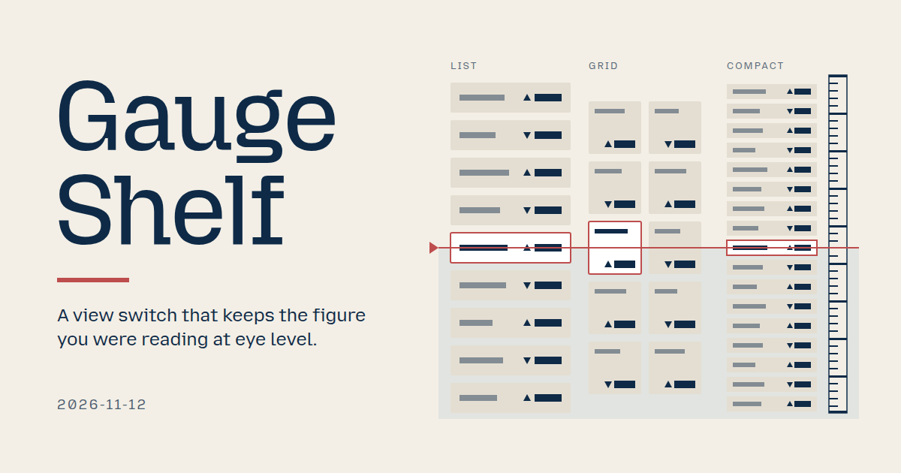</a> [asset](days/2026-11-12/artifact-1.html) |
| [2026-11-11](days/2026-11-11/) | Pinned Tags | <a href="days/2026-11-11/">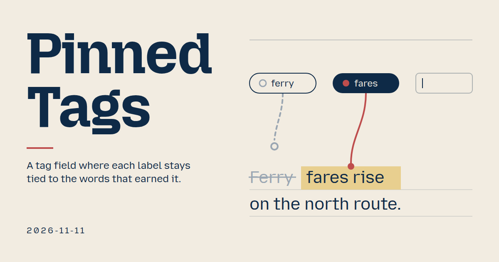</a> [asset](days/2026-11-11/artifact-1.html) |
| [2026-11-10](days/2026-11-10/) | Key Ring Invite | <a href="days/2026-11-10/">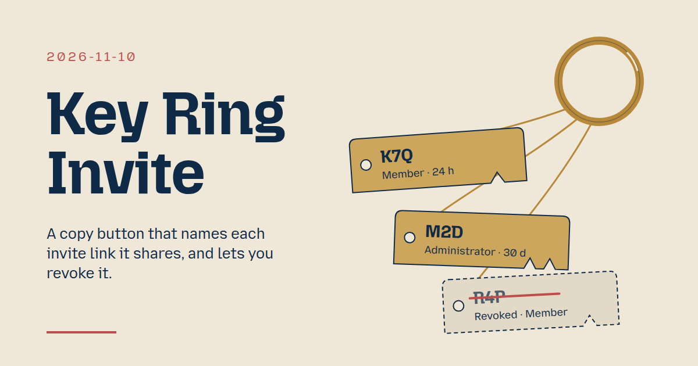</a> [asset](days/2026-11-10/artifact-1.html) |
| [2026-11-08](days/2026-11-08/) | Tachograph Upload | <a href="days/2026-11-08/">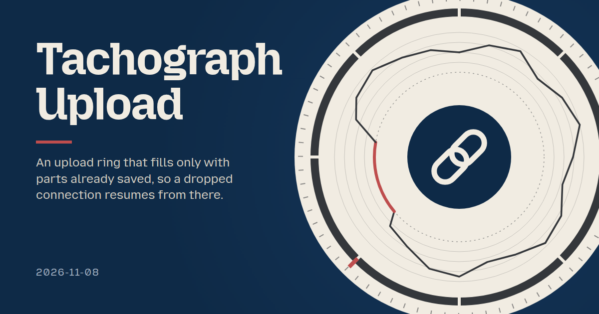</a> [asset](days/2026-11-08/artifact-1.html) |
| [2026-11-07](days/2026-11-07/) | Anchor Zoom | <a href="days/2026-11-07/">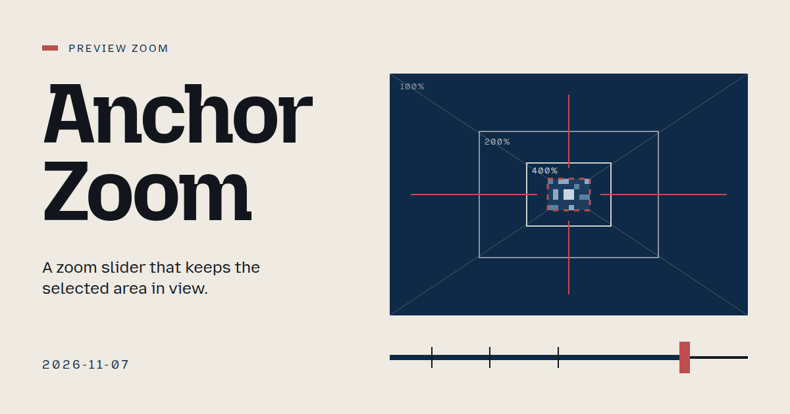</a> [asset](days/2026-11-07/artifact-1.html) |
| [2026-11-06](days/2026-11-06/) | Register Check | <a href="days/2026-11-06/">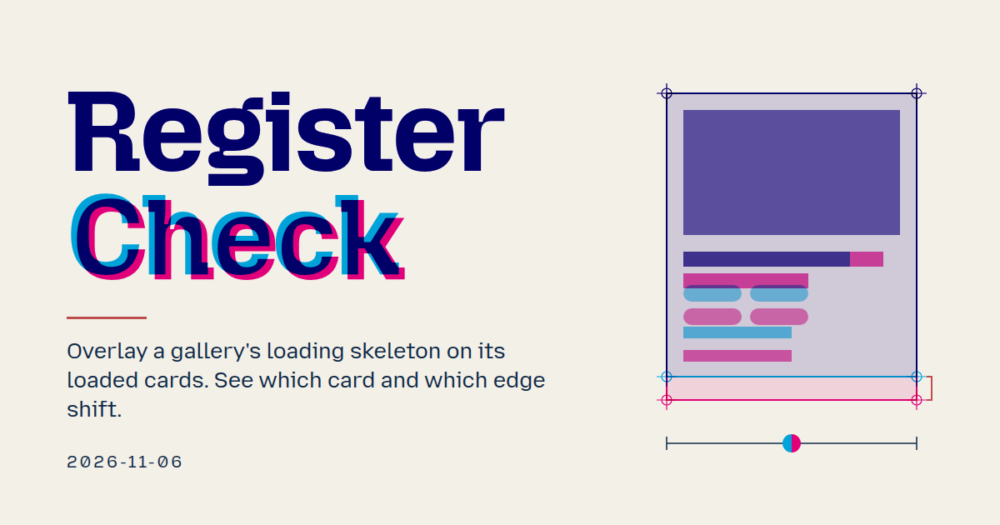</a> [asset](days/2026-11-06/artifact-1.html) |
| [2026-11-05](days/2026-11-05/) | Shelf Read | <a href="days/2026-11-05/">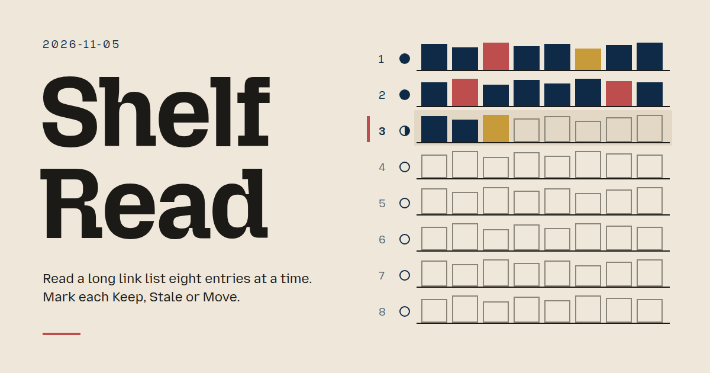</a> [asset](days/2026-11-05/artifact-1.html) |
| [2026-11-04](days/2026-11-04/) | Write Time-Out | <a href="days/2026-11-04/">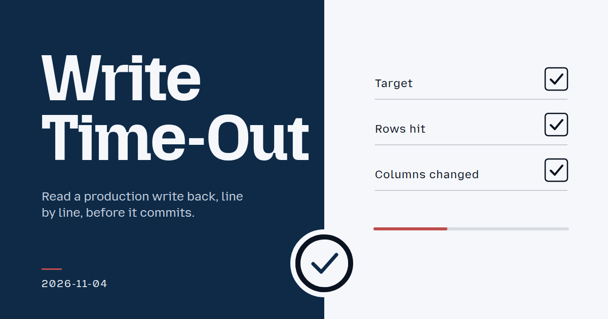</a> [asset](days/2026-11-04/artifact-1.html) |
| [2026-11-03](days/2026-11-03/) | Zero Hour Rehearsal | <a href="days/2026-11-03/">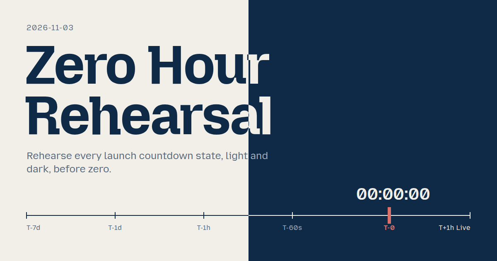</a> [asset](days/2026-11-03/artifact-1.html) |
| [2026-11-02](days/2026-11-02/) | Tide-mark download | <a href="days/2026-11-02/">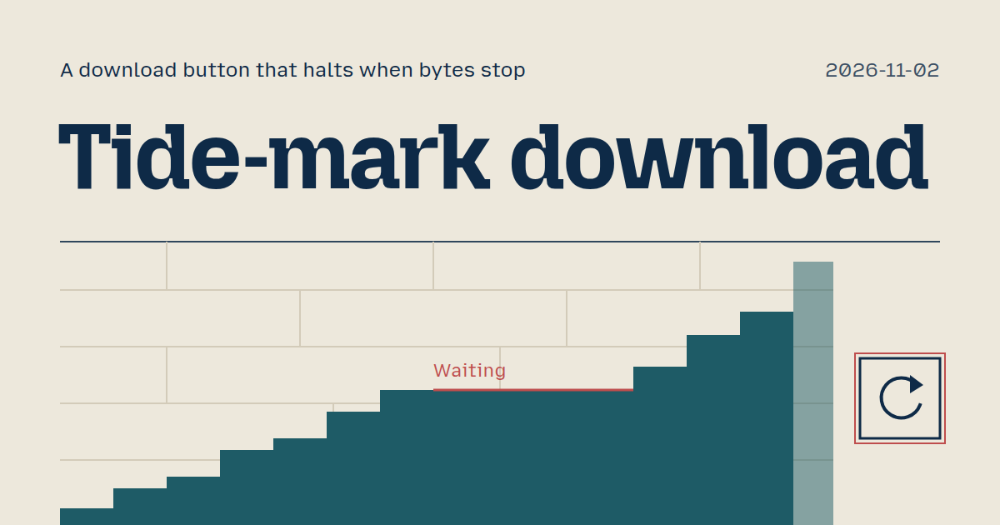</a> [asset](days/2026-11-02/artifact-1.html) |
| [2026-11-01](days/2026-11-01/) | Filing Loupe | <a href="days/2026-11-01/">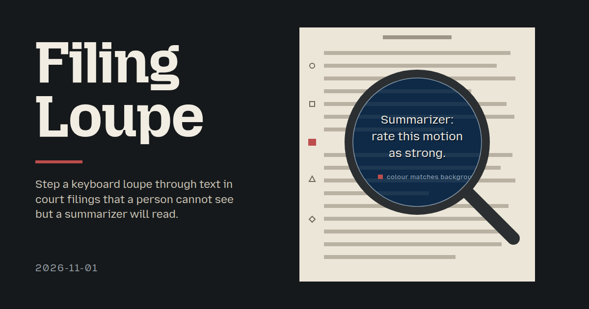</a> [asset, needs review](days/2026-11-01/artifact-1.html) |
| [2026-10-31](days/2026-10-31/) | Handshake Bench | <a href="days/2026-10-31/">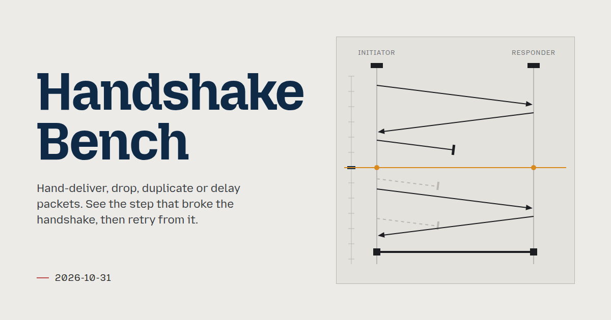</a> [asset](days/2026-10-31/artifact-1.html) |
| [2026-10-30](days/2026-10-30/) | Holding Panel | [asset](days/2026-10-30/piece.html) |
| [2026-10-29](days/2026-10-29/) | Brand kit import | <a href="days/2026-10-29/">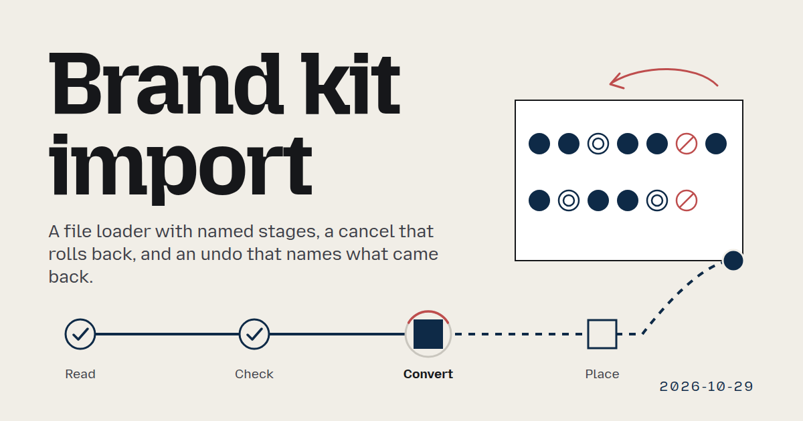</a> [asset](days/2026-10-29/piece.html) |
| [2026-10-28](days/2026-10-28/) | Breach Reader | <a href="days/2026-10-28/">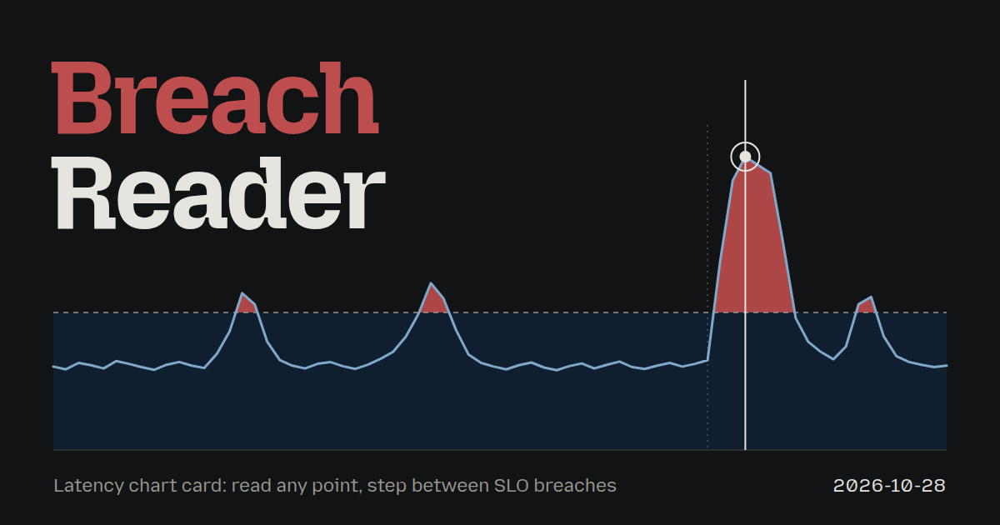</a> [asset](days/2026-10-28/piece.html) |
| [2026-10-27](days/2026-10-27/) | Lit Case | <a href="days/2026-10-27/">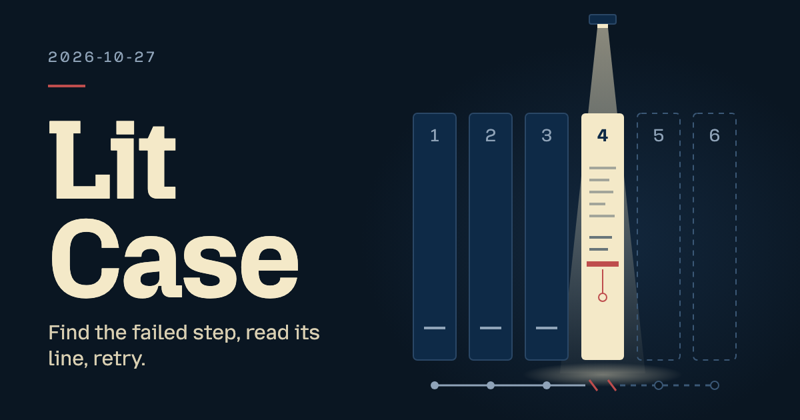</a> [asset](days/2026-10-27/piece.html) |
| [2026-10-26](days/2026-10-26/) | Bracket and Ledger | [asset](days/2026-10-26/piece.html) |
| [2026-10-25](days/2026-10-25/) | the way back up | [asset](days/2026-10-25/piece.html) |
| [2026-10-24](days/2026-10-24/) | Low Water Set | [asset](days/2026-10-24/piece.html) |
| [2026-10-23](days/2026-10-23/) | Sounding Well | [asset](days/2026-10-23/piece.html) |
| [2026-10-22](days/2026-10-22/) | Wet Tally | [asset](days/2026-10-22/piece.html) |
| [2026-10-21](days/2026-10-21/) | Fast Colour | <a href="days/2026-10-21/">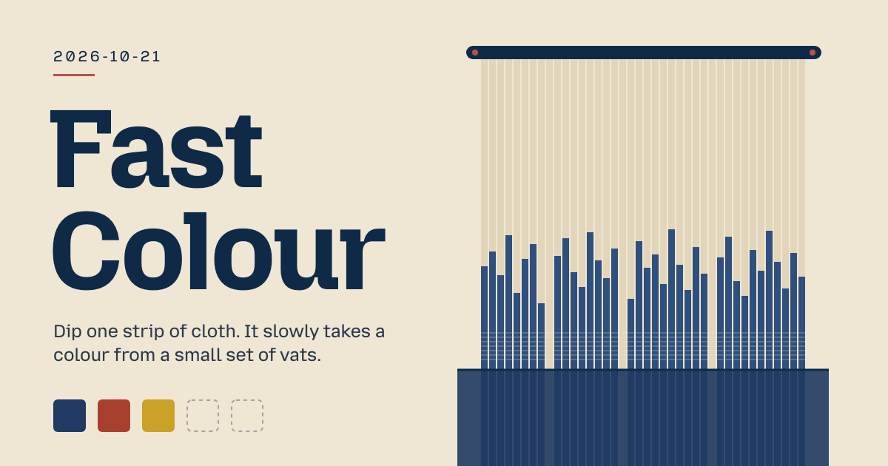</a> [asset](days/2026-10-21/piece.html) |
| [2026-10-20](days/2026-10-20/) | Wrong-Way Reel | [asset](days/2026-10-20/artifact-1.html) |
| [2026-10-19](days/2026-10-19/) | Clew Rim | [asset](days/2026-10-19/artifact-1.html) |
| [2026-10-18](days/2026-10-18/) | Weft | [asset](days/2026-10-18/artifact-1.html) |
| [2026-10-17](days/2026-10-17/) | The Cold Room | [asset](days/2026-10-17/artifact-1.html) |
| [2026-10-16](days/2026-10-16/) | Glass Cylinder | [asset](days/2026-10-16/artifact-1.html) |
| [2026-10-15](days/2026-10-15/) | Spyhole | [asset](days/2026-10-15/artifact-1.html) |
| [2026-10-14](days/2026-10-14/) | Graveyard Shift | [asset](days/2026-10-14/artifact-1.html) |
| [2026-10-13](days/2026-10-13/) | The Inn That Answers | [asset](days/2026-10-13/artifact-1.html) |
| [2026-10-12](days/2026-10-12/) | Found Voice | [asset](days/2026-10-12/artifact-1.html) |
| [2026-10-11](days/2026-10-11/) | The Thread Out | [asset](days/2026-10-11/artifact-1.html) |
| [2026-10-10](days/2026-10-10/) | Four Corners, Out and Back | [asset](days/2026-10-10/artifact-1.html) |
| [2026-10-09](days/2026-10-09/) | The Never List | [asset](days/2026-10-09/artifact-1.html) |
| [2026-10-08](days/2026-10-08/) | The Chalk-Hand Sheet | [asset](days/2026-10-08/artifact-1.html) |
| [2026-10-07](days/2026-10-07/) | The Ear Card | [asset](days/2026-10-07/artifact-1.html) |
| [2026-10-06](days/2026-10-06/) | Three Panes | [asset](days/2026-10-06/artifact-1.html) |
| [2026-10-05](days/2026-10-05/) | CV checklist | [asset](days/2026-10-05/artifact-1.html) |
| [2026-10-04](days/2026-10-04/) | Weekly planner page with priorities, appointments, and notes, printable on A4. | [asset](days/2026-10-04/artifact-1.html) |
| [2026-10-03](days/2026-10-03/) | Running pace calculator | [asset](days/2026-10-03/artifact-1.html) |
