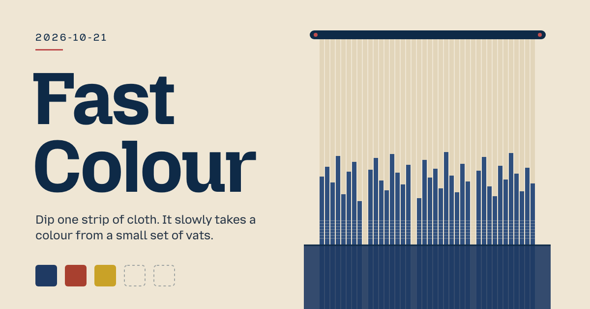

# Archive

Every daily team and the asset it made, newest first. 28 days recorded.

[Today](README.md)

| Date | Task | Team | Constraint | Asset |
|---|---|---|---|---|
| [2026-10-30](days/2026-10-30/) | Holding Panel | Dance choreographer · Railway signaller · Optical technician · Satellite repair apprentice | Use one consistent spacing scale. |  [asset](days/2026-10-30/piece.html) |
| [2026-10-29](days/2026-10-29/) | Brand kit import | Puppet maker · Control room operator · Foley artist · Velvet beetle | An empty state offers one clear action. |  [asset](days/2026-10-29/piece.html) |
| [2026-10-28](days/2026-10-28/) | Breach Reader | Precision machinist · Air traffic controller · Furniture designer · Asteroid workshop tutor | Repeated input cannot queue duplicate work. |  [asset](days/2026-10-28/piece.html) |
| [2026-10-27](days/2026-10-27/) | Lit Case | Exhibit light technician · Medical illustrator · Interface designer · Impatient commuter | The component fits a narrow phone frame. |  [asset](days/2026-10-27/piece.html) |
| [2026-10-26](days/2026-10-26/) | Bracket and Ledger | Type designer · Motion director · Motion engineer · Lunar archivist | Every selected item has a non-color state marker. | [asset](days/2026-10-26/piece.html) |
| [2026-10-25](days/2026-10-25/) | the way back up | Window dresser · Sign painter · Textile designer · Katsushika Hokusai | Lowercase only. | [asset](days/2026-10-25/piece.html) |
| [2026-10-24](days/2026-10-24/) | Low Water Set | Museum curator · Urban planner · Comic artist · Arachne | Prints clearly on a black-and-white printer. | [asset](days/2026-10-24/piece.html) |
| [2026-10-23](days/2026-10-23/) | Sounding Well | Printmaker · Packaging designer · Bookbinder · Charles Darwin | No buttons. | [asset](days/2026-10-23/piece.html) |
| [2026-10-22](days/2026-10-22/) | Wet Tally | Animator · Chef · Librarian · Gulliver | Under 30 KB in total. | [asset](days/2026-10-22/piece.html) |
| [2026-10-21](days/2026-10-21/) | Fast Colour | Beekeeper · Luthier · Weaver · Robinson Crusoe | Saves the input in the browser and restores it on reload. |  [asset](days/2026-10-21/piece.html) |
| [2026-10-20](days/2026-10-20/) | Wrong-Way Reel | Upholsterer · Clockmaker · Translator · Scheherazade | Text still reads clearly at 200 percent zoom. | [asset](days/2026-10-20/artifact-1.html) |
| [2026-10-19](days/2026-10-19/) | Clew Rim | Taxidermist · Wheelwright · Glassblower · Daedalus | All text at 18 px or larger. | [asset](days/2026-10-19/artifact-1.html) |
| [2026-10-18](days/2026-10-18/) | Weft | Blacksmith · Urban planner · Weaver · Charles Darwin | Changes with the time of day. | [asset](days/2026-10-18/artifact-1.html) |
| [2026-10-17](days/2026-10-17/) | The Cold Room | Florist · Teacher · Calligrapher · Daedalus | Hides one thing for the curious to find. | [asset](days/2026-10-17/artifact-1.html) |
| [2026-10-16](days/2026-10-16/) | Glass Cylinder | Locksmith · Packaging designer · Window dresser · Scheherazade | Every change can be undone. | [asset](days/2026-10-16/artifact-1.html) |
| [2026-10-15](days/2026-10-15/) | Spyhole | Ceramicist · Textile designer · Costume designer · Ada Lovelace | Works fully offline after the first load. | [asset](days/2026-10-15/artifact-1.html) |
| [2026-10-14](days/2026-10-14/) | Graveyard Shift | Radio producer · Industrial designer · Museum curator · Odysseus | No more than two levels of heading. | [asset](days/2026-10-14/artifact-1.html) |
| [2026-10-13](days/2026-10-13/) | The Inn That Answers | Documentary director · Playwright · Puppeteer · Benjamin Franklin | Monospace typeface only. | [asset](days/2026-10-13/artifact-1.html) |
| [2026-10-12](days/2026-10-12/) | Found Voice | Set designer · Bookbinder · Data journalist · Euclid | All text at 18 px or larger. | [asset](days/2026-10-12/artifact-1.html) |
| [2026-10-11](days/2026-10-11/) | The Thread Out | Costume designer · Cartographer · Furniture maker · Daedalus | The user does exactly one thing on the page. | [asset](days/2026-10-11/artifact-1.html) |
| [2026-10-10](days/2026-10-10/) | Four Corners, Out and Back | Game designer · Service designer · Comic artist · Sisyphus | Every number shows its unit. | [asset](days/2026-10-10/artifact-1.html) |
| [2026-10-09](days/2026-10-09/) | The Never List | Beekeeper · Sign painter · Librarian · Phoenix | Shows the formula or rule behind every result. | [asset](days/2026-10-09/artifact-1.html) |
| [2026-10-08](days/2026-10-08/) | The Chalk-Hand Sheet | Packaging designer · Brand strategist · Taxidermist · Time | Uses a single accent color. | [asset](days/2026-10-08/artifact-1.html) |
| [2026-10-07](days/2026-10-07/) | The Ear Card | Teacher · Urban planner · Upholsterer · Don Quixote | Fits in a postcard-sized area. | [asset](days/2026-10-07/artifact-1.html) |
| [2026-10-06](days/2026-10-06/) | Three Panes | Window dresser · Calligrapher · Textile designer · Glass fox | Shows a filled-in example before the user types. | [asset](days/2026-10-06/artifact-1.html) |
| [2026-10-05](days/2026-10-05/) | CV checklist | Bookbinder · Glassblower · Chef · Captain Ahab | Has a dark mode that follows the system setting. | [asset](days/2026-10-05/artifact-1.html) |
| [2026-10-04](days/2026-10-04/) | Weekly planner page with priorities, appointments, and notes, printable on A4. | Comic artist · Packaging designer · Exhibition designer · Printmaker | One column only. | [asset](days/2026-10-04/artifact-1.html) |
| [2026-10-03](days/2026-10-03/) | Running pace calculator | Service designer · Product designer · Interaction designer · Choreographer | Has a dark mode that follows the system setting. | [asset](days/2026-10-03/artifact-1.html) |
