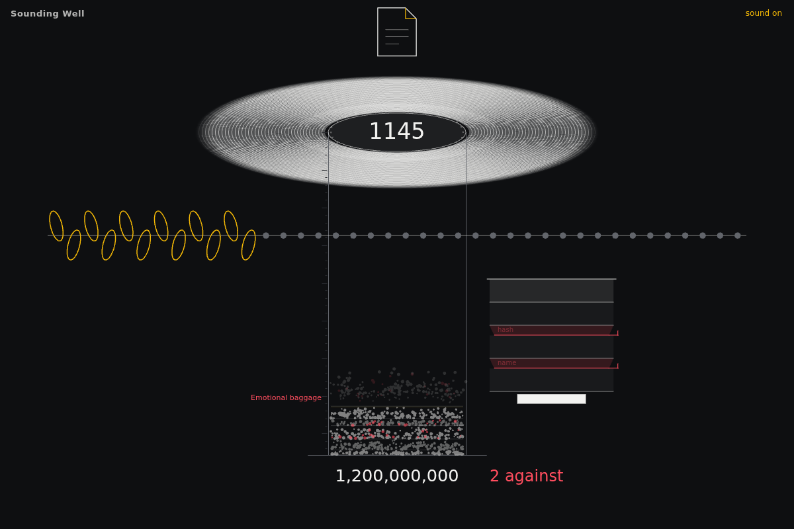
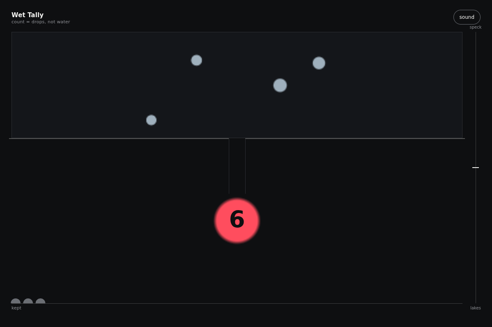

# daily-team

Design inspiration for people building small or large projects and prototypes. Each day a new four-person creative team explores working interface components you can try and adapt. This repository is the record: each day's team, its plan, and its asset, kept in [days/](days/) and listed in the [archive](ARCHIVE.md).

From 2026-10-26, the cast resets around UI craft. Buttons, loaders, panels and cards lead the brief pool; useful inputs, navigation and engineering data views follow. Readable states, precise spacing and short, purposeful animation matter more than an abstract concept. Ideas and reviewed source paths from `00-components` live in [component-inspiration.json](component-inspiration.json). Claude daily runs can read their actual HTML/CSS/JS from `isas1/creative-sites-vault`, choose a base that fits the task, and improve its useful mechanism, finish, states and motion. The initial bank covers a button, arc loader, metric card, bottom sheet, log viewer, pipeline panel and code diff; add reviewed paths and matching terms to expand it.

Tasks start with a project need: upload a photo, switch a pricing plan, find a command, edit a title, or show progress. The team explores different forms and motion while keeping that purpose clear. You do not need design training to recognize where a component could fit in your project.

Everything in `days/` is written by a language model and checked by scripts, not by hand. The model and provider for each day are on its page.

## Today

<!-- TODAY:START -->
### 2026-10-25: the way back up

**Task:** Breadcrumb in footprints: the trail back up is a line of prints that deepen as each is reached.

**Decision:** the visitor walks down into a real dye-sample library, and the way back up is a trail of prints they can hover, hold, drag, fling and scrub, with each print deepening as they reach it.

[Open the day](days/2026-10-25/) · [Use it](https://isas1.github.io/daily-team/2026-10-25/) · [Archive](ARCHIVE.md)
<!-- TODAY:END -->

## This week

<!-- WEEK:START -->
**Season 4**, since 2026-10-19. New this season: Wheelwright, Gilder, Thatcher, Lacemaker, Rope maker, Bell founder, Organ builder, Stage manager, Ariadne, Phileas Fogg, and 4 new temperaments. A new season with 8 new roles and 8 new methods is drafted every Monday.

### Vote on what gets built next

[Suggest a task](https://github.com/isas1/daily-team/issues/new?template=task-suggestion.yml) or vote with a thumbs-up on [open suggestions](https://github.com/isas1/daily-team/issues?q=is%3Aissue+is%3Aopen+label%3Atask-suggestion+sort%3Areactions-%2B1-desc). The most voted are screened every Monday.

No open suggestions yet.
<!-- WEEK:END -->

## Recent days

<!-- RECENT:START -->
| Date | Asset | Task | Team |
|---|---|---|---|
| [2026-10-25](days/2026-10-25/) |  | the way back up | Window dresser · Sign painter · Textile designer · Katsushika Hokusai |
| [2026-10-24](days/2026-10-24/) |  | Low Water Set | Museum curator · Urban planner · Comic artist · Arachne |
| [2026-10-23](days/2026-10-23/) |  | Sounding Well | Printmaker · Packaging designer · Bookbinder · Charles Darwin |
| [2026-10-22](days/2026-10-22/) |  | Wet Tally | Animator · Chef · Librarian · Gulliver |
| [2026-10-21](days/2026-10-21/) |  | Fast Colour | Beekeeper · Luthier · Weaver · Robinson Crusoe |
| [2026-10-20](days/2026-10-20/) |  | Wrong-Way Reel | Upholsterer · Clockmaker · Translator · Scheherazade |
| [2026-10-19](days/2026-10-19/) |  | Clew Rim | Taxidermist · Wheelwright · Glassblower · Daedalus |

[All 23 days](ARCHIVE.md)
<!-- RECENT:END -->

## How it works

1. **The team.** `team.sh` turns the date into four members, each with a role, a method, and a stance, plus a constraint and a task. Current tasks name one component and its project use. Open UI requests from this repo and `isas1/web-components` can replace the pool task; each scoped brief rests for 28 days after use, and its source is recorded. The date gives the same cast and base task; request selection depends on the saved issue snapshot and recent records. Earlier seasons used open sparks and material processes; their records stay as made. From season 3, each member also has a temperament: how they argue. Within a season no role or method repeats within 7 days and no constraint within 22 days. A pool task rests for half the task pool plus 1 days: 21 with the current 40-task pool.
2. **The guest.** From season 2, member 4 is a guest who brings one method: a historical figure, a figure from myth, a character from an old book, an archetype, a person from the future, or a creature. Historical guests never speak as the person. Other guests speak in character, in original words, never quoting the source. Real people and authors must have died at least 100 years ago, myths are used in their traditional form, and gods of living religions, brands, and modern franchises are excluded.
3. **The cast.** Every Monday a language model drafts the next season: 16 new roles, 16 new methods, 8 new temperaments, and 6 new guests join from 2026-10-26, the longest-serving leave, and voted suggestions become component briefs. Scripts check the draft and it opens as a pull request for review. Seasons start on a future Monday, so past days never change.
4. **The work.** Each morning a language model plays the team. Each member pitches a different design for the same project need, thinking from their own nature: their craft, or for a guest, their myth, era, or body. They argue for 6 to 10 lines, then plan ten component variations and a working project prototype made from them. Each component stays one self-contained HTML file. Older days keep their original format.
5. **The checks.** The file must have a title and a mobile layout, stay under 100 KB, and make no network requests. Component tiles may use up to 80 words of useful content, including card and panel labels. A file that fails is retried once, then marked "needs review". These source checks do not prove visual quality; browser review must verify state behavior, motion, both themes and phone fit before reuse.
6. **The record.** The workflow takes a screenshot, draws the team card, writes the day page, updates the archive and this README, and commits the result. Days that fail are recorded too.
7. **The weekly report.** Each Sunday a script gathers the week's changes, days, seasons, and GitHub activity, and a language model writes a short summary from those facts only. A check rejects any number or name that is not in the facts. Reports are in [reports/](reports/).

## Take part

[Suggest a task](https://github.com/isas1/daily-team/issues/new?template=task-suggestion.yml), vote with a thumbs-up on open suggestions, or read [CONTRIBUTING.md](CONTRIBUTING.md).

## Run your own

Fork the repo, then add one secret:

- `OPENROUTER_API_KEY` for OpenRouter's free models (the default). Create the key with a credit limit.
- Or `CLAUDE_CODE_OAUTH_TOKEN` from `claude setup-token` to use a Claude subscription, and set the repository variable `PROVIDER` to `claude`. A full component day uses 12 requests. Failed checks and a referee can add requests.

The Daily workflow reads component requests before planning. Add optional secret `COMPONENT_REQUESTS_TOKEN` with **Issues: read-only** access to `daily-team` and `web-components` to include private issues; the default Actions token may only read this repo. Unavailable sources print a warning and the task pool remains usable. This lane only reads issues; it never comments on or closes source requests. Label a focused issue `daily-component`, `component-request` or `request:accepted` to include it explicitly, or use the existing task suggestion form. Common component names in issue titles are also screened for relevance; maintenance audits and infrastructure work stay out.

To read source code too, select `isas1/creative-sites-vault` on the same fine-grained token and add **Contents: read-only**. The source step fetches only the reviewed files under `00-components`, at one pinned commit. Missing access or files produce warnings and fall back to idea notes; generation still runs. One relevant base reaches planning and every build. The plan names the retained mechanism and concrete improvements; `day.json` records its path, commit and content hash, not the original source. Source snapshots stay temporary and source code is never executed by the intake. New outputs still need browser review. Private source context is enabled for Claude only; OpenRouter runs use the idea notes.

For local source reuse, set `COMPONENTS_DIR` to your `00-components` folder before `sh daily.sh` or `node run.mjs --provider claude`. You can also save `GITHUB_TOKEN=$(gh auth token) node github.mjs component-sources > /tmp/daily-team-sources.json` and pass `--sources /tmp/daily-team-sources.json`. Custom briefs and historical dates do not use this source bank. Source code is sent to Claude as prompt context.

Run `GITHUB_TOKEN=$(gh auth token) node github.mjs access-check` to check both issue repositories and every reviewed vault source without model calls. The Component access workflow performs the same check with `COMPONENT_REQUESTS_TOKEN` and prints metadata only, never original source. On forks, configure the secret or skip that optional workflow.

For a local snapshot, run `GITHUB_TOKEN=$(gh auth token) node github.mjs requests > /tmp/daily-team-requests.json`, then `node run.mjs --date 2026-10-26 --requests /tmp/daily-team-requests.json --dry-run`. Add `--brief` to use your own brief instead. Request bodies stay in the temporary input; day records retain the source link and scoped task.

Optional variables: `MODEL`, `CLAUDE_MODEL` (default `claude-opus-5-5`), `ARTIFACTS` (0 to 10; default 10 plus a joined piece on component days, else 1), `TZ`, and `PAGES` (`true` to publish the tools on GitHub Pages). To record a day by hand with your Claude login, run `sh daily.sh`. It commits and pushes.

The folder also works as a Claude Code skill: clone it into `~/.claude/skills/daily-team`, then use `/daily-team`.

## Safety

- Keys are passed only to the step that calls the model. They are never written to disk or printed.
- The Claude provider runs with no tools, no MCP servers, no user settings or hooks, and no CLAUDE.md, so the model can only return text.
- Every asset gets a Content-Security-Policy that blocks network requests. On GitHub Pages, assets run only inside a sandboxed frame.
- Free models can log prompts. Do not put private material in `brief.md`.
- See [SECURITY.md](SECURITY.md) to report a problem.

## License

Code and content: MIT.

Design: the Sam Creates design system, in [brand/](brand/). The fonts are Mozilla Headline and Mozilla Text under the SIL Open Font License 1.1; see [brand/fonts](brand/fonts).
