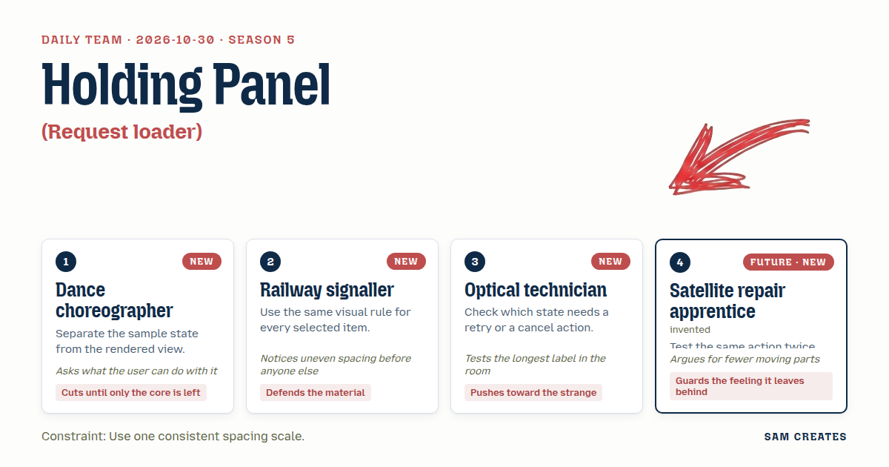
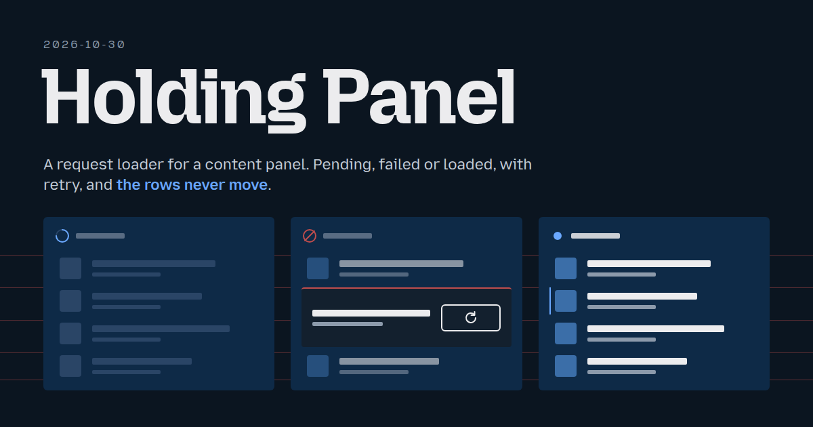
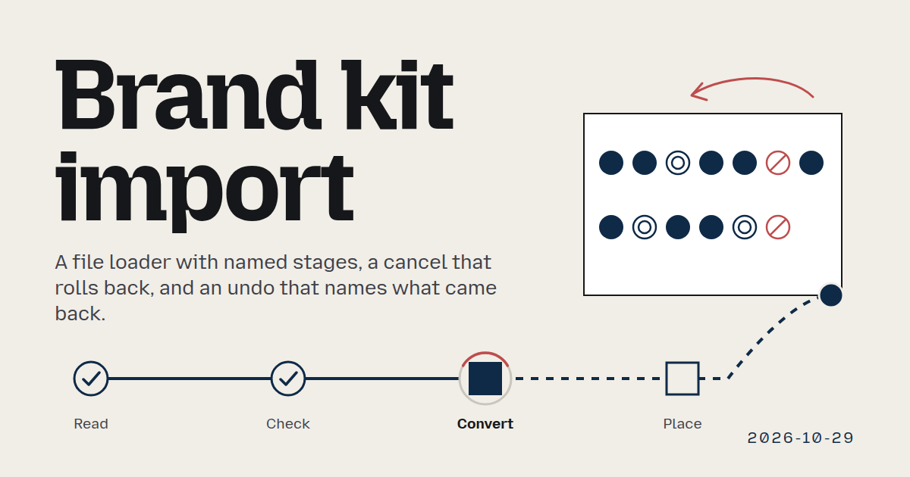
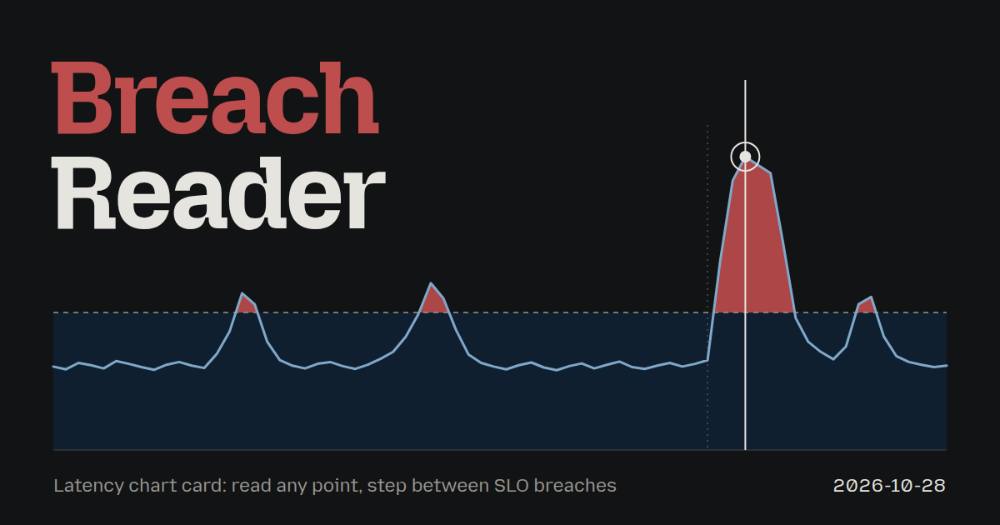
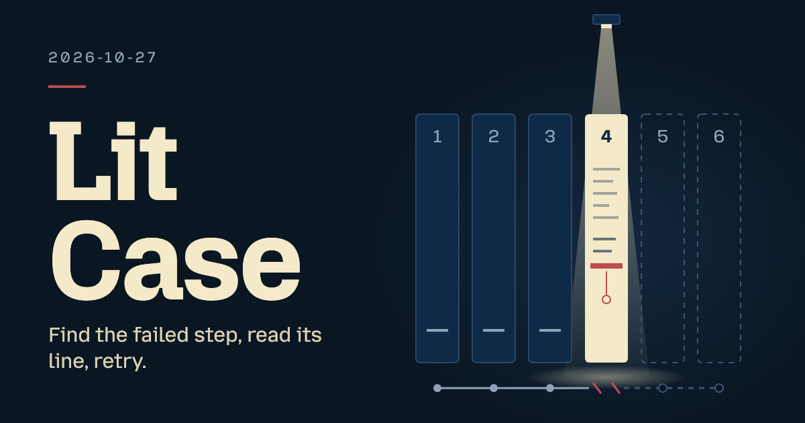
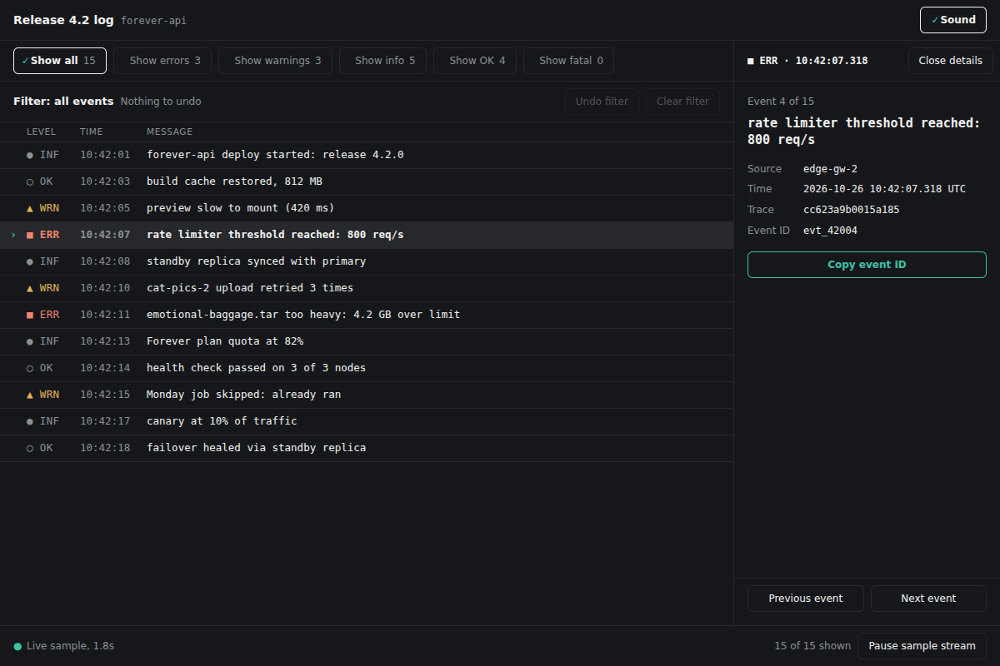
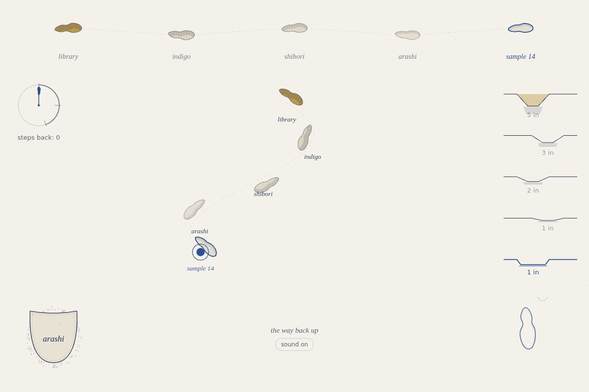
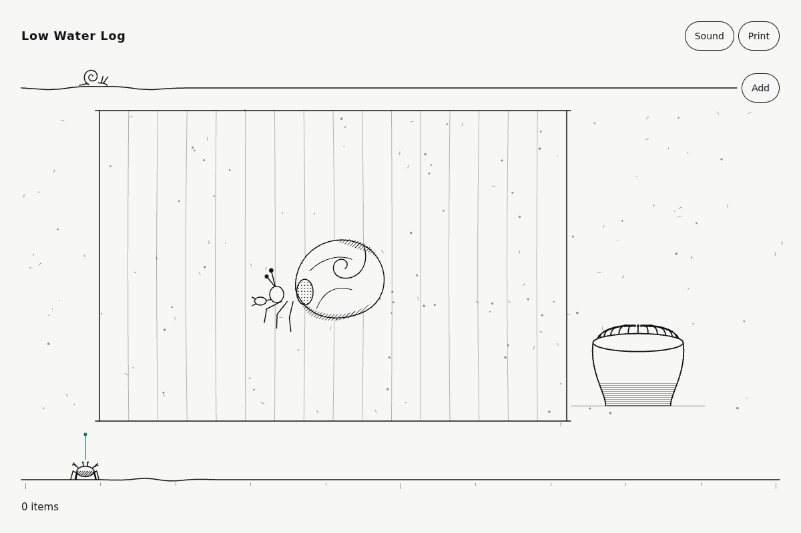

# daily-team

Each day, four creative roles turn current signals into one useful interactive project. GitHub Trending, Hacker News, Reddit and design/engineering feeds inform three competing directions. The team chooses a real audience, a practical need and a distinct interaction, then builds one complete offline HTML prototype.

From 2026-10-31, normal Daily Team runs focus on original projects: creative tools, simulations, games, explorable explanations and unusual product workflows. Each saved plan records its evidence, nearest familiar approach, useful difference, recovery path and comparison with recent projects. Trend signals inspire work; they do not prove demand or originality.

Component production continues separately in the private [daily-components repository](https://github.com/isas1/daily-components), copied with history before this change. Existing component-team remains separate. Earlier component days and the previously scheduled culture editions keep their original format. Explicit `--pack` still builds components here.

Everything in `days/` is written by a language model and checked by scripts, not by hand. The model and provider for each day are on its page.

## Today

<!-- TODAY:START -->
### 2026-10-30: Holding Panel

<a href="days/2026-10-30/"></a>

**Task:** Request loader: a loader for a content panel that moves from pending to loaded or failed, with a retry action and stable layout.

**Decision:** The team builds a reading-list panel that loads three sample sources and holds its layout through every state.

<a href="days/2026-10-30/"></a>

[Open the day](days/2026-10-30/) · [Use it](https://isas1.github.io/daily-team/2026-10-30/) · [Archive](ARCHIVE.md)
<!-- TODAY:END -->

## This week

<!-- WEEK:START -->
**Season 5**, since 2026-10-26. New this season: Interface designer, Motion director, Interaction engineer, Type designer, Accessibility specialist, Human factors engineer, Icon designer, Design systems engineer, Mobile interface designer, Data interface designer, Usability researcher, Interaction prototyper, Visual designer, Motion engineer, Interface copywriter, Quality engineer, Cabinet maker, Watch restorer, Instrument maker, Exhibit light technician, Architectural model maker, Technical illustrator, Medical illustrator, Scientific illustrator, Foley artist, Color grading specialist, Dance choreographer, Puppet maker, Stage illusion builder, Camera operator, Furniture designer, Ergonomist, Railway signaller, Control room operator, Air traffic controller, Flight deck designer, Game interface designer, Technical writer, Cartographic designer, Wayfinding designer, Precision machinist, Optical technician, Lens grinder, Instrument tuner, Kinetic sculptor, Letter cutter, Silversmith, Furniture restorer, the first 36 guests, and 24 temperaments. A new season is drafted every Monday; from 2026-10-26 it replaces 16 roles and 16 methods.

### Vote on what gets built next

[Suggest a task](https://github.com/isas1/daily-team/issues/new?template=task-suggestion.yml) or vote with a thumbs-up on [open suggestions](https://github.com/isas1/daily-team/issues?q=is%3Aissue+is%3Aopen+label%3Atask-suggestion+sort%3Areactions-%2B1-desc). The most voted are screened every Monday.

No open suggestions yet.
<!-- WEEK:END -->

## Recent days

<!-- RECENT:START -->
| Date | Asset | Task | Team |
|---|---|---|---|
| [2026-10-30](days/2026-10-30/) | <a href="days/2026-10-30/"></a> | Holding Panel | Dance choreographer · Railway signaller · Optical technician · Satellite repair apprentice |
| [2026-10-29](days/2026-10-29/) | <a href="days/2026-10-29/"></a> | Brand kit import | Puppet maker · Control room operator · Foley artist · Velvet beetle |
| [2026-10-28](days/2026-10-28/) | <a href="days/2026-10-28/"></a> | Breach Reader | Precision machinist · Air traffic controller · Furniture designer · Asteroid workshop tutor |
| [2026-10-27](days/2026-10-27/) | <a href="days/2026-10-27/"></a> | Lit Case | Exhibit light technician · Medical illustrator · Interface designer · Impatient commuter |
| [2026-10-26](days/2026-10-26/) | <a href="days/2026-10-26/"></a> | Bracket and Ledger | Type designer · Motion director · Motion engineer · Lunar archivist |
| [2026-10-25](days/2026-10-25/) | <a href="days/2026-10-25/"></a> | the way back up | Window dresser · Sign painter · Textile designer · Katsushika Hokusai |
| [2026-10-24](days/2026-10-24/) | <a href="days/2026-10-24/"></a> | Low Water Set | Museum curator · Urban planner · Comic artist · Arachne |

[All 28 days](ARCHIVE.md)
<!-- RECENT:END -->

## How it works

1. **The team.** `team.sh` turns the date into four members, each with a role, a method, and a stance, plus a constraint and a task. For new project days the trend-backed project brief takes priority over the legacy component task pool. Open UI requests from this repo and `isas1/web-components` can replace the pool task; each scoped brief rests for 28 days after use, and its source is recorded. The date gives the same cast and base task; request selection depends on the saved issue snapshot and recent records. Earlier seasons used open sparks and material processes; their records stay as made. From season 3, each member also has a temperament: how they argue. Within a season no role or method repeats within 7 days and no constraint within 22 days. A pool task rests for half the task pool plus 1 days: 21 with the current 40-task pool.
2. **The guest.** From season 2, member 4 is a guest who brings one method: a historical figure, a figure from myth, a character from an old book, an archetype, a person from the future, or a creature. Historical guests never speak as the person. Other guests speak in character, in original words, never quoting the source. Real people and authors must have died at least 100 years ago, myths are used in their traditional form, and gods of living religions, brands, and modern franchises are excluded.
3. **The cast.** Every Monday a language model drafts the next season: 16 new roles, 16 new methods, 8 new temperaments, and 6 new guests join from 2026-10-26, the longest-serving leave, and voted suggestions inform the brief pool; new project runs choose their direction from current evidence. Scripts check the draft and it opens as a pull request for review. Seasons start on a future Monday, so past days never change.
4. **The work.** Each morning a language model plays the team. From 2026-10-31, members compare three project directions, argue for 6 to 10 lines, then choose one audience, need and interaction. The plan combines two source families when available and rejects close repeats from the previous 28 days. One finished project includes working input, visible feedback, useful output and recovery. Historical and explicit component packs keep their original format.
5. **The checks.** The file must have a title and a mobile layout, stay under 100 KB, and make no network requests. Component tiles may use up to 80 words of useful content, including card and panel labels. A file that fails is retried once, then marked "needs review". These source checks do not prove visual quality; browser review must verify state behavior, motion, both themes and phone fit before reuse.
6. **The record.** The workflow commissions a project cover from the same four members and their saved plan, renders it at 1200 × 630, then uses that cover in Today, thumbnails, day pages, the archive and gallery. The branded team card stays first; interface screenshots stay as evidence. Missing or stale covers fall back to the original screenshots. The workflow writes the pages and commits the result. Days that fail are recorded too.
7. **The weekly report.** Each Sunday a script gathers the week's changes, days, seasons, and GitHub activity, and a language model writes a short summary from those facts only. A check rejects any number or name that is not in the facts. Reports are in [reports/](reports/).

## Take part

[Suggest a task](https://github.com/isas1/daily-team/issues/new?template=task-suggestion.yml), vote with a thumbs-up on open suggestions, or read [CONTRIBUTING.md](CONTRIBUTING.md).

## Two-night extra editions

30–31 October 2026, Lisbon time: 00:30 news/feed inspiration, 02:30 culture, 04:30 popular-component expansion. Normal 06:00 run continues. Culture continues daily afterward: a different past or present culture, without repeats, until the sourced queue ends. Twelve cultures currently queued through 10 November; the list can be extended by appending new culture IDs. News/popular stop after 31 October. Separate records preserve the normal day. Extra runs use six components plus one connected demo and skip model comparisons. Scheduled GitHub jobs may start late.

[Browse extra editions](https://isas1.github.io/daily-team/editions/) · [Schedule and evidence guide](docs/extra-editions.md)

## Project discovery and component packs

[Project guide](docs/trend-projects.md) covers evidence, originality checks, replay, source failure and the private component copy. Normal runs build one project (or `--artifacts 0` for planning only). Use `--pack` for component production.

Historical component behavior:
From 2026-10-27, packs contain distinct standalone components, shared tokens and one connected project. One planning call handles team debate, opportunity selection and structured metadata. Smashing Magazine and Hacker News feeds supply bounded inspiration; cached backlog and original tasks handle source failure. Codrops stays disabled after its candidate feed returned HTTP 410. Custom briefs retain priority.

[Pack guide](docs/component-packs.md) covers size, custom packs, saved-input replay, offline mode, category mappings, exports and human library outcomes. Generated candidates always require review. Try `node pack-sample.mjs` for a deterministic sample with no live model calls.

## Run your own

Fork the repo, then add one secret:

- `OPENROUTER_API_KEY` for OpenRouter's free models (the default). Create the key with a credit limit.
- Or `CLAUDE_CODE_OAUTH_TOKEN` from `claude setup-token` to use a Claude subscription, and set the repository variable `PROVIDER` to `claude`. A default six-component pack uses nine requests including its cover, before comparisons; Sonnet and Haiku add twelve. Legacy ten-variation days use thirteen plus twenty comparison requests. Failed checks and a referee can add requests.

Explicit component mode in the Daily workflow reads component requests before planning. Project mode uses public trend sources and does not read private component code. Add optional secret `COMPONENT_REQUESTS_TOKEN` with **Issues: read-only** access to `daily-team` and `web-components` to include private issues; the default Actions token may only read this repo. Unavailable sources print a warning and the task pool remains usable. This lane only reads issues; it never comments on or closes source requests. Label a focused issue `daily-component`, `component-request` or `request:accepted` to include it explicitly, or use the existing task suggestion form. Common component names in issue titles are also screened for relevance; maintenance audits and infrastructure work stay out.

To read source code too, select `isas1/creative-sites-vault` on the same fine-grained token and add **Contents: read-only**. The source step fetches only the reviewed files under `00-components`, at one pinned commit. Missing access or files produce warnings and fall back to idea notes; generation still runs. One relevant base reaches planning and every build. The plan names the retained mechanism and concrete improvements; `day.json` records its path, commit and content hash, not the original source. Source snapshots stay temporary and source code is never executed by the intake. New outputs still need browser review. Private source context is enabled for Claude only; OpenRouter runs use the idea notes.

For local source reuse, set `COMPONENTS_DIR` to your `00-components` folder before `sh daily.sh` or `node run.mjs --provider claude`. You can also save `GITHUB_TOKEN=$(gh auth token) node github.mjs component-sources > /tmp/daily-team-sources.json` and pass `--sources /tmp/daily-team-sources.json`. Custom briefs and historical dates do not use this source bank. Source code is sent to Claude as prompt context.

Run `GITHUB_TOKEN=$(gh auth token) node github.mjs access-check` to check both issue repositories and every reviewed vault source without model calls. The Component access workflow performs the same check with `COMPONENT_REQUESTS_TOKEN` and prints metadata only, never original source. On forks, configure the secret or skip that optional workflow.

For a local snapshot, run `GITHUB_TOKEN=$(gh auth token) node github.mjs requests > /tmp/daily-team-requests.json`, then `node run.mjs --date 2026-10-26 --requests /tmp/daily-team-requests.json --dry-run`. Add `--brief` to use your own brief instead. Request bodies stay in the temporary input; day records retain the source link and scoped task.

Optional variables: `MODEL`, `CLAUDE_MODEL` (default `claude-opus-5-5`), `ARTIFACTS` (project mode: 0 or 1, default 1; explicit packs: 0 to 10, default 6 plus connected demo), `TZ`, and `PAGES` (`true` to publish the tools on GitHub Pages). To record a day by hand with your Claude login, run `sh daily.sh`. It commits and pushes.

### Project covers

Run `node cover.mjs --date YYYY-MM-DD --provider claude` to commission only an existing day's cover, without regenerating its artifacts. Use `--out path/to/days` for another records folder, `--dry-run` to inspect the team brief, or `--force` to replace the cover. The stage saves `cover.html`, `cover.png` and `cover.json` (member contributions, chosen direction, actual model, and a hash of the day record). Matching covers resume without a model call. A failed commission leaves the previous files intact; publishing checks the hash and falls back when the day has changed. Run `node publish.mjs` afterward to update image references. Both daily entrypoints run the cover stage with the day's configured provider; no image API key or extra package is needed. Local rendering needs Chrome, as the team cards do.

### Three-model components and video

On Claude component days, the Daily workflow and `daily.sh` also build every row with Sonnet and Haiku using the same recorded team plan. Opus components are reused when their model matches. Each result records its actual model ID; missing or failed output is labeled and never copied from another model. The workflow's `compare` input, or `COMPARE_MODELS=0` locally, can turn this stage off. Local video rendering needs the dependencies below installed first.

The self-contained `comparison.html` view has four equal quadrants: a 3–7 word task heading and three live components with model names above them. Choose a row, replay it, or play all rows. Each row runs for 4 seconds at normal speed: rest, input, and settling. The MP4 is 1080 × 1080, 30 fps, with six pack rows taking 24 seconds (legacy ten-row days take 40 seconds). The preview uses fresh temporary storage and drives existing input handlers; original artifacts stay unchanged. Slow effects show 4 seconds of progress, rather than being sped up to their end state.

To compare an existing day with your local Claude login:

```sh
node compare.mjs --date 2026-10-21
npm install --no-save --package-lock=false playwright@1.63.0
npx playwright install chromium
node render-comparison.mjs --date 2026-10-21
```

Install `ffmpeg` separately. Use `--seconds 3` through `--seconds 5` with `compare.mjs` to change segment length, `--view-only` to rebuild the view without model calls, or `--force` to regenerate model variants. Completed variants resume automatically. `COMPARE_OPUS_MODEL`, `COMPARE_SONNET_MODEL`, and `COMPARE_HAIKU_MODEL` override the default `claude-*-5-5` models. `PLAYWRIGHT_MODULE`, `CHROME`, and `FFMPEG` can point to existing local renderer tools.

The folder also works as a Claude Code skill: clone it into `~/.claude/skills/daily-team`, then use `/daily-team`.

## Safety

- Keys are passed only to the step that calls the model. They are never written to disk or printed.
- The Claude provider runs with no tools, no MCP servers, no user settings or hooks, and no CLAUDE.md, so the model can only return text.
- Every asset gets a Content-Security-Policy that blocks network requests. On GitHub Pages, assets run only inside a sandboxed frame.
- Free models can log prompts. Do not put private material in `brief.md`.
- See [SECURITY.md](SECURITY.md) to report a problem.

## License

Code and content: MIT.

Design: the Sam Creates design system, in [brand/](brand/). The fonts are Mozilla Headline and Mozilla Text under the SIL Open Font License 1.1; see [brand/fonts](brand/fonts).
