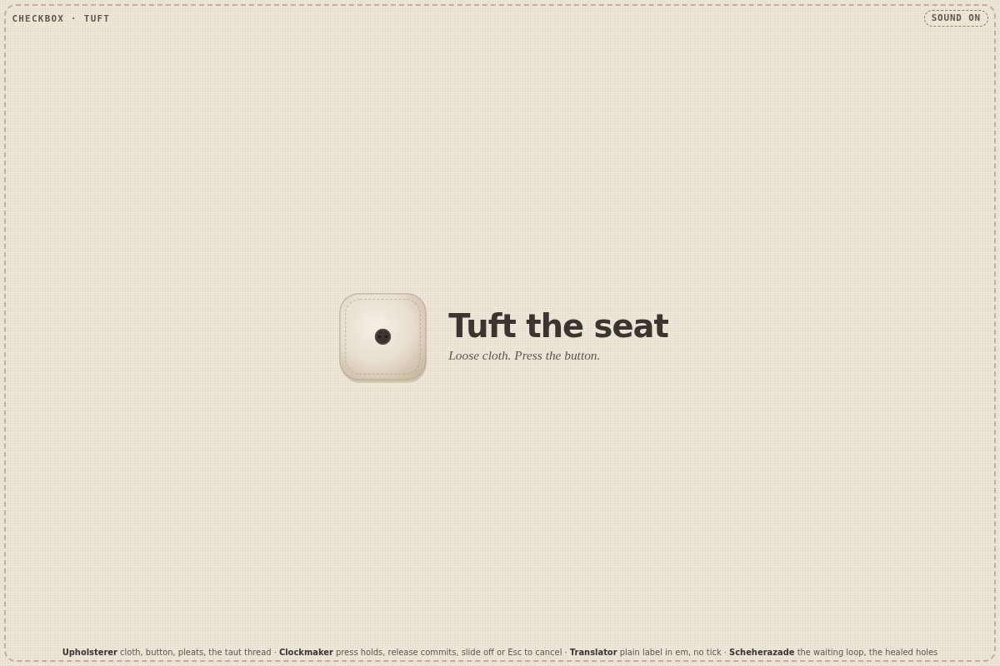
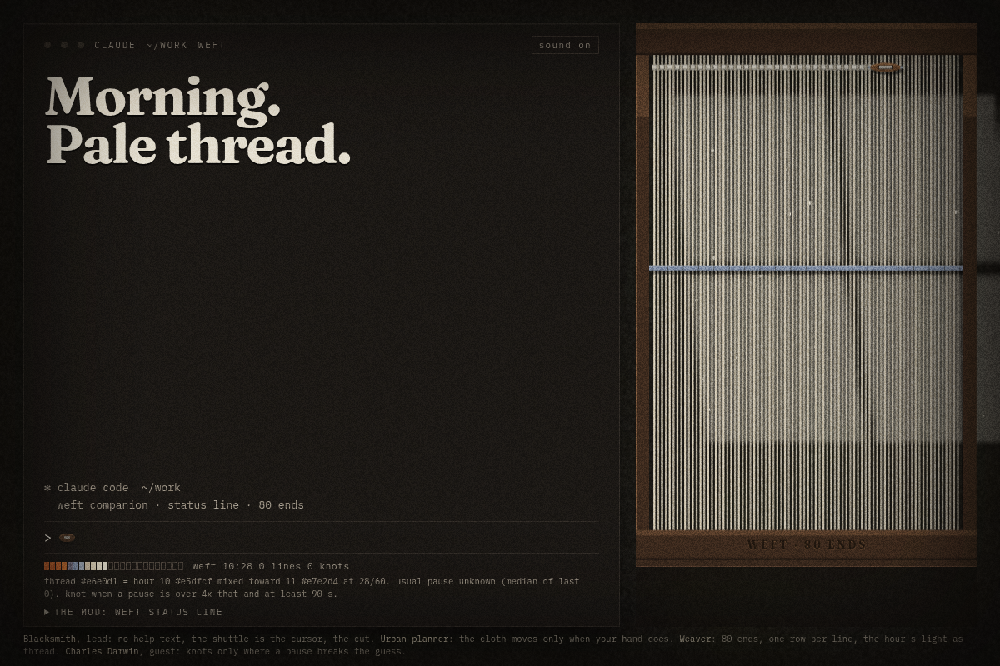
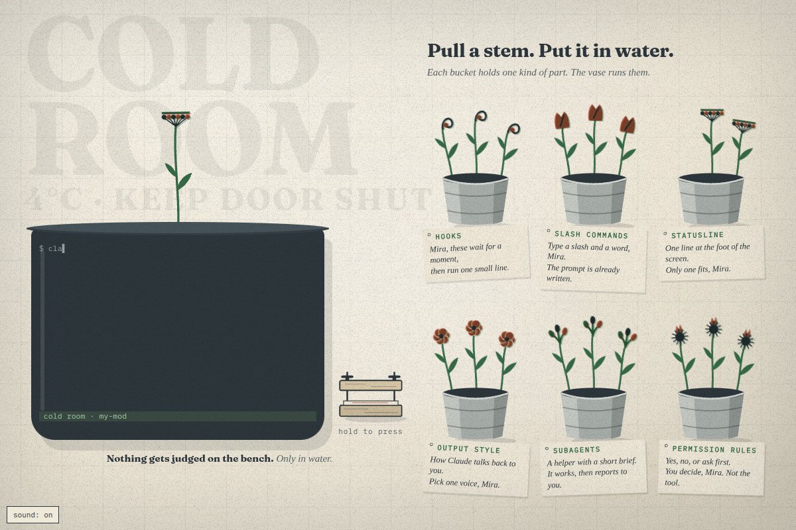
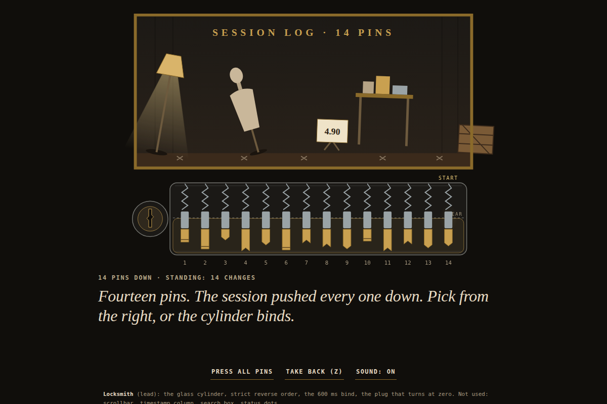

# daily-team

Design inspiration for people building small or large projects and prototypes. Each day a new four-person creative team explores working interface components you can try and adapt. This repository is the record: each day's team, its plan, and its asset, kept in [days/](days/) and listed in the [archive](ARCHIVE.md).

From 2026-10-26, the cast resets around UI craft. Buttons, loaders, panels and cards lead the brief pool; useful inputs, navigation and engineering data views follow. Readable states, precise spacing and short, purposeful animation matter more than an abstract concept. Ideas from `00-components` are distilled into [component-inspiration.json](component-inspiration.json), so cloud runs can use them without the local source folder.

Tasks start with a project need: upload a photo, switch a pricing plan, find a command, edit a title, or show progress. The team explores different forms and motion while keeping that purpose clear. You do not need design training to recognize where a component could fit in your project.

Everything in `days/` is written by a language model and checked by scripts, not by hand. The model and provider for each day are on its page.

## Today

<!-- TODAY:START -->
### 2026-10-21: Fast Colour

<a href="days/2026-10-21/"></a>

**Task:** Color swatch in dye bath: dip the cloth, and it slowly takes one color from a small set of vats.

**Decision:** The page is a dye house where the visitor dips one strip of cloth through a rack of vats that the tide fills by one pot per visit, and the colour the cloth takes is the swatch they pick, kept in the browser until they return.

<a href="days/2026-10-21/"></a>

[Open the day](days/2026-10-21/) · [Use it](https://isas1.github.io/daily-team/2026-10-21/) · [Archive](ARCHIVE.md)
<!-- TODAY:END -->

## This week

<!-- WEEK:START -->
**Season 4**, since 2026-10-19. New this season: Wheelwright, Gilder, Thatcher, Lacemaker, Rope maker, Bell founder, Organ builder, Stage manager, Ariadne, Phileas Fogg, and 4 new temperaments. A new season with 8 new roles and 8 new methods is drafted every Monday.

### Vote on what gets built next

[Suggest a task](https://github.com/isas1/daily-team/issues/new?template=task-suggestion.yml) or vote with a thumbs-up on [open suggestions](https://github.com/isas1/daily-team/issues?q=is%3Aissue+is%3Aopen+label%3Atask-suggestion+sort%3Areactions-%2B1-desc). The most voted are screened every Monday.

No open suggestions yet.
<!-- WEEK:END -->

## Recent days

<!-- RECENT:START -->
| Date | Asset | Task | Team |
|---|---|---|---|
| [2026-10-21](days/2026-10-21/) | <a href="days/2026-10-21/"></a> | Fast Colour | Beekeeper · Luthier · Weaver · Robinson Crusoe |
| [2026-10-20](days/2026-10-20/) | <a href="days/2026-10-20/"></a> | Wrong-Way Reel | Upholsterer · Clockmaker · Translator · Scheherazade |
| [2026-10-19](days/2026-10-19/) | <a href="days/2026-10-19/"></a> | Clew Rim | Taxidermist · Wheelwright · Glassblower · Daedalus |
| [2026-10-18](days/2026-10-18/) | <a href="days/2026-10-18/"></a> | Weft | Blacksmith · Urban planner · Weaver · Charles Darwin |
| [2026-10-17](days/2026-10-17/) | <a href="days/2026-10-17/"></a> | The Cold Room | Florist · Teacher · Calligrapher · Daedalus |
| [2026-10-16](days/2026-10-16/) | <a href="days/2026-10-16/"></a> | Glass Cylinder | Locksmith · Packaging designer · Window dresser · Scheherazade |
| [2026-10-15](days/2026-10-15/) | <a href="days/2026-10-15/"></a> | Spyhole | Ceramicist · Textile designer · Costume designer · Ada Lovelace |

[All 19 days](ARCHIVE.md)
<!-- RECENT:END -->

## How it works

1. **The team.** `team.sh` turns the date into four members, each with a role, a method, and a stance, plus a constraint and a task. Current tasks name one component and its project use. Open UI requests from this repo and `isas1/web-components` can replace the pool task; each scoped brief rests for 28 days after use, and its source is recorded. The date gives the same cast and base task; request selection depends on the saved issue snapshot and recent records. Earlier seasons used open sparks and material processes; their records stay as made. From season 3, each member also has a temperament: how they argue. Within a season no role or method repeats within 7 days and no constraint within 22 days. A pool task rests for half the task pool plus 1 days: 21 with the current 40-task pool.
2. **The guest.** From season 2, member 4 is a guest who brings one method: a historical figure, a figure from myth, a character from an old book, an archetype, a person from the future, or a creature. Historical guests never speak as the person. Other guests speak in character, in original words, never quoting the source. Real people and authors must have died at least 100 years ago, myths are used in their traditional form, and gods of living religions, brands, and modern franchises are excluded.
3. **The cast.** Every Monday a language model drafts the next season: 16 new roles, 16 new methods, 8 new temperaments, and 6 new guests join from 2026-10-26, the longest-serving leave, and voted suggestions become component briefs. Scripts check the draft and it opens as a pull request for review. Seasons start on a future Monday, so past days never change.
4. **The work.** Each morning a language model plays the team. Each member pitches a different design for the same project need, thinking from their own nature: their craft, or for a guest, their myth, era, or body. They argue for 6 to 10 lines, then choose a project context and plan distinct reusable components with shared design tokens and a connected working demo. From 2026-10-27, default packs contain six justified components; size can vary from one to ten. Earlier days retain their original variation format. Each component stays one self-contained HTML file. Older days keep their original format.
5. **The checks.** The file must have a title and a mobile layout, stay under 100 KB, and make no network requests. Component tiles may use up to 80 words of useful content, including card and panel labels. A file that fails is retried once, then marked "needs review". These source checks do not prove visual quality; browser review must verify state behavior, motion, both themes and phone fit before reuse.
6. **The record.** The workflow commissions a project cover from the same four members and their saved plan, renders it at 1200 × 630, then uses that cover in Today, thumbnails, day pages, the archive and gallery. The branded team card stays first; interface screenshots stay as evidence. Missing or stale covers fall back to the original screenshots. The workflow writes the pages and commits the result. Days that fail are recorded too.
7. **The weekly report.** Each Sunday a script gathers the week's changes, days, seasons, and GitHub activity, and a language model writes a short summary from those facts only. A check rejects any number or name that is not in the facts. Reports are in [reports/](reports/).

## Take part

[Suggest a task](https://github.com/isas1/daily-team/issues/new?template=task-suggestion.yml), vote with a thumbs-up on open suggestions, or read [CONTRIBUTING.md](CONTRIBUTING.md).

## Component packs and feed planning

From 2026-10-27, packs contain distinct standalone components, shared tokens and one connected project. One planning call handles team debate, opportunity selection and structured metadata. Smashing Magazine and Hacker News feeds supply bounded inspiration; cached backlog and original tasks handle source failure. Codrops stays disabled after its candidate feed returned HTTP 410. Custom briefs retain priority.

[Pack guide](docs/component-packs.md) covers size, custom packs, saved-input replay, offline mode, category mappings, exports and human library outcomes. Generated candidates always require review. Try `node pack-sample.mjs` for a deterministic sample with no live model calls.

## Run your own

Fork the repo, then add one secret:

- `OPENROUTER_API_KEY` for OpenRouter's free models (the default). Create the key with a credit limit.
- Or `CLAUDE_CODE_OAUTH_TOKEN` from `claude setup-token` to use a Claude subscription, and set the repository variable `PROVIDER` to `claude`. A default six-component pack uses nine requests including its cover, before comparisons; Sonnet and Haiku add twelve. Legacy ten-variation days use thirteen plus twenty comparison requests. Failed checks and a referee can add requests.

The Daily workflow reads component requests before planning. Add optional secret `COMPONENT_REQUESTS_TOKEN` with read access to both repos to include private `web-components` issues; the default Actions token may only read this repo. Unavailable sources print a warning and the task pool remains usable. This lane only reads issues; it never comments on or closes source requests. Label a focused issue `daily-component`, `component-request` or `request:accepted` to include it explicitly, or use the existing task suggestion form. Common component names in issue titles are also screened for relevance; maintenance audits and infrastructure work stay out.

For a local snapshot, run `GITHUB_TOKEN=$(gh auth token) node github.mjs requests > /tmp/daily-team-requests.json`, then `node run.mjs --date 2026-10-26 --requests /tmp/daily-team-requests.json --dry-run`. Add `--brief` to use your own brief instead. Request bodies stay in the temporary input; day records retain the source link and scoped task.

Optional variables: `MODEL`, `CLAUDE_MODEL` (default `claude-opus-5-5`), `ARTIFACTS` (0 to 10; default 6 plus a connected demo for packs from 2026-10-27, legacy component days 10 plus a piece, else 1), `TZ`, and `PAGES` (`true` to publish the tools on GitHub Pages). To record a day by hand with your Claude login, run `sh daily.sh`. It commits and pushes.

### Project covers

Run `node cover.mjs --date YYYY-MM-DD --provider claude` to commission only an existing day's cover, without regenerating its artifacts. Use `--out path/to/days` for another records folder, `--dry-run` to inspect the team brief, or `--force` to replace the cover. The stage saves `cover.html`, `cover.png` and `cover.json` (member contributions, chosen direction, actual model, and a hash of the day record). Matching covers resume without a model call. A failed commission leaves the previous files intact; publishing checks the hash and falls back when the day has changed. Run `node publish.mjs` afterward to update image references. Both daily entrypoints run the cover stage with the day's configured provider; no image API key or extra package is needed. Local rendering needs Chrome, as the team cards do.

### Three-model components and video

On Claude component days, the Daily workflow and `daily.sh` also build every row with Sonnet and Haiku using the same recorded team plan. Opus components are reused when their model matches. Each result records its actual model ID; missing or failed output is labeled and never copied from another model. The workflow's `compare` input, or `COMPARE_MODELS=0` locally, can turn this stage off. Local video rendering needs the dependencies below installed first.

The self-contained `comparison.html` view has four equal quadrants: a 3–7 word task heading and three live components with model names above them. Choose a row, replay it, or play all rows. Each row runs for 4 seconds at normal speed: rest, input, and settling. The MP4 is 1080 × 1080, 30 fps, with six pack rows taking 24 seconds (legacy ten-row days take 40 seconds). The preview uses fresh temporary storage and drives existing input handlers; original artifacts stay unchanged. Slow effects show 4 seconds of progress, rather than being sped up to their end state.

To compare an existing day with your local Claude login:

```sh
node compare.mjs --date 2026-10-21
npm install --no-save --package-lock=false playwright@1.63.0
npx playwright install chromium
node render-comparison.mjs --date 2026-10-21
```

Install `ffmpeg` separately. Use `--seconds 3` through `--seconds 5` with `compare.mjs` to change segment length, `--view-only` to rebuild the view without model calls, or `--force` to regenerate model variants. Completed variants resume automatically. `COMPARE_OPUS_MODEL`, `COMPARE_SONNET_MODEL`, and `COMPARE_HAIKU_MODEL` override the default `claude-*-5-5` models. `PLAYWRIGHT_MODULE`, `CHROME`, and `FFMPEG` can point to existing local renderer tools.

The folder also works as a Claude Code skill: clone it into `~/.claude/skills/daily-team`, then use `/daily-team`.

## Safety

- Keys are passed only to the step that calls the model. They are never written to disk or printed.
- The Claude provider runs with no tools, no MCP servers, no user settings or hooks, and no CLAUDE.md, so the model can only return text.
- Every asset gets a Content-Security-Policy that blocks network requests. On GitHub Pages, assets run only inside a sandboxed frame.
- Free models can log prompts. Do not put private material in `brief.md`.
- See [SECURITY.md](SECURITY.md) to report a problem.

## License

Code and content: MIT.

Design: the Sam Creates design system, in [brand/](brand/). The fonts are Mozilla Headline and Mozilla Text under the SIL Open Font License 1.1; see [brand/fonts](brand/fonts).
