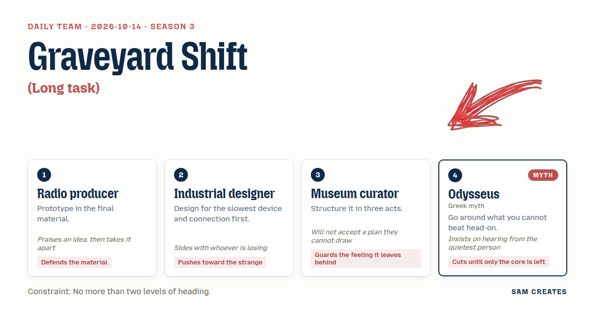
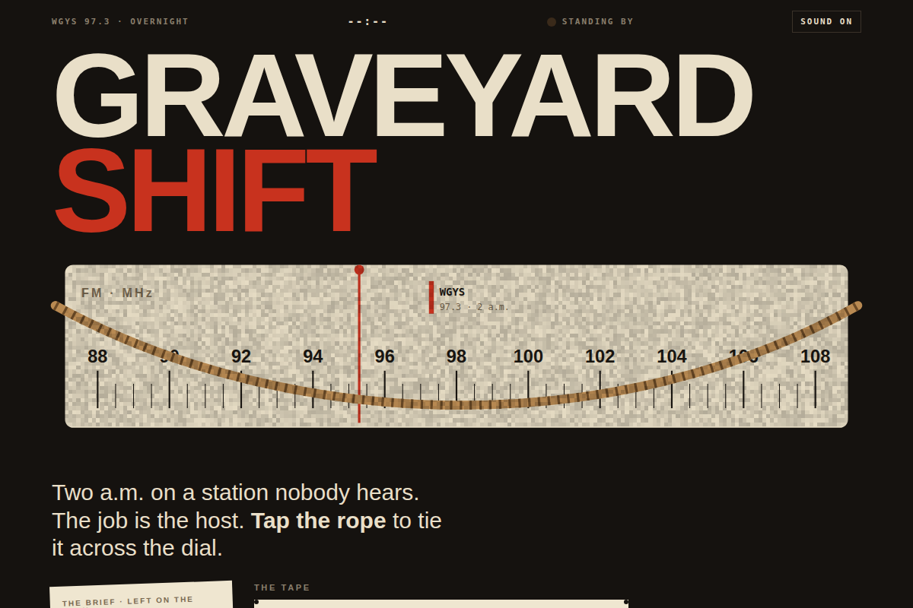
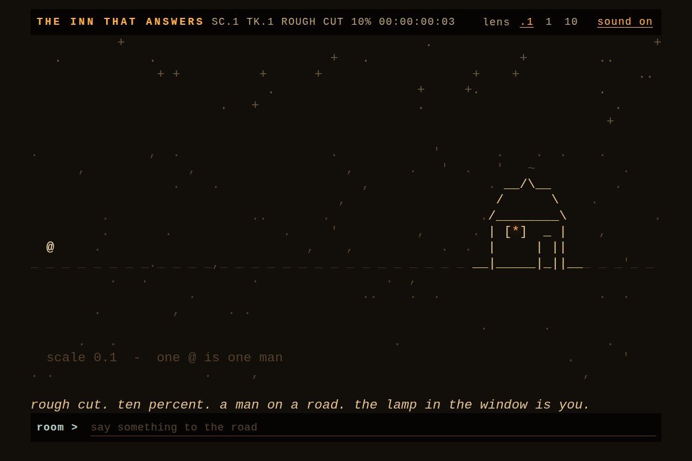
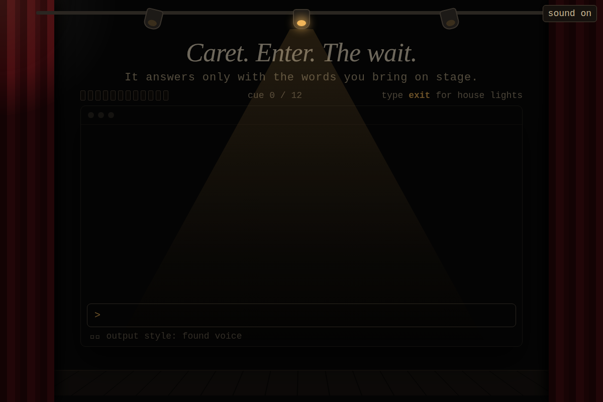
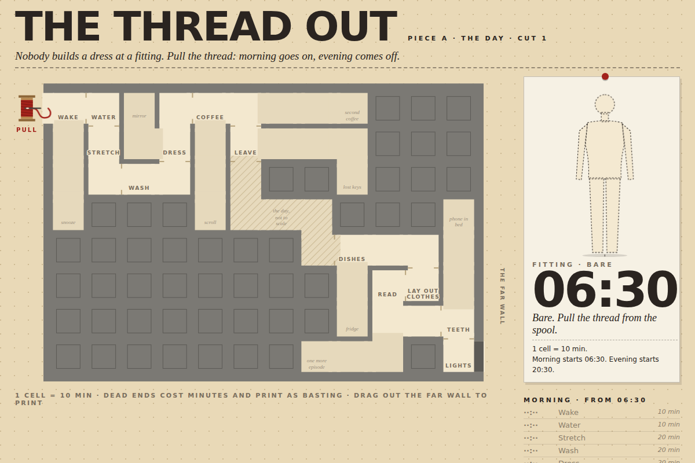
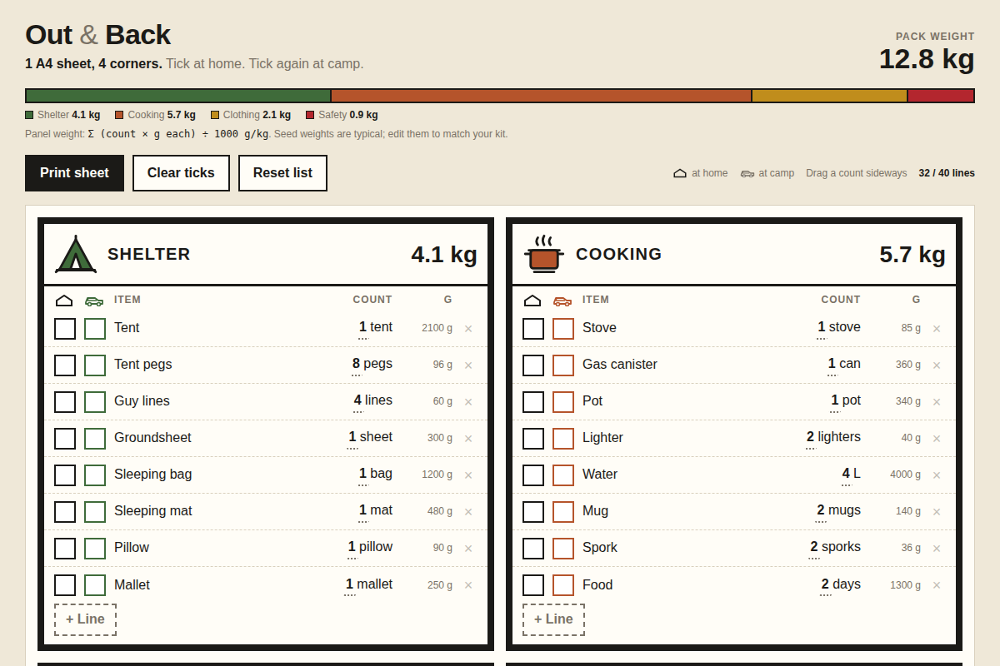
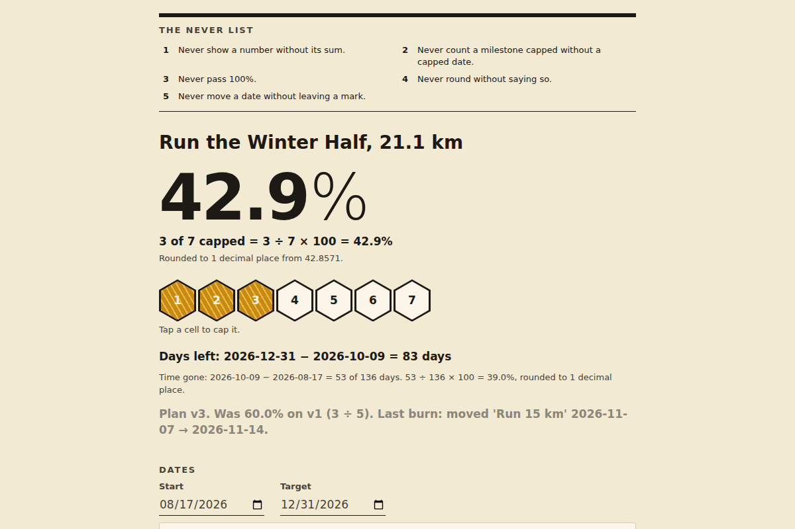
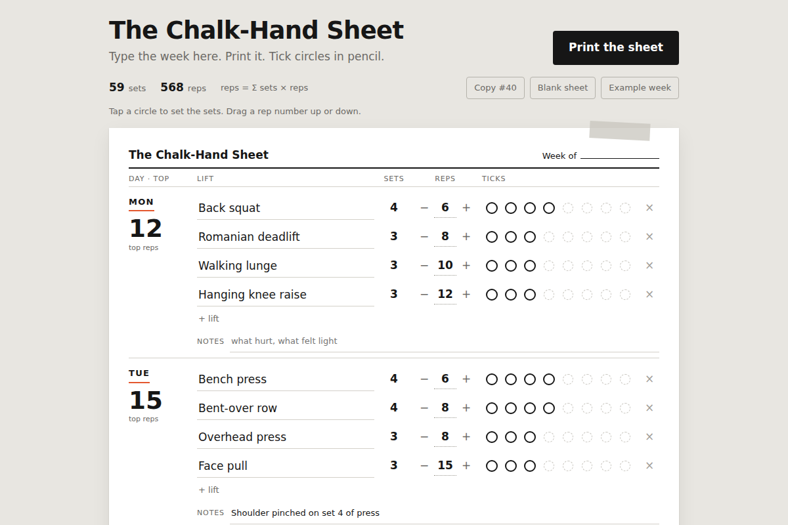

# daily-team

A new four-person creative team every day, and the small web tool it built. This repository is the record: each day's team, its plan, and its asset, kept in [days/](days/) and listed in the [archive](ARCHIVE.md).

Everything in `days/` is written by a language model and checked by scripts, not by hand. The model and provider for each day are on its page.

## Today

<!-- TODAY:START -->
### 2026-10-14: Graveyard Shift

**Task:** Long task: a Claude Code job that runs for hours while no one watches.

**Decision:** The page is an overnight radio station that only broadcasts while the visitor's tab is hidden, calls them back through the tab title like a singer, and gives them the night's tape when they return.

[Open the day](days/2026-10-14/) · [Use it](https://isas1.github.io/daily-team/2026-10-14/) · [Archive](ARCHIVE.md)
<!-- TODAY:END -->

## This week

<!-- WEEK:START -->
**Season 3**, since 2026-10-12. New this season: Luthier, Stonemason, Clockmaker, Weaver, Florist, Cobbler, Translator, Sculptor, Mary Anning, Clockwork beetle, and 24 temperaments. A new season with 8 new roles and 8 new methods is drafted every Monday.

### Vote on what gets built next

[Suggest a task](https://github.com/isas1/daily-team/issues/new?template=task-suggestion.yml) or vote with a thumbs-up on [open suggestions](https://github.com/isas1/daily-team/issues?q=is%3Aissue+is%3Aopen+label%3Atask-suggestion+sort%3Areactions-%2B1-desc). The most voted are screened every Monday.

No open suggestions yet.
<!-- WEEK:END -->

## Recent days

<!-- RECENT:START -->
| Date | Asset | Task | Team |
|---|---|---|---|
| [2026-10-14](days/2026-10-14/) |  | Graveyard Shift | Radio producer · Industrial designer · Museum curator · Odysseus |
| [2026-10-13](days/2026-10-13/) |  | The Inn That Answers | Documentary director · Playwright · Puppeteer · Benjamin Franklin |
| [2026-10-12](days/2026-10-12/) |  | Found Voice | Set designer · Bookbinder · Data journalist · Euclid |
| [2026-10-11](days/2026-10-11/) |  | The Thread Out | Costume designer · Cartographer · Furniture maker · Daedalus |
| [2026-10-10](days/2026-10-10/) |  | Four Corners, Out and Back | Game designer · Service designer · Comic artist · Sisyphus |
| [2026-10-09](days/2026-10-09/) |  | The Never List | Beekeeper · Sign painter · Librarian · Phoenix |
| [2026-10-08](days/2026-10-08/) |  | The Chalk-Hand Sheet | Packaging designer · Brand strategist · Taxidermist · Time |

[All 12 days](ARCHIVE.md)
<!-- RECENT:END -->

## How it works

1. **The team.** `team.sh` turns the date into four members, each with a role, a method, and a stance, plus a constraint and a spark: an open starting point, not a brief. From season 3 the team decides what to make from it. From season 3, each member also has a temperament: how they argue. The same date always gives the same team. Within a season no role or method repeats within 7 days, no constraint within 22 days, and no task within 61 days.
2. **The guest.** From season 2, member 4 is a guest who brings one method: a historical figure, a figure from myth, a character from an old book, an archetype, a person from the future, or a creature. Historical guests never speak as the person. Other guests speak in character, in original words, never quoting the source. Real people and authors must have died at least 100 years ago, myths are used in their traditional form, and gods of living religions, brands, and modern franchises are excluded.
3. **The cast.** Every Monday a language model drafts the next season: 8 new roles, 8 new methods, 4 new temperaments, and 2 new guests join, the longest-serving leave, and voted suggestions become sparks. Scripts check the draft and it opens as a pull request for review. Seasons start on a future Monday, so past days never change.
4. **The work.** Each morning a language model plays the team. Each member pitches a different thing to make from the spark, thinking from their own nature: their craft, or for a guest, their myth, era, or body. They argue for 6 to 10 lines, then the lead decides. If the team splits, a neutral referee picks one side. Then they build it as one HTML file: a toy, a picture, an instrument, a story, or a tool.
5. **The checks.** The file must have a title and a mobile layout, stay under 100 KB, and make no network requests. A file that fails is retried once, then marked "needs review".
6. **The record.** The workflow takes a screenshot, draws the team card, writes the day page, updates the archive and this README, and commits the result. Days that fail are recorded too.
7. **The weekly report.** Each Sunday a script gathers the week's changes, days, seasons, and GitHub activity, and a language model writes a short summary from those facts only. A check rejects any number or name that is not in the facts. Reports are in [reports/](reports/).

## Take part

[Suggest a task](https://github.com/isas1/daily-team/issues/new?template=task-suggestion.yml), vote with a thumbs-up on open suggestions, or read [CONTRIBUTING.md](CONTRIBUTING.md).

## Run your own

Fork the repo, then add one secret:

- `OPENROUTER_API_KEY` for OpenRouter's free models (the default). Create the key with a credit limit.
- Or `CLAUDE_CODE_OAUTH_TOKEN` from `claude setup-token` to use a Claude subscription, and set the repository variable `PROVIDER` to `claude`. Each day uses 2 to 5 requests from your plan's limits.

Optional variables: `MODEL`, `CLAUDE_MODEL` (default `claude-opus-5-5`), `ARTIFACTS` (0 to 4, default 1), `TZ`, and `PAGES` (`true` to publish the tools on GitHub Pages). To record a day by hand with your Claude login, run `sh daily.sh`. It commits and pushes.

The folder also works as a Claude Code skill: clone it into `~/.claude/skills/daily-team`, then use `/daily-team`.

## Safety

- Keys are passed only to the step that calls the model. They are never written to disk or printed.
- The Claude provider runs with no tools, no MCP servers, no user settings or hooks, and no CLAUDE.md, so the model can only return text.
- Every asset gets a Content-Security-Policy that blocks network requests. On GitHub Pages, assets run only inside a sandboxed frame.
- Free models can log prompts. Do not put private material in `brief.md`.
- See [SECURITY.md](SECURITY.md) to report a problem.

## License

Code and content: MIT.

Design: the Sam Creates design system, in [brand/](brand/). The fonts are Mozilla Headline and Mozilla Text under the SIL Open Font License 1.1; see [brand/fonts](brand/fonts).
