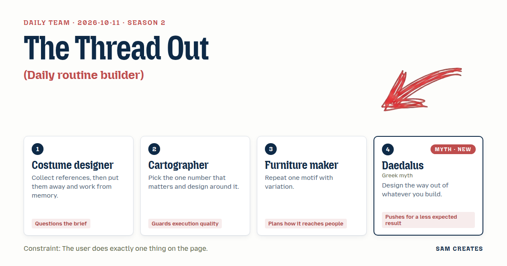

# 2026-10-11: The Thread Out

[Today](../../README.md) · [Archive](../../ARCHIVE.md)



**Task:** Daily routine builder: morning and evening steps with times, printable.

**Constraint:** The user does exactly one thing on the page.

**Season:** 2026-10-05

**Decision:** The page is a gray maze with a bare paper figure at its morning gate, and the visitor does one thing: drag a single thread from the gate to the evening wall, and the corridors it passes through become their timed morning and evening steps.

## Asset

<a href="artifact-1.html"></a>

[Use it](https://isas1.github.io/daily-team/2026-10-11/) · [artifact-1.html](artifact-1.html), led by Costume designer. Model: claude-opus-5-5.

## The session

### Pitch

**1 · Costume designer: Quick Change**\
A routine is a costume. You put it on at seven and take it off at ten.\
I don't want them building anything. Nobody builds a dress at a fitting.\
One bare figure on the page. You pull one thread at the hem.\
Morning dresses itself onto the body, layer by layer, each layer a step with a time pinned to it.\
Keep pulling and evening unpicks it in reverse.\
Print it and you get the pattern pieces, with the times chalked on the seams.

**2 · Cartographer: Contour Day**\
One number. Wake time. Everything else is relief drawn from it.\
The day is terrain. Morning is a slope up and evening is a slope down. Each step is a contour line labeled with its time.\
You drag the sun marker along the left edge. The whole map re-projects.\
Nothing else moves. Nothing else can be touched.\
It prints at A4 with a scale bar in minutes, and every label is legible at arm's length.\
If the type collides on the printout, it is wrong.

**3 · Furniture maker: Two Chests**\
One joint. A dovetail. Every step is a drawer, every drawer the same dovetail, cut wider for longer steps.\
Morning chest on the left, evening chest on the right, grain running down the day.\
You slide the first drawer open. The rest follow in sequence, each with its time burned into the front.\
The print is a cut sheet. Scissors, glue, cereal-box card.\
It stands up on the counter. That's how it reaches the kitchen.\
Nobody keeps a list. People keep a box.

**4 · Daedalus: The Way Out of the Day**\
I built a house of corridors so well that I could not leave it. I know what a morning is.\
Every routine is walls. Wake, wash, eat, the same turns until the turns walk you.\
So give them the maze. Morning is the gate. Evening is the far wall.\
They lay one thread through it, once. Where it bends, a step. Where it runs long, time passes.\
And the far wall must open. I will not build another house without a door.\
When they print, the walls stay on the screen. Only the thread goes onto paper.

### Clash

**2 · Cartographer:** Daedalus, a thread through a maze has dead ends. If they wander, the times go wrong. My unit is the minute, and you want them lost.

**4 · Daedalus:** Lost is the point, mapmaker. A day with no wrong corridor is a cell. Let doubling back cost minutes. They will feel it in the legs.

**1 · Costume designer:** Daedalus, your thread is my thread. I sew with it. But I want it worn, on a body. A maze has no body.

**4 · Daedalus:** The body is inside the maze. That was always the trouble. Stand your figure at the gate and let it carry what it passes.

**3 · Furniture maker:** Cartographer, your map prints flat and goes in a drawer. Mine stands. A thing on the counter gets used.

**2 · Cartographer:** Fold it and a crease cuts through 7:15. A label on a crease is a label nobody reads.

**3 · Furniture maker:** Daedalus, then make your corridors my joint. One module, repeated, wider where the step runs long. I can cut that.

**4 · Daedalus:** Yes. A maze is one wall said many times.

**1 · Costume designer:** Cartographer, drop the sun marker. The thread is the one thing they do. Your number becomes the scale: one cell, ten minutes.

**2 · Cartographer:** Then the dead ends get priced and printed. If they wasted twenty minutes, the paper says so. Daedalus wants the walls gone and the wandering forgiven. I don't.

### Decision

The page is a gray maze with a bare paper figure at its morning gate, and the visitor does one thing: drag a single thread from the gate to the evening wall, and the corridors it passes through become their timed morning and evening steps.

Concept: The Thread Out

- Costume designer: the figure at the gate puts on one garment per morning corridor and takes one off per evening corridor. The printout is a pattern piece with the thread as the seam line and notches at each step.
- Cartographer: one number sets the scale, 1 cell = 10 minutes from 06:30. Labels are tested at A4 with no collisions.
- Furniture maker: every corridor is the same wall module, cut 1, 2, or 3 cells wide for 10, 20, or 30 minutes.
- Daedalus: the far wall opens when the thread reaches it, and the walls never print. Only the thread leaves the page.

The Furniture maker lost the standing box, because a fold breaks the times. Daedalus lost forgiveness: wasted corridors print as dashed basting stitches with their minutes counted. Basting can be pulled out, so the way out stays open, and the cost stays on paper.

### Build notes

1. Build the maze in SVG from one corridor module repeated on a 12 x 8 grid, in widths of 1, 2, and 3 cells. Label morning corridors Wake, Water, Stretch, Wash, Dress, Coffee, Leave. Label evening corridors Dishes, Lay Out Clothes, Read, Teeth, Lights.
2. Use pointer events for the one drag. Snap the thread to cell centers. Convert length to clock times at 10 minutes per cell from 06:30. Draw backtracked cells dashed and add their minutes. Add or remove one SVG garment layer on the figure per corridor. Slide the far wall open when the thread touches it.
3. Write `@media print` rules that hide walls and the figure and print the thread as a solid 1.5pt seam. Mark each step with a notch and a 10pt time label. Print dead ends as dashed basting with their minutes. Put "Cut along the thread" at the top. Check A4 portrait for label collisions before shipping.

**Guest:** Daedalus (myth; Greek myth). The method is drawn from public-domain history, myth, or literature, or invented. The guest speaks in character in original words, never quoting the source, and nothing here is endorsed by anyone.

## Team

```text
Team for 2026-10-11
Season: 2026-10-05

1. Costume designer
   Method: Collect references, then put them away and work from memory.
   Stance: Questions the brief.
2. Cartographer
   Method: Pick the one number that matters and design around it.
   Stance: Guards execution quality.
3. Furniture maker
   Method: Repeat one motif with variation.
   Stance: Plans how it reaches people.
4. Daedalus (myth; Greek myth) [guest] [new]
   Method: Design the way out of whatever you build.
   Stance: Pushes for a less expected result.

Constraint: The user does exactly one thing on the page.
Task: Daily routine builder: morning and evening steps with times, printable.
```

Provider: claude. Model: claude-opus-5-5.
