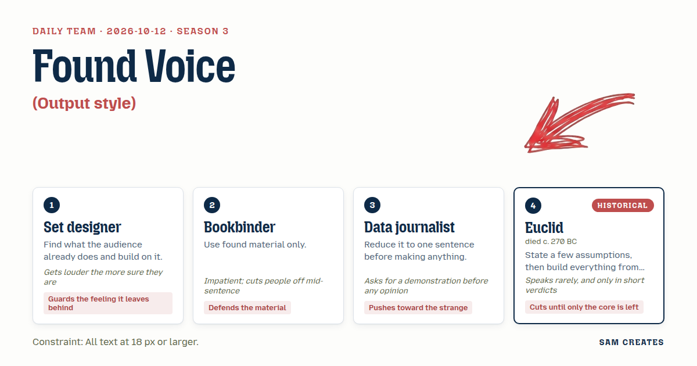

# 2026-10-12: Found Voice

[Today](../../README.md) · [Archive](../../ARCHIVE.md)



**Task:** Output style: a Claude Code voice that changes how every answer sounds.

**Constraint:** All text at 18 px or larger.

**Season:** 2026-10-12

**Decision:** The page is a fake Claude Code terminal whose assistant can answer only with words the visitor has already typed, one sentence at a time, at a pace the visitor drags into shape, until the house lights come up on the whole stock of words ...

## Asset

<a href="artifact-1.html"></a>

[Use it](https://isas1.github.io/daily-team/2026-10-12/) · [artifact-1.html](artifact-1.html), led by Set designer. Model: claude-opus-5-5.

## The session

### Pitch

**1 · Set designer: House Lights**\
People already know the ritual. Caret blinks. They type. They hit Enter. They wait.\
I keep all of that. What I change is the room the answer walks into.\
The same answer, played under a different rig: one follow spot, a lit scrim, a bare work light.\
The voice is the staging: pace, pauses, where the words stand on the boards.\
When they leave, the house lights come up and the stage is a terminal again.\
That last plain second is what they take home.

**2 · Bookbinder: Found Voice**\
No new words. None.\
The voice is sewn only from what the visitor has already typed: questions, typos, half-commands.\
Each answer is cut from those scraps and gathered into a signature on the page.\
At first it can barely speak. Ten questions in, it sounds like them.\
The thread shows. The seams show. Type sizes don't match, and none are under 18 px.\
A voice you fed yourself.

**3 · Data journalist: The Trace**\
Every answer gets reduced to one sentence first. That sentence is all the voice says.\
Under it runs a line like a seismograph: stress, pause, and length for each word.\
Drag the line flat and the voice goes clipped. Spike it and the voice stalls and stretches.\
The voice becomes a shape you edit by hand.\
Show me a voice that isn't a rhythm.

**4 · Euclid: Three Givens**\
The visitor writes three rules for the voice. Nothing else is assumed.\
Each answer is built step by step from those rules, and the steps stay on screen.\
A rule that produces nothing gets struck out.\
What remains is the voice.

### Clash

**3 · Data journalist:** Bookbinder, demonstrate. The visitor has typed one question. What does your voice say back?

**2 · Bookbinder:** "how do I", and then it stops. Good. It's honest about how little stock it has—

**3 · Data journalist:** —so it answers with a silence that has a seam in it. That's strange. I'll take it.

**4 · Euclid:** One given is enough. Answers use only words the visitor typed.

**1 · Set designer:** Then put it where they already live. Caret, Enter, the wait. They do that forty times a day. That's the stage, and the ending is the house lights coming up on their own—

**2 · Bookbinder:** —lights aren't words. Keep your rig off the text.

**1 · Set designer:** The rig is the ending. When the last answer is done, everything they fed it lands on one plain lit page. They have to see it was them. They have to SEE it.

**4 · Euclid:** The trace is a second given. Strike it.

**3 · Data journalist:** No. Strike the trace and the visitor only types. Show me the voice changing under a hand and not only under a keyboard.

**4 · Euclid:** The hand can choose which words. That is enough.

### Decision

The page is a fake Claude Code terminal whose assistant can answer only with words the visitor has already typed, one sentence at a time, at a pace the visitor drags into shape, until the house lights come up on the whole stock of words they fed it.

Concept: Found Voice

- Set designer: the caret, the Enter key, and the wait stay exactly as visitors know them. The page ends with the house lights coming up on one plain sheet.
- Bookbinder: no word on the page that the visitor did not type first. Answers show their seams. The final sheet is laid out as a sewn signature.
- Data journalist: every answer is one sentence. The trace stays under each answer, but it holds only pause and stress. It never adds words.
- Euclid: the single given, "only found words," is the whole engine. There are no themes, no presets, and no second rule.
- Euclid lost the trace. In a terminal, a voice is its timing as much as its words, and without the trace the visitor's hand has nothing to do but type. Bookbinder lost on keeping lighting off the text, because the final lit page is how the visitor learns the voice was theirs. Euclid has not conceded that the trace is needed, and that argument is still open.

### Build notes

1. Stock engine. Split every submitted prompt into words and keep a count for each word. An answer is one sentence of at most `floor(stock.length / 3)` words. Pick words from the current prompt first, then fill by frequency from the rest of the stock. Punctuation must come from the stock too. If the stock runs out, the answer stops mid-line with a visible seam glyph `┆`.
2. Trace. An SVG polyline sits under each answer with one draggable handle per word. Handle height sets the delay before that word types out, from 0 to 900 ms. A new answer inherits the last trace shape, so the visitor's pacing builds up over the session.
3. House lights. After 12 prompts, or when the visitor types `exit`, the background fades from `#0b0b0b` to `#f4efe6` over 2.4 s. The full stock is set as one page with word size `calc(18px + 4px * uses)`. A CSS rule enforces a minimum of `font-size: max(18px, …)` on every element, including the caret line, the trace labels, and the seam glyph.

**Guest:** Euclid (historical; died c. 270 BC). The method is drawn from public-domain history, myth, or literature, or invented. The guest never speaks as the figure, and nothing here is endorsed by anyone.

## Team

```text
Team for 2026-10-12
Season: 2026-10-12

1. Set designer
   Method: Find what the audience already does and build on it.
   Stance: Guards the feeling it leaves behind.
   Temperament: Gets louder the more sure they are.
2. Bookbinder
   Method: Use found material only.
   Stance: Defends the material.
   Temperament: Impatient; cuts people off mid-sentence.
3. Data journalist
   Method: Reduce it to one sentence before making anything.
   Stance: Pushes toward the strange.
   Temperament: Asks for a demonstration before any opinion.
4. Euclid (historical; died c. 270 BC) [guest]
   Method: State a few assumptions, then build everything from them.
   Stance: Cuts until only the core is left.
   Temperament: Speaks rarely, and only in short verdicts.

Constraint: All text at 18 px or larger.
Task: Output style: a Claude Code voice that changes how every answer sounds.
```

Provider: claude. Model: claude-opus-5-5.
