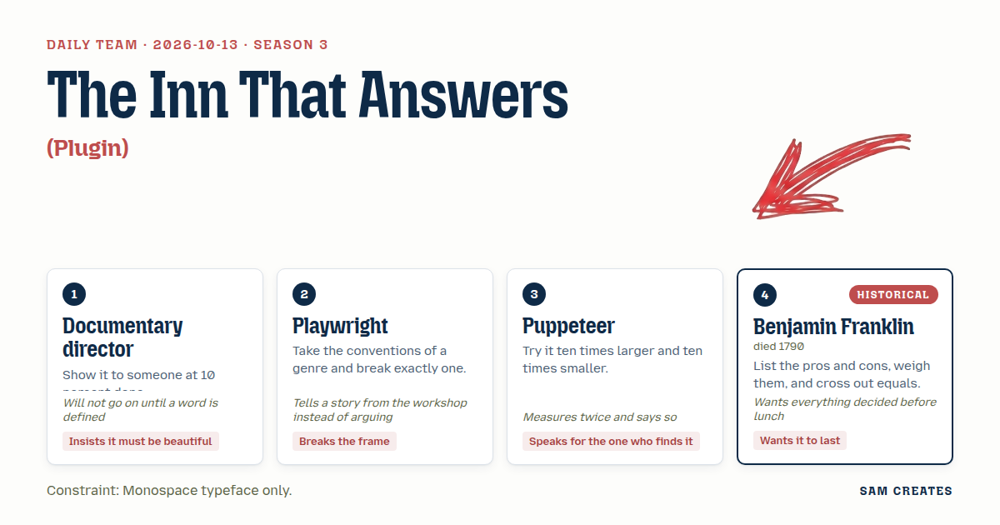

# 2026-10-13: The Inn That Answers

[Today](../../README.md) · [Archive](../../ARCHIVE.md)



**Task:** Plugin: a bundle of Claude Code mods that arrives like a traveller with a full pack.

**Constraint:** Monospace typeface only.

**Season:** 2026-10-12

**Decision:** The page is a monospace inn on an 80 by 24 grid where a traveller arrives with a pack of Claude Code mods and the visitor, playing the room, answers his commands, pulls the pack open strap by strap, names each item before he may set it d...

## Asset

<a href="artifact-1.html"></a>

[Use it](https://isas1.github.io/daily-team/2026-10-13/) · [artifact-1.html](artifact-1.html), led by Documentary director. Model: claude-opus-5-5.

## The session

### Pitch

**1 · Documentary director: Customs at 10 Percent**\
A border post at night. Rendered in Courier, 80 columns.\
The traveller sets the pack on the counter. You open it.\
Each mod comes out a tenth finished: a hook with no body, a command with no name.\
You cannot wave it through until it has a word for what it is.\
Type the word. Then it gets its frame. Then it is beautiful.

**2 · Playwright: You Are the Inn**\
Text adventures have one rule: you walk into rooms.\
Break it. You don't walk. You are the room.\
The traveller types at you: `> look`, `> set down pack`, `> sleep`.\
You answer as walls, as a lamp, as a floor that creaks.\
He has never been answered by a room before. Neither have you.

**3 · Puppeteer: The Pack at Three Scales**\
I measured the screen twice. 80 by 24. That's the stage.\
At one tenth, the traveller is one `@` crossing a field of dots.\
At life size, he's a figure built from slashes, pack on his back.\
At ten times, the pack is the whole screen and every strap is a line you can pull.\
Whoever finds him gets to choose how close to stand.

**4 · Benjamin Franklin: The Printed Ledger**\
Two columns, set in type: what the pack gives, what it costs.\
Each mod goes on one side. Commands, hooks, agents, servers, skills.\
Where two items do the same work, strike both lines and keep one.\
What survives is set as a sheet and kept in the browser.\
Come back next month. The sheet is still there.

### Clash

**1 · Documentary director:** Playwright, before we go further. What is a "room" here? A box of characters, or a place he sleeps? I don't cut a single frame until that's fixed.

**2 · Playwright:** Documentary director, we lost a whole set to a flood on tour once. We played the inn with the front row as the walls, and the actor knocked on their knees to come in. Nobody in that row forgot it. The room is whoever is watching.

**3 · Puppeteer:** Playwright, I checked this twice. If the visitor is the walls, the visitor holds nothing. At one tenth scale that's fine, they're the field. At ten times scale the pack fills everything and the walls are gone. The one who finds him needs something in their hand.

**4 · Benjamin Franklin:** Puppeteer, put the strings on the scale against the cost. A figure the visitor drags is one more part that breaks in a year. A room that only answers keeps working. On my list the strings cancel out.

**3 · Puppeteer:** Benjamin Franklin, then no strings on him. One string on the pack. Pull a strap and it opens. I'm keeping one.

**1 · Documentary director:** Benjamin Franklin, your crossing out. Define "equal." Two mods with the same name? Two that both format code?

**4 · Benjamin Franklin:** Documentary director, equal means the same job at the same moment. Two hooks that both run before a commit and both lint: one goes. Can we fix that and move on to the build?

**1 · Documentary director:** Benjamin Franklin, not yet. If they just vanish, it's ugly. Strike them through and leave them on the page, like a draft with its corrections showing.

**4 · Benjamin Franklin:** Documentary director, a sheet meant to last should hold what was decided. Struck lines are clutter on a record.

**2 · Playwright:** Documentary director, then let the traveller watch you strike them. Once, he looks out past the room at the visitor and says so. That's the one rule I'll break inside the rule I already broke.

### Decision

The page is a monospace inn on an 80 by 24 grid where a traveller arrives with a pack of Claude Code mods and the visitor, playing the room, answers his commands, pulls the pack open strap by strap, names each item before he may set it down, and watches duplicates get struck through until he leaves at dawn and the room keeps a printed sheet of what stayed.

Concept: The Inn That Answers

- Documentary director: every mod comes out of the pack a tenth finished and gets its full drawing only after the visitor types a word for it.
- Playwright: the visitor is the room, answering the traveller's `> look` and `> set down`, and once, after the first strike, he turns and addresses the visitor directly.
- Puppeteer: three zoom levels on the same grid, `@` at one tenth, the slash-figure at life size, the pack at ten times with straps the visitor drags open.
- Benjamin Franklin: two-column ledger of gives and costs, equal items struck by his definition, and the surviving sheet saved to localStorage and shown on return.

Benjamin Franklin lost the struck lines: they stay visible on the screen and on the kept sheet, because a pack that was argued over should show the argument. Puppeteer lost the draggable figure, because Franklin's case on breakage held. I lost the customs desk to the Playwright's room, because a counter makes the visitor an official and the room makes them a host.

### Build notes

1. Set the whole page in one monospace stack (`"Courier New", ui-monospace, monospace`) on a fixed 80 by 24 `<pre>` grid. Draw the traveller, the straps, and the ledger as characters only, with no images. Three scale states swap the grid contents at 0.1x, 1x, and 10x.
2. Fill the pack with 9 mods across five kinds: commands, hooks, agents, MCP servers, skills. Include two pre-commit lint hooks and two commands that both format code, so the equal-strike rule fires at least twice. Each mod renders as a 10 percent sketch until the visitor types a definition of 3 or more words.
3. Script the traveller's arrival, his `>` commands, one fourth-wall line after the first strike, and his departure at dawn. On departure, write the ledger, struck lines included, to `localStorage` under `inn-sheet`. Print it first on any return visit, before he arrives again.

**Guest:** Benjamin Franklin (historical; died 1790). The method is drawn from public-domain history, myth, or literature, or invented. The guest never speaks as the figure, and nothing here is endorsed by anyone.

## Team

```text
Team for 2026-10-13
Season: 2026-10-12

1. Documentary director
   Method: Show it to someone at 10 percent done.
   Stance: Insists it must be beautiful.
   Temperament: Will not go on until a word is defined.
2. Playwright
   Method: Take the conventions of a genre and break exactly one.
   Stance: Breaks the frame.
   Temperament: Tells a story from the workshop instead of arguing.
3. Puppeteer
   Method: Try it ten times larger and ten times smaller.
   Stance: Speaks for the one who finds it.
   Temperament: Measures twice and says so.
4. Benjamin Franklin (historical; died 1790) [guest]
   Method: List the pros and cons, weigh them, and cross out equals.
   Stance: Wants it to last.
   Temperament: Wants everything decided before lunch.

Constraint: Monospace typeface only.
Task: Plugin: a bundle of Claude Code mods that arrives like a traveller with a full pack.
```

Provider: claude. Model: claude-opus-5-5.
