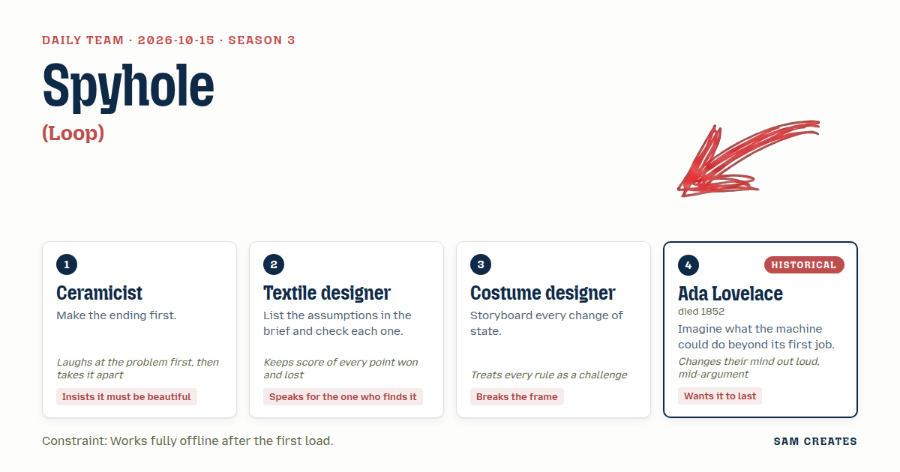
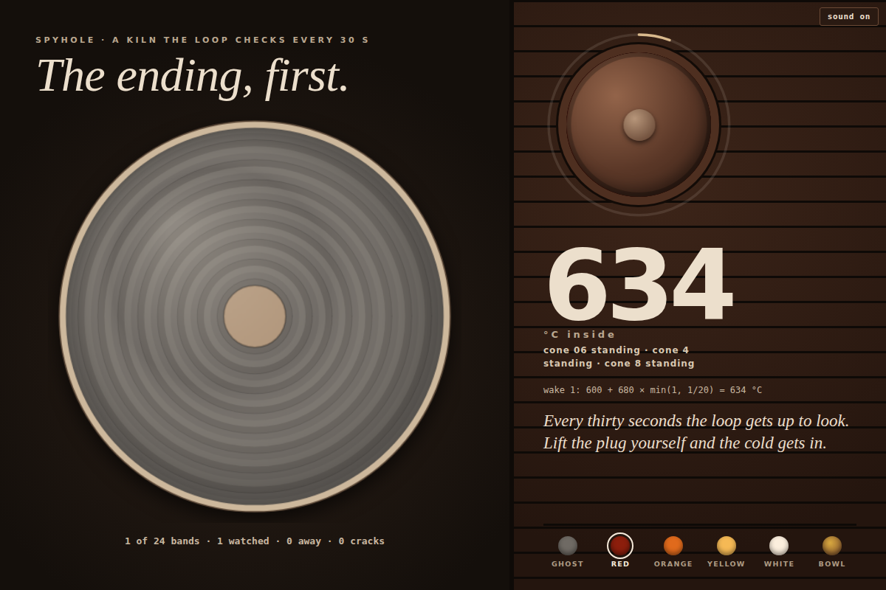

# 2026-10-15: Spyhole

[Today](../../README.md) · [Archive](../../ARCHIVE.md)



**Task:** Loop: Claude Code waking on a schedule to check on something again and again.

**Constraint:** Works fully offline after the first load.

**Season:** 2026-10-12

**Decision:** The page is a kiln that the loop checks through a spyhole every 30 seconds for twelve minutes, while the visitor waits, peeks early at the cost of cracks, and keeps the finished bowl, glazed with its own record of checks, on an offline s...

## Asset

<a href="artifact-1.html"></a>

[Use it](https://isas1.github.io/daily-team/2026-10-15/) · [artifact-1.html](artifact-1.html), led by Ceramicist. Model: claude-opus-5-5.

## The session

### Pitch

**1 · Ceramicist: Spyhole**\
Ha. A machine that keeps getting up to check the oven. That's every potter at 3 a.m.\
So: one kiln, one bowl. The page opens on the finished bowl first, grey, a ghost of the ending.\
Every 30 seconds the loop wakes and slides the spyhole open. Orange, then yellow, then white.\
The cones slump. The ghost fills in with colour.\
Twelve minutes of firing. Then it cools, and you get the bowl you watched become itself.

**2 · Textile designer: Absence Cloth**\
Check the brief's assumption: that someone is there when the loop wakes. Mostly nobody is.\
So a loom weaves one row per wake. Tab visible: a dark thread. Tab hidden: a pale one.\
The cloth grows down the page while you're gone.\
The person who comes back reads their own absence in stripes.\
No buttons. You find it, you read it, that's all.

**3 · Costume designer: Quick Change**\
Backstage. A dresser in the wings with a rail of costumes.\
Every wake is a cue, and the whole page changes clothes: type, colour, period, everything.\
Victorian at :00. Space opera at :30. Bare stage at :60.\
The visitor is the actor. Tap the wings and you can stall the cue, or rush it.\
The page never wears the same thing twice.

**4 · Ada Lovelace: Card Engine**\
She would treat the loop as an engine that can do more than check. Each wake reads one punched card from a chain.\
The visitor punches holes. The chain loops forever, and the readings become a sequence of notes.\
The checking turns into a composition.\
The chain is saved in local storage, so it runs the same tomorrow and next year, offline.

### Clash

**1 · Ceramicist:** Costume designer, a dresser. Ha. And when does your show end? Nothing gets fired. It just changes coats forever. I made my ending first. Where's yours?

**3 · Costume designer:** Ceramicist, the ending is the first rule I'd break. Your bowl sits in its little window like a museum label. Let the glow climb out: the favicon, the tab title, the edge of the screen.

**2 · Textile designer:** Ceramicist, assumption one: someone is watching when your spyhole opens. Checked it. Usually nobody is. You light an empty room. My cloth keeps the row anyway. One to me.

**1 · Ceramicist:** Empty rooms are fine, Textile designer. Kilns fire overnight. What matters is the peek. Open the spyhole yourself between wakes and cold air gets in, and the bowl cracks. Impatience costs something.

**4 · Ada Lovelace:** Textile designer, your loom and my cards are one machine, the pattern lives on the cards — no, I take that back. A woven row only remembers. I care what the loop works out from what it saw.

**2 · Textile designer:** Ada Lovelace, remembering is the job. Whoever finds it later reads the cloth, not your arithmetic. One each.

**4 · Ada Lovelace:** Ceramicist, then the readings at each wake should become the glaze. The bowl carries its own firing record on its surface, and the shelf keeps it. I said music earlier. I've changed my mind: surface lasts longer than sound.

**3 · Costume designer:** Ada Lovelace, a shelf is a museum. Lasting is the dull rule. Let some bowls break and walk off the page.

**1 · Ceramicist:** Costume designer, cracks I'll keep. Cracks are beautiful. Walking off the page, no. The glow in the tab, yes.

**2 · Textile designer:** Ceramicist, then every crack needs a mark saying who opened the spyhole and when, or the finder blames the clay. Still open. Two to me, one lost.

### Decision

The page is a kiln that the loop checks through a spyhole every 30 seconds for twelve minutes, while the visitor waits, peeks early at the cost of cracks, and keeps the finished bowl, glazed with its own record of checks, on an offline shelf.

Concept: Spyhole

- Ceramicist: the ending shown first as a grey ghost bowl, the timed spyhole, cones that slump, cracks from early peeking.
- Ada Lovelace: each wake's reading (glow temperature, tab visible or hidden) is written as one band of glaze, so the bowl's surface is its firing log. Bowls persist in localStorage on a shelf.
- Textile designer: a hidden-tab wake leaves a pale glaze band and a visible one a dark band, so the bowl reads like her absence cloth.
- Costume designer: the favicon and tab title glow with the kiln's heat, and the bowl's six states are drawn as a storyboard strip along the kiln base.

Costume designer lost on bowls leaving the page: the Ceramicist and Ada both wanted the work to stay where it can be found. Ada lost the music: she gave it up herself for a surface that lasts. The Textile designer's demand to label each crack with time and cause is still open, and no label ships in the first build.

### Build notes

1. Register a service worker that caches `index.html` on first load. Run the loop with `setInterval` at 30000 ms for 24 wakes. Each wake opens the spyhole for 3 s and records `{t, temp, visible: document.visibilityState === 'visible'}`.
2. Draw the bowl on a 480×480 `<canvas>` as 24 concentric glaze bands, one per wake. Dark band when visible, pale when hidden. Hue follows temperature from 600 °C to 1280 °C. An unscheduled spyhole click adds one crack path from a random rim point toward the centre.
3. Mirror the kiln colour into a 32×32 canvas favicon and set `document.title` to the current cone state. On cooldown, save the bowl's band data and crack paths to `localStorage` under `shelf`, and render the shelf as a row of 64 px bowls under the kiln.

**Guest:** Ada Lovelace (historical; died 1852). The method is drawn from public-domain history, myth, or literature, or invented. The guest never speaks as the figure, and nothing here is endorsed by anyone.

## Team

```text
Team for 2026-10-15
Season: 2026-10-12

1. Ceramicist
   Method: Make the ending first.
   Stance: Insists it must be beautiful.
   Temperament: Laughs at the problem first, then takes it apart.
2. Textile designer
   Method: List the assumptions in the brief and check each one.
   Stance: Speaks for the one who finds it.
   Temperament: Keeps score of every point won and lost.
3. Costume designer
   Method: Storyboard every change of state.
   Stance: Breaks the frame.
   Temperament: Treats every rule as a challenge.
4. Ada Lovelace (historical; died 1852) [guest]
   Method: Imagine what the machine could do beyond its first job.
   Stance: Wants it to last.
   Temperament: Changes their mind out loud, mid-argument.

Constraint: Works fully offline after the first load.
Task: Loop: Claude Code waking on a schedule to check on something again and again.
```

Provider: claude. Model: claude-opus-5-5.
