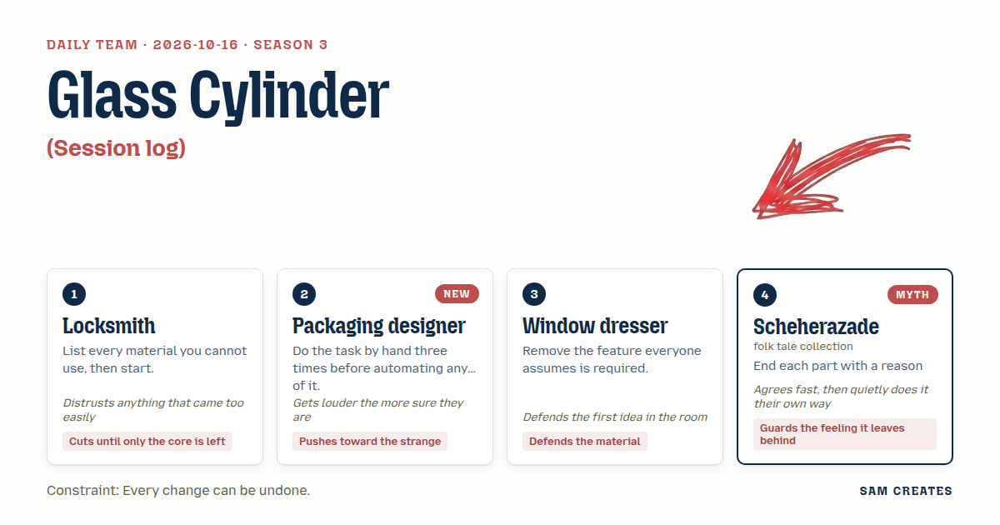

# 2026-10-16: Glass Cylinder

[Today](../../README.md) · [Archive](../../ARCHIVE.md)



**Task:** Session log: the trail a Claude Code session leaves behind it.

**Constraint:** Every change can be undone.

**Season:** 2026-10-12

**Decision:** The page is a clear glass lock cylinder with one pin for each step of a recorded Claude Code session; the visitor lifts the pins in reverse order, each lifted pin slides one object in a small shop-window scene back to its starting mark, ...

## Asset

<a href="artifact-1.html"></a>

[Use it](https://isas1.github.io/daily-team/2026-10-16/) · [artifact-1.html](artifact-1.html), led by Locksmith. Model: claude-opus-5-5.

## The session

### Pitch

**1 · Locksmith: Reverse Pick**\
What I can't use: a scrollbar, a timestamp column, a search box, green and red status dots.\
The session is a lock. Every edit it made pushed one pin down.\
Undo is the pick. Pick in reverse order or the cylinder binds.\
Last pin set, the plug turns, and you stand in the folder as it was before the session started.\
A log that opens on one click is lying to you.

**2 · Packaging designer: Fold Record**\
I printed a real session and folded it by hand. Three times. On my desk.\
Every tool call is a crease. Edit is a valley fold. Bash is a mountain fold. Read is a score line.\
By the last call the log is a crushed little packet in the middle of the screen.\
You unfold it crease by crease. The flat sheet comes back.\
The crease lines stay on the paper. THAT is the trail.

**3 · Window dresser: Night Window**\
A shop window after closing. The session worked in it all night.\
A lamp moved. A dummy turned. A price card swapped for another.\
No text anywhere. Nobody reads logs. People stop and look at windows.\
Drag the glass toward morning and each object slides back to its mark.\
The objects carry the record. The words go.

**4 · Scheherazade: One Edit a Night**\
Every night the session made one change, and then it stopped before the next.\
You come to me and I tell you that night: the file it opened, the line it set down, the line it put aside.\
I end each telling at the door of the night before.\
You may ask me to unsay a night, and I will unsay it.\
Then you will want to know what came before it.

### Clash

**1 · Locksmith:** Packaging designer, your crease stays after the unfold. Then the change isn't undone. The rule says every change.

**2 · Packaging designer:** Locksmith, the FILE is undone. The paper remembers. A trail that wipes itself is no trail. I'm SURE of this.

**3 · Window dresser:** Scheherazade, your tale is all words, and a log is already words. Put the objects in the window and let them speak.

**4 · Scheherazade:** Yes, objects. A lamp can tell a night as well as a mouth can. I will keep one line beside each lamp, only one.

**1 · Locksmith:** Scheherazade, your unsaying waits for the next telling. That's a toll on the door. I don't trust a door that charges.

**4 · Scheherazade:** Then call it a pin that will not lift until the one above it is touched. Locksmith, you already build that.

**3 · Window dresser:** Locksmith, pins sit inside brass where nobody sees them. The window shows everything. Keep the window.

**1 · Locksmith:** Then cut the brass. Clear glass cylinder. The pins are the window.

**2 · Packaging designer:** Window dresser, your objects slide home too clean. Leave a SCUFF on the floor where the lamp stood.

**3 · Window dresser:** Packaging designer, a window floor is swept every morning before the shop opens. No scuffs. That's the work.

### Decision

The page is a clear glass lock cylinder with one pin for each step of a recorded Claude Code session; the visitor lifts the pins in reverse order, each lifted pin slides one object in a small shop-window scene back to its starting mark, and one line of tale says what that step did and ends on the step before it.

Concept: Glass Cylinder

- Locksmith: the cylinder, the strict reverse order, and the bind. A pin lifted out of turn jams for 600 ms and drops back. The plug turns only when all 14 pins are set.
- Packaging designer: each pin's cut follows its tool. Edit pins are V-cut, Bash pins are peaked, Read pins are flat-scored. A pin can be pressed back down to redo its step.
- Window dresser: the scene sits behind the cylinder: lamp, dummy, price card, shelf, crate. Each object stands for a file. There is no log list and no timestamps.
- Scheherazade: one line per pin, shown only while that pin is up. Each line closes on the step before it. The last line is about the empty folder.
- Window dresser lost the wordless window. Without a line pulling the visitor to the next pin, the reverse order reads as a locked door, not a trail.
- Packaging designer lost the permanent crease. A mark that cannot be lifted is a change that cannot be undone. Scuffs appear when an object moves home, and pressing its pin down again clears them. The scuff argument stays open: Window dresser still wants the floor bare.

### Build notes

1. Write `session.json` with 14 steps from a real session: tool name (Read, Edit, Bash), file path, one-line tale, object id, start and end coordinates. Render the cylinder as one SVG, 720 x 240, with pins as `<rect>` elements cut by tool type.
2. Wire input in `pick.js`. Click or tap lifts a pin. The left and right arrows move focus between pins. Space lifts or presses the focused pin. An out-of-order lift plays the 600 ms bind and an `aria-live` note reading "binds". Every action pushes to an undo stack, so redo always works.
3. Animate objects with CSS transforms over 400 ms. Draw each scuff as a 30% opacity ellipse that is removed on redo. When all pins are set, rotate the plug 90 degrees and fade the window to the empty-folder scene. A single "press all pins" control replays the session forward at one step per 300 ms.

**Guest:** Scheherazade (myth; folk tale collection). The method is drawn from public-domain history, myth, or literature, or invented. The guest speaks in character in original words, never quoting the source, and nothing here is endorsed by anyone.

## Team

```text
Team for 2026-10-16
Season: 2026-10-12

1. Locksmith
   Method: List every material you cannot use, then start.
   Stance: Cuts until only the core is left.
   Temperament: Distrusts anything that came too easily.
2. Packaging designer
   Method: Do the task by hand three times before automating any of it. [new]
   Stance: Pushes toward the strange.
   Temperament: Gets louder the more sure they are.
3. Window dresser
   Method: Remove the feature everyone assumes is required.
   Stance: Defends the material.
   Temperament: Defends the first idea in the room.
4. Scheherazade (myth; folk tale collection) [guest]
   Method: End each part with a reason to come back.
   Stance: Guards the feeling it leaves behind.
   Temperament: Agrees fast, then quietly does it their own way.

Constraint: Every change can be undone.
Task: Session log: the trail a Claude Code session leaves behind it.
```

Provider: claude. Model: claude-opus-5-5.
