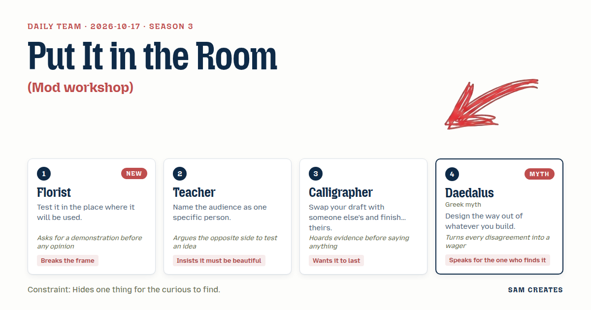

# 2026-10-17: The Cold Room

[Today](../../README.md) · [Archive](../../ARCHIVE.md)



**Task:** Mod workshop: a place to build a Claude Code mod from parts.

**Constraint:** Hides one thing for the curious to find.

**Season:** 2026-10-12

**Decision:** The page is a florist's cold room where the visitor pulls part-stems from buckets and arranges them in a vase that is a live mock Claude Code session, watching each part bloom or droop as the session runs.

## Asset

<a href="artifact-1.html"></a>

[Use it](https://isas1.github.io/daily-team/2026-10-17/) · [artifact-1.html](artifact-1.html), led by Florist. Model: claude-opus-5-5.

## The session

### Pitch

**1 · Florist: The Cold Room**\
Buckets along the wall. Each bucket holds one kind of stem: hooks, slash commands, a statusline, a subagent.\
You pull a stem and put it in the vase. The vase is a running terminal.\
The statusline blooms at the bottom edge. The hook fires on the next prompt.\
Wrong pairing, the stem droops. You see it fail in the room where it lives.\
Nothing gets judged on the bench. Only in water.

**2 · Teacher: A Primer for Mira**\
Mira. Second year. Installed Claude Code last week. Scared to touch settings.json.\
A picture book, one part per spread, cream paper, a single ink colour.\
She turns a page and a line of her mod writes itself in the margin.\
Last page, the whole mod, set like a poem.\
If it isn't lovely she closes the book. I won't let her.

**3 · Calligrapher: The Relay Scroll**\
You open the page and find a mod someone else left half-written.\
You finish it. One brush, no eraser, every line stays.\
Then you leave yours half-done for whoever comes next to this screen.\
The scroll gets longer and never shorter.\
Settings files outlive the people who wrote them. The page should know that.

**4 · Daedalus: The Labyrinth with a Thread**\
Every part you place raises a wall. Hooks, rules, agents: corridors.\
Build as deep as you like. The maze is yours.\
Before any wall stands, you must draw the passage back out: the line that undoes it.\
No exit, no wall. That is the bargain.\
Somewhere a thread lies on the floor for the one who looks down.

### Clash

**1 · Florist:** Calligrapher, show me the swap working. Hand me a half-built mod now and I'll tell you if I'd finish it or bin it.

**3 · Calligrapher:** I have three of my own drafts a second hand improved and two it ruined. I'm keeping the count. Your vase is dead by Thursday. I won't build a thing made to rot.

**1 · Florist:** It rots so you look at it today. A mod that sits perfect in a drawer has never met a terminal.

**2 · Teacher:** Then I'll argue against you both. Mira wants neither a vase nor a scroll. She wants one part per page and someone telling her it's safe.

**4 · Daedalus:** Safe is a door, Teacher. I wager a feather Mira tries the walls before she reads a single caption. Give each part its way back and she'll go anywhere.

**2 · Teacher:** Taken. If she reads first, the captions must be good enough to deserve her. I'll write them to her by name.

**3 · Calligrapher:** Daedalus, an exit on every stem tells her nothing lasts. That's a lie about settings files. People keep them for years.

**4 · Daedalus:** They keep them because they can't find the door. Hide one door well and whoever finds it trusts the rest.

**1 · Florist:** Prove it in the vase. Put the cut ends where she'll see them the moment she lifts a stem.

**2 · Teacher:** Wilting will frighten her. You're showing her the one thing she fears, a mod that breaks.

### Decision

The page is a florist's cold room where the visitor pulls part-stems from buckets and arranges them in a vase that is a live mock Claude Code session, watching each part bloom or droop as the session runs.

Concept: The Cold Room

- Florist: the buckets, the vase-as-terminal, and drooping as the only verdict. A stem is never judged on the bench, only in the running session.
- Teacher: every bucket tag is a two-line note addressed to Mira. The palette is cream, slate, and one green.
- Calligrapher: when the visitor clicks "press", the arrangement flattens into a card showing the finished settings.json in a single brush-weight font. The card is stored in localStorage and stays in the corner on the next visit.
- Daedalus: each stem's cut end, seen when it is lifted, shows the line that removes it. The hidden thing is a seventh bucket at the bottom of the scroll that looks empty. It holds one stem tagged "for the one who looked down". Placed in the vase, it prints the full uninstall for the arrangement as a thread unwinding across the terminal.
- Calligrapher lost the no-undo scroll. The Florist held that a part has to be tried alive, and a living arrangement must let stems come back out. Teacher lost the book structure because one page at a time keeps Mira from seeing parts collide, and collisions are what she needs to see. Teacher's objection to wilting stands. Drooping stays in.

### Build notes

1. Build six buckets: hook, slash command, statusline, output style, subagent, permission rule, with three stems each, plus the hidden seventh. Each stem object holds `{name, tag, effect, cutEnd, conflictsWith}`.
2. Render the vase as a 60x18 monospace pane that replays a scripted session every 8 seconds. Each placed stem changes the replay: the statusline line appears, the hook echoes, a denied tool shows a rule. A stem in `conflictsWith` tilts 30 degrees over 2 seconds and greys out.
3. On lift, flip the stem to show `cutEnd` in the bottom 20px. The "press" button serializes the vase to JSON, draws the card, and writes it to `localStorage['coldroom.pressed']`.

**Guest:** Daedalus (myth; Greek myth). The method is drawn from public-domain history, myth, or literature, or invented. The guest speaks in character in original words, never quoting the source, and nothing here is endorsed by anyone.

## Team

```text
Team for 2026-10-17
Season: 2026-10-12

1. Florist [new]
   Method: Test it in the place where it will be used.
   Stance: Breaks the frame.
   Temperament: Asks for a demonstration before any opinion.
2. Teacher
   Method: Name the audience as one specific person.
   Stance: Insists it must be beautiful.
   Temperament: Argues the opposite side to test an idea.
3. Calligrapher
   Method: Swap your draft with someone else's and finish theirs.
   Stance: Wants it to last.
   Temperament: Hoards evidence before saying anything.
4. Daedalus (myth; Greek myth) [guest]
   Method: Design the way out of whatever you build.
   Stance: Speaks for the one who finds it.
   Temperament: Turns every disagreement into a wager.

Constraint: Hides one thing for the curious to find.
Task: Mod workshop: a place to build a Claude Code mod from parts.
```

Provider: claude. Model: claude-opus-5-5.
