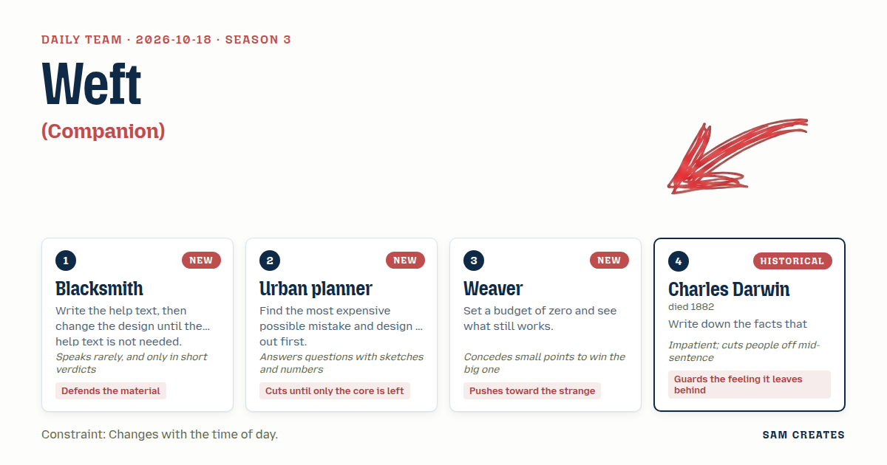

# 2026-10-18: Weft

[Today](../../README.md) · [Archive](../../ARCHIVE.md)



**Task:** Companion: a Claude Code mod that keeps someone company while they work.

**Constraint:** Changes with the time of day.

**Season:** 2026-10-12

**Decision:** The page is a narrow terminal-side loom where every line the visitor types is woven as one row of cloth in the colour of that hour's outdoor light, a long pause ties a knot, and the visitor cuts the strip to end the session and keep it.

## Asset

<a href="artifact-1.html"></a>

[Use it](https://isas1.github.io/daily-team/2026-10-18/) · [artifact-1.html](artifact-1.html), led by Blacksmith. Model: claude-opus-5-5.

## The session

### Pitch

**1 · Blacksmith: Bank Fire**\
A dark pane beside your editor. A forge in it.\
Each key you press is a hammer blow on a bar.\
Dawn: kindling. Noon: white heat. Midnight: coals, banked.\
No words on the screen.\
Quench to end. The bar cools into one line of your day.

**2 · Urban planner: Window Across the Street**\
Sketch: one apartment block, 6 floors, 4 windows each. 24 lights.\
Each light is a stranger also working. It follows your local clock.\
At 09:00, 20 lit. At 03:00, 1. Yours.\
The worst mistake is a companion that interrupts. Cost: about 23 minutes of focus each time.\
So it never speaks, never pings, never moves on its own. It only stays lit.

**3 · Weaver: Weft**\
No fire, no city, no pictures. One thread.\
Every line you type becomes one row of cloth, 80 threads wide.\
The thread takes the colour of the light outside at that hour.\
Grey-blue dawn. Bleached noon. Copper under a 3 a.m. street lamp.\
When you stop, you cut it. You keep a strip of your session.

**4 · Charles Darwin: Field Notes on One Worker**\
A small observer that keeps a notebook on you.\
It begins with a guess: when you work best, how long you stop.\
Then it writes down only the moments that break the guess.\
You worked at 4 a.m. You paused 40 minutes and came back faster.\
At the end you read the list of what surprised it. You come away feeling watched closely and kindly.

### Clash

**2 · Urban planner:** Blacksmith, your fire cools when they stop. Run the numbers: twenty minutes of thinking and the forge is dead. That is a guilt machine.

**1 · Blacksmith:** Iron cools. That part is true.

**3 · Weaver:** Fine, I give you the cooling, it's honest. But Urban planner, twenty-four strangers' windows is still a picture of other people's—

**4 · Charles Darwin:** Other people's lives. Yes. And here is the fact against all of us: people say they want company, then they mute anything on screen that moves. A full block at 2 a.m. would be muted too.

**2 · Urban planner:** Then nothing moves unless their hands move. Zero idle animation. Cloth grows on a keystroke or not at all.

**3 · Weaver:** Agreed, it grows only from their hand. But the pause has to show somewhere. Darwin, your surprises become knots in the cloth.

**4 · Charles Darwin:** Knots, good. But copper and violet at night is you decorating. The colour has to be the real light at that hour, dim and dull, or the—

**3 · Weaver:** Copper at 3 a.m. is the real light. Go stand under a sodium lamp.

**1 · Blacksmith:** Cloth. No labels. The shuttle is the cursor.

**2 · Urban planner:** Then where is the exit, Blacksmith. A strip that never ends is a road with no off-ramp.

### Decision

The page is a narrow terminal-side loom where every line the visitor types is woven as one row of cloth in the colour of that hour's outdoor light, a long pause ties a knot, and the visitor cuts the strip to end the session and keep it.

Concept: Weft

- Blacksmith: no help text anywhere. The shuttle sits where the cursor is, and its position is the only instruction.
- Urban planner: zero idle motion and zero messages. The cloth changes only on a keystroke or a cut.
- Weaver: the cloth, 80 threads wide, one row per line, colour taken from the hour, including copper after midnight.
- Charles Darwin: knots. The loom keeps a running guess of the visitor's usual pause, and only pauses that break the guess get a knot. Hovering a knot shows its time and length.
- Blacksmith lost the forge, because a fire that dies when you stop punishes thinking. Urban planner lost the windows, because company that is always visible gets muted. The night palette and the ending stay open: Darwin wants dull night colours, Weaver keeps copper for now, and the cut stays manual against Urban planner's wish for an automatic end.

### Build notes

1. Build a 320px-wide canvas beside a fake editor pane. On each Enter, draw one row of 80 thread cells. The colour comes from a 24-stop table keyed to `new Date().getHours()` and interpolated by minutes. Stops include 05:00 `#7d8aa0`, 12:00 `#e8e4d8`, and 03:00 `#b5652e`.
2. Track the gaps between keystrokes as a rolling median over the last 30 gaps. When a gap exceeds 4× the median and is at least 90 seconds, draw a 3-row knot at the next row and store `{time, length}` for the hover tooltip. Nothing animates between keystrokes.
3. Cut on `Esc`, or by dragging the shuttle off the bottom edge. The strip detaches, rotates 90°, and offers itself as a PNG download named `weft-YYYY-MM-DD-HHMM.png`. A new empty warp starts in the current hour's colour.

**Guest:** Charles Darwin (historical; died 1882). The method is drawn from public-domain history, myth, or literature, or invented. The guest never speaks as the figure, and nothing here is endorsed by anyone.

## Team

```text
Team for 2026-10-18
Season: 2026-10-12

1. Blacksmith
   Method: Write the help text, then change the design until the help text is not needed. [new]
   Stance: Defends the material.
   Temperament: Speaks rarely, and only in short verdicts.
2. Urban planner
   Method: Find the most expensive possible mistake and design it out first. [new]
   Stance: Cuts until only the core is left.
   Temperament: Answers questions with sketches and numbers.
3. Weaver [new]
   Method: Set a budget of zero and see what still works.
   Stance: Pushes toward the strange.
   Temperament: Concedes small points to win the big one.
4. Charles Darwin (historical; died 1882) [guest]
   Method: Write down the facts that disagree with you first.
   Stance: Guards the feeling it leaves behind.
   Temperament: Impatient; cuts people off mid-sentence.

Constraint: Changes with the time of day.
Task: Companion: a Claude Code mod that keeps someone company while they work.
```

Provider: claude. Model: claude-opus-5-5.
