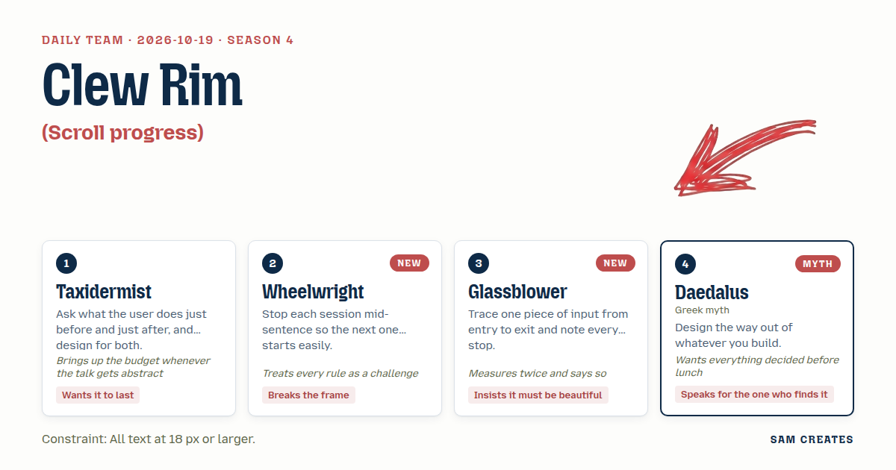
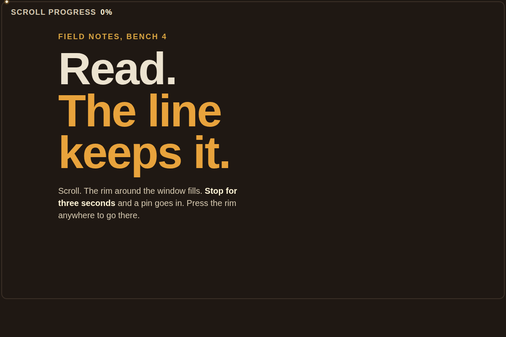

# 2026-10-19: Clew Rim

[Today](../../README.md) · [Archive](../../ARCHIVE.md)



**Task:** Scroll progress: a thin line that shows how much of a page is read.

**Constraint:** All text at 18 px or larger.

**Season:** 2026-10-19

**Decision:** The page is a 2 px line that runs around all four edges of the window, cooling behind its hot head as you read, leaving persistent knots where you paused, and pressing any knot or point on it takes you back there.

## Asset

<a href="artifact-1.html"></a>

[Use it](https://isas1.github.io/daily-team/2026-10-19/) · [artifact-1.html](artifact-1.html), led by Taxidermist. Model: claude-opus-5-5.

## The session

### Pitch

**1 · Taxidermist: The Mounted Line**\
Before the page, they came from somewhere. After it, they leave with something half-read.\
So the line keeps what they read. Read spans set hard, like a skin on a form.\
Where they stopped, a pin goes in. The pin is still there next week.\
Close the tab, come back in October, the line still knows.\
One thin bar, one colour for set, one for fresh. That fits the budget.

**2 · Wheelwright: Rim**\
Why is the line at the top? Who wrote that rule?\
Run it round all four edges of the window. A tyre on the page.\
Each section is a felloe, a curved piece of rim. You fill them one by one.\
Stop reading and the felloe stays half-joined. Unfinished on purpose.\
Next time you see the open joint and you want to close it.

**3 · Glassblower: Annealing Line**\
The head of the line is hot. Orange, almost white.\
Behind it the glass cools: amber, then clear, then a faint blue-grey.\
Scroll fast and the head runs hotter. Stop and it settles.\
I followed one wheel tick from input to paint: event, frame, length, colour. Five stops.\
Nothing on the screen but that one cooling thread.

**4 · Daedalus: The Clew**\
I built a house no one could leave. I will not build another.\
The line is a thread you paid out as you went in. Press any point on it and you are back there.\
At the end, the thread must show a door. Not a wall. A door.\
I speak for the one who arrives late, halfway down, lost.\
They should see the way back at a glance. Decide it before the meal.

### Clash

**2 · Wheelwright:** Taxidermist, your pins sit at clean stops. A wheel parked at the end of a spoke is hard to roll again. Put the pin mid-felloe.

**1 · Taxidermist:** A pin mid-sentence is still a pin, Wheelwright. What I fear is a line that forgets. And four edges means four corners of path maths in one afternoon.

**3 · Glassblower:** I traced it twice, Wheelwright. Scroll, frame, length along path, corner. At a square corner the hot head snaps 90 degrees. Glass never does that. Radius 12 px or it is ugly.

**4 · Daedalus:** Glassblower, beauty can wait. The late arrival needs the way back. The thread must answer a press. Settle it now.

**3 · Glassblower:** A 2 px thread is a target no thumb finds, Daedalus. I measured. The line stays 2 px. The hit band is 24 px.

**2 · Wheelwright:** Daedalus, a rim has no end. The head meets its own tail. Why a door at all?

**4 · Daedalus:** A loop with no way out is the mistake I already made, Wheelwright. At full, the rim parts at the lower right. That gap is the door.

**1 · Taxidermist:** Daedalus, the pins persist across visits, and that is your way back. The door costs one animation. We pay it. Glassblower, cooling is one gradient. Cheap.

**3 · Glassblower:** One gradient is a sticker, Taxidermist. Cooling follows time since the head passed, not position. A slow reader's line stays warm longer. I will not ship a sticker.

### Decision

The page is a 2 px line that runs around all four edges of the window, cooling behind its hot head as you read, leaving persistent knots where you paused, and pressing any knot or point on it takes you back there.

Concept: Clew Rim

- Taxidermist: knots set wherever the reader pauses 3 seconds or more, stored per page, still there on the next visit.
- Wheelwright: the line is a rim around the full viewport perimeter. Knots sit where the reader actually stopped, mid-section, mid-sentence.
- Glassblower: the head is hot and the line cools by elapsed time, on 12 px rounded corners.
- Daedalus: the line answers press, click, and keyboard. At 100% the rim parts at the lower right into a 40 px gap.

Wheelwright lost the endless loop: a rim that never opens traps the reader, and Daedalus has built that once. Taxidermist lost the flat gradient: cooling by time stays because a slow reader's warm line is the only form here no other kit would ship. The cost of tracking time per segment stays an open complaint.

### Build notes

1. Draw one SVG `rect` inset 4 px from the viewport with `rx="12"`, stroke 2 px. Set `stroke-dasharray` from `getTotalLength()` times scroll ratio on each `requestAnimationFrame`. Store a timestamp per 1% segment and colour each from #fff4d6 (0 s) through #e8a33c (2 s) to #9aa7b4 (20 s and after). With `prefers-reduced-motion`, show the cooled colour at once.
2. Drop a knot after 3 seconds without scroll. Keep up to 12 per URL in `localStorage`. Each knot is a `button` with a 24 px hit area and an `aria-label` such as "Return to 41%, paused 3 days ago". Hover and focus show the same label at 18 px. Clicking or pressing the 24 px band anywhere along the rim scrolls to that point.
3. The rim is one tab stop. Left and Right arrows move between knots, Enter jumps, Home and End go to 0% and 100%, and Delete removes a knot. States to show: empty (0%), reading, pausing (knot fades in over 3 s), knot focused, complete (the 40 px gap opens at the lower right over 400 ms, labelled "Done. Back to top" at 18 px), and returning visit (old knots shown in cooled grey).

**Guest:** Daedalus (myth; Greek myth). The method is drawn from public-domain history, myth, or literature, or invented. The guest speaks in character in original words, never quoting the source, and nothing here is endorsed by anyone.

## Team

```text
Team for 2026-10-19
Season: 2026-10-19

1. Taxidermist
   Method: Ask what the user does just before and just after, and design for both.
   Stance: Wants it to last.
   Temperament: Brings up the budget whenever the talk gets abstract.
2. Wheelwright [new]
   Method: Stop each session mid-sentence so the next one starts easily. [new]
   Stance: Breaks the frame.
   Temperament: Treats every rule as a challenge.
3. Glassblower
   Method: Trace one piece of input from entry to exit and note every stop. [new]
   Stance: Insists it must be beautiful.
   Temperament: Measures twice and says so.
4. Daedalus (myth; Greek myth) [guest]
   Method: Design the way out of whatever you build.
   Stance: Speaks for the one who finds it.
   Temperament: Wants everything decided before lunch.

Constraint: All text at 18 px or larger.
Task: Scroll progress: a thin line that shows how much of a page is read.
```

Provider: claude. Model: claude-opus-5-5.
