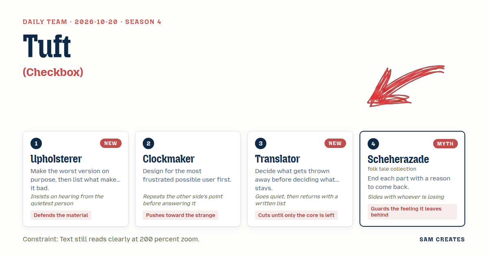
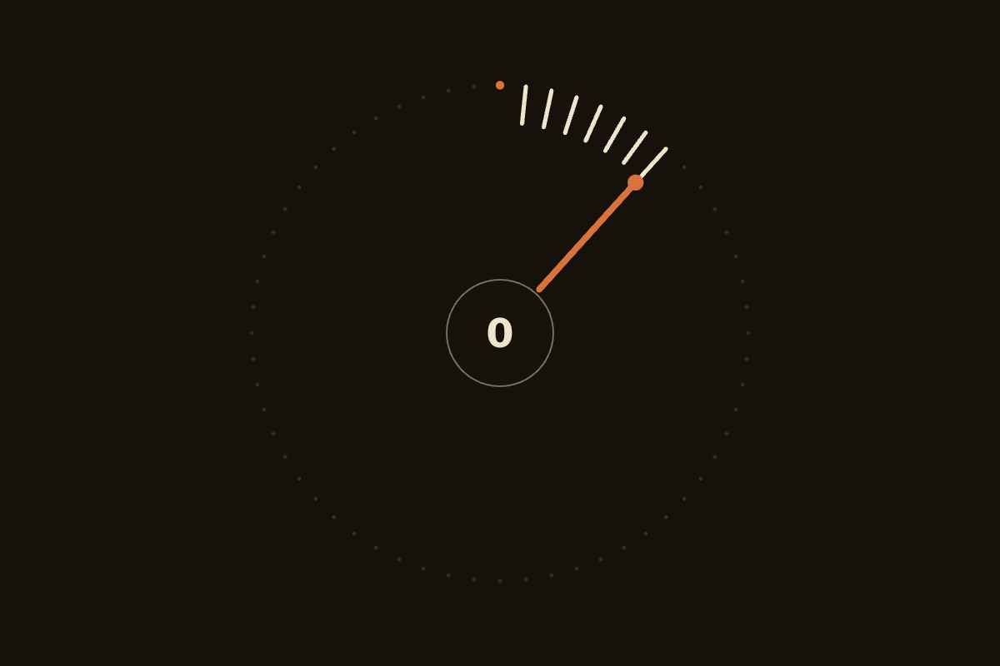
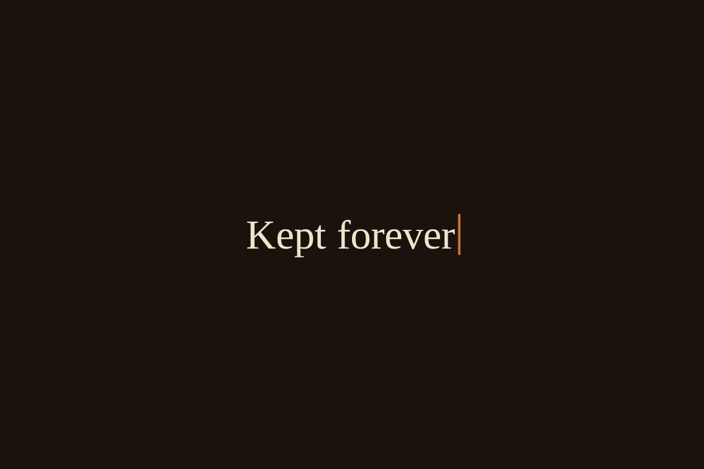
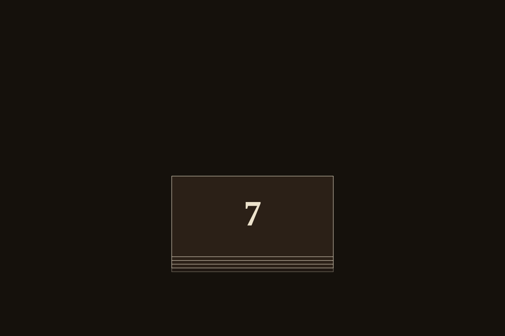

# 2026-10-20: Wrong-Way Reel

[Today](../../README.md) · [Archive](../../ARCHIVE.md)



**Task:** Undo in rewind: a mistake runs back along its own path, the way tape plays in reverse.

**Constraint:** Text still reads clearly at 200 percent zoom.

**Season:** 2026-10-19

**Decision:** The page is a set of four undo controls, each running the visitor's own actions backward the way tape reverses, and the visitor makes marks, then takes them back by dragging a seam ripper, spinning a crown, holding a word, or flinging a ...

## Asset

<a href="artifact-1.html"></a>

[Use it](https://isas1.github.io/daily-team/2026-10-20/) · [artifact-1.html](artifact-1.html), led by Upholsterer. Model: claude-opus-5-5.

<a href="artifact-2.html"></a>

[Use it](https://isas1.github.io/daily-team/2026-10-20/) · [artifact-2.html](artifact-2.html), led by Clockmaker. Model: claude-opus-5-5.

<a href="artifact-3.html"></a>

[Use it](https://isas1.github.io/daily-team/2026-10-20/) · [artifact-3.html](artifact-3.html), led by Translator. Model: claude-opus-5-5.

<a href="artifact-4.html"></a>

[Use it](https://isas1.github.io/daily-team/2026-10-20/) · [artifact-4.html](artifact-4.html), led by Scheherazade. Model: claude-opus-5-5.

## The session

### Pitch

**1 · Upholsterer: Unpicking**\
A seam runs across the page. Every mark the visitor makes pulls one stitch through the cloth.\
Undo is the seam ripper. Drag it left and the thread draws back out through its own holes.\
I built the worst one first. The thread vanished and the cloth went smooth. It lied.\
So the holes stay. Two pinpricks for every stitch you took back.\
The thread drags because cloth grips. Pull hard and it gives, slows, stops.

**2 · Clockmaker: Backlash**\
Picture the person who just lost an hour. They hit undo forty times in a row.\
Give them a crown to spin. Spin it backward and the hands sweep back over every tick.\
The ticks sound reversed. Tock, then tick. The tape is wrong-way round and you can hear it.\
They spin too far, and the hands overshoot, then spring forward to the step they meant.\
One number in the dial: how many steps back.

**3 · Translator: Unsaid**\
First, what goes. The history list. The arrow icon. The menu. The redo.\
What is left: one word, the verb for the last thing you did.\
Hold it. The letters run back out, right to left, like tape leaving the head.\
When the word is empty, the previous verb writes itself in. Keep holding, it keeps going.\
Nothing else on the page.

**4 · Scheherazade: The Thousandth Fold**\
Each thing you do is a night, and the nights lie in a stack.\
Fling the top one upward and it folds back over itself and slides beneath, the way tape spools onto the reel behind.\
But I do not tear the night out. Its corner stays turned down.\
A turned corner is a promise. You may come back for it.\
Only the night number shows. And when you stop flinging, the last fold hangs open a little, waiting.

### Clash

**2 · Clockmaker:** Upholsterer, you say the thread should drag because cloth grips. My frustrated person hears that and feels punished. They want it to fly.

**1 · Upholsterer:** Thread that flies tears the holes wider. The drag is the cloth telling them the truth. Translator, you have said nothing. Say it.

**3 · Translator:** A list. Thrown away from the set, in order: the redo, the holes, the reversed tick, the turned corners.

**4 · Scheherazade:** Then I stand with the holes, since you came for them first. A page with no scars has no story of how it got there.

**1 · Upholsterer:** The holes are the material. Take them out and the seam pretends no one ever sewed it.

**2 · Clockmaker:** Translator, you are saying the core is the last action and nothing more. Then my furious person goes back one step at a time, and they are already shouting.

**3 · Translator:** One step, repeated. Hold longer and it runs further. Tape has no menu and nobody asks for one.

**4 · Scheherazade:** Clockmaker, your hands overshoot the place they wanted to land. That is a small cruelty to someone already hurt.

**2 · Clockmaker:** You call the overshoot cruel. I call it the hands checking they went far enough, and the spring brings them home.

**3 · Translator:** Scheherazade, the corners stay out of mine. Unsaid stays unsaid.

### Decision

The page is a set of four undo controls, each running the visitor's own actions backward the way tape reverses, and the visitor makes marks, then takes them back by dragging a seam ripper, spinning a crown, holding a word, or flinging a night.

Concept: Wrong-Way Reel

| # | Member | Concept | Composition | Input | Motion | Visible text |
|---|---|---|---|---|---|---|
| 1 | Upholsterer | Unpicking | horizontal line | drag | inertia and friction | a number: stitches left |
| 2 | Clockmaker | Backlash | radial | scrub or wheel | spring overshoot | a number: steps back |
| 3 | Translator | Unsaid | single object | press and hold | morph | a short label: the last verb |
| 4 | Scheherazade | The Thousandth Fold | vertical stack | fling | fold | a number: the night |

No two rows share composition, input, and motion. Each row differs on all three.

- Upholsterer: the seam, the thread that drags through its own holes, and the pinprick holes left after every undo.
- Clockmaker: the crown wheel, the reversed tock-tick, and the overshoot that springs back to the intended step.
- Translator: one word on the page, letters leaving right to left, and continuous rewind while held. No redo in this variation.
- Scheherazade: the stack of nights, the backward fold onto the reel, the turned-down corner that acts as redo, and the last fold left slightly open.
- Clockmaker lost the argument over friction in the seam. The holes are the only honest record that cloth keeps, and thread with no drag would remove them. Translator lost the argument over cutting holes and corners from the whole set. That cut holds only inside Unsaid. The question of whether an undone action should be recoverable stays open between Translator and Scheherazade, and the set shows both answers side by side.

### Build notes

1. Size all visible text in `rem`, with a minimum of 1.25rem. Lay out the four controls in a single `flex-wrap` container so they stack into one column at 200 percent zoom. Check each number and the verb at 200 percent zoom in Chrome and Firefox.
2. Share one action log across the page. Clicking empty space adds one action, using a verb from a list of 12. Each control reads that log and rewinds it in its own motion. Upholsterer uses friction 0.92 per frame. Clockmaker uses a spring with stiffness 180 and damping 12. Translator removes one letter every 70 ms. Scheherazade folds with a 420 ms `rotateX`.
3. Give every control a keyboard path, using arrow keys for the seam and the crown, holding Space for the word, and Page Up for the nights. Generate the reversed tick with Web Audio as a 40 ms decaying envelope played backward. Draw the tape-oxide brown `#5a3a22` on cream `#f2ead8`, with contrast at 7:1 or higher for text.

**Guest:** Scheherazade (myth; folk tale collection). The method is drawn from public-domain history, myth, or literature, or invented. The guest speaks in character in original words, never quoting the source, and nothing here is endorsed by anyone.

## Team

```text
Team for 2026-10-20
Season: 2026-10-19

1. Upholsterer
   Method: Make the worst version on purpose, then list what makes it bad. [new]
   Stance: Defends the material.
   Temperament: Insists on hearing from the quietest person.
2. Clockmaker
   Method: Design for the most frustrated possible user first.
   Stance: Pushes toward the strange.
   Temperament: Repeats the other side's point before answering it.
3. Translator
   Method: Decide what gets thrown away before deciding what stays. [new]
   Stance: Cuts until only the core is left.
   Temperament: Goes quiet, then returns with a written list.
4. Scheherazade (myth; folk tale collection) [guest]
   Method: End each part with a reason to come back.
   Stance: Guards the feeling it leaves behind.
   Temperament: Sides with whoever is losing.

Constraint: Text still reads clearly at 200 percent zoom.
Task: Undo in rewind: a mistake runs back along its own path, the way tape plays in reverse.
```

Provider: claude. Model: claude-opus-5-5.
