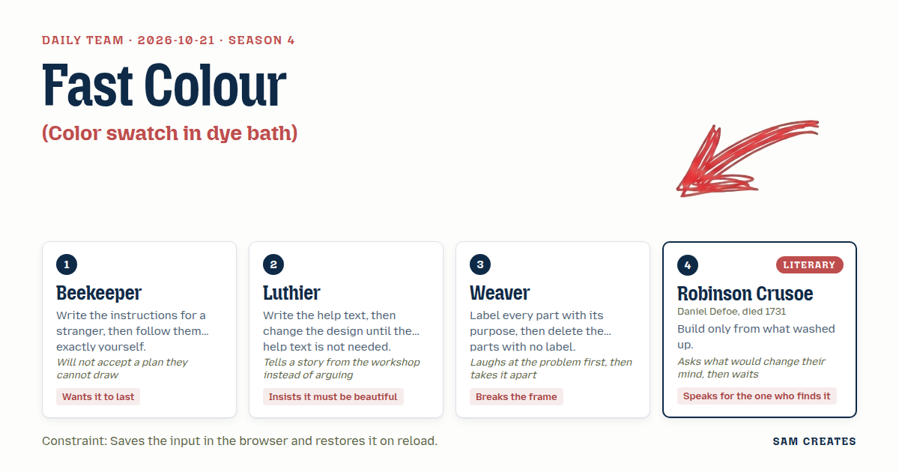
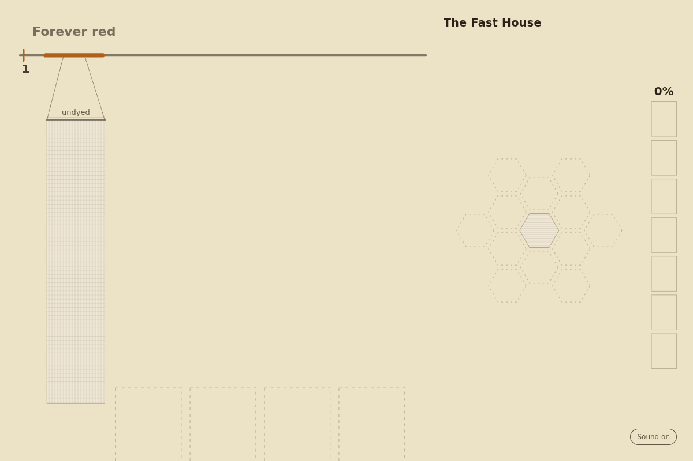
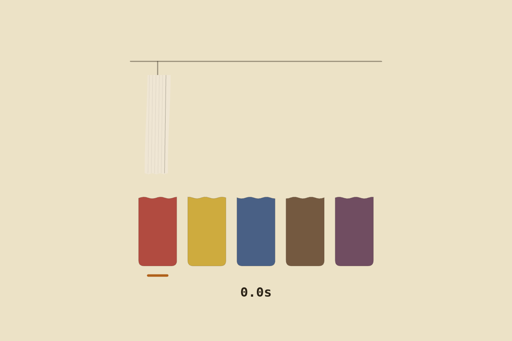
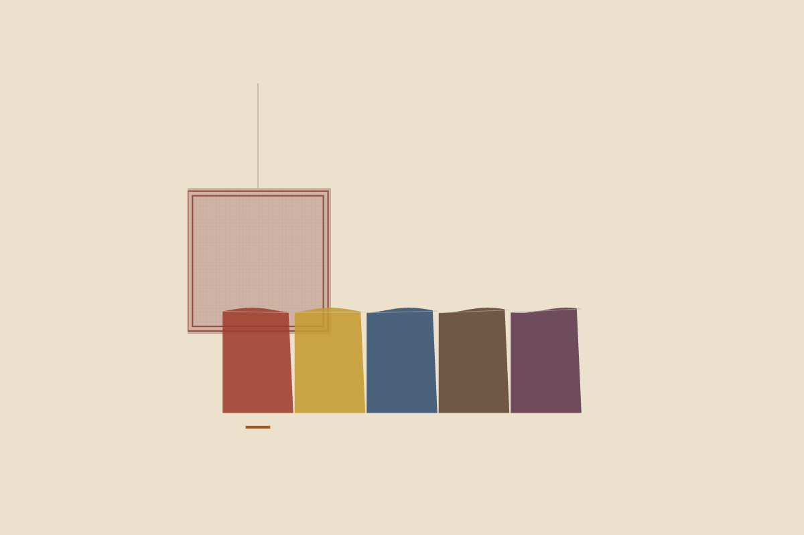
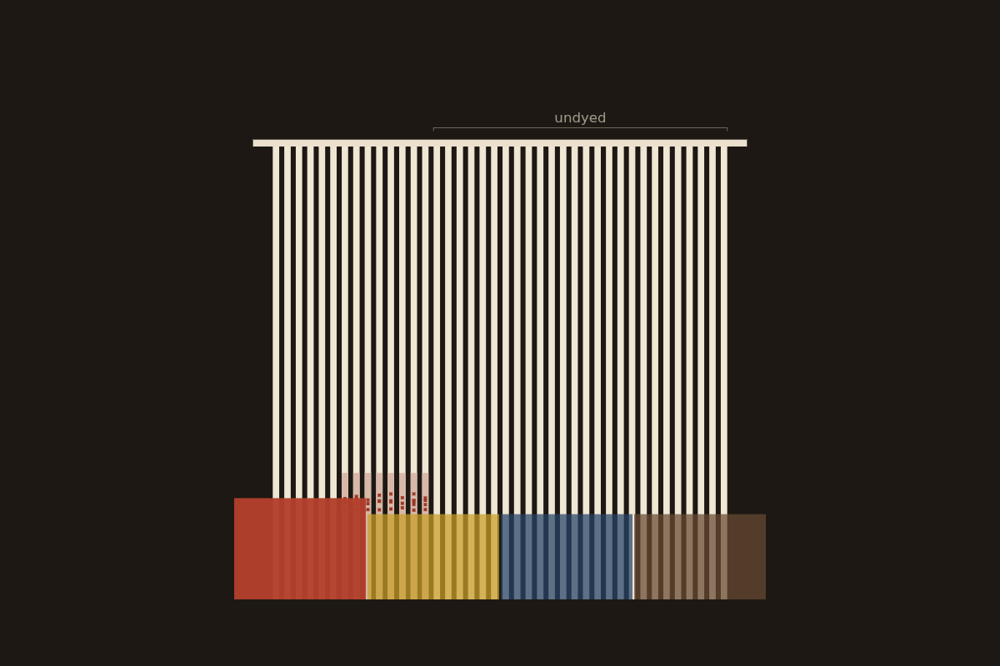
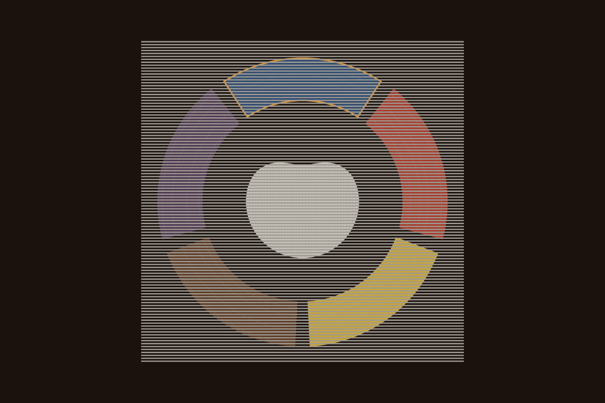
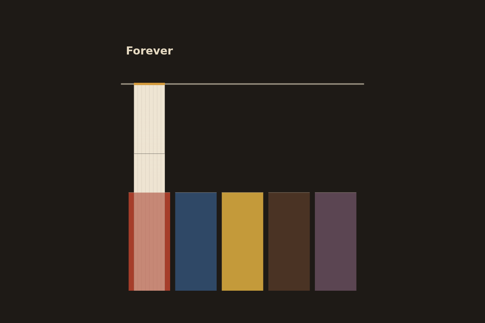
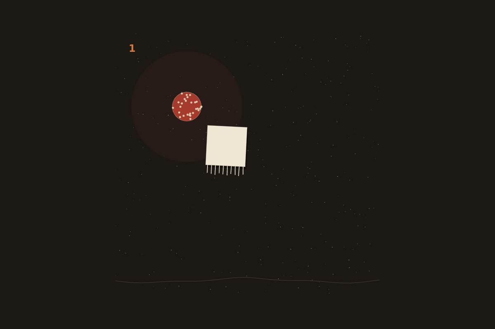
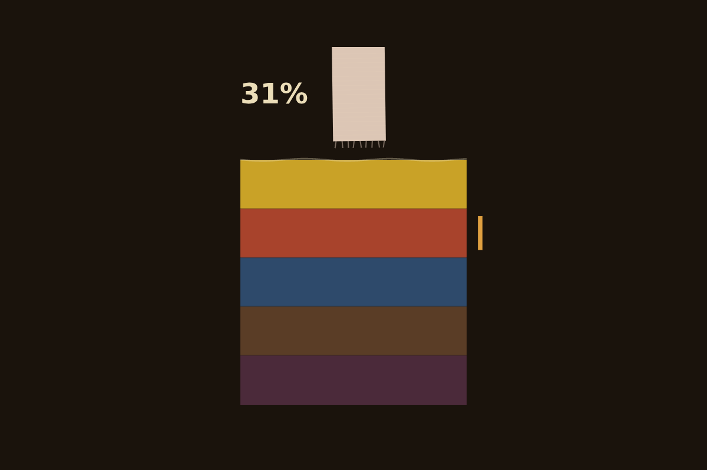
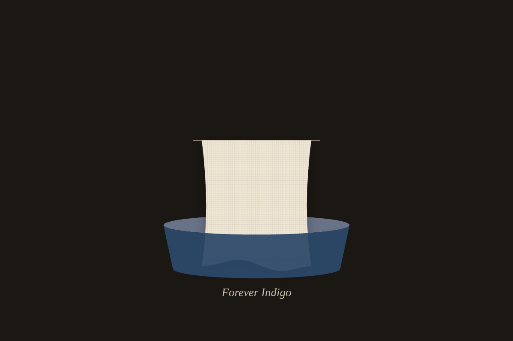

# 2026-10-21: Fast Colour

[Today](../../README.md) · [Archive](../../ARCHIVE.md)



**Task:** Color swatch in dye bath: dip the cloth, and it slowly takes one color from a small set of vats.

**Constraint:** Saves the input in the browser and restores it on reload.

**Season:** 2026-10-19

**Decision:** The page is a dye house where the visitor dips one strip of cloth through a rack of vats that the tide fills by one pot per visit, and the colour the cloth takes is the swatch they pick, kept in the browser until they return.


[Cover art direction](cover.json) · [Cover source](cover.html)

## Asset

<a href="piece.html"></a>

[Use it](https://isas1.github.io/daily-team/2026-10-21/) · [piece.html](piece.html), led by Beekeeper. Model: claude-opus-5-5.

<a href="artifact-1.html"></a>

[Use it](https://isas1.github.io/daily-team/2026-10-21/) · [artifact-1.html](artifact-1.html), led by Beekeeper. Model: claude-opus-5-5.

<a href="artifact-2.html"></a>

[Use it](https://isas1.github.io/daily-team/2026-10-21/) · [artifact-2.html](artifact-2.html), led by Luthier. Model: claude-opus-5-5.

<a href="artifact-3.html"></a>

[Use it](https://isas1.github.io/daily-team/2026-10-21/) · [artifact-3.html](artifact-3.html), led by Weaver. Model: claude-opus-5-5.

<a href="artifact-4.html"></a>

[Use it](https://isas1.github.io/daily-team/2026-10-21/) · [artifact-4.html](artifact-4.html), led by Robinson Crusoe. Model: claude-opus-5-5.

<a href="artifact-5.html"></a>

[Use it](https://isas1.github.io/daily-team/2026-10-21/) · [artifact-5.html](artifact-5.html), led by Beekeeper. Model: claude-opus-5-5.

<a href="artifact-6.html"></a>

[Use it](https://isas1.github.io/daily-team/2026-10-21/) · [artifact-6.html](artifact-6.html), led by Luthier. Model: claude-opus-5-5.

<a href="artifact-7.html"></a>

[Use it](https://isas1.github.io/daily-team/2026-10-21/) · [artifact-7.html](artifact-7.html), led by Weaver. Model: claude-opus-5-5.

<a href="artifact-8.html"></a>

[Use it](https://isas1.github.io/daily-team/2026-10-21/) · [artifact-8.html](artifact-8.html), led by Robinson Crusoe. Model: claude-opus-5-5.

<a href="artifact-9.html"></a>

[Use it](https://isas1.github.io/daily-team/2026-10-21/) · [artifact-9.html](artifact-9.html), led by Beekeeper. Model: claude-opus-5-5.

<a href="artifact-10.html"></a>

[Use it](https://isas1.github.io/daily-team/2026-10-21/) · [artifact-10.html](artifact-10.html), led by Luthier. Model: claude-opus-5-5.

## The session

### Pitch

**1 · Beekeeper: Mordant Rack**\
Five vats in a row, left to right, in the order I'd write on a card for a stranger.\
Card says: hold over a vat and the cloth sinks; let go and it lifts. That's the whole card.\
I followed it myself. Four seconds held, pale. Twelve, deep. The colour climbs slowly, the way comb fills.\
Arrow keys walk the rack, space holds. A finger held on glass does the same.\
Close the tab, come back next morning, and the cloth hangs where you left it, same shade.\
If it fades on reload, it was never dyed.

**2 · Luthier: Varnish Coats**\
One swatch, centred. My first help text read: "Scroll to add a coat. Scroll back to sand one off."\
Then each coat showed at the edge as a thin ring, like growth lines in a cut neck block. The text went.\
Wheel, or scrub with a thumb, lays coats. Each one lands with a small bounce, then goes still.\
The vat is whatever colour sits under the cloth's lower edge.\
It saves coat by coat. Reload, and it's the same depth under your thumb.

**3 · Weaver: Warp Threads**\
Ha. A swatch is a square pretending it isn't made of thread.\
So, forty threads. Each one has a tag naming the vat it went into. A thread with no tag gets cut.\
Drag across the field and only the threads you cross get dipped. Dye wicks up them as specks.\
The colour you've picked is what the cloth averages to when you stand back.\
And it hangs off the bottom of the page. The frame is a loom bar, nothing more.

**4 · Robinson Crusoe: Wreck Pots**\
I had no vats. I had what the morning tide left on the sand, and I kept all of it.\
So the pots stand in a column, one for each landing. First visit, one pot. Each return, the tide brings one more.\
Fling the cloth down the column. It slides past the pots, slows where it will, and takes that colour.\
I cut a notch for every day ashore. The notch count is the only mark on the page.\
Whoever comes after finds the cloth where I left it. That is the saving.

### Clash

**3 · Weaver:** Beekeeper, five vats fixed from the first second. What's the fifth one's label if nobody ever dips it? No label, it goes.

**1 · Beekeeper:** Weaver, draw me the rack without it, then. A stranger has to see the whole row before they hold anything, or the card lies to them.

**4 · Robinson Crusoe:** Beekeeper, you would hand a stranger five pots on the first morning. What would make you hand them one?

**1 · Beekeeper:** Crusoe, a drawing where the second pot arrives in the same place every time. Show me that, and I'll take your tide.

**2 · Luthier:** Weaver, a player once brought me a cello with the paper label torn out. We found the maker's name in pencil under the top, on a strip nobody would have tagged. Your untagged threads are where the name hides. Leave them in.

**3 · Weaver:** Luthier, ha, fine. The undyed threads stay, and their tag says "undyed". That still doesn't move the cloth back inside the page.

**2 · Luthier:** Weaver, I once let a binding run past the heel to see what it would do. The client sent the guitar back in a week. A finished edge is the only promise a piece can keep.

**3 · Weaver:** It's cloth, Luthier. Cloth hangs. A guitar that hangs over a table edge falls; a swatch that hangs over a page edge is just drying.

**4 · Robinson Crusoe:** Luthier, your coats never stop. I never had more varnish than one shell could hold. What would make you cap them?

**2 · Luthier:** Crusoe, nothing I can name yet. Let me hold it and see.

### Decision

The page is a dye house where the visitor dips one strip of cloth through a rack of vats that the tide fills by one pot per visit, and the colour the cloth takes is the swatch they pick, kept in the browser until they return.

Concept: Fast Colour

| # | Member | Concept | Composition | Input | Motion | Visible text |
|---|---|---|---|---|---|---|
| 1 | Beekeeper | Mordant Rack | horizontal line | press and hold | morph | seconds held |
| 2 | Luthier | Varnish Coats | single object | scrub or wheel | spring overshoot | nothing |
| 3 | Weaver | Warp Threads | field of many | drag | particles | "undyed" |
| 4 | Robinson Crusoe | Wreck Pots | vertical stack | fling | inertia and friction | notch count |
| 5 | Beekeeper | Comb Cells | radial | tap | fold | nothing |
| 6 | Luthier | Sound Hole Tub | radial | hover nearness | morph | nothing |
| 7 | Weaver | Selvage Pull | horizontal line | drag | fold | vat name |
| 8 | Robinson Crusoe | Tide Line | field of many | hover nearness | particles | pot count |
| 9 | Beekeeper | Fastness Column | vertical stack | press and hold | inertia and friction | percent fixed |
| 10 | Luthier | Last Coat | single object | tap | morph | colour name |

Check: radial (5, 6), horizontal line (1, 7), vertical stack (4, 9), single object (2, 10), and field of many (3, 8) are all used. The ten composition, input, and motion triples are all different.

Piece: The Fast House is a palette tool. The visitor pulls one strip of cloth through the rack (rows 1, 7). Dye wicks up its threads (row 3). The vats are only the pots the tide has brought (rows 4, 8). Each finished swatch folds into a comb (row 5), and its fastness shows on the column (row 9). The comb is the saved palette, stored in localStorage and restored on reload.

- Beekeeper: the hold-to-dip rack, the one-line instruction card, and the rule that a dyed colour never fades on reload.
- Luthier: coats capped at seven per swatch, each shown as a ring at the edge, and the bounce when a coat lands. The help text is removed.
- Weaver: the threaded field, the "undyed" tag on threads that took no colour, and the strip that hangs past the bottom edge of the page.
- Robinson Crusoe: one pot on the first visit and one more per return, up to five, each in a fixed slot. The notch count is the only number on the rack.
- Luthier lost the finished edge to Weaver, because cloth hangs to dry and the overhang is where finished swatches leave the rack. Weaver lost the cutting of untagged threads to Luthier, because the undyed threads show which threads the dye skipped. Beekeeper lost the five-vat rack to Crusoe and accepted it once each pot's slot could be drawn in advance. Luthier never named a cap for the coats. The lead set it at seven.

### Build notes

1. Dye model: each vat holds one sRGB colour. Depth after t seconds held is `1 - exp(-t / 6)`. Mix in linear RGB by multiplying toward the vat colour from undyed linen `#efe6d4`. Each coat adds 0.14 depth, up to 7 coats. Wicking particles rise 2 px per frame and stop at the thread's current depth.
2. Persistence: store one localStorage key, `fasthouse.v1`, holding `{visits, pots[], strip:{threads[40], coats}, comb[]}`. On load, increment `visits`. When `visits` is below 6, append the next pot from a fixed list of 5 into its fixed slot. Restore the strip and the comb before the first paint so no colour flashes.
3. Input and states: the rack is a `role="radiogroup"` and the strip is a `role="slider"` with `aria-valuenow` set to depth. Left and right arrows choose a vat. Holding Space dips, Enter folds the swatch into the comb, and Delete unpicks a comb cell. Pointer events cover both mouse and touch. Draw these states: one pot only, hovering over a vat, dipping, lifted, fixed, comb cell selected, focus ring, and comb full at 12 cells.

**Guest:** Robinson Crusoe (literary; Daniel Defoe, died 1731). The method is drawn from public-domain history, myth, or literature, or invented. The guest speaks in character in original words, never quoting the source, and nothing here is endorsed by anyone.

## Team

```text
Team for 2026-10-21
Season: 2026-10-19

1. Beekeeper
   Method: Write the instructions for a stranger, then follow them exactly yourself.
   Stance: Wants it to last.
   Temperament: Will not accept a plan they cannot draw.
2. Luthier
   Method: Write the help text, then change the design until the help text is not needed.
   Stance: Insists it must be beautiful.
   Temperament: Tells a story from the workshop instead of arguing.
3. Weaver
   Method: Label every part with its purpose, then delete the parts with no label.
   Stance: Breaks the frame.
   Temperament: Laughs at the problem first, then takes it apart.
4. Robinson Crusoe (literary; Daniel Defoe, died 1731) [guest]
   Method: Build only from what washed up.
   Stance: Speaks for the one who finds it.
   Temperament: Asks what would change their mind, then waits.

Constraint: Saves the input in the browser and restores it on reload.
Task: Color swatch in dye bath: dip the cloth, and it slowly takes one color from a small set of vats.
```

Provider: claude. Model: claude-opus-5-5.
