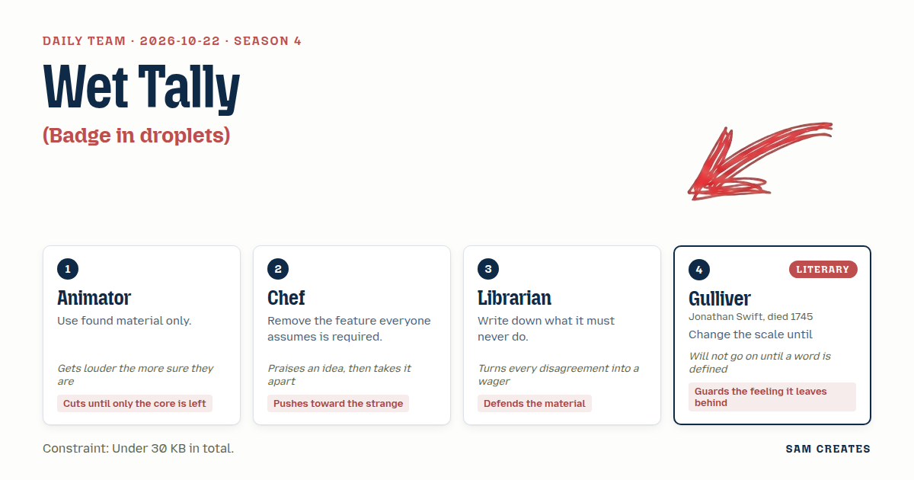
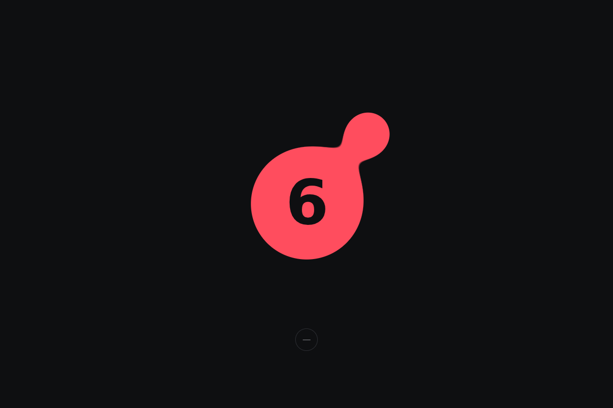
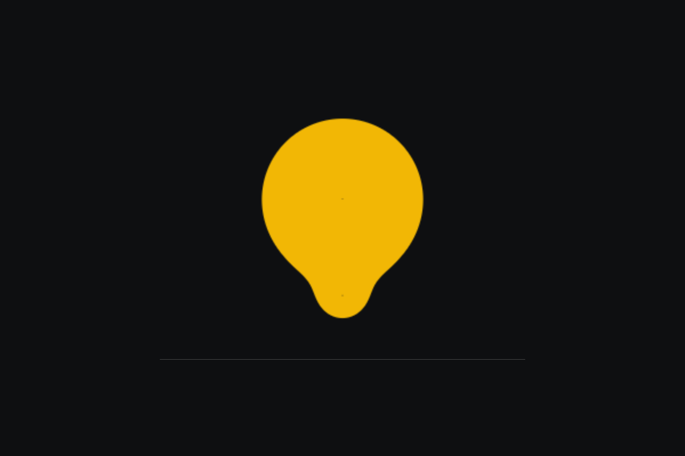
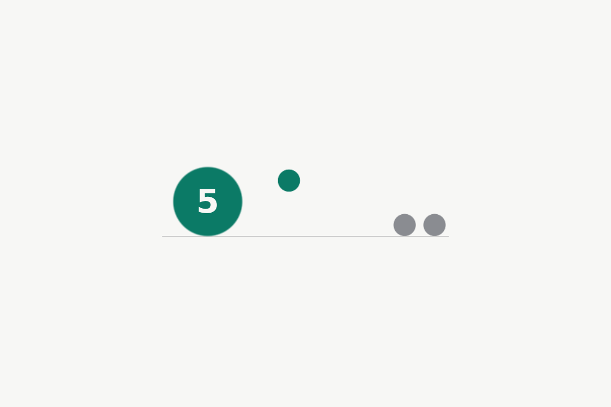
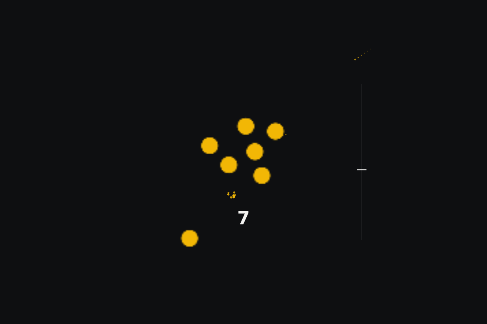
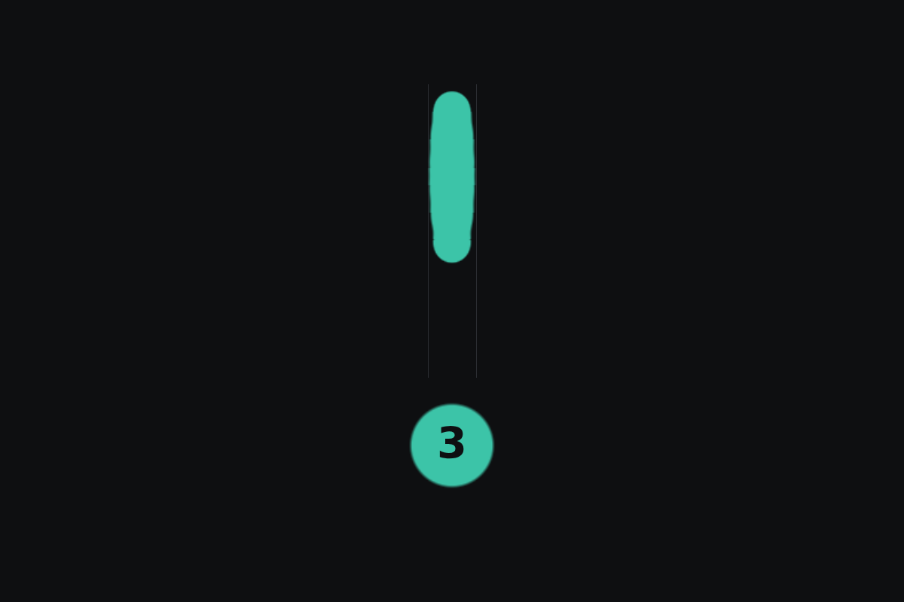
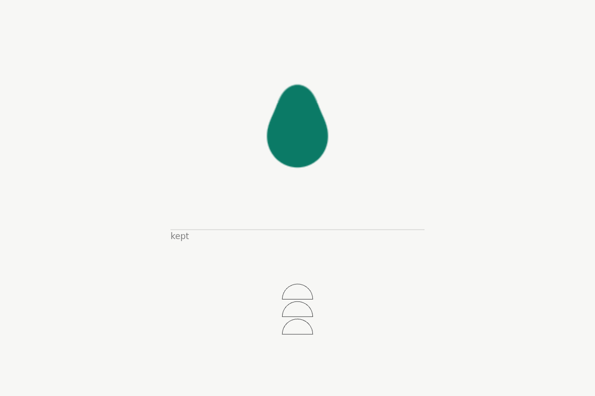
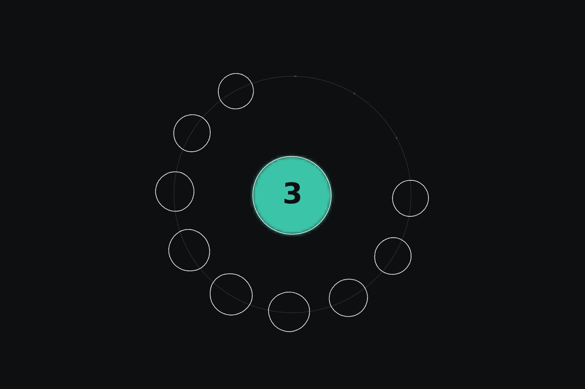
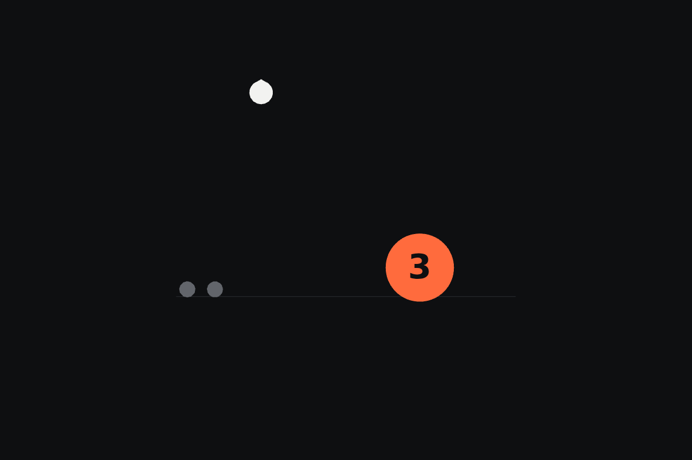

# 2026-10-22: Wet Tally

[Today](../../README.md) · [Archive](../../ARCHIVE.md)



**Task:** Badge in droplets: the count grows as drops merge, and a drop splits off when it goes down.

**Constraint:** Under 30 KB in total.

**Season:** 2026-10-19

**Decision:** The set is ten droplet badges that add by merging and subtract by shedding a drop that is kept, and the visitor taps, holds, flings, and rescales them to count.

## Asset

<a href="piece.html"></a>

[Use it](https://isas1.github.io/daily-team/2026-10-22/) · [piece.html](piece.html), led by Animator. Model: claude-opus-5-5.

<a href="artifact-1.html"></a>

[Use it](https://isas1.github.io/daily-team/2026-10-22/) · [artifact-1.html](artifact-1.html), led by Animator. Model: claude-opus-5-5.

<a href="artifact-2.html"></a>

[Use it](https://isas1.github.io/daily-team/2026-10-22/) · [artifact-2.html](artifact-2.html), led by Chef. Model: claude-opus-5-5.

<a href="artifact-3.html"></a>

[Use it](https://isas1.github.io/daily-team/2026-10-22/) · [artifact-3.html](artifact-3.html), led by Librarian. Model: claude-opus-5-5.

<a href="artifact-4.html"></a>

[Use it](https://isas1.github.io/daily-team/2026-10-22/) · [artifact-4.html](artifact-4.html), led by Gulliver. Model: claude-opus-5-5.

<a href="artifact-5.html"></a>

[Use it](https://isas1.github.io/daily-team/2026-10-22/) · [artifact-5.html](artifact-5.html), led by Animator. Model: claude-opus-5-5.

<a href="artifact-6.html"></a>

[Use it](https://isas1.github.io/daily-team/2026-10-22/) · [artifact-6.html](artifact-6.html), led by Chef. Model: claude-opus-5-5.

<a href="artifact-7.html"></a>

[Use it](https://isas1.github.io/daily-team/2026-10-22/) · [artifact-7.html](artifact-7.html), led by Librarian. Model: claude-opus-5-5.

<a href="artifact-8.html"></a>

[Use it](https://isas1.github.io/daily-team/2026-10-22/) · [artifact-8.html](artifact-8.html), led by Gulliver. Model: claude-opus-5-5.

<a href="artifact-9.html"></a>

[Use it](https://isas1.github.io/daily-team/2026-10-22/) · [artifact-9.html](artifact-9.html), led by Animator. Model: claude-opus-5-5.

<a href="artifact-10.html"></a>

[Use it](https://isas1.github.io/daily-team/2026-10-22/) · [artifact-10.html](artifact-10.html), led by Chef. Model: claude-opus-5-5.

## The session

### Pitch

**1 · Animator: Bead**\
One drop. That is the badge.\
Tap it and a second drop rolls in from the edge and swallows into it. The number inside goes up.\
Decrease it and the drop pinches and lets a small one fall.\
I took the red from the browser's own focus ring and the shine from the cursor's outline. Found, all of it.\
No ring, no shadow, no box. Cut everything until a drop is left.

**2 · Chef: Unsalted**\
Lovely bead. Now take the number out.\
Everyone thinks a badge is a digit in a circle. It isn't. It's weight.\
Hold and the drop swells, overshoots, settles fat. Let go and it sheds a bead that wobbles off.\
You read the count the way you read a pot about to boil. By how it trembles.\
Screen readers still get the number. Eyes get the heft.

**3 · Librarian: Ledger of Drops**\
Rule one, written before anything else: a drop must never disappear.\
When the count goes down, the drop that splits off is kept. It rolls into a line under the badge and stays there.\
Fling a drop off the badge and friction parks it on the shelf, in order.\
The badge shows what you have now. The line shows what you gave away.\
Nothing is thrown out. That is the whole design.

**4 · Gulliver: Two Shores**\
First tell me what you mean by "count". The number of drops, or the amount of water? These are not the same sum.\
I propose a badge that may be seen at two sizes. From afar it is a speck, and the speck says seven.\
Turn the wheel and you descend until each of the seven is a lake, and the merges are slow floods.\
Turn it back and all that labour is a dot again.\
What I would keep is the small cold feeling of seeing one's great matter shrink to a freckle.

### Clash

**2 · Chef:** Librarian, your shelf is a lovely idea and it ruins the badge. A badge that remembers every loss is a guilt counter.

**3 · Librarian:** I'll wager you a full shelf that nobody who sees their old drops lined up calls it guilt. They call it a record. Defend the water, don't pour it out.

**4 · Gulliver:** Before you two wager anything, define "loss". When a drop splits from the badge, is the badge smaller, or has the water only moved house?

**3 · Librarian:** Moved house. Same volume, two addresses. That is exactly why it must stay on screen.

**1 · Animator:** Then the shelf stays. And the number stays in my bead. Chef, a badge with no digit is a blob. People need to read seven at a glance.

**2 · Chef:** At a glance they read red and round. Your digit is the salt everyone pours before tasting. Cut it, you cut things for a living.

**4 · Gulliver:** Animator, at my far scale the speck is too small to wear a digit. At my near scale each lake is too large to need one. Your number lives only in the middle size.

**1 · Animator:** Then the middle size is the badge. That is where it sits on a real screen. The number STAYS where people actually look.

**2 · Chef:** Then put it in and watch me take it out of every other row.

### Decision

The set is ten droplet badges that add by merging and subtract by shedding a drop that is kept, and the visitor taps, holds, flings, and rescales them to count.

Concept: Wet Tally

| # | Member | Concept | Composition | Input | Motion | Visible text |
|---|---|---|---|---|---|---|
| 1 | Animator | Bead | single object | tap | morph | number |
| 2 | Chef | Unsalted | single object | press and hold | spring overshoot | nothing |
| 3 | Librarian | Ledger of Drops | horizontal line | fling | inertia and friction | number |
| 4 | Gulliver | Two Shores | field of many | scrub or wheel | particles | number |
| 5 | Animator | Gutter | vertical stack | drag | inertia and friction | number |
| 6 | Chef | Lean | field of many | hover nearness | morph | nothing |
| 7 | Librarian | Never Spilled | vertical stack | press and hold | fold | kept |
| 8 | Gulliver | Tide Ring | radial | hover nearness | spring overshoot | number |
| 9 | Animator | Drip | horizontal line | tap | particles | number |
| 10 | Chef | Seed Pod | radial | drag | morph | nothing |

Check: all five compositions appear. No two rows share composition, input, and motion together.

Piece: Wet Tally, a hand counter for counting anything at a door or a window, where tapping the pane drips a drop in (rows 1, 9), drops run down and merge into the badge (5), holding splits one off and folds it onto a kept shelf below (7, 3), the wheel drops between the speck and the lakes (4, 8), and the drops lean toward a hand that comes near (6).

- Animator: the single bead with its number, the tap that drips, the gutter the drops run down. Colours are taken from the browser's focus ring.
- Chef: the drops lean and swell toward the hand. The number is absent in rows 2, 6, and 10.
- Librarian: no drop is ever deleted. Every subtraction lands on the shelf with the label "kept".
- Gulliver: the wheel that rescales the whole counter, and the definition used on the page, where count means drops and not volume.
- Chef lost the main badge's number. The number stays because at working size people read it at a glance. The argument about the shelf as a guilt counter is still open, and Chef has said so.

### Build notes

1. Write one `index.html` with inline JS and CSS. Draw the drops as metaballs on a single `<canvas>` using a threshold on summed radial fields. Target under 18 KB and keep the 30 KB limit as a ceiling.
2. Store state as an array of drops `{x, y, r, vx, vy, kept}`. A merge adds areas (`r = sqrt(r1² + r2²)`). A split halves area into a child with `kept: true` that runs on friction 0.92 to the shelf. Nothing is ever removed from the array.
3. Put a real `<button aria-live="polite">` over the canvas. Space or Enter adds a drop, Shift+Enter or Backspace splits one, and `+`/`-` or the wheel switches scale. The accessible name always reads the current count, including in the rows that show no digit.

**Guest:** Gulliver (literary; Jonathan Swift, died 1745). The method is drawn from public-domain history, myth, or literature, or invented. The guest speaks in character in original words, never quoting the source, and nothing here is endorsed by anyone.

## Team

```text
Team for 2026-10-22
Season: 2026-10-19

1. Animator
   Method: Use found material only.
   Stance: Cuts until only the core is left.
   Temperament: Gets louder the more sure they are.
2. Chef
   Method: Remove the feature everyone assumes is required.
   Stance: Pushes toward the strange.
   Temperament: Praises an idea, then takes it apart.
3. Librarian
   Method: Write down what it must never do.
   Stance: Defends the material.
   Temperament: Turns every disagreement into a wager.
4. Gulliver (literary; Jonathan Swift, died 1745) [guest]
   Method: Change the scale until something looks absurd.
   Stance: Guards the feeling it leaves behind.
   Temperament: Will not go on until a word is defined.

Constraint: Under 30 KB in total.
Task: Badge in droplets: the count grows as drops merge, and a drop splits off when it goes down.
```

Provider: claude. Model: claude-opus-5-5.
