# 2026-10-23: Sounding Well

[Today](../../README.md) · [Archive](../../ARCHIVE.md)

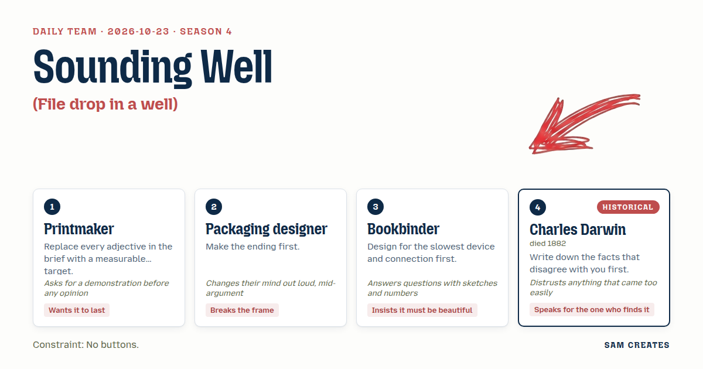

**Task:** File drop in a well: a dropped file falls, rings spread, and the echo confirms it arrived.

**Constraint:** No buttons.

**Season:** 2026-10-19

**Decision:** The page is a well that takes a dropped file, drops it down a measured shaft, stitches it in chunk by chunk, holds back the echo until the receiver's hash agrees, and keeps every file and its record in layers for whoever finds it later.

## Asset

<a href="piece.html"></a>

[Use it](https://isas1.github.io/daily-team/2026-10-23/) · [piece.html](piece.html), led by Printmaker. Model: claude-opus-5-5.

<a href="artifact-1.html">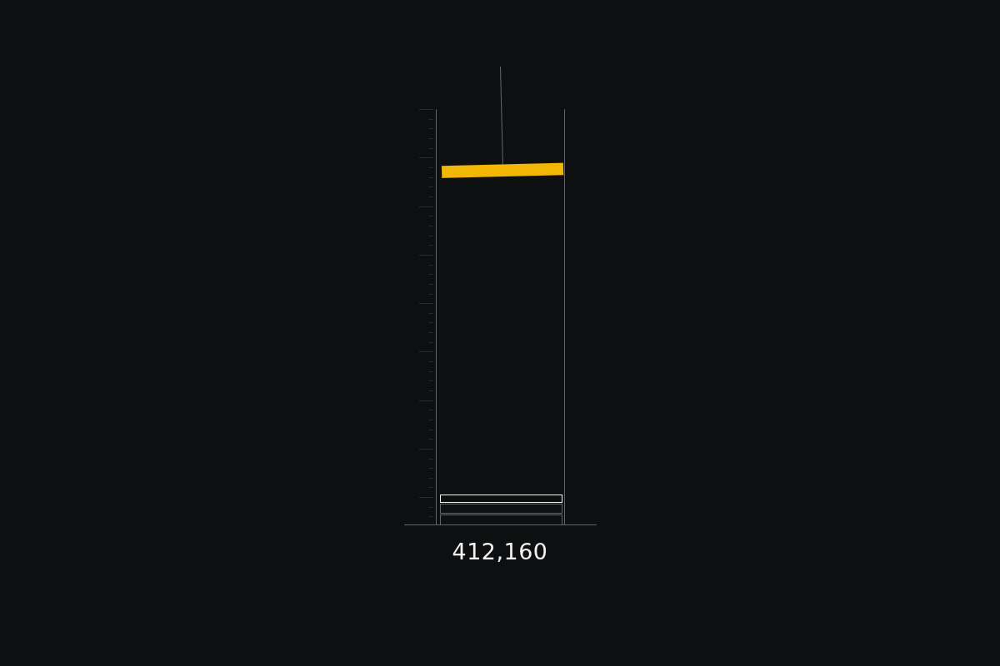</a>

[Use it](https://isas1.github.io/daily-team/2026-10-23/) · [artifact-1.html](artifact-1.html), led by Printmaker. Model: claude-opus-5-5.

<a href="artifact-2.html">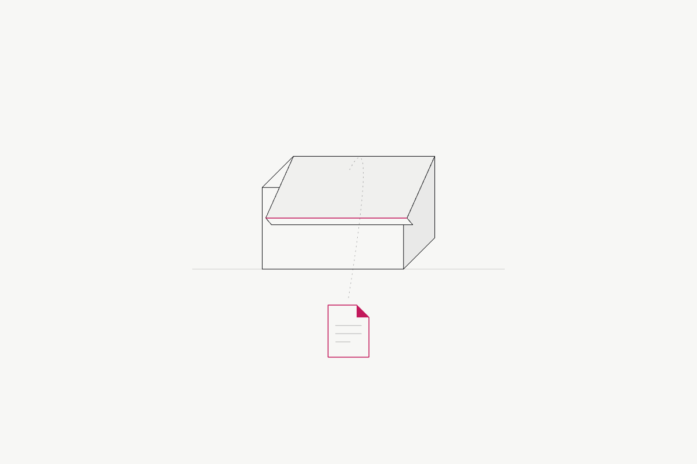</a>

[Use it](https://isas1.github.io/daily-team/2026-10-23/) · [artifact-2.html](artifact-2.html), led by Packaging designer. Model: claude-opus-5-5.

<a href="artifact-3.html">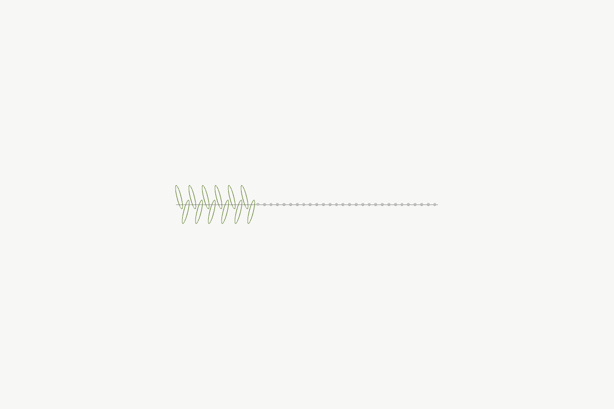</a>

[Use it](https://isas1.github.io/daily-team/2026-10-23/) · [artifact-3.html](artifact-3.html), led by Bookbinder. Model: claude-opus-5-5.

<a href="artifact-4.html">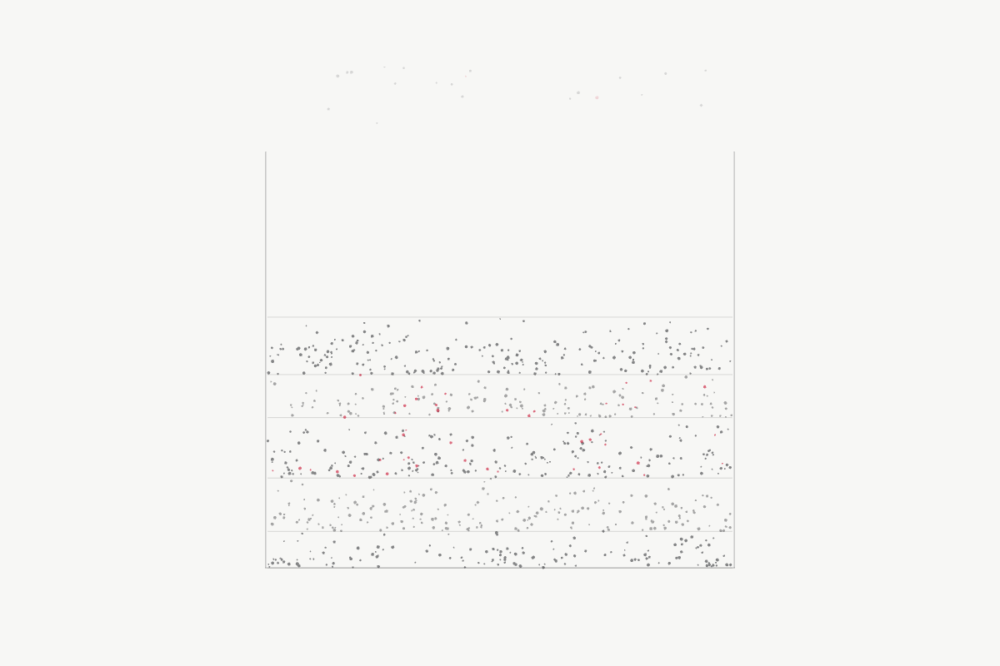</a>

[Use it](https://isas1.github.io/daily-team/2026-10-23/) · [artifact-4.html](artifact-4.html), led by Charles Darwin. Model: claude-opus-5-5.

<a href="artifact-5.html">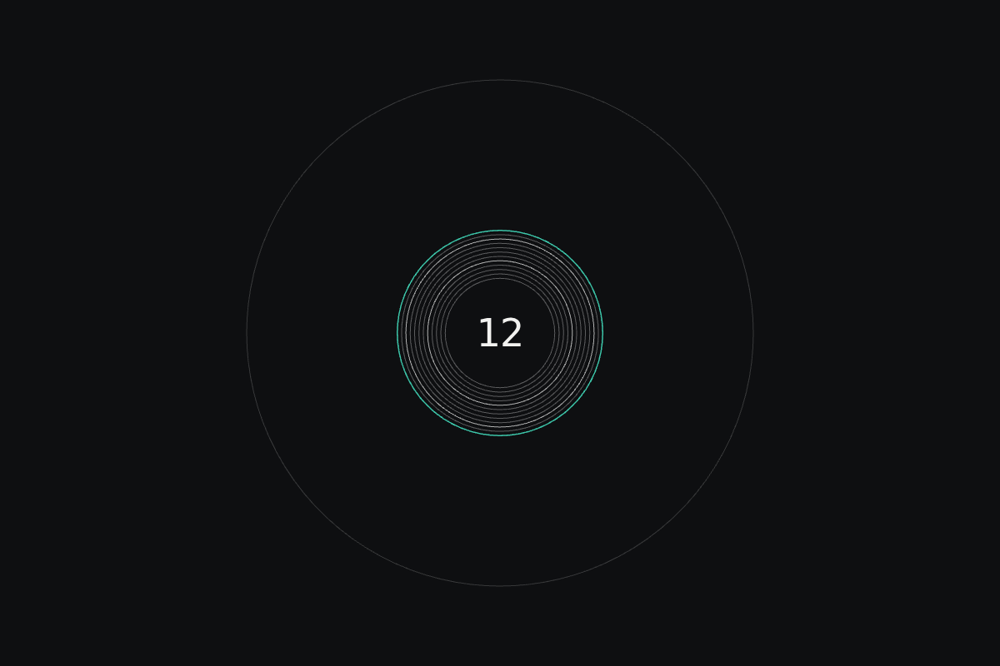</a>

[Use it](https://isas1.github.io/daily-team/2026-10-23/) · [artifact-5.html](artifact-5.html), led by Printmaker. Model: claude-opus-5-5.

<a href="artifact-6.html">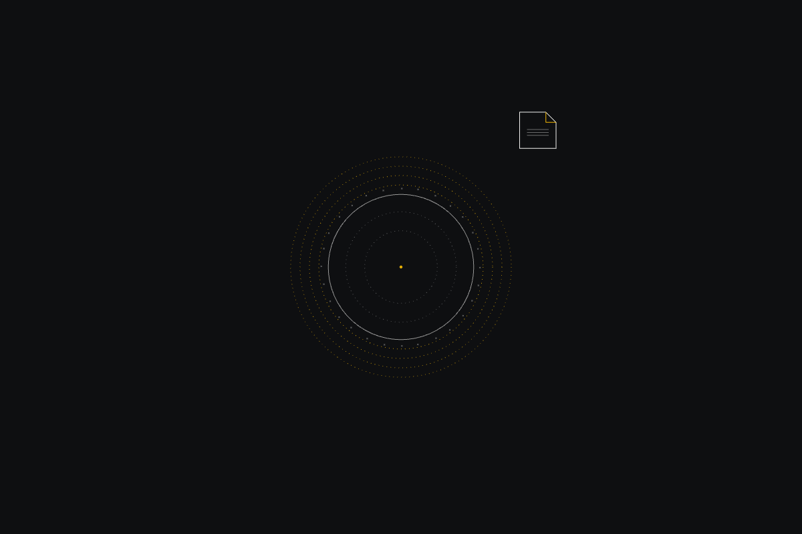</a>

[Use it](https://isas1.github.io/daily-team/2026-10-23/) · [artifact-6.html](artifact-6.html), led by Packaging designer. Model: claude-opus-5-5.

<a href="artifact-7.html">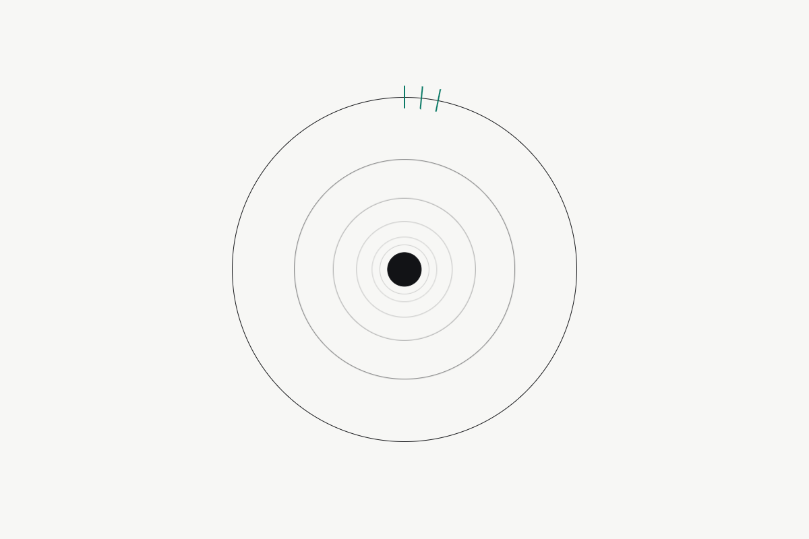</a>

[Use it](https://isas1.github.io/daily-team/2026-10-23/) · [artifact-7.html](artifact-7.html), led by Bookbinder. Model: claude-opus-5-5.

<a href="artifact-8.html">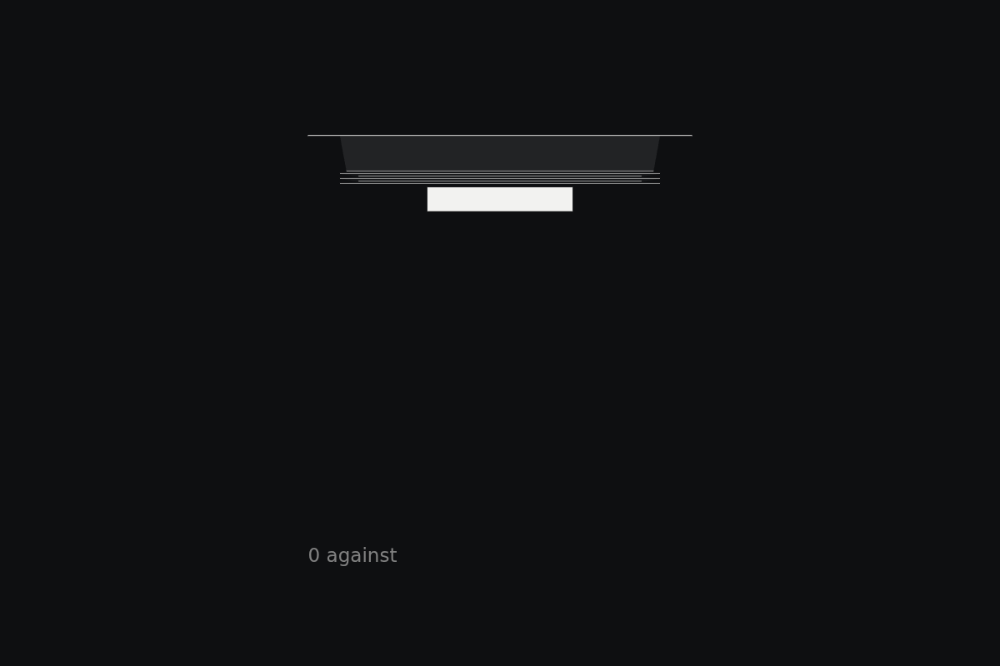</a>

[Use it](https://isas1.github.io/daily-team/2026-10-23/) · [artifact-8.html](artifact-8.html), led by Charles Darwin. Model: claude-opus-5-5.

<a href="artifact-9.html">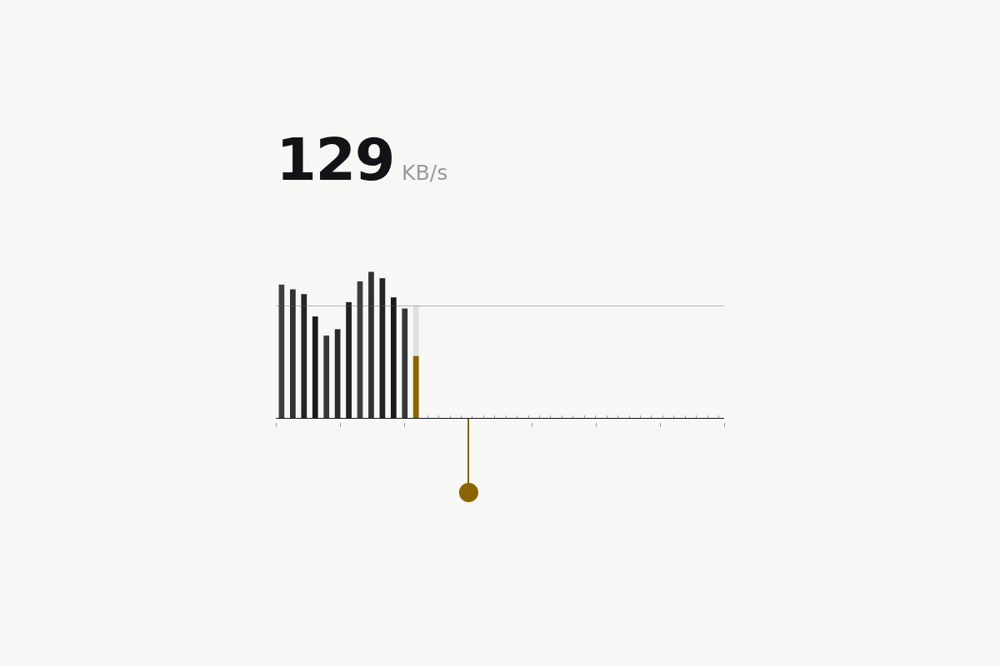</a>

[Use it](https://isas1.github.io/daily-team/2026-10-23/) · [artifact-9.html](artifact-9.html), led by Printmaker. Model: claude-opus-5-5.

<a href="artifact-10.html">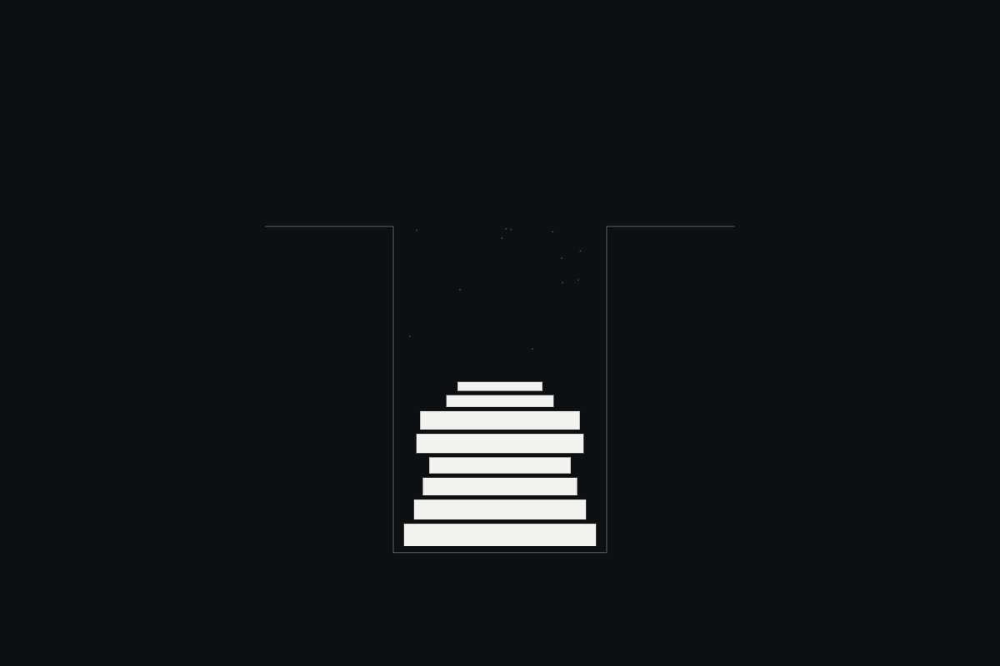</a>

[Use it](https://isas1.github.io/daily-team/2026-10-23/) · [artifact-10.html](artifact-10.html), led by Packaging designer. Model: claude-opus-5-5.

## The session

### Pitch

**1 · Printmaker: Plumb Line**\
A single shaft, 600 px deep. Nothing else on the page.\
The file falls at a rate set by its size: 1 px per 10 KB, friction holds it back.\
One ring per megabyte, spaced 14 px. Count them and you know the weight.\
The echo arrives after the measured round trip, never sooner.\
Byte count printed at the bottom when it lands. That number stays.\
Show me it working on a 40 MB file before anyone calls it good.

**2 · Packaging designer: Lid**\
I made the ending first: a closed box that says arrived.\
The page opens on it. You fling a file at the lid.\
The lid folds open, takes the file, folds shut. That's the echo.\
The rings don't stay inside. They run off the edge of the window.\
The tab title is the outside of the box. It changes when it lands.\
Maybe the box is the well. Maybe the well is the box. I'll know when I see it fold.

**3 · Bookbinder: Kettle Stitch**\
Built for a 2017 phone on 3G first. Sketch: one horizontal thread, 320 px.\
The file is cut into 64 KB chunks. Each chunk that lands is one stitch.\
Stitches morph from a dot to a 6 px loop. CSS borders only, no canvas.\
Script under 2 KB. Rings spaced 1, 2, 3, 5, 8 px. That spacing is the beauty.\
Press and hold the thread to see the count: 12/40.\
If it is ugly on the slow phone it is ugly everywhere.

**4 · Charles Darwin: Strata**\
The well keeps everything that has been dropped into it, in layers.\
Each file settles as one stratum. Particles drift down and pack.\
Before the well calls a file arrived, it writes what argues against that: size mismatch, failed hash, missing chunks.\
Those notes sit in the layer with the file.\
Whoever comes later scrubs down through the layers and finds the file with its record.\
The page works for that later person first, the sender second.

### Clash

**1 · Printmaker:** Packaging designer, show me a ring on a 40 MB file. How many, how far apart, in pixels. Until I see that, "spreads" is an adjective.

**2 · Packaging designer:** Printmaker, forty rings, then they leave the window and the tab title says arrived. No, wait, the tab is too far away, nobody looks there. The rings stop at the edge and fold the corner down. Actually, keep the tab. The finder sees the tab later.

**3 · Bookbinder:** Packaging designer, forty rings at 60 fps on that phone is 2,400 repaints a second. One ring per landed chunk, border-radius only, and they fade at 400 px. That holds at 30 fps on a Moto G5.

**4 · Charles Darwin:** Bookbinder, a ring per chunk tells the sender's side. The receiver has not checked anything yet. The echo should wait until the other side computes a hash and it matches.

**1 · Printmaker:** Charles Darwin, demonstrate it. Drop a file with one byte flipped and show me the well refusing to echo.

**4 · Charles Darwin:** Printmaker, then the mismatch goes on screen before any success does. A clean echo that shows up in 200 ms on a 40 MB file is the one I would check twice.

**2 · Packaging designer:** Charles Darwin, no. The ending is the echo. If it opens with doubt, the drop feels like a hearing. Fine, show the doubt, but it folds shut once the hash agrees.

**3 · Bookbinder:** Printmaker, strata will not survive past 200 files on a slow device. Cap it at 64 layers. Older layers compress to 1 px lines.

**1 · Printmaker:** Bookbinder, 1 px is a target I can measure. Accepted. But the layers must outlive the session. localStorage, no expiry.

**4 · Charles Darwin:** Packaging designer, if the doubt folds shut, the person who finds the file next week never sees it. That person needs the record more than the sender does.

### Decision

The page is a well that takes a dropped file, drops it down a measured shaft, stitches it in chunk by chunk, holds back the echo until the receiver's hash agrees, and keeps every file and its record in layers for whoever finds it later.

Concept: Sounding Well

| # | Member | Concept | Composition | Input | Motion | Visible text |
|---|---|---|---|---|---|---|
| 1 | Printmaker | Plumb Line | vertical stack | drag | inertia and friction | byte count |
| 2 | Packaging designer | Lid | single object | fling | fold | arrived |
| 3 | Bookbinder | Kettle Stitch | horizontal line | press and hold | morph | 12/40 |
| 4 | Charles Darwin | Strata | field of many | scrub or wheel | particles | nothing |
| 5 | Printmaker | Ring Gauge | radial | hover nearness | spring overshoot | ring count |
| 6 | Packaging designer | Off the Edge | radial | drag | particles | nothing |
| 7 | Bookbinder | Two Kilobyte Well | single object | tap | spring overshoot | nothing |
| 8 | Charles Darwin | Against Log | vertical stack | press and hold | fold | 2 against |
| 9 | Printmaker | Plate Pressure | horizontal line | scrub or wheel | inertia and friction | KB/s |
| 10 | Packaging designer | Backward Fall | field of many | fling | morph | nothing |

Check: radial in rows 5 and 6. Horizontal line in rows 3 and 9. Vertical stack in rows 1 and 8. Single object in rows 2 and 7. Field of many in rows 4 and 10. No two rows share composition, input, and motion.

Piece: Sounding Well is a working dead-drop. A file dragged in falls down the plumb shaft (1). It is stitched in chunk by chunk along the thread (3). Rings spread with a count that springs on approach (5). The rings run off the window and write the echo into the tab title (6). The doubts are logged before any success (8). The file settles as a stratum (4). A later finder scrubs down through the strata and flings a layer upward to recover its file (10). Rows used: 1, 3, 4, 5, 6, 8, 10.

- Printmaker: every motion has a number behind it. 1 px per 10 KB of fall, 14 px ring spacing, a byte count that stays, and strata that persist in localStorage with no expiry.
- Packaging designer: the ending exists first as the tab-title echo. Rings break out of the window frame. The finder recovers a file with a backward fling.
- Bookbinder: 64 KB chunks become stitches, rings are borders only, script stays under 2 KB per component, the cap is 64 layers with 1 px compression, and the spacing follows 1, 2, 3, 5, 8.
- Charles Darwin: the echo waits for a matching receiver hash. Mismatches appear on screen first. Each stratum keeps its record for the finder.
- Packaging designer lost the argument over folding the doubt shut. The record stays open in the stratum because the finder, who arrives later, has only the record to go on.

### Build notes

1. Make the well surface a focusable `div` with `role="region"` and `tabindex="0"`. Drop opens on drag-over. Enter or a tap opens the hidden file input. There is no `<button>` element anywhere on the page.
2. Split each file into 64 KB chunks with `File.slice`. Add one stitch and one CSS-border ring per landed chunk. Compute SHA-256 with `crypto.subtle.digest` on the receiving side. Write the tab-title echo only when the hashes match. Otherwise log the mismatch to the Against Log first.
3. Store strata in localStorage as `{name, bytes, hash, against[]}`, capped at 64 entries, with older layers rendered as 1 px lines. Throttle in DevTools to Slow 3G and 4x CPU, and confirm the rings hold 30 fps on a 40 MB file and a one-byte-flipped copy.

**Guest:** Charles Darwin (historical; died 1882). The method is drawn from public-domain history, myth, or literature, or invented. The guest never speaks as the figure, and nothing here is endorsed by anyone.

## Team

```text
Team for 2026-10-23
Season: 2026-10-19

1. Printmaker
   Method: Replace every adjective in the brief with a measurable target.
   Stance: Wants it to last.
   Temperament: Asks for a demonstration before any opinion.
2. Packaging designer
   Method: Make the ending first.
   Stance: Breaks the frame.
   Temperament: Changes their mind out loud, mid-argument.
3. Bookbinder
   Method: Design for the slowest device and connection first.
   Stance: Insists it must be beautiful.
   Temperament: Answers questions with sketches and numbers.
4. Charles Darwin (historical; died 1882) [guest]
   Method: Write down the facts that disagree with you first.
   Stance: Speaks for the one who finds it.
   Temperament: Distrusts anything that came too easily.

Constraint: No buttons.
Task: File drop in a well: a dropped file falls, rings spread, and the echo confirms it arrived.
```

Provider: claude. Model: claude-opus-5-5.
