# 2026-10-24: Low Water Set

[Today](../../README.md) · [Archive](../../ARCHIVE.md)

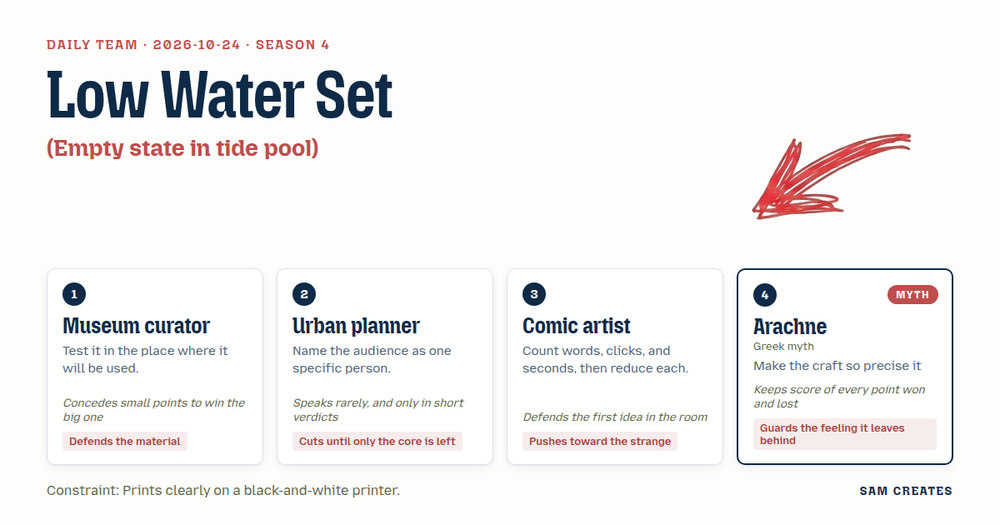

**Task:** Empty state in tide pool: an empty list is a still pool with one small creature waiting.

**Constraint:** Prints clearly on a black-and-white printer.

**Season:** 2026-10-19

**Decision:** The set is ten working empty states for a list, each a still tide pool with one small creature waiting, all drawn in pure black line so they print cleanly, and each one lets the visitor add, remove, and return to empty.

## Asset

<a href="piece.html"></a>

[Use it](https://isas1.github.io/daily-team/2026-10-24/) · [piece.html](piece.html), led by Museum curator. Model: claude-opus-5-5.

<a href="artifact-1.html">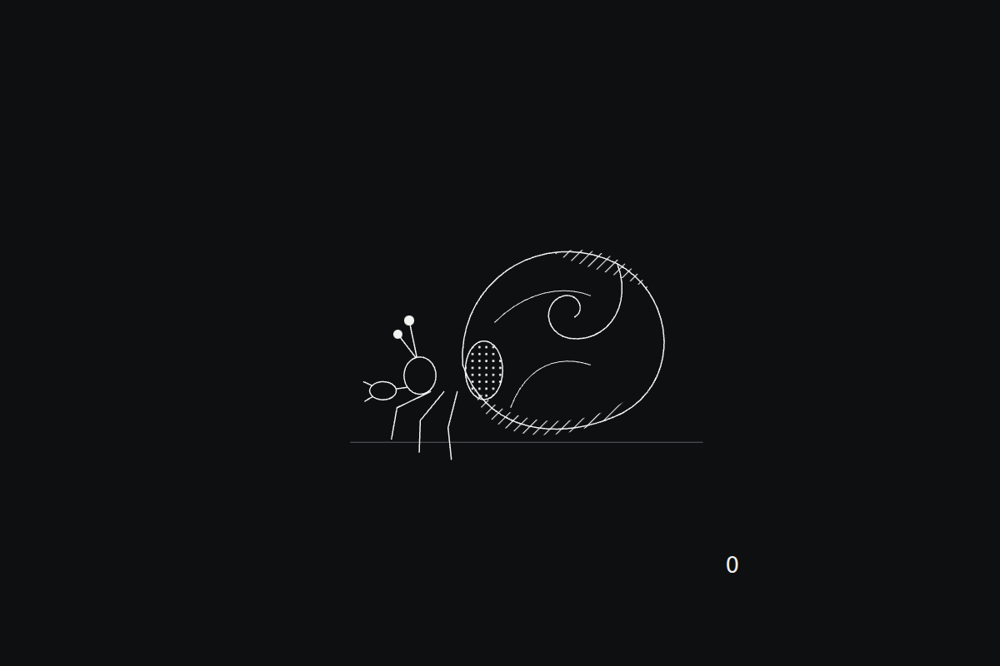</a>

[Use it](https://isas1.github.io/daily-team/2026-10-24/) · [artifact-1.html](artifact-1.html), led by Museum curator. Model: claude-opus-5-5.

<a href="artifact-2.html">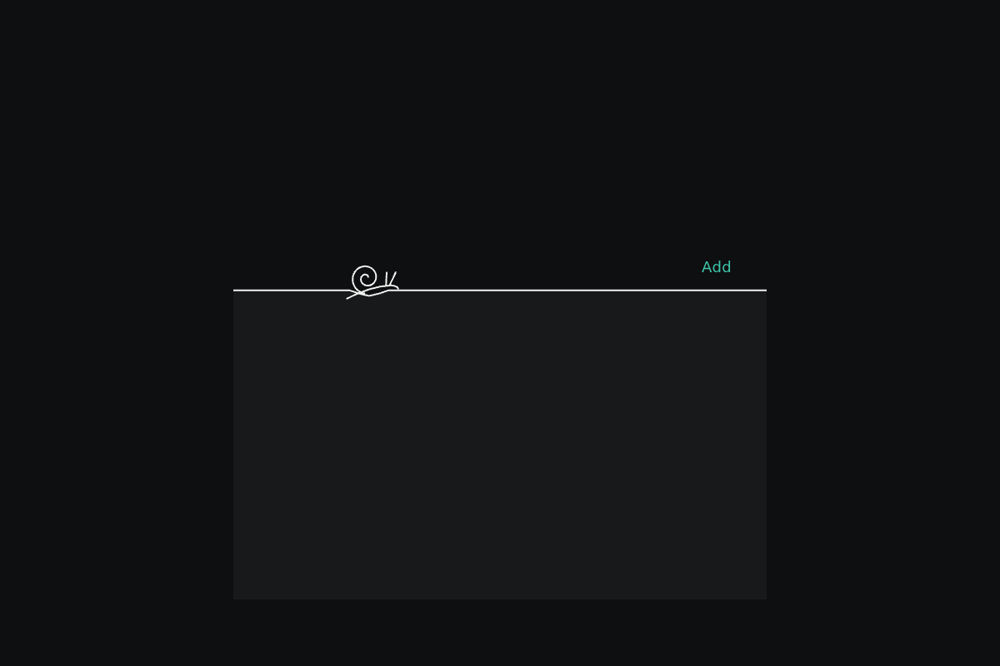</a>

[Use it](https://isas1.github.io/daily-team/2026-10-24/) · [artifact-2.html](artifact-2.html), led by Urban planner. Model: claude-opus-5-5.

<a href="artifact-3.html">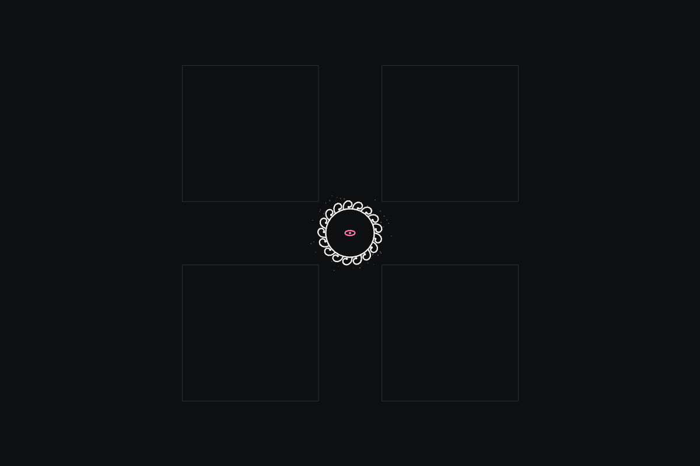</a>

[Use it](https://isas1.github.io/daily-team/2026-10-24/) · [artifact-3.html](artifact-3.html), led by Comic artist. Model: claude-opus-5-5.

<a href="artifact-4.html">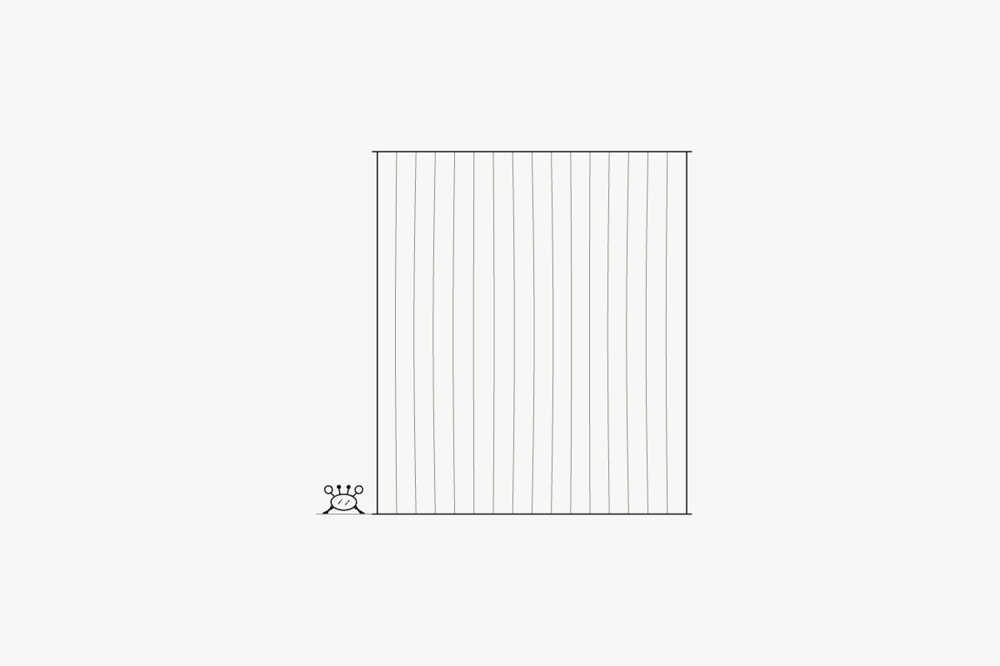</a>

[Use it](https://isas1.github.io/daily-team/2026-10-24/) · [artifact-4.html](artifact-4.html), led by Arachne. Model: claude-opus-5-5.

<a href="artifact-5.html">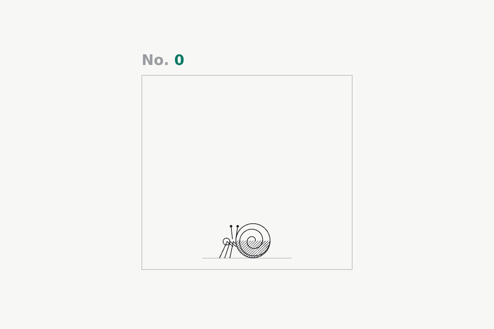</a>

[Use it](https://isas1.github.io/daily-team/2026-10-24/) · [artifact-5.html](artifact-5.html), led by Museum curator. Model: claude-opus-5-5.

<a href="artifact-6.html">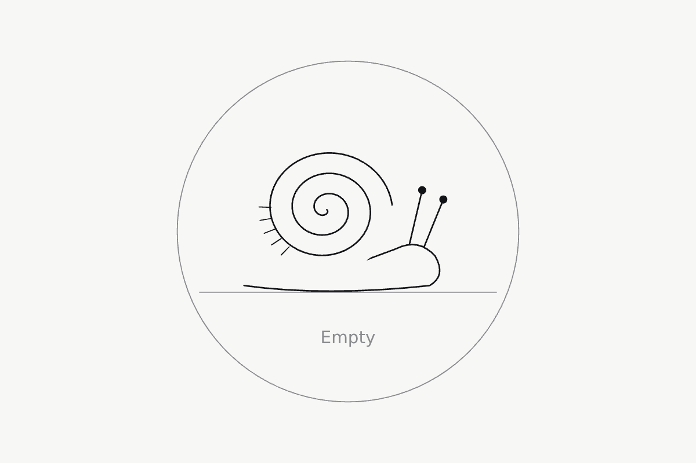</a>

[Use it](https://isas1.github.io/daily-team/2026-10-24/) · [artifact-6.html](artifact-6.html), led by Urban planner. Model: claude-opus-5-5.

<a href="artifact-7.html">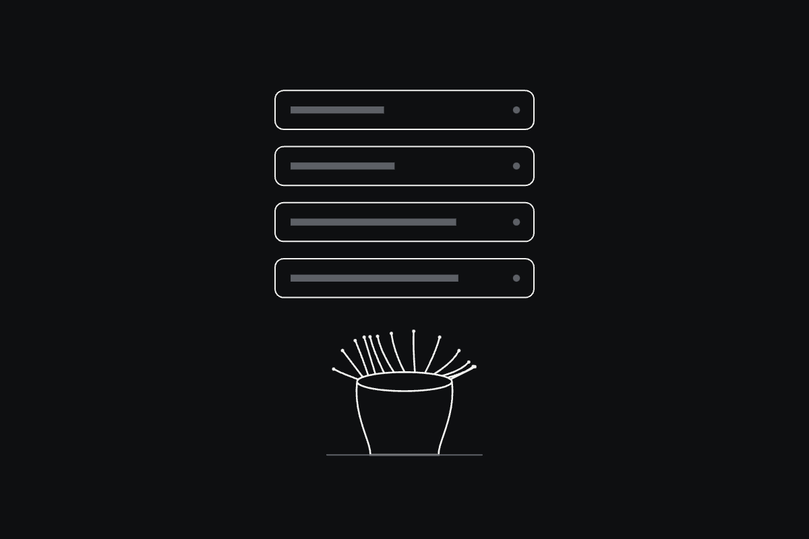</a>

[Use it](https://isas1.github.io/daily-team/2026-10-24/) · [artifact-7.html](artifact-7.html), led by Comic artist. Model: claude-opus-5-5.

<a href="artifact-8.html">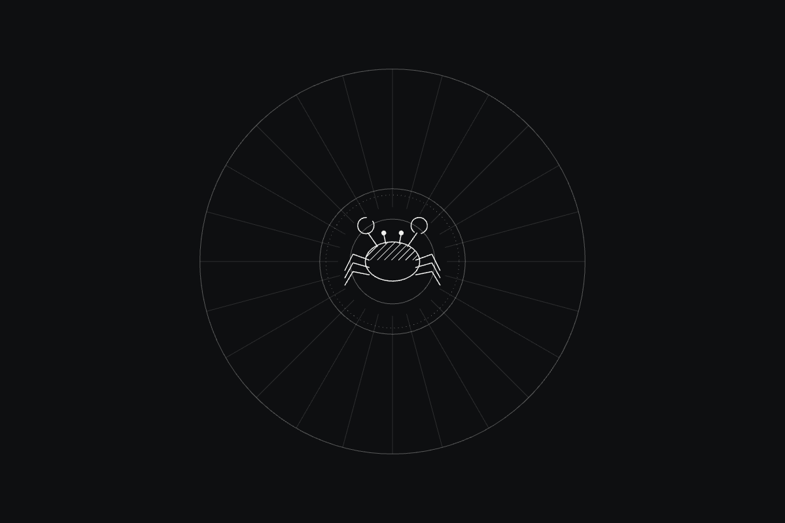</a>

[Use it](https://isas1.github.io/daily-team/2026-10-24/) · [artifact-8.html](artifact-8.html), led by Arachne. Model: claude-opus-5-5.

<a href="artifact-9.html">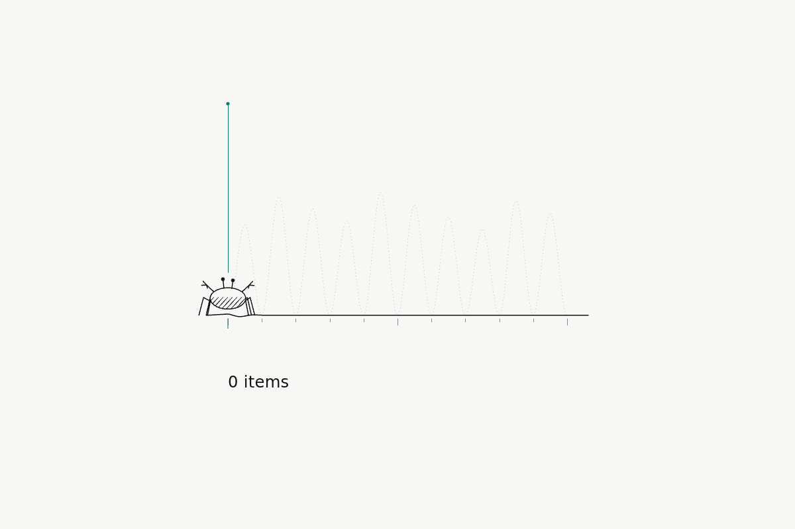</a>

[Use it](https://isas1.github.io/daily-team/2026-10-24/) · [artifact-9.html](artifact-9.html), led by Museum curator. Model: claude-opus-5-5.

<a href="artifact-10.html">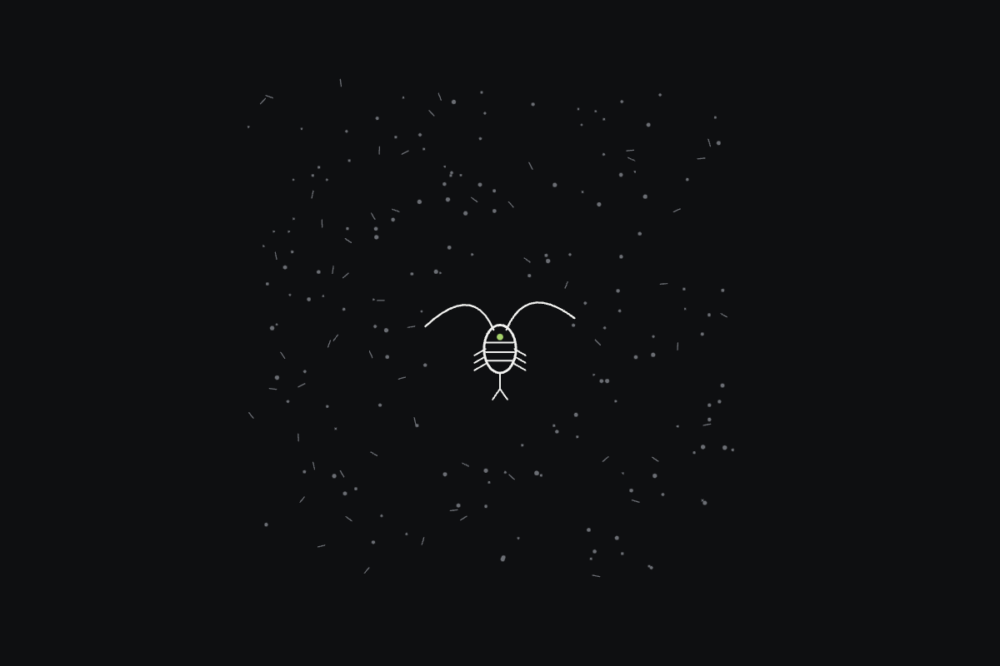</a>

[Use it](https://isas1.github.io/daily-team/2026-10-24/) · [artifact-10.html](artifact-10.html), led by Urban planner. Model: claude-opus-5-5.

## The session

### Pitch

**1 · Museum curator: Specimen Tray**\
An empty list is a drawer with nothing catalogued yet.\
One hermit crab sits in the corner of the tray, drawn in black ink, shell hatched, legs out.\
Press and hold the crab and it pulls into its shell. A new accession label slides in under the glass.\
Delete the last label and the crab comes back out, slowly, the way they do once the shadow has passed.\
I printed the sketch at 600 dpi and it held. Every line is a line. No grey wash, because grey wash goes to mud.

**2 · Urban planner: Waterline for Ines**\
Ines. Night nurse. 6 a.m., phone in one hand, coat half on.\
Her list is empty. She needs to see that in one glance.\
One horizontal line. One periwinkle sitting on it.\
Tap the line and an item drops in, and the water springs back.\
Nothing else.

**3 · Comic artist: Anemone Gutter**\
Zero words. I counted.\
The empty state is a closed anemone in the white gutter between panels.\
Bring the cursor near and the tentacles unfold, one ring at a time. Move away and they fold back.\
When you delete an item, fling it at the anemone and it swallows it.\
The list is empty because the animal ate everything. That is the first idea and I am keeping it.

**4 · Arachne: Still Weft**\
The pool's surface is a warp of fine threads, stretched taut, with no weft.\
In the empty state a small crab rests at the selvedge and waits for the shuttle.\
Drag across the surface and you throw a weft thread. That is one item, woven in for good.\
The ripple must travel the threads and die at the frame, the way still water truly settles.\
Let the masters of any loom compare their cloth to this pool.\
When the cloth is bare it must feel at rest. It must not feel abandoned.

### Clash

**3 · Comic artist:** Curator, your tray is a museum label. I count four words and one hold before anything happens. My anemone needs zero.

**1 · Museum curator:** Comic, take the words. The label becomes a single numeral. The crab stays in hatched ink, because I printed a toned version and the shell vanished into the grey.

**4 · Arachne:** Curator, hatching is weaving by another name. I mark that point to me. Comic, when your list is empty the visitor must feel a resting pool. Your version shows a fed stomach.

**3 · Comic artist:** Arachne, it ate everything. That is the honest feeling of done. I am keeping the swallow.

**2 · Urban planner:** Ines deletes by accident at 6 a.m. Undo. Five seconds.

**1 · Museum curator:** Planner is right, and I tested it on the rocks with wet fingers. Half my taps missed. Comic keeps the swallow, and the item stays visible inside the anemone's body for five seconds. Tap it there and it comes back.

**4 · Arachne:** So the Comic wins the swallow and loses the clock. That leaves one each. I still say the empty pool must not look like a stomach.

**3 · Comic artist:** Arachne, a calm animal is a full one. Nobody waits beside a hungry anemone.

**2 · Urban planner:** Unsettled. Print both. Ask Ines.

### Decision

The set is ten working empty states for a list, each a still tide pool with one small creature waiting, all drawn in pure black line so they print cleanly, and each one lets the visitor add, remove, and return to empty.

Concept: Low Water Set

| # | Member | Concept | Composition | Input | Motion | Visible text |
|---|---|---|---|---|---|---|
| 1 | Museum curator | Specimen Tray | single object | press and hold | morph | 0 |
| 2 | Urban planner | Waterline for Ines | horizontal line | tap | spring overshoot | Add |
| 3 | Comic artist | Anemone Gutter | radial | hover nearness | fold | nothing |
| 4 | Arachne | Still Weft | field of many | drag | inertia and friction | nothing |
| 5 | Museum curator | Accession Stack | vertical stack | scrub or wheel | fold | No. 0 |
| 6 | Urban planner | Last Snail | single object | tap | particles | Empty |
| 7 | Comic artist | Swallowed Item | vertical stack | fling | particles | 5 |
| 8 | Arachne | Ripple Ring | radial | press and hold | spring overshoot | nothing |
| 9 | Museum curator | Tide Chart | horizontal line | scrub or wheel | inertia and friction | 0 items |
| 10 | Urban planner | Plankton Field | field of many | hover nearness | particles | nothing |

Check: all ten composition, input, and motion triples are distinct. Radial appears in rows 3 and 8, horizontal line in 2 and 9, vertical stack in 5 and 7, single object in 1 and 6, and field of many in 4 and 10.

Piece: Low Water Log is a working list for one person, built from rows 1, 2, 4, 5, 7, 9, and 10. Tapping the waterline adds an entry (2), each entry is woven in as a weft thread (4) and stacks as an accession label (5), deleted entries are flung to the anemone and held for five seconds (7), scrubbing the tide chart scrolls the list (9), plankton stir near the cursor (10), and the empty state is the crab in the tray (1). The Print button produces a line-art sheet that can be carried to the shore.

- Museum curator: the hatched crab, the print-first ink rule, and the five-second undo tested with wet hands.
- Urban planner: Ines as the user, the one-tap waterline, and the cut to a single numeral of text.
- Comic artist: the zero-word anemone and the swallow as the delete gesture.
- Arachne: the warp-and-weft surface, the ripple that dies at the frame, and the rule that empty must read as rest.
- Who lost: the Comic artist lost the two-second clock, because missed taps on wet rock showed that five seconds was needed. The Curator lost the label words to the Comic's count. Arachne and the Comic remain split on whether the empty pool reads as rest or as a full stomach. The Planner's proposal to print both versions and ask Ines stands as the test.

### Build notes

1. Draw every creature and thread as SVG strokes at 1.5 px, black on white, with shading done only by hatching and stipple patterns. Add an `@media print` stylesheet that removes motion, fixes the crab in its waiting pose, and prints at A5. Proof the print on a 600 dpi mono laser printer before any colour decision is made.
2. Wire the keyboard. Enter adds an entry at the waterline. Delete flings the focused entry to the anemone. U restores it within 5 seconds. Arrow keys scrub the tide chart. Announce the count through `aria-live="polite"` ("0 items" when empty). Hit areas are at least 44 px for wet-finger touch.
3. Build the empty state twice, once with the crab resting at the selvedge and once with the anemone closed and full. Print both, hand them to one night-shift nurse at the end of a shift, and record which one she reads as "nothing left to do" within 2 seconds.

**Guest:** Arachne (myth; Greek myth). The method is drawn from public-domain history, myth, or literature, or invented. The guest speaks in character in original words, never quoting the source, and nothing here is endorsed by anyone.

## Team

```text
Team for 2026-10-24
Season: 2026-10-19

1. Museum curator
   Method: Test it in the place where it will be used.
   Stance: Defends the material.
   Temperament: Concedes small points to win the big one.
2. Urban planner
   Method: Name the audience as one specific person.
   Stance: Cuts until only the core is left.
   Temperament: Speaks rarely, and only in short verdicts.
3. Comic artist
   Method: Count words, clicks, and seconds, then reduce each.
   Stance: Pushes toward the strange.
   Temperament: Defends the first idea in the room.
4. Arachne (myth; Greek myth) [guest]
   Method: Make the craft so precise it challenges the masters.
   Stance: Guards the feeling it leaves behind.
   Temperament: Keeps score of every point won and lost.

Constraint: Prints clearly on a black-and-white printer.
Task: Empty state in tide pool: an empty list is a still pool with one small creature waiting.
```

Provider: claude. Model: claude-opus-5-5.
