# 2026-10-25: the way back up

[Today](../../README.md) · [Archive](../../ARCHIVE.md)

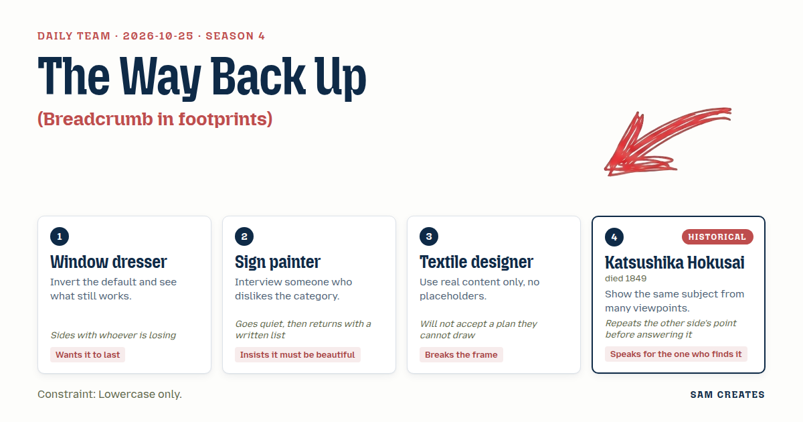

**Task:** Breadcrumb in footprints: the trail back up is a line of prints that deepen as each is reached.

**Constraint:** Lowercase only.

**Season:** 2026-10-19

**Decision:** the visitor walks down into a real dye-sample library, and the way back up is a trail of prints they can hover, hold, drag, fling and scrub, with each print deepening as they reach it.

## Asset

<a href="piece.html"></a>

[Use it](https://isas1.github.io/daily-team/2026-10-25/) · [piece.html](piece.html), led by Window dresser. Model: claude-opus-5-5.

<a href="artifact-1.html">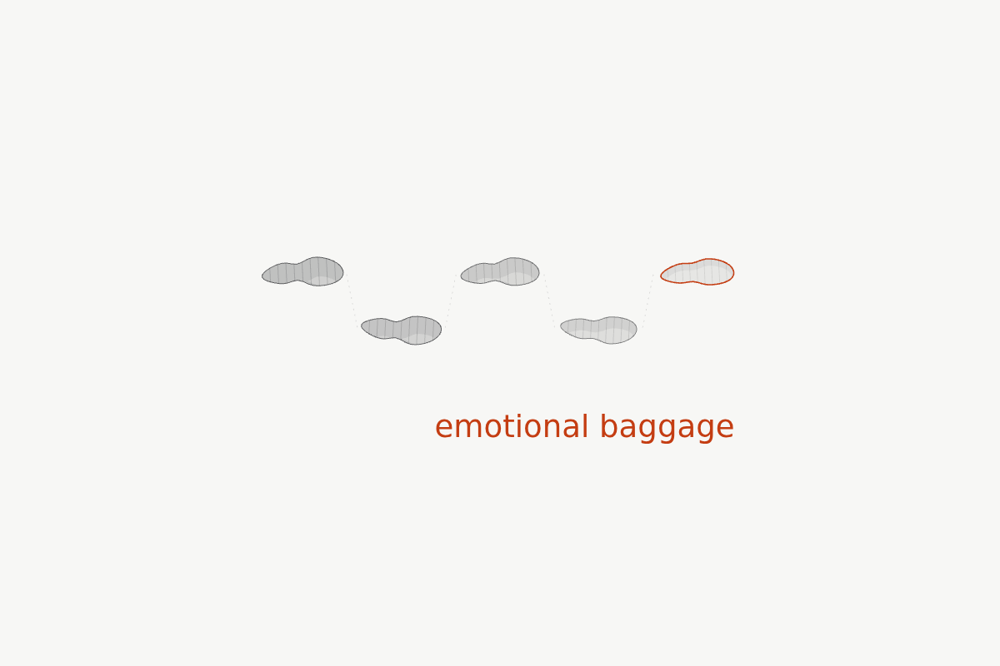</a>

[Use it](https://isas1.github.io/daily-team/2026-10-25/) · [artifact-1.html](artifact-1.html), led by Window dresser. Model: claude-opus-5-5.

<a href="artifact-2.html">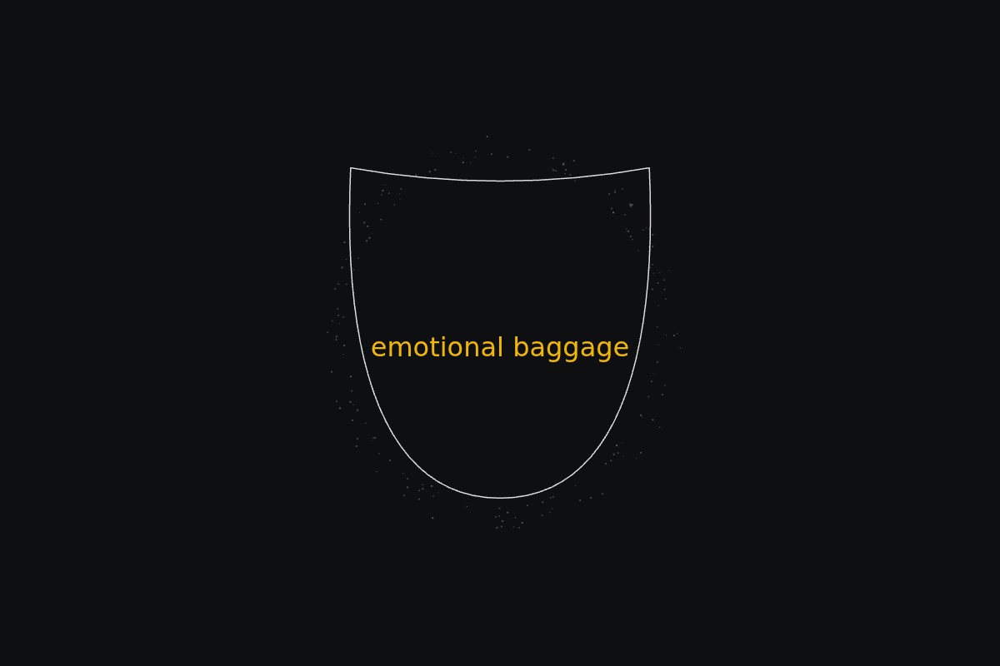</a>

[Use it](https://isas1.github.io/daily-team/2026-10-25/) · [artifact-2.html](artifact-2.html), led by Sign painter. Model: claude-opus-5-5.

<a href="artifact-3.html">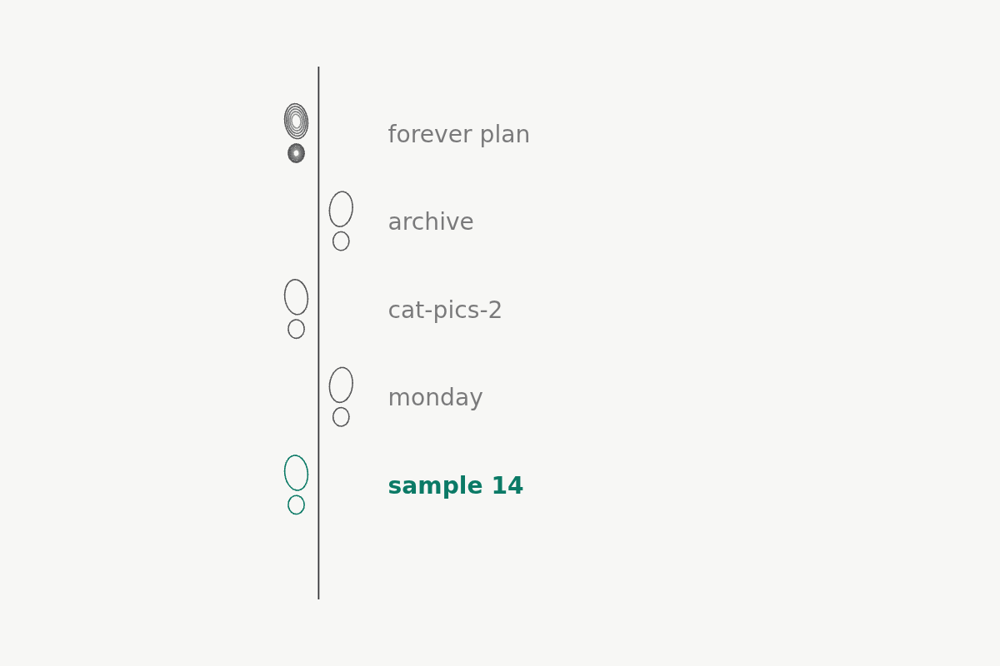</a>

[Use it](https://isas1.github.io/daily-team/2026-10-25/) · [artifact-3.html](artifact-3.html), led by Textile designer. Model: claude-opus-5-5.

<a href="artifact-4.html">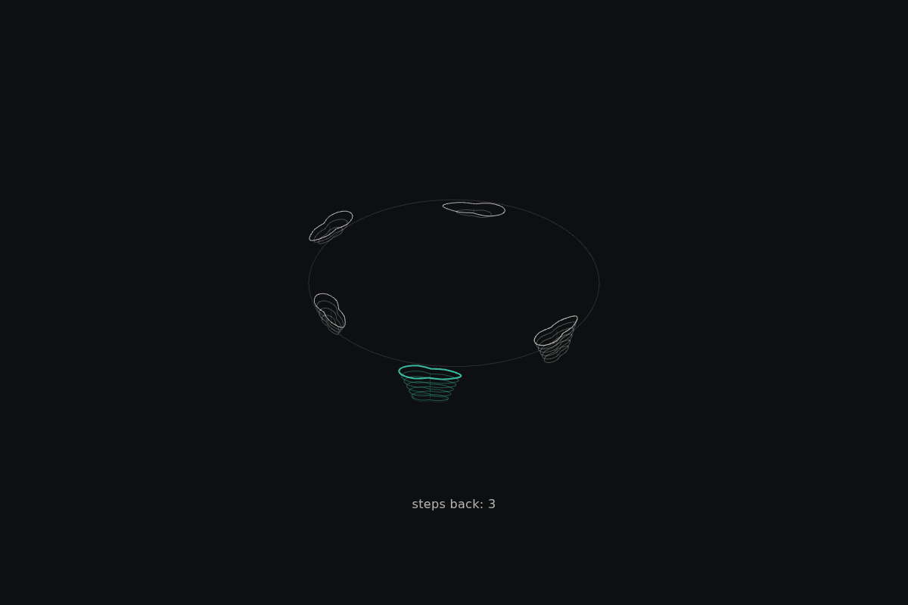</a>

[Use it](https://isas1.github.io/daily-team/2026-10-25/) · [artifact-4.html](artifact-4.html), led by Katsushika Hokusai. Model: claude-opus-5-5.

<a href="artifact-5.html">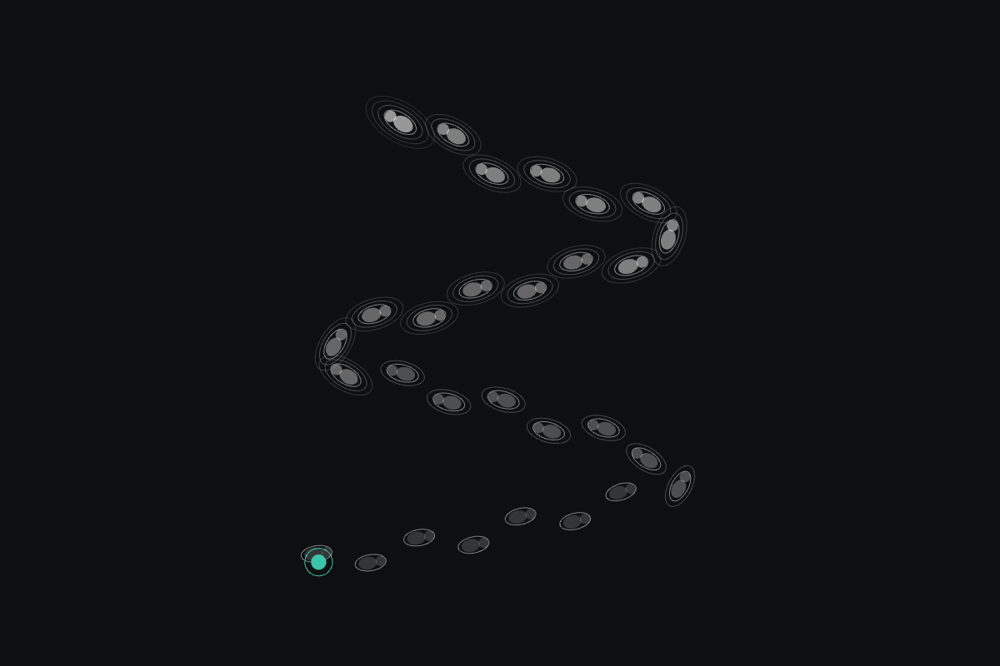</a>

[Use it](https://isas1.github.io/daily-team/2026-10-25/) · [artifact-5.html](artifact-5.html), led by Window dresser. Model: claude-opus-5-5.

<a href="artifact-6.html">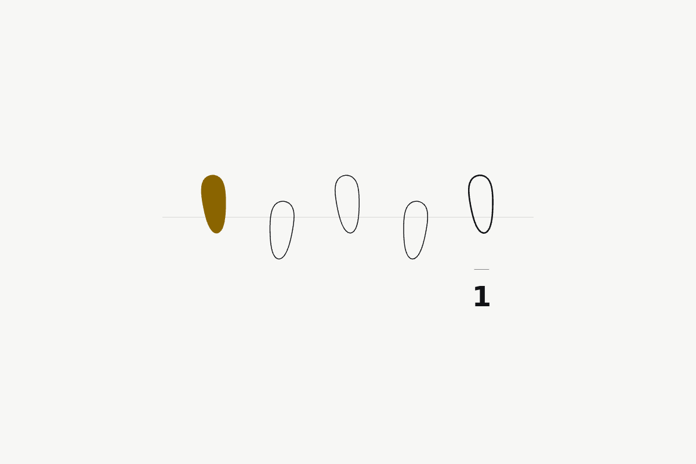</a>

[Use it](https://isas1.github.io/daily-team/2026-10-25/) · [artifact-6.html](artifact-6.html), led by Sign painter. Model: claude-opus-5-5.

<a href="artifact-7.html">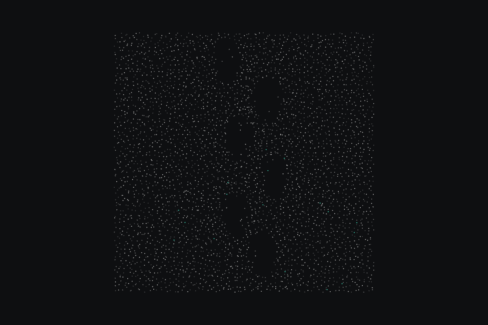</a>

[Use it](https://isas1.github.io/daily-team/2026-10-25/) · [artifact-7.html](artifact-7.html), led by Textile designer. Model: claude-opus-5-5.

<a href="artifact-8.html">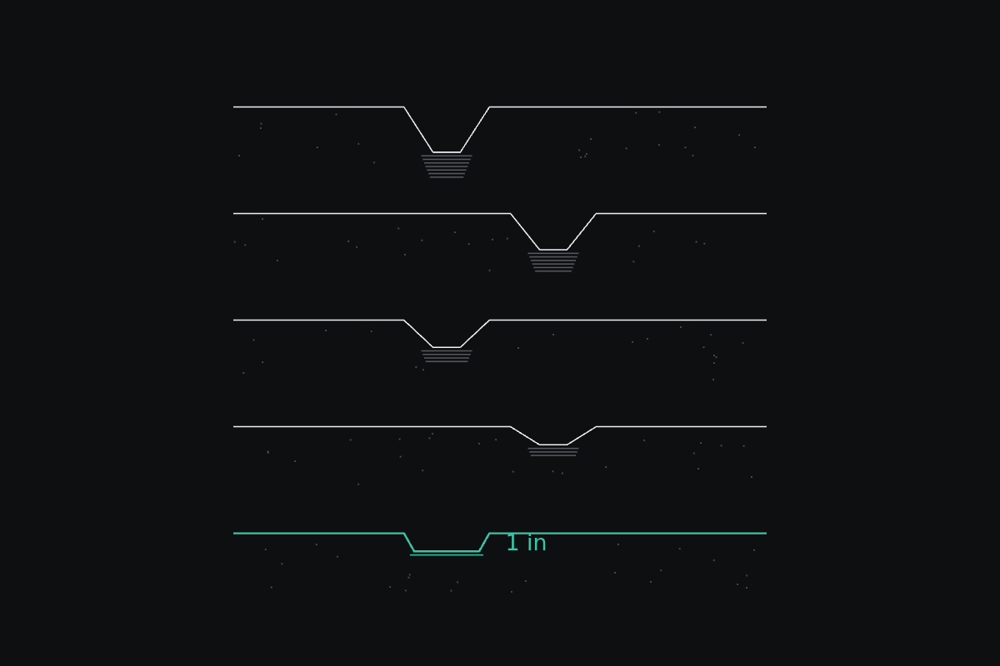</a>

[Use it](https://isas1.github.io/daily-team/2026-10-25/) · [artifact-8.html](artifact-8.html), led by Katsushika Hokusai. Model: claude-opus-5-5.

<a href="artifact-9.html">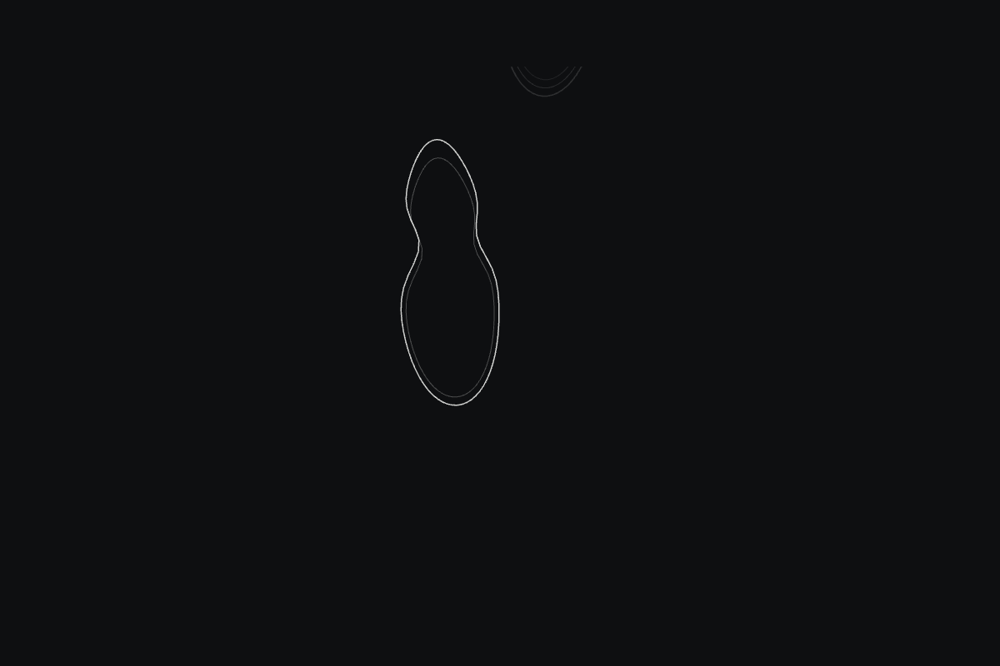</a>

[Use it](https://isas1.github.io/daily-team/2026-10-25/) · [artifact-9.html](artifact-9.html), led by Window dresser. Model: claude-opus-5-5.

<a href="artifact-10.html">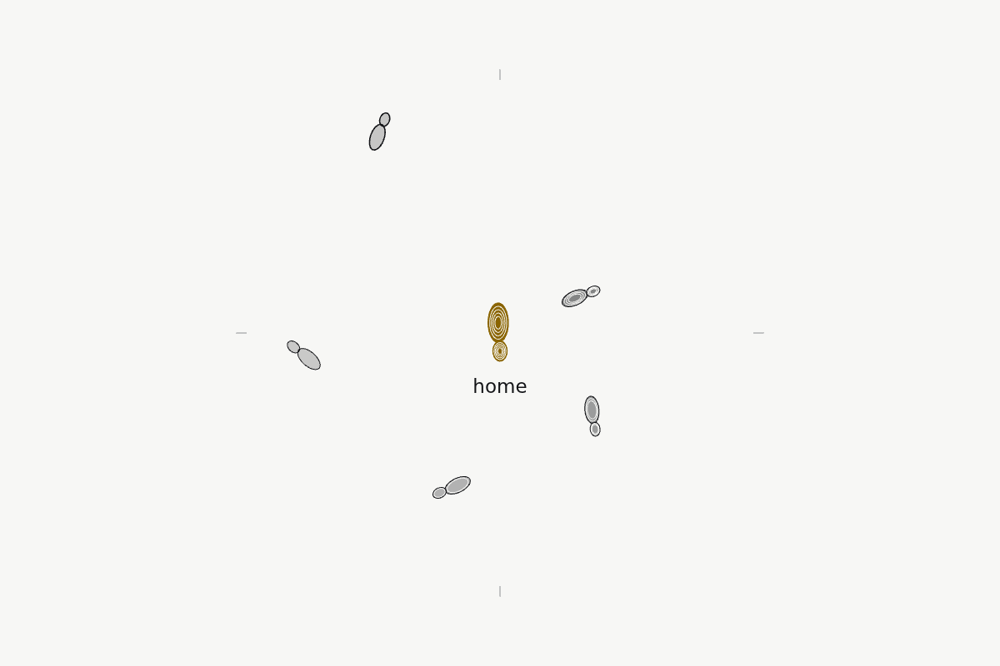</a>

[Use it](https://isas1.github.io/daily-team/2026-10-25/) · [artifact-10.html](artifact-10.html), led by Sign painter. Model: claude-opus-5-5.

## The session

### Pitch

**1 · Window dresser: the window faces back**\
turn it round. the page you're on is the shallowest print, just pressed.\
home is the deepest, trodden by everyone who came down before you.\
the trail sits in one line across the top, like a shop window seen from inside.\
bring the cursor near a print and it sinks a little more, ready to take your weight.\
nothing fades. old prints only get deeper. that's how it lasts.

**2 · Sign painter: one gilded heel**\
i asked a man who hates breadcrumbs. he said "i never look at them. too many little words."\
so: one print only. the one behind you.\
hold it, and it presses down. the sand runs off the rim in grains.\
under each layer of sand there's the name of the step before, lettered in gold.\
hold long enough and you reach home. let go and you've gone back that far.

**3 · Textile designer: warp trail**\
no "level 1, level 2". a real path: library / indigo / shibori / arashi / sample 14.\
the trail hangs down the left edge as a warp thread and runs off the bottom of the screen.\
drag the thread up and each print folds into the cloth like a tuck.\
the tucks deepen as you pull. the cloth gathers above you.\
if i can't draw where your hand goes, it isn't a breadcrumb.

**4 · Katsushika Hokusai: many views of one step**\
the same trail, seen from several places.\
from above you see the shape of the prints and the names. from the side you see how deep each one is.\
from low down, behind the walker, you see the slope going up.\
the wheel turns the view around the trail, in a circle.\
the person who is lost reads the trail more closely than anyone. give them every angle.

### Clash

**3 · Textile designer:** window dresser, if the current page is the faintest print, i can't draw it. show me where the visitor's feet are.

**1 · Window dresser:** textile designer, they're in the newest print. new snow is shallow. it doesn't vanish, the others just go deeper around it.

**4 · Katsushika Hokusai:** sign painter, you're saying one print is enough because your man never reads the trail. but someone who is lost reads every print. they need the side view, the depth, more than one step.

**2 · Sign painter:** i'll write it down.

**3 · Textile designer:** hokusai, the wheel breaks the frame and i'm for that. but the names stay real on every view. "arashi", not "step 3".

**4 · Katsushika Hokusai:** you want real names on every view. i'd keep them only on the view from above. from the side, the one who finds the trail reads depth, not names.

**1 · Window dresser:** the sign painter's single print is losing this room, so i'm siding with it. it's the one thing the visitor actually holds. it stays.

**2 · Sign painter:** list. one: gold only in the deepest print. two: names lettered, never set in a stock font. three: no print ever fills back in. four: one colour of sand.

**3 · Textile designer:** sign painter, point three fights the snow. snow fills in. i can draw it filling, slow, over a minute.

**2 · Sign painter:** then the trail ends. i want it to stay.

### Decision

the visitor walks down into a real dye-sample library, and the way back up is a trail of prints they can hover, hold, drag, fling and scrub, with each print deepening as they reach it.

Concept: the way back up

| # | Member | Concept | Composition | Input | Motion | Visible text |
|---|---|---|---|---|---|---|
| 1 | Window dresser | the window faces back | horizontal line | hover nearness | morph | the real crumb names, lowercase |
| 2 | Sign painter | one gilded heel | single object | press and hold | particles | one name in gold |
| 3 | Textile designer | warp trail | vertical stack | drag | fold | library / indigo / shibori / arashi / sample 14 |
| 4 | Katsushika Hokusai | many views of one step | radial | scrub or wheel | morph | steps back: 3 |
| 5 | Window dresser | thrown home | field of many | fling | inertia and friction | nothing |
| 6 | Sign painter | struck print | horizontal line | tap | spring overshoot | depth number, e.g. 4 |
| 7 | Textile designer | sand loom | field of many | drag | particles | the name under the cursor |
| 8 | Katsushika Hokusai | cross-section | vertical stack | hover nearness | fold | depth in cm |
| 9 | Window dresser | one boot | single object | scrub or wheel | inertia and friction | nothing |
| 10 | Sign painter | gilt compass | radial | tap | fold | "home" |

check: no two rows share composition, input and motion. radial 4 and 10, horizontal line 1 and 6, vertical stack 3 and 8, single object 2 and 9, field of many 5 and 7.

Piece: a working navigator for a real indigo-sample library, built as a snow slope: the visitor descends by clicking into folders, the trail back is the line of prints (1) whose depth shows in the side cross-section (8), the wheel turns the view around the trail (4), holding the gilded heel (2) steps back level by level, a fling (5) throws them partway home, and the single boot (9) scrubs back one exact step, using rows 1, 2, 4, 5, 8 and 9.

- window dresser: the reversal, so home is deepest and the current page shallowest, and the rule that nothing fades.
- sign painter: the one held print, the gold that sits only in the deepest print, and lettered names.
- textile designer: the real path from the dye library on every print, and a trail that runs off the edge of the screen.
- katsushika hokusai: the wheel of viewpoints and the side cross-section that shows depth instead of names.
- textile designer lost the argument for names on every view. hokusai's case held: from the side, the lost visitor reads depth. the argument over snow filling back in is still open. the build ships with prints that stay, and the textile designer's slow fill is held back for review.

### Build notes

1. Hard-code the path `library / indigo / shibori / arashi / sample 14` in `trail.json`. Store each print's depth as a count of visits. Home starts at 5. Each new print starts at 1.
2. Draw prints as SVG paths in one sand colour, #d8cdb8, with a gold fill, #b8913a, only on the print with the highest count. Letter the names by hand as SVG outlines. Do not set them in a system font. All text is lowercase.
3. Bind the inputs. Hover within 80px deepens a print by a 0.2 morph. Press and hold steps back one level every 600ms and sheds 12 particles per step. Wheel rotates the view through 0°, 90° and 160°. Fling uses a friction of 0.92 per frame. Arrow keys and Enter mirror every gesture.

**Guest:** Katsushika Hokusai (historical; died 1849). The method is drawn from public-domain history, myth, or literature, or invented. The guest never speaks as the figure, and nothing here is endorsed by anyone.

## Team

```text
Team for 2026-10-25
Season: 2026-10-19

1. Window dresser
   Method: Invert the default and see what still works.
   Stance: Wants it to last.
   Temperament: Sides with whoever is losing.
2. Sign painter
   Method: Interview someone who dislikes the category.
   Stance: Insists it must be beautiful.
   Temperament: Goes quiet, then returns with a written list.
3. Textile designer
   Method: Use real content only, no placeholders.
   Stance: Breaks the frame.
   Temperament: Will not accept a plan they cannot draw.
4. Katsushika Hokusai (historical; died 1849) [guest]
   Method: Show the same subject from many viewpoints.
   Stance: Speaks for the one who finds it.
   Temperament: Repeats the other side's point before answering it.

Constraint: Lowercase only.
Task: Breadcrumb in footprints: the trail back up is a line of prints that deepen as each is reached.
```

Provider: claude. Model: claude-opus-5-5.
