# 2026-10-26: Bracket and Ledger

[Today](../../README.md) · [Archive](../../ARCHIVE.md)

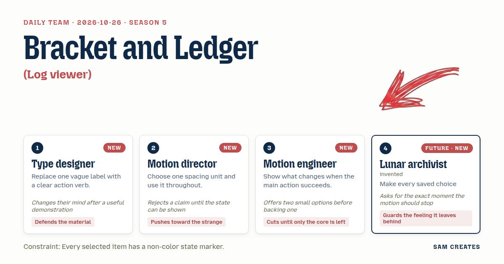

**Task:** Log viewer: a compact panel for a developer tool that filters sample events by severity and opens the selected event details.

**Request source:** [isas1/web-components #127](https://github.com/isas1/web-components/issues/127). Local prototype; source issue stays open.

**Constraint:** Every selected item has a non-color state marker.

**Season:** 2026-10-26

**Decision:** The page is a compact log panel for a developer tool: the visitor filters sample events by severity, selects one with mouse, touch or keyboard, and opens its details beside or below the list.

## Asset

<a href="piece.html"></a>

[Use it](https://isas1.github.io/daily-team/2026-10-26/) · [piece.html](piece.html), led by Type designer. Model: claude-opus-5-5.

<a href="artifact-1.html">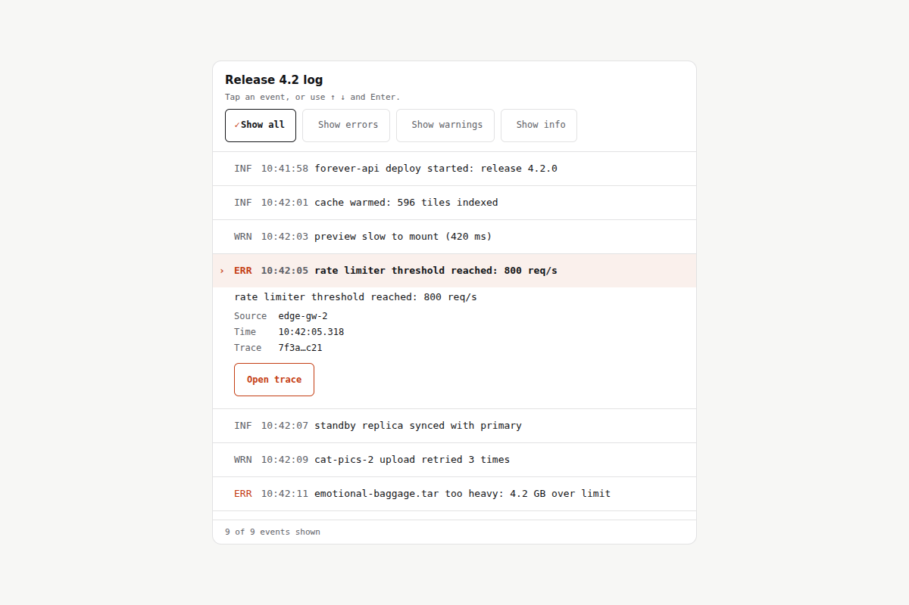</a>

[Use it](https://isas1.github.io/daily-team/2026-10-26/) · [artifact-1.html](artifact-1.html), led by Type designer. Model: claude-opus-5-5.

<a href="artifact-2.html">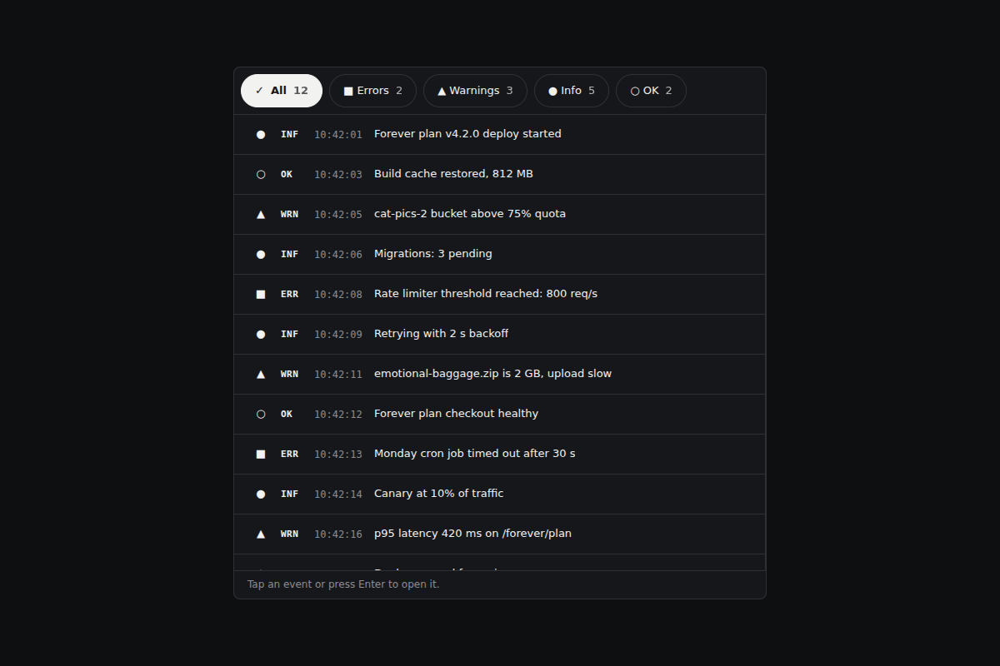</a>

[Use it](https://isas1.github.io/daily-team/2026-10-26/) · [artifact-2.html](artifact-2.html), led by Motion director. Model: claude-opus-5-5.

<a href="artifact-3.html">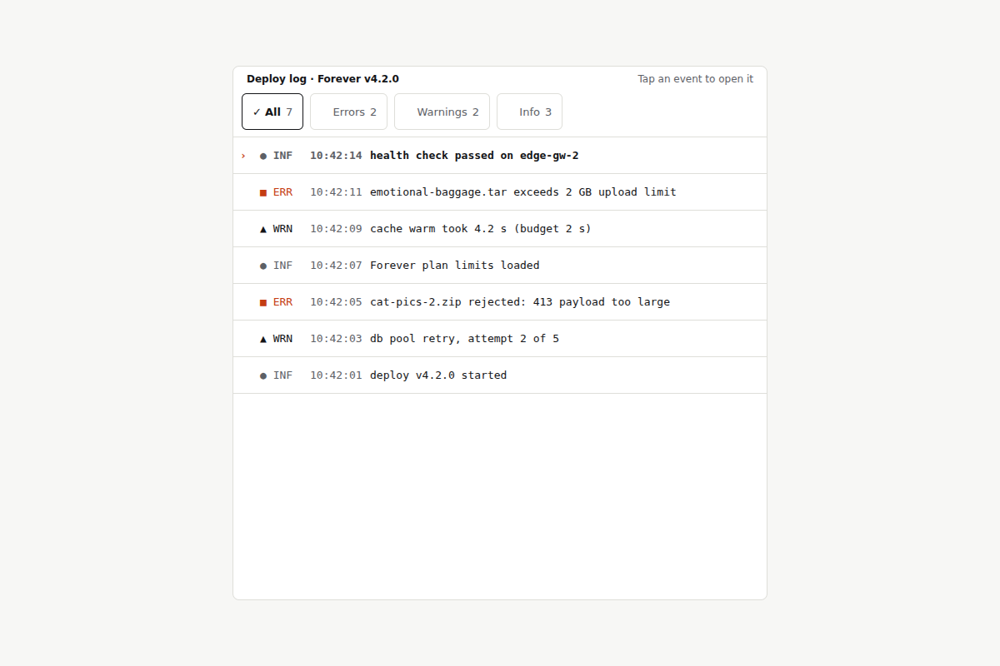</a>

[Use it](https://isas1.github.io/daily-team/2026-10-26/) · [artifact-3.html](artifact-3.html), led by Motion engineer. Model: claude-opus-5-5.

<a href="artifact-4.html">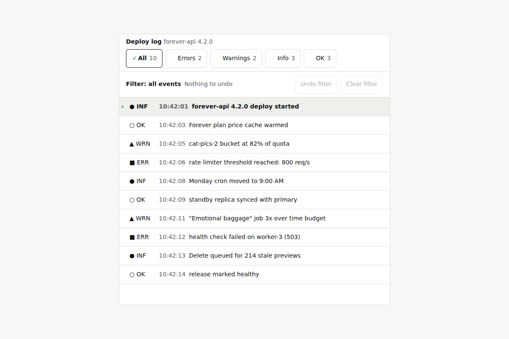</a>

[Use it](https://isas1.github.io/daily-team/2026-10-26/) · [artifact-4.html](artifact-4.html), led by Lunar archivist. Model: claude-opus-5-5.

<a href="artifact-5.html">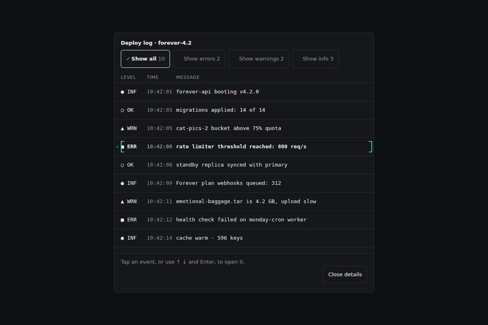</a>

[Use it](https://isas1.github.io/daily-team/2026-10-26/) · [artifact-5.html](artifact-5.html), led by Type designer. Model: claude-opus-5-5.

<a href="artifact-6.html">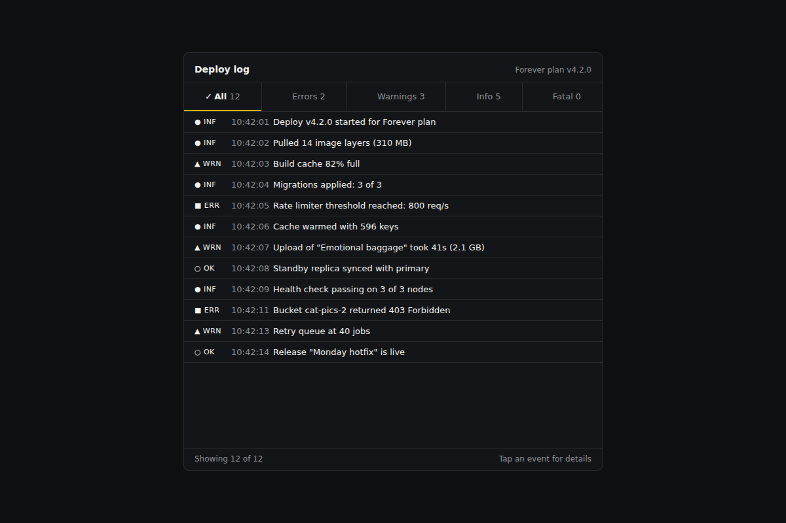</a>

[Use it](https://isas1.github.io/daily-team/2026-10-26/) · [artifact-6.html](artifact-6.html), led by Motion director. Model: claude-opus-5-5.

<a href="artifact-7.html">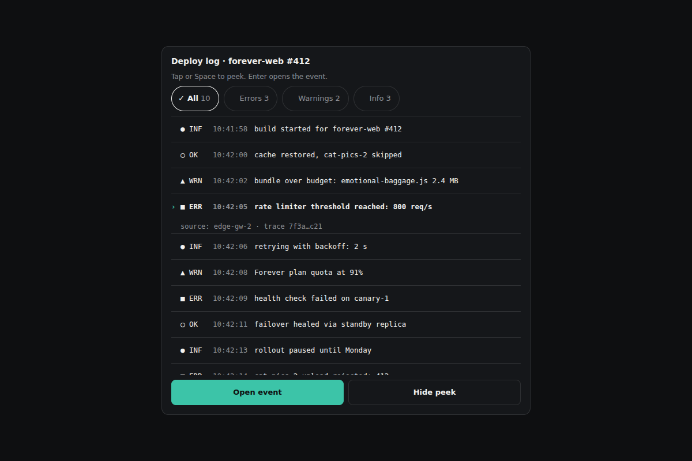</a>

[Use it](https://isas1.github.io/daily-team/2026-10-26/) · [artifact-7.html](artifact-7.html), led by Motion engineer. Model: claude-opus-5-5.

<a href="artifact-8.html">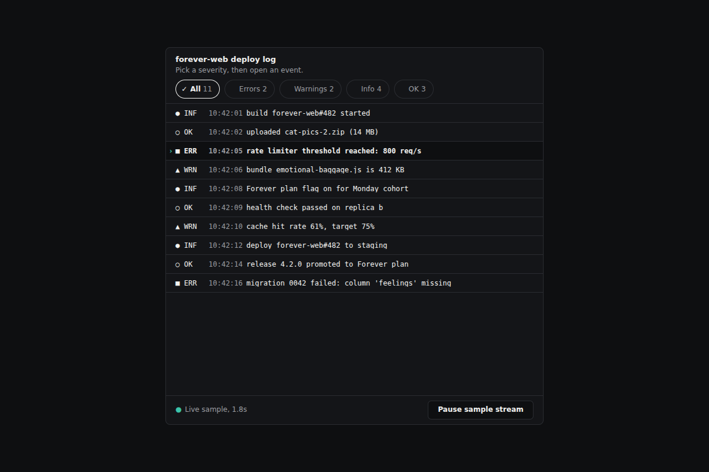</a>

[Use it](https://isas1.github.io/daily-team/2026-10-26/) · [artifact-8.html](artifact-8.html), led by Lunar archivist. Model: claude-opus-5-5.

<a href="artifact-9.html">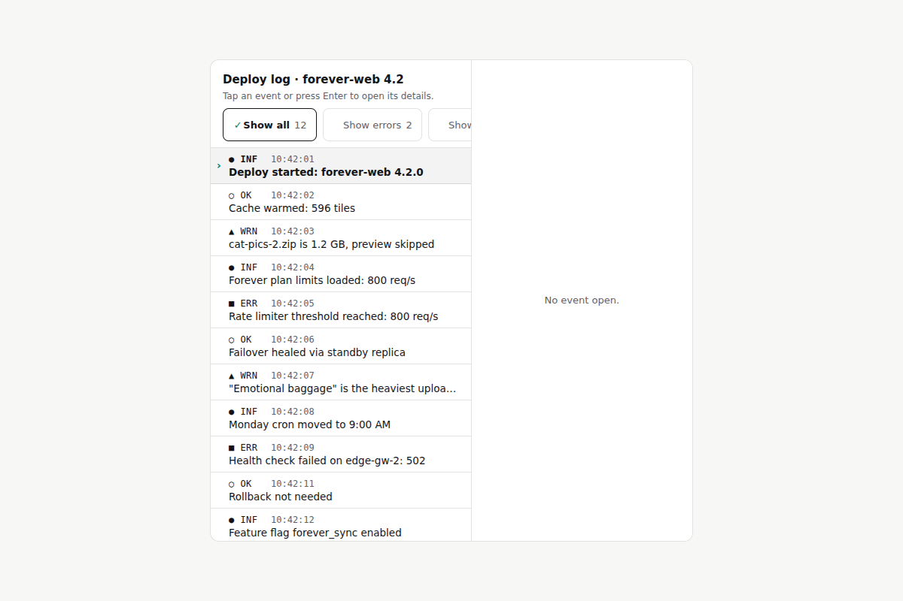</a>

[Use it](https://isas1.github.io/daily-team/2026-10-26/) · [artifact-9.html](artifact-9.html), led by Type designer. Model: claude-opus-5-5.

<a href="artifact-10.html">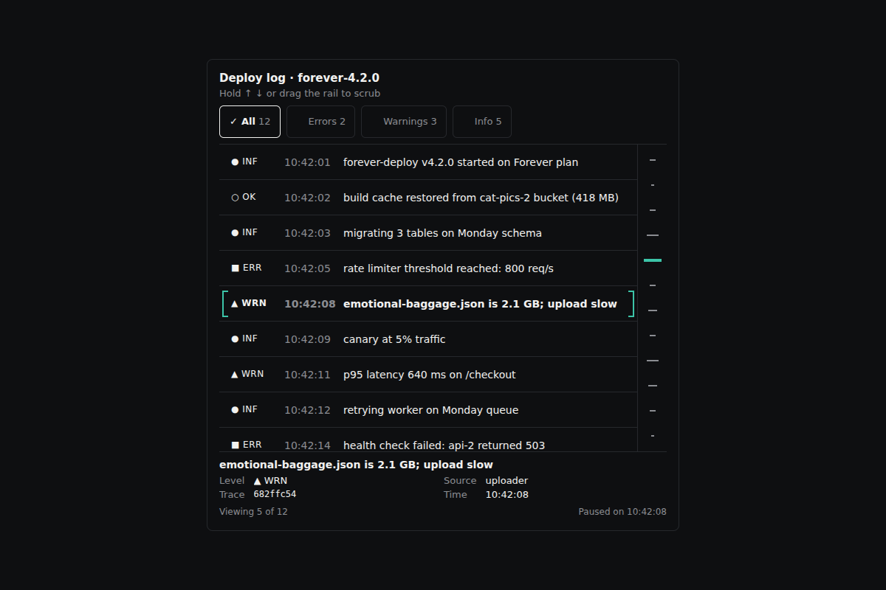</a>

[Use it](https://isas1.github.io/daily-team/2026-10-26/) · [artifact-10.html](artifact-10.html), led by Motion director. Model: claude-opus-5-5.

## The session

### Pitch

**1 · Type designer: Weight Rail**\
A list of log lines in mono, set at 13px with tabular figures so the timestamps stack.\
Each filter is a verb: "Show errors," "Show warnings," "Show all."\
The selected row turns heavier, from 400 to 650, and a bracket appears in its gutter.\
Severity is spelled out in letters (ERR, WRN, INF, OK), so the meaning does not depend on colour.\
Opening a row unfolds its detail under it. Same font, smaller, with the trace ID set in full.\
No icons where a word works.

**2 · Motion director: Eight-Pixel Drawer**\
One unit, 8px. Rows are 32. The gutter is 16. The drawer is 320.\
Open an event and the list does something odd. It narrows to a 48px column of severity glyphs, an index.\
The detail drawer takes the remaining width.\
Arrow keys move through the index while the drawer redraws.\
I want to see every one of those states before anyone tells me it works.

**3 · Motion engineer: Open, Then Settle**\
Two screens in one panel: the list, then the event.\
Press Enter on a row. The row lifts into the header slot, and the detail fades in under it.\
The only success action is "Copy event ID." It reads "Copied ID" for 1.6s.\
If the clipboard fails, it says so and selects the ID text instead.\
Back or Escape returns to the list, with focus on the same row.\
Nothing else.

**4 · Lunar archivist: Pinned Ledger**\
Every signal I receive arrived 1.3 seconds late and will be read again years from now.\
So each filter you pick goes on a ledger line above the list: "Filter: errors."\
Each line can be undone. Ctrl+Z, or the "Undo filter" button.\
The open event keeps its place even when new events land.\
I want to know the frame where everything comes to rest. After that, nothing moves until you touch it.

### Clash

**2 · Motion director:** Type designer, you say weight marks the selection. Put a 650 row next to a 400 row in mono and show me. Until then it's a claim.

**1 · Type designer:** Motion director, a mono with a weight axis keeps the same width. The row does not reflow. The bracket plus the weight is two markers, and neither one is a colour.

**3 · Motion engineer:** Type designer, two options. Weight alone, or a "›" glyph in a fixed 16px gutter. I back the gutter, because Menlo has no weight axis and it falls back to 400 or 700 only.

**1 · Type designer:** Engineer, you just showed me the fallback pair, and the 650 is gone. The gutter glyph comes first. Weight becomes the second marker.

**4 · Lunar archivist:** Motion director, your drawer squeezes the list into glyphs. Tell me the exact frame it stops squeezing.

**2 · Motion director:** Archivist, 240ms, and then nothing moves until the next input. The column is the point. A list that turns into an index is the strange part worth keeping.

**4 · Lunar archivist:** A message cut down to a glyph is a record I can't read back. Where I live, everything gets read long after it happened. The text has to stay on the page.

**3 · Motion engineer:** Archivist, then cut the stream. Every row that arrives while someone is reading shifts the row they were reading. One sample set, no ingest.

**4 · Lunar archivist:** Engineer, a frozen archive is the dust I live in. Keep the stream, stop it on the first touch, and say when it stopped.

**2 · Motion director:** Engineer, I side with the archivist on the stream. I'm against you both on the column. Show me a phone where the full list beats the index.

### Decision

The page is a compact log panel for a developer tool: the visitor filters sample events by severity, selects one with mouse, touch or keyboard, and opens its details beside or below the list.

Concept: Bracket and Ledger

| # | Member | Concept | Composition | Input | Motion | Visible text |
|---|---|---|---|---|---|---|
| 1 | Type designer | Weight Rail | Compact list. Detail unfolds inline under the selected row | Tap a row, or Arrow Up/Down then Enter. Tap a filter, or Tab then Space | "›" appears in the 16px gutter at 0ms. Weight 400 to 700 over 160ms ease-out. Detail height 0 to content over 200ms cubic-bezier(0.16,1,0.3,1), then stops | "Show all", "Show errors", "Show warnings", "Show info". Row: "ERR 10:42:05 rate limiter threshold reached: 800 req/s". Detail: "Trace 7f3a…c21", "Open trace" |
| 2 | Motion director | Eight-Pixel Drawer | Split panel. List narrows to a 48px severity index, and the drawer is 320px | Tap a row or Enter to open. Arrow keys move in the index. Escape closes | List width 100% to 48px and drawer translateX(24px) to 0 with opacity, both 240ms cubic-bezier(0.16,1,0.3,1). Stops at 240ms | Index glyphs "■ ▲ ● ○". Drawer: "Event 3 of 12", "Close details" |
| 3 | Motion engineer | Open, Then Settle | Stacked panel: the list view swaps for the event view | Enter or tap opens. "Back to events" button or Escape returns | Row moves from its list position into the header slot by FLIP, 220ms ease-out. Detail fades in over 120ms after a 100ms delay. The copy label swaps over 120ms | "Back to events", "Copy event ID", "Copied ID", "Copy failed. ID text selected." |
| 4 | Lunar archivist | Pinned Ledger | Toolbar with a filter ledger line above the list | Select a filter. "Undo filter" button or Ctrl+Z. "Clear filter" | A new ledger entry slides in 8px over 180ms ease-out. Undo reverses it in 180ms. Nothing moves after that | "Filter: errors", "Undo filter", "Clear filter", "Restored: all events" |
| 5 | Type designer | Severity Letterforms | Dense table with columns for level, time and message, with tabular figures | Arrow Up/Down, Home/End, tap | The "›" marker glides between rows with translateY over 140ms ease-out. The row bracket appears at the end of the glide | "■ ERR", "▲ WRN", "● INF", "○ OK", "10:42:01" |
| 6 | Motion director | Count Shutter | Segmented filter with counts, above the list | Tap a segment, or Left/Right arrows then Space | Rows that do not match collapse from 32px to 0 in steps(4) over 200ms. Matching rows close the gap over 200ms ease-out | "All 12", "✓ Errors 2", "Warnings 3", "Info 5". Empty: "No errors in this sample.", "Show all events" |
| 7 | Motion engineer | Peek Line | Single-line rows with a one-line peek under the selected row | Space to peek. Enter or the "Open event" button to open full detail. Escape closes | Peek height 0 to 24px over 140ms ease-out. Full open over 200ms. Close is 160ms ease-in | "Open event", "source: edge-gw-2", "Hide peek" |
| 8 | Lunar archivist | Stopped Stream | Panel with a sample stream line in the footer | The stream stops on the first input. "Resume sample stream" button. Reduced motion starts paused | A new row grows from 0 to 32px over 200ms ease-out every 1.8s until the first input, then stops. The selection keeps its row | "Sample stream paused at 10:42:14", "Resume sample stream", "Live sample, 1.8s" |
| 9 | Type designer | Detail Sheet | Bottom sheet on widths under 480px, side pane above that | Tap or Enter opens. "Close details" button or Escape closes. Focus returns to the row | Sheet translateY(100%) to 0 over 260ms cubic-bezier(0.16,1,0.3,1). Close is 180ms ease-in | "Close details", "Copy event ID", "Previous event", "Next event" |
| 10 | Motion director | Bracket Scrub | Compact list with corner brackets on the selected row | Hold Arrow Up/Down to scrub. Detail updates after a 150ms pause | Brackets glide row to row over 120ms linear. Detail crossfades over 100ms once the scrub stops | "[ ]" brackets, "Viewing 5 of 12", "Paused on 10:42:08" |

States:
- Normal: the full sample list, with "Show all" pressed and marked "✓".
- Focus: a 2px outline offset 2px on chips, rows and buttons, reached by Tab and the arrow keys.
- Active: a pressed chip shows "✓" and bold text. A selected row shows the "›" gutter glyph and bold weight. Both are non-colour markers.
- Disabled: "Undo filter" is greyed out and shows "Nothing to undo" until a filter changes. "Previous event" is disabled on the first row.
- Pending: copying shows "Copying…" for up to 400ms.
- Empty: a filter with no matches shows "No errors in this sample." with a "Show all events" button that recovers.
- Success: "Copied ID" for 1.6s, then the label returns to "Copy event ID".
- Failure: "Copy failed. ID text selected." The ID stays selected for a manual copy, and the button stays usable for retry.
- Stream paused: the stream stops on the first input and shows its stop time. "Resume sample stream" restarts it.

Use: A log panel inside a developer tool or deploy page. Required input: choose a severity and select an event. Observable outcome: the list narrows to that severity, and the chosen event's message, source, trace ID and timestamp open in a detail view that can be copied, closed and undone.

Base: https://github.com/isas1/creative-sites-vault/blob/7dcc3a8071841bd07d2c2d7a6347d2b00440aac5/00-components/monitors-logs/forever/rolling-log-band/rolling-log-band.html. The severity filter chips (`data-level`), the level/time/text line structure and the pause toggle on a 1.8s interval survive in rows 6 and 8. Three improvements:
1. Replace the rotateX cylinder with flat 32px rows in a `listbox` that supports arrow keys, Home/End and Enter.
2. Turn the misused `tablist` chips into `aria-pressed` toggle buttons with a "✓" glyph, counts and an empty state.
3. Stop the stream on the first input, start paused under reduced motion, and add a detail view with visible copy failure and focus return.
This plan comes from reading the source only. No visual check was made.

Inspiration: `rolling-log-band` is the base. `ci-pipeline-oscilloscope` lends the failure detail and retry pattern, used here for copy retry without alert dialogs. `bottom-sheet` lends the Escape, close button and focus return for row 9.

Request: https://github.com/isas1/web-components/issues/127. This builds one sample log viewer with made-up events. It does not resolve the issue.

Piece: A deploy log inspector panel for triaging one sample release. It uses rows 1, 3, 4, 5, 6, 8 and 9: lettered severity rows with gutter markers, a counted filter with an empty state, an undoable filter ledger, a stream that stops on touch, and a detail view that opens inline on desktop and as a sheet on phones, with copy feedback.

- Type designer: verb labels on filters, spelled-out severity letters with shape glyphs, tabular timestamps, and bold weight as the second selection marker.
- Motion director: the 8px unit (32px rows, 16px gutter, 320px pane), stepped row collapse on filter, and the index drawer kept as row 2.
- Motion engineer: the "›" gutter glyph as the first selection marker, the copy action with success and failure text, and focus return on close.
- Lunar archivist: the undoable filter ledger, the stream that stops on first input with its stop time shown, and a stated rest frame for every transition.

The motion director lost the index column as the default view, because the archivist showed that a message cut to a glyph cannot be read back; the column survives only in row 2, and that argument stays open. The motion engineer lost removing the stream, because a stream that stops on first touch keeps the sample feeling live without moving the row being read.

### Build notes

1. Build the list as `role="listbox"` with 32px `role="option"` rows. Put "›" in a fixed 16px gutter and set `font-weight: 700` on `aria-selected="true"`. Keep severity as the "■ ERR" style text in its own 56px column.
2. Make the filters `<button aria-pressed>` with "✓" and a count. Push each change onto an array shown as the ledger line. Wire "Undo filter" and Ctrl+Z to pop that array, and disable the button when the array is empty.
3. Under 480px, open the detail as a sheet at 260ms. Otherwise open it inline at 200ms. On close, return focus to the row. Wrap `navigator.clipboard.writeText` in try/catch so a failure shows "Copy failed. ID text selected." and selects the ID span. Clear the 1.8s interval on the first pointerdown or keydown.

**Guest:** Lunar archivist (future; invented). The method is drawn from public-domain history, myth, or literature, or invented. The guest speaks in character in original words, never quoting the source, and nothing here is endorsed by anyone.

## Team

```text
Team for 2026-10-26
Season: 2026-10-26

1. Type designer [new]
   Method: Replace one vague label with a clear action verb. [new]
   Stance: Defends the material.
   Temperament: Changes their mind after a useful demonstration.
2. Motion director [new]
   Method: Choose one spacing unit and use it throughout. [new]
   Stance: Pushes toward the strange.
   Temperament: Rejects a claim until the state can be shown.
3. Motion engineer [new]
   Method: Show what changes when the main action succeeds. [new]
   Stance: Cuts until only the core is left.
   Temperament: Offers two small options before backing one.
4. Lunar archivist (future; invented) [guest] [new]
   Method: Make every saved choice easy to find and reverse.
   Stance: Guards the feeling it leaves behind.
   Temperament: Asks for the exact moment the motion should stop.

Constraint: Every selected item has a non-color state marker.
Task: Latency chart: a chart card for a service dashboard that selects a time range and reveals latency at a chosen point.
```

Provider: claude. Model: claude-opus-5-5.
