# 2026-10-27: Lit Case

[Today](../../README.md) · [Archive](../../ARCHIVE.md)

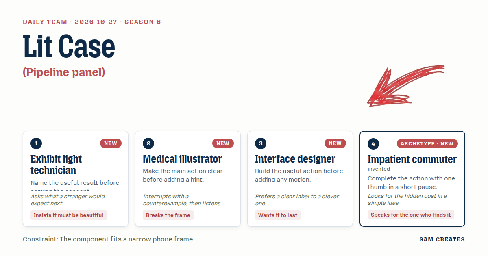

**Task:** Pipeline panel: a status panel for a build tool that expands a failed step, shows its log and retries it in a local demo.

**Request source:** [isas1/web-components #127](https://github.com/isas1/web-components/issues/127). Local prototype; source issue stays open.

**Constraint:** The component fits a narrow phone frame.

**Season:** 2026-10-26

**Decision:** The page is a phone-width pipeline panel: the visitor opens the failed build step, reads the log line that stopped it, and retries the step in a local demo.


[Cover art direction](cover.json) · [Cover source](cover.html)

## Asset

<a href="piece.html">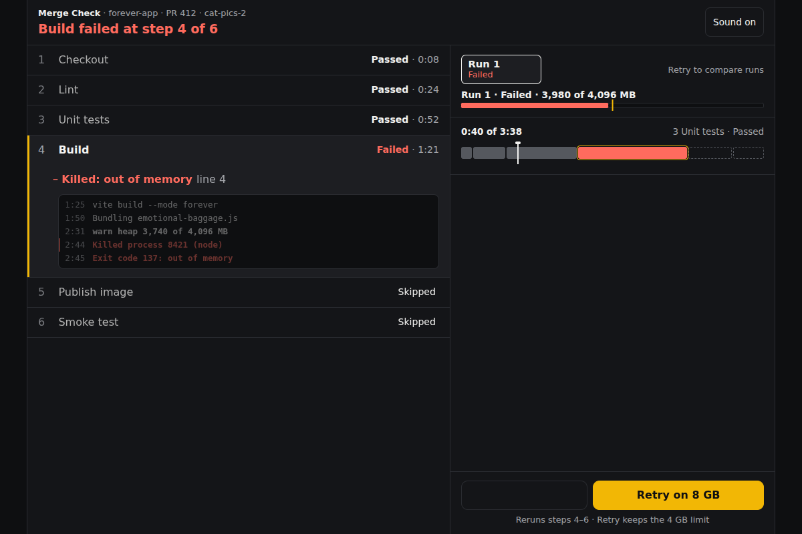</a>

[Use it](https://isas1.github.io/daily-team/2026-10-27/) · [piece.html](piece.html), led by Exhibit light technician. Model: claude-opus-5-5.

<a href="artifact-1.html">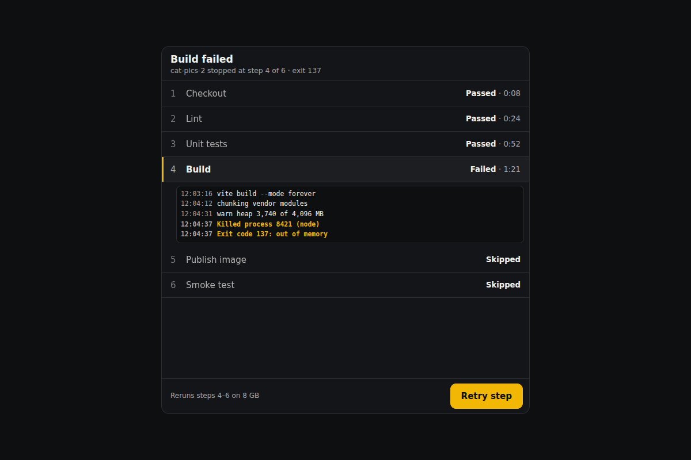</a>

[Use it](https://isas1.github.io/daily-team/2026-10-27/) · [artifact-1.html](artifact-1.html), led by Exhibit light technician. Model: claude-opus-5-5.

<a href="artifact-2.html">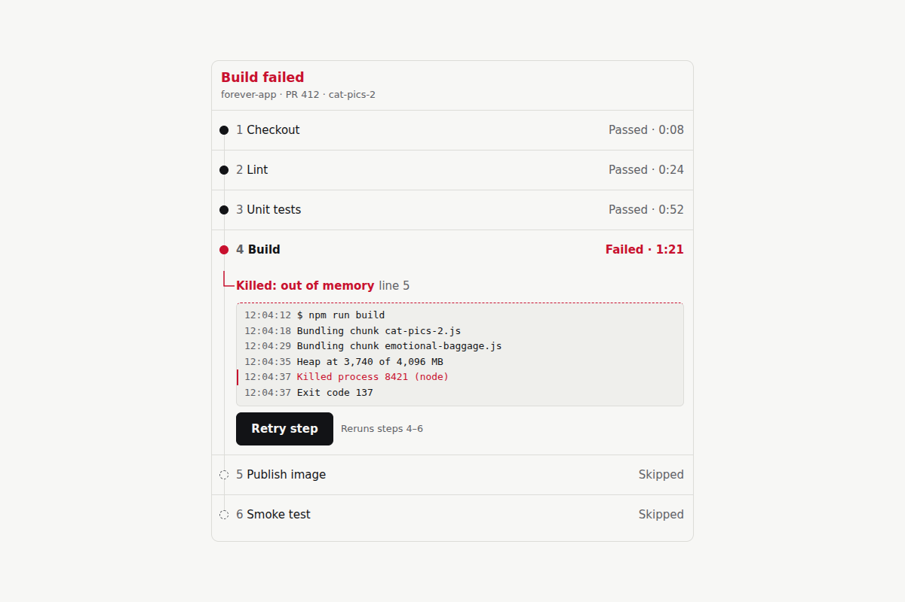</a>

[Use it](https://isas1.github.io/daily-team/2026-10-27/) · [artifact-2.html](artifact-2.html), led by Medical illustrator. Model: claude-opus-5-5.

<a href="artifact-3.html">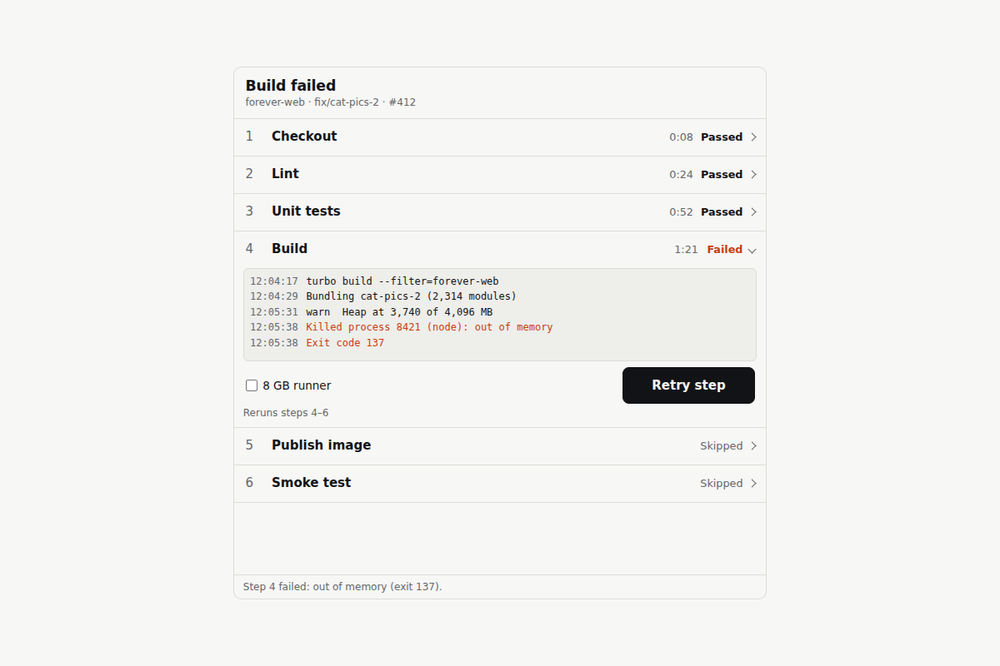</a>

[Use it](https://isas1.github.io/daily-team/2026-10-27/) · [artifact-3.html](artifact-3.html), led by Interface designer. Model: claude-opus-5-5.

<a href="artifact-4.html">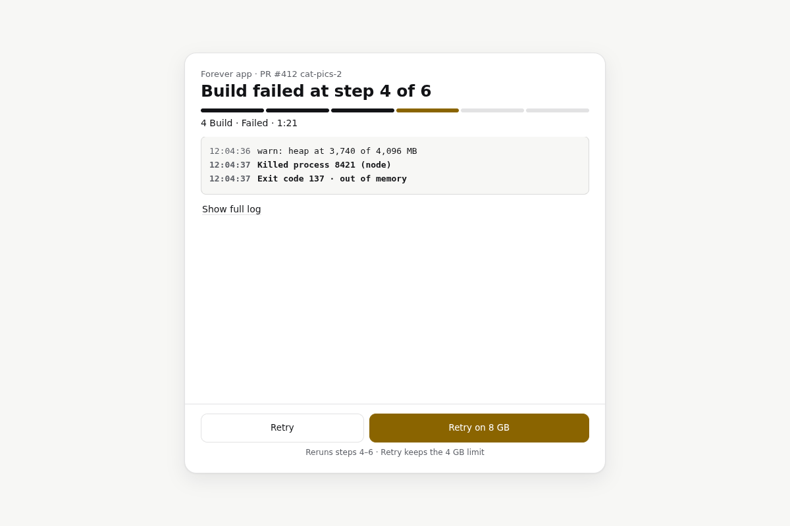</a>

[Use it](https://isas1.github.io/daily-team/2026-10-27/) · [artifact-4.html](artifact-4.html), led by Impatient commuter. Model: claude-opus-5-5.

<a href="artifact-5.html">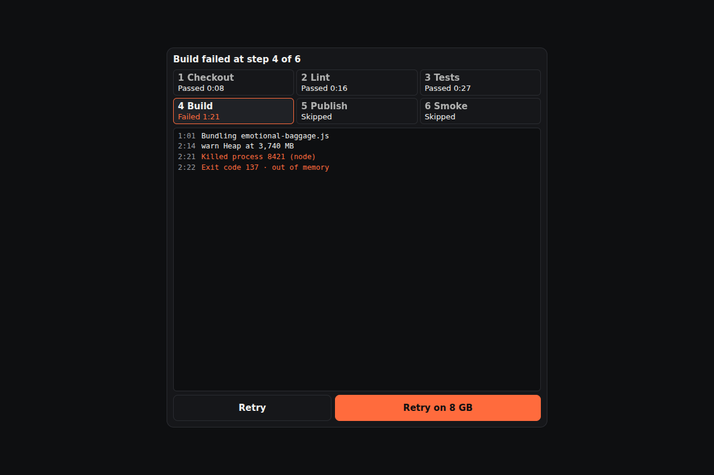</a>

[Use it](https://isas1.github.io/daily-team/2026-10-27/) · [artifact-5.html](artifact-5.html), led by Exhibit light technician. Model: claude-opus-5-5.

<a href="artifact-6.html">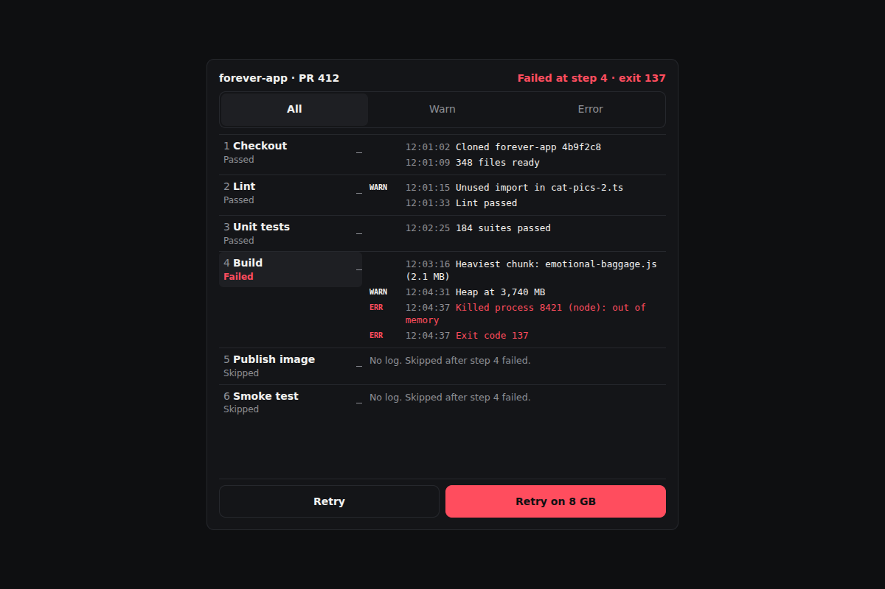</a>

[Use it](https://isas1.github.io/daily-team/2026-10-27/) · [artifact-6.html](artifact-6.html), led by Medical illustrator. Model: claude-opus-5-5.

<a href="artifact-7.html">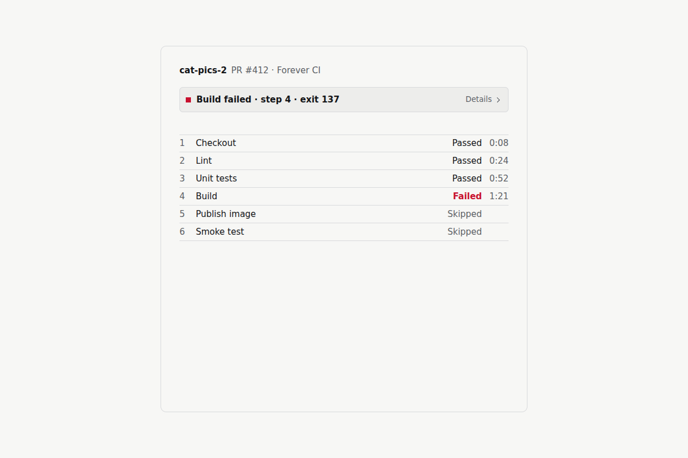</a>

[Use it](https://isas1.github.io/daily-team/2026-10-27/) · [artifact-7.html](artifact-7.html), led by Interface designer. Model: claude-opus-5-5.

<a href="artifact-8.html">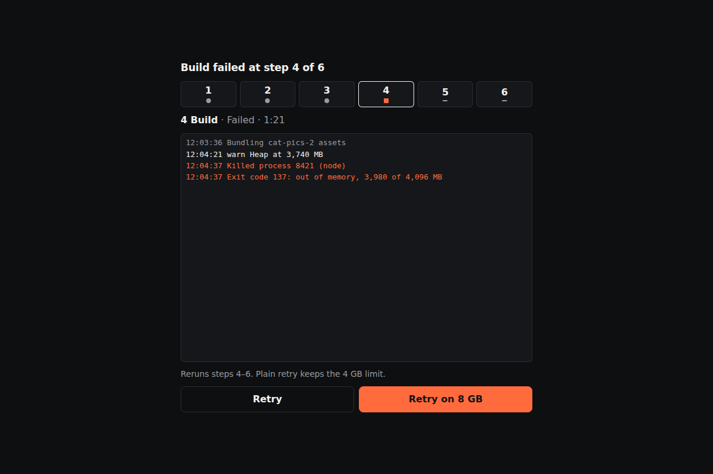</a>

[Use it](https://isas1.github.io/daily-team/2026-10-27/) · [artifact-8.html](artifact-8.html), led by Impatient commuter. Model: claude-opus-5-5.

<a href="artifact-9.html">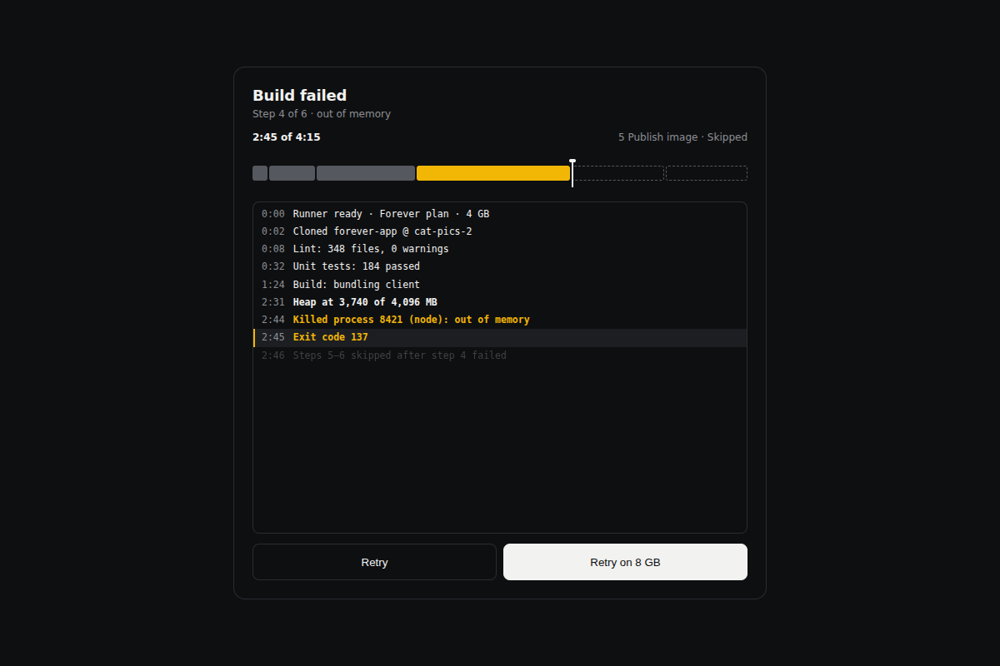</a>

[Use it](https://isas1.github.io/daily-team/2026-10-27/) · [artifact-9.html](artifact-9.html), led by Exhibit light technician. Model: claude-opus-5-5.

<a href="artifact-10.html">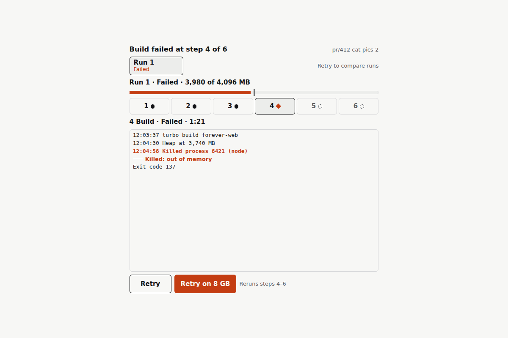</a>

[Use it](https://isas1.github.io/daily-team/2026-10-27/) · [artifact-10.html](artifact-10.html), led by Medical illustrator. Model: claude-opus-5-5.

## The session

### Pitch

**1 · Exhibit light technician: Spotlit Step**\
You open the panel and see one thing first: which step broke.\
Six steps sit in a case. The failed one is lit. The other five drop back to a low level.\
Its log sits under it the way a label sits under an object.\
After you press Retry, the light moves on to step 5, then step 6, as each one runs.\
A stranger's next question is "did it work". The light should answer that before the text does.

**2 · Medical illustrator: Cutaway**\
Exit 137 is a symptom. The visitor needs the cause.\
Tap the failed step and the row opens like a cross-section.\
The log is cut at the line that killed the process, not scrolled to the bottom.\
A short leader line runs from the step's dot to that line and labels it: "Killed: out of memory".\
Retry sits below the cut, where your eye lands after the label.

**3 · Interface designer: Plain Accordion**\
Six rows. Each row is a native button with `aria-expanded`.\
Status is a word: Passed, Failed, Skipped. Colour only repeats the word.\
Only one row is open at a time. The open row holds the log and a Retry button.\
The Retry label reserves its width, so "Retry step", "Retrying" and "Passed in 1:14" never push the layout.\
Build the click first. Add motion after, and keep it short.

**4 · Impatient commuter: Thumb Sheet**\
Two stops left. One thumb. Signal drops in the tunnel.\
Top line: "Build failed at step 4 of 6." That tells me where it stopped.\
Below it, the last three log lines. Tap to see more if I have time.\
At the bottom, where my thumb rests: Retry, and Retry on 8 GB.\
Plain retry hits the same wall. Tell me that before I spend a tap.

### Clash

**4 · Impatient commuter:** Light technician, your dimmed rows at 45 percent disappear on a phone in daylight on a train. I can't tell whether step 5 ran.

**1 · Exhibit light technician:** Then step 5 needs a word, "Skipped", at full contrast. The light only says where to look first. It never carries the status alone.

**2 · Medical illustrator:** Interface designer, here is a case that breaks the accordion. A row reads "exit 137" and nobody outside ops knows that means memory. My leader label does.

**3 · Interface designer:** Write that label, then. But a line drawn across the frame breaks at 252 px and lands on the Retry button. Keep it inside the row.

**2 · Medical illustrator:** Inside the row, then. The log still opens at the failing line, with two lines above it for context.

**4 · Impatient commuter:** Interface designer, your Retry button hides the bill. A plain retry reruns 3 steps and fails again at 4 GB. Say so before I tap.

**3 · Interface designer:** Two clear labels: "Retry" and "Retry on 8 GB". No price on a button. The text goes stale the day pricing changes.

**4 · Impatient commuter:** Then put it under the button in small type. Someone pays for those runner minutes, and it isn't the button.

**1 · Exhibit light technician:** Medical illustrator, after it passes, a stranger expects the next steps to start. The light walks to 5 and 6 at the pace they actually run, not faster.

### Decision

The page is a phone-width pipeline panel: the visitor opens the failed build step, reads the log line that stopped it, and retries the step in a local demo.

Concept: Lit Case

| # | Member | Concept | Composition | Input | Motion | Visible text |
|---|---|---|---|---|---|---|
| 1 | Exhibit light technician | Spotlit Step | Compact list of 6 step rows. The failed row is lit and the others sit at 70% luminance with full-contrast status words. The log opens under the lit row. | Tap a row. Arrow Up/Down moves between rows, Enter opens a row. Retry is a native button. | Other rows dim over 300 ms ease-out. The log fades up 8 px over 220 ms cubic-bezier(0.2,0,0,1). After a pass, the highlight moves to step 5 and then step 6 as each sample step runs. | "Build failed", "4 Build · Failed · 1:21", "5 Publish image · Skipped", log lines, "Retry step" |
| 2 | Medical illustrator | Cutaway | Failed row splits open. The log is cut at the fatal line with 2 lines of context, and a 24 px leader line inside the row points to a label. | Tap the step or press Enter. Tap the label or press Enter on it to scroll the log to the fatal line. | The row opens 240 ms cubic-bezier(0.3,0,0,1). The leader line draws over 180 ms after the row opens, using stroke-dashoffset. | "Killed: out of memory", "12:04:37 Killed process 8421 (node)", "Exit code 137", "Retry step" |
| 3 | Interface designer | Plain Accordion | 6 disclosure rows with one open. The log area is 112 px tall and scrolls horizontally. The Retry button has a reserved width. | Tap or press Enter/Space on a row header. Tab reaches Retry. | Height opens over 200 ms ease-out. The label crossfades over 120 ms. Nothing else moves. | "Passed", "Failed", "Skipped", "Retry step", "Retrying", "Passed in 1:14", "Failed again" |
| 4 | Impatient commuter | Thumb Sheet | A one-line summary on top, the last 3 log lines in the middle, and two 44 px buttons anchored at the bottom. | Thumb tap on either button. Tab and Enter reach both. "Show full log" expands the log. | The sheet rises 12 px over 260 ms ease-out. The pressed button scales to 0.97 over 80 ms and releases over 120 ms. | "Build failed at step 4 of 6", "Retry", "Retry on 8 GB", "Reruns steps 4–6", "Show full log" |
| 5 | Exhibit light technician | Cue Rail | Source stage cards as a 3×2 grid of tiles, with the selected tile lit and the log below. | Tap a tile. Arrow keys move a roving tabindex across the grid. Enter selects. | The lit outline glides between tiles over 200 ms cubic-bezier(0.2,0,0,1). The log swaps with a 150 ms crossfade. | "1 Checkout 0:08", "4 Build Failed", "6 Smoke Skipped", log for the selected step |
| 6 | Medical illustrator | Labeled Log | A full log view with step names as margin labels and a filter for All, Warn and Error. | Select a filter. Arrow Left/Right moves within the segmented control. Tap a margin label to jump to that step. | Filtered lines collapse over 150 ms ease-in. Remaining lines settle over 150 ms ease-out. | "All", "Warn", "Error", "No errors in Checkout", "Heap at 3,740 MB" |
| 7 | Interface designer | Status Line | Collapsed to one 44 px line that expands to the failed step and its log. | Tap or press Enter on the line. Escape collapses it and returns focus. | Expands over 220 ms ease-out. The chevron rotates 90° over 160 ms. | "Build failed · step 4 · exit 137", "Retry step", "Collapse" |
| 8 | Impatient commuter | Cost Before Tap | A Retry block with a scope line and an Undo window of 4 s before the rerun starts. | Tap Retry, then tap Undo within 4 s. Enter and Tab work for both. | A 4 s linear bar marks the undo window. It is labeled as the undo window, so it does not read as build progress. | "Retry on 8 GB", "Reruns steps 4–6", "Starting in 4 s", "Undo" |
| 9 | Exhibit light technician | Timeline Sweep | The source's scrubber, reduced to a 6-segment run bar with the failed segment marked. The log line at the cursor is highlighted. | Drag the cursor. Arrow keys step through timestamps and Home/End jump to the ends. It is a native range input. | The cursor follows input with no easing. The matching log line highlights over 120 ms. | "0:00", "2:45 of 4:15", "Build", "Exit code 137" |
| 10 | Medical illustrator | Before / After Plate | Two run tabs that show peak memory and result side by side after a retry. | Tap the Run 1 or Run 2 tab. Arrow Left/Right switches tabs. | Content crossfades over 180 ms. The memory bar width animates over 240 ms ease-out. | "Run 1 · Failed · 3,980 of 4,096 MB", "Run 2 · Passed · 5,120 of 8,192 MB" |

States:
- Normal: The panel loads with step 4 failed and open. Steps 5–6 read "Skipped".
- Focus: A 2 px outline with a 2 px offset appears on every row, tile, tab, filter and button.
- Active: Buttons scale to 0.97 for 80 ms. The selected row or tile stays lit.
- Disabled: Retry buttons disable while a retry is pending. Skipped steps have no Retry button.
- Pending: Labels change to "Retrying" and step 4 reads "Running". Steps 5–6 read "Queued". An aria-live line announces each change. There is no percent bar.
- Empty: A skipped step's log reads "No log. Skipped after step 4 failed." An empty filter result reads "No errors in Checkout".
- Success: "Retry on 8 GB" passes in 1:14. Steps 5–6 run in sequence and the summary reads "Build passed".
- Failure: Plain "Retry" fails again with exit 137 and the label reads "Failed again". The 8 GB option stays enabled as the recovery. A "Reset demo" link restores the original run.
- Reduced motion: All transitions are instant and the highlight jumps instead of moving.

Use: The panel belongs in a small team app or a CI view for a side project, wherever someone checks a pull request build on their phone. It needs a run with ordered steps and logs, plus a retry action. The visitor can see which step failed and why, and can see a retry change the step and every later step to a final state.

Base: https://github.com/isas1/creative-sites-vault/blob/2cc613c24464c5ec4921bc6d3dcefb322a955a71/00-components/devtools-delivery/ci-oscilloscope/ci-pipeline-oscilloscope.html. Three mechanisms survive. Rows 5 and 9 keep the stage selection with status meta. Rows 1–3 keep the timestamped log with severity classes. The retry flips the failed step's state, now with a rerun scope. Improvements:
1. Replace the `alert()` and the div `role="button"` cards with native buttons and an aria-live status line.
2. Make retry update one shared sample state. Plain retry fails again, 8 GB passes, and steps 5–6 move from Skipped to Queued to Passed in order.
3. Drop the canvas, the oscilloscope housing and the fault toggle. Fit everything inside the 252 px square left after the 44 px and 56 px wall rows (`wallInset: true`), and give the log horizontal scroll.

These are build targets from reading the source. Nothing has been checked visually yet.

References: The panel's sample data stays within issue #127 (https://github.com/isas1/web-components/issues/127). It does not claim to resolve that issue.
- `buttons/splitflap/01-riffle-label-button.html` supplies the reserved-width Retry label states.
- `loaders/05-dash-orbital-ring/var-1-arc-spinner.html` supplies honest pending feedback with no invented progress.
- `monitors-logs/forever/rolling-log-band/rolling-log-band.html` supplies the severity filter and its empty result for row 6.

Piece: Merge Check is a phone-width tool for a team app, where a reviewer opens a pull request's failed build, scrubs to the fatal line, retries on 8 GB with a 4 s undo, and compares both runs before merging, using rows 1, 2, 3, 4, 8, 9 and 10.

- Exhibit light technician: The lit failed row, the highlight that walks through steps 5–6 as they run, and the timeline sweep.
- Medical illustrator: The cutaway that opens at the fatal line, the "Killed: out of memory" label, and the before/after plate.
- Interface designer: Native disclosure rows, word-based status, reserved-width labels and the 200 ms ceiling on motion.
- Impatient commuter: The two bottom-anchored retry buttons, the "Reruns steps 4–6" scope line and the undo window.
- The medical illustrator lost the leader line that crossed the frame, because at 252 px it covered Retry. The commuter lost the price line under the button. "Reruns steps 4–6" ships instead, because scope stays true when pricing changes.

### Build notes

1. Hold all sample state in one object: 6 steps, each with a status, a duration and log lines. Plain retry writes "Failed again" and 3,980 MB. The 8 GB retry runs step 4 for 1.4 s, then steps 5 and 6 for 0.8 s each. Every view reads only from this object.
2. Lay out at 252×252 px. Give the summary 32 px, rows 36 px and the open log 112 px with `overflow-x: auto`. Put the buttons in a 44 px bottom bar. Test at 320 px viewport width and 200% text zoom.
3. Wire the keys: Arrow Up/Down on rows, a roving tabindex on the rail, a native range for the sweep, and Escape to collapse with focus returned. Route every status change through one `aria-live="polite"` line. Gate every transition behind `prefers-reduced-motion`.

**Guest:** Impatient commuter (archetype; invented). The method is drawn from public-domain history, myth, or literature, or invented. The guest speaks in character in original words, never quoting the source, and nothing here is endorsed by anyone.

## Team

```text
Team for 2026-10-27
Season: 2026-10-26

1. Exhibit light technician [new]
   Method: Name the useful result before naming the concept. [new]
   Stance: Insists it must be beautiful.
   Temperament: Asks what a stranger would expect next.
2. Medical illustrator [new]
   Method: Make the main action clear before adding a hint. [new]
   Stance: Breaks the frame.
   Temperament: Interrupts with a counterexample, then listens.
3. Interface designer [new]
   Method: Build the useful action before adding any motion. [new]
   Stance: Wants it to last.
   Temperament: Prefers a clear label to a clever one.
4. Impatient commuter (archetype; invented) [guest] [new]
   Method: Complete the action with one thumb in a short pause.
   Stance: Speaks for the one who finds it.
   Temperament: Looks for the hidden cost in a simple idea.

Constraint: The component fits a narrow phone frame.
Task: Unread count: a badge for an inbox that updates when messages arrive or someone marks them read.
```

Provider: claude. Model: claude-opus-5-5.
