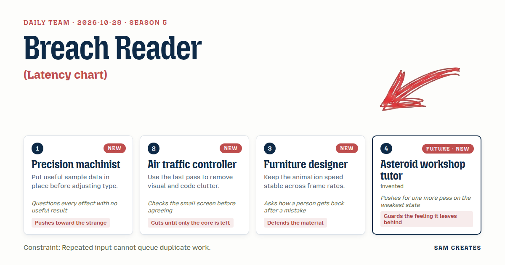
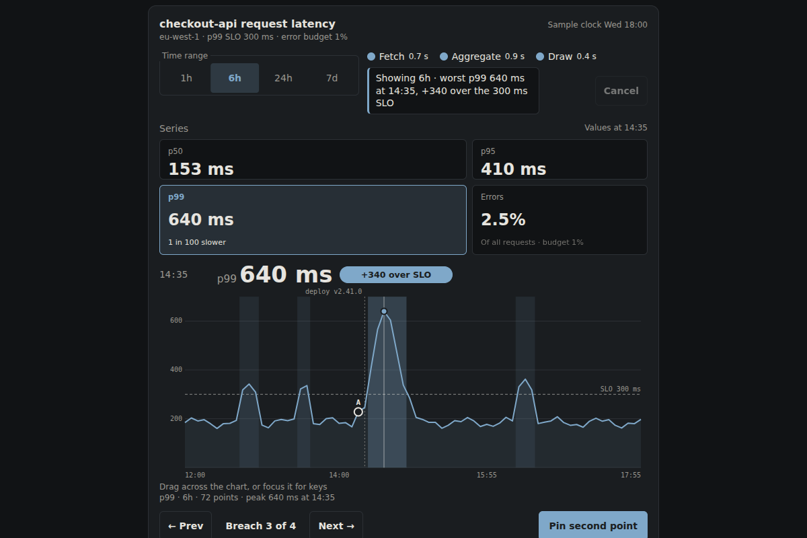
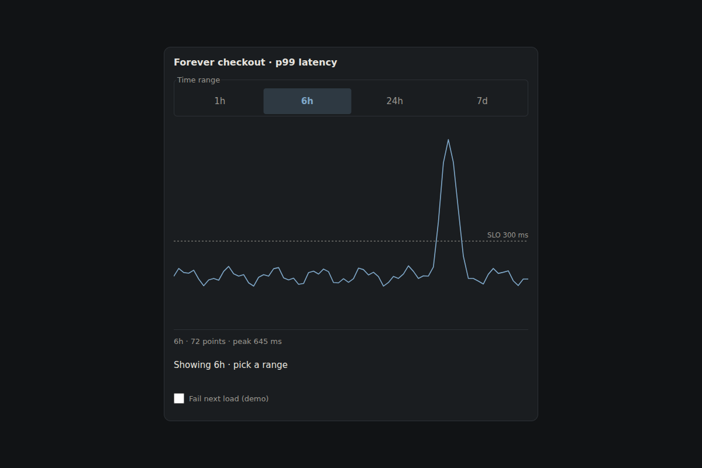
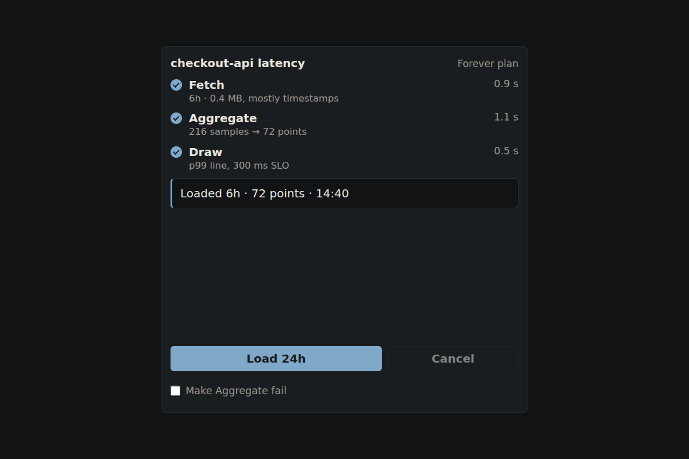
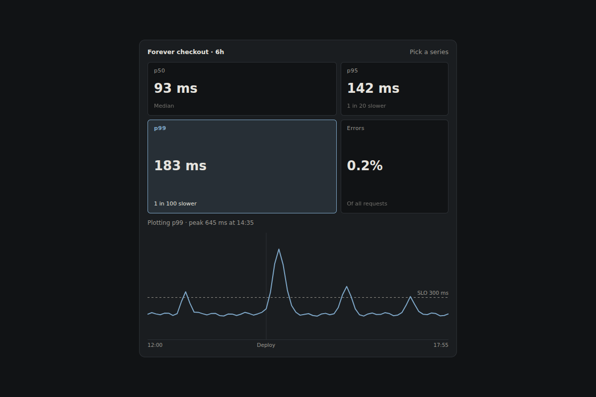
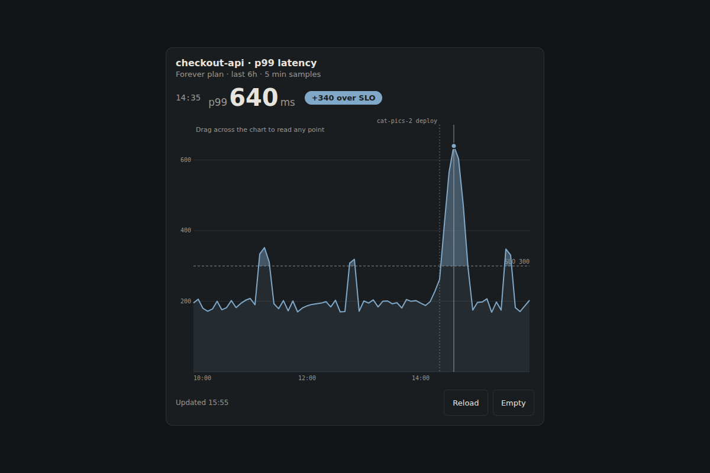
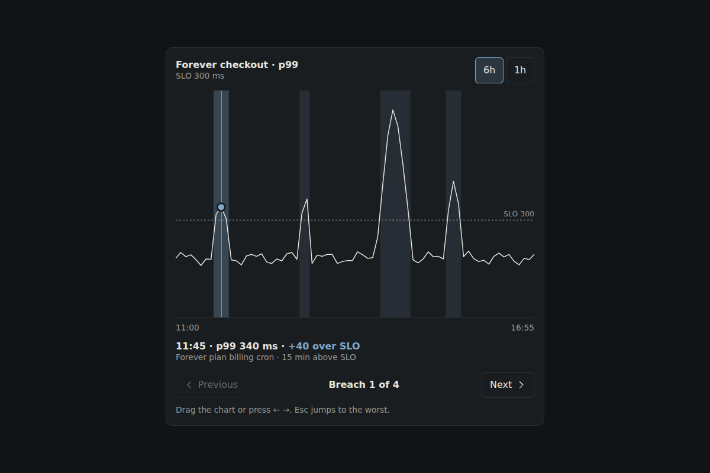
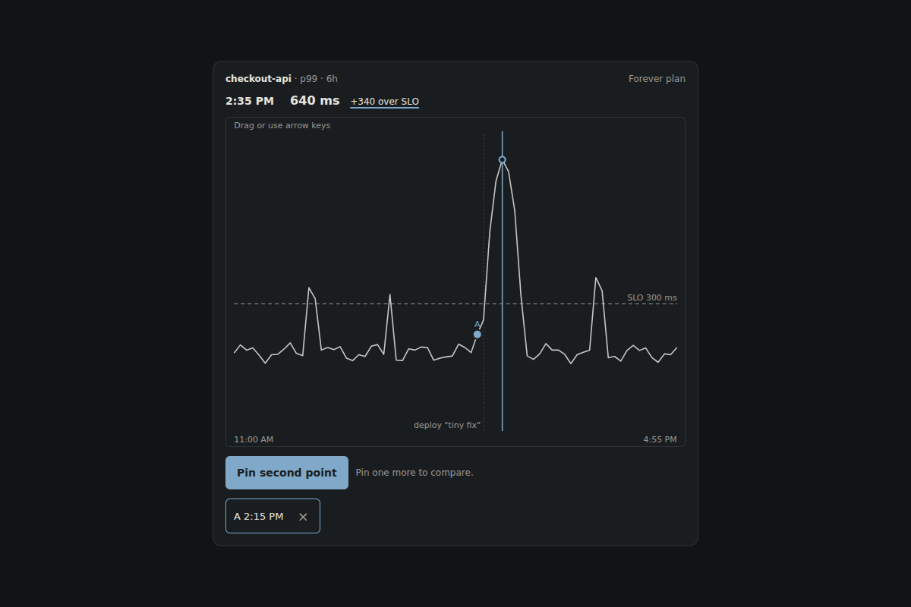

# 2026-10-28: Breach Reader

[Today](../../README.md) · [Archive](../../ARCHIVE.md)



**Task:** Latency chart: a chart card for a service dashboard that selects a time range and reveals request latency at a chosen point.

**Request source:** [isas1/web-components #127](https://github.com/isas1/web-components/issues/127). Local prototype; source issue stays open.

**Constraint:** Repeated input cannot queue duplicate work.

**Season:** 2026-10-26

**Decision:** The team builds a single latency card for checkout-api where a visitor picks a range, watches named load stages, chooses a percentile, reads any point, steps between SLO breaches, and pins two points to get a delta.


[Cover art direction](cover.json) · [Cover source](cover.html)

## Feed evidence

- smashing: fetched (9 items)
- hacker-news: fetched (20 items)
- codrops: disabled — 2026-10-27: endpoint returns HTTP 410; awaiting verified replacement
- Used feed inspiration: Stop Treating CSS Container Queries Like Traditional Media Queries — https://smashingmagazine.com/2026/09/stop-treating-css-container-queries-traditional-media-queries/
- Chosen opportunity: request-isas1/web-components-127. The eligible request carries the explicit brief plus guidance on realistic data, dusted palette and both themes. Feed items were weaker. The container-query article informs one layout rule without driving the project.

[Saved planning input](planning-input.json)

## Asset

[Pack manifest](pack.json) · [Shared tokens](tokens.json) · [Planning input](planning-input.json)

Generated candidates require human review. Library acceptance: unreviewed.

[Compare Opus, Sonnet, and Haiku](comparison.html)

<a href="piece.html"></a>

[Use it](https://isas1.github.io/daily-team/2026-10-28/) · [piece.html](piece.html), led by Precision machinist. Model: claude-opus-5-5.

<a href="artifact-1.html"></a>

[Use it](https://isas1.github.io/daily-team/2026-10-28/) · [artifact-1.html](artifact-1.html), led by Precision machinist. Model: claude-opus-5-5.

<a href="artifact-2.html"></a>

[Use it](https://isas1.github.io/daily-team/2026-10-28/) · [artifact-2.html](artifact-2.html), led by Air traffic controller. Model: claude-opus-5-5.

<a href="artifact-3.html"></a>

[Use it](https://isas1.github.io/daily-team/2026-10-28/) · [artifact-3.html](artifact-3.html), led by Furniture designer. Model: claude-opus-5-5.

<a href="artifact-4.html"></a>

[Use it](https://isas1.github.io/daily-team/2026-10-28/) · [artifact-4.html](artifact-4.html), led by Asteroid workshop tutor. Model: claude-opus-5-5.

<a href="artifact-5.html"></a>

[Use it](https://isas1.github.io/daily-team/2026-10-28/) · [artifact-5.html](artifact-5.html), led by Precision machinist. Model: claude-opus-5-5.

<a href="artifact-6.html"></a>

[Use it](https://isas1.github.io/daily-team/2026-10-28/) · [artifact-6.html](artifact-6.html), led by Air traffic controller. Model: claude-opus-5-5.

## The session

### Pitch

### Clash

**1 · Precision machinist:** The source bento springs its grid tracks. With 72 real samples on screen, a tile resize that moves the chart is an effect with no useful result. The spring has to earn its frames.

**2 · Air traffic controller:** Checked at 360 px. Four tiles and a chart do not fit side by side. Below 480 px the tiles become one row of chips with no expansion. The spring runs only where there is room.

**3 · Furniture designer:** Where it runs, it uses `k = 1 - (1 - 0.14)^dt` with dt capped at 50 ms. It stops when settled. That part of the source is sound. The idle cycling and hover-to-select are not. Those go.

**4 · Asteroid workshop tutor:** Then the tiles stay, because they teach which line you are reading. Pick p95 and the chart redraws in p95. That is a first useful result in one press.

**2 · Air traffic controller:** The undo for range changes duplicates cancel. Cut it. A cancelled load keeps the previous data, so there is nothing to undo.

**3 · Furniture designer:** Agreed, if cancel restores the previous selection in the range control too. Otherwise the radio says 24h while the chart shows 6h.

**1 · Precision machinist:** Delta strip stays. But it lives inside the pin button's result, not as a seventh part. Two pins give one delta. A third pin replaces the oldest.

**4 · Asteroid workshop tutor:** The weakest state is a failed load. One more pass on that state. Name the stage that failed, keep the old chart, and give one retry button that cannot fire twice.

### Decision

The team builds a single latency card for `checkout-api` where a visitor picks a range, watches named load stages, chooses a percentile, reads any point, steps between SLO breaches, and pins two points to get a delta.

Concept: **Breach Reader**

The machinist set the sample data first. That data gives 72 points, a deploy at 14:20, a 300 ms p99 SLO and four breaches. Every label width was sized from it. The machinist also folded the delta into the pin action. The controller held the 360 px check and cut the undo control. The controller also stopped the tile spring below 480 px. The furniture designer kept the dt-scaled spring and made cancel restore both the data and the range control. The tutor set the opening state with the cursor on the worst breach. The tutor also forced a final pass on the failed-load state.

Rejected direction: the **Tower Strip** at three parts. It reads latency well. It gives no way to find breaches or compare two moments, and those are the two tasks an on-call engineer does after opening the card.

Source: https://github.com/isas1/creative-sites-vault/blob/1595af38a69fbb67c674ef4b90b776a2245c270b/00-components/cards/c16-magnetic-bento.html. The retained mechanism is the rAF loop that eases CSS `fr` track variables toward targets. The step is frame-rate independent, and the loop stops once settled. It appears in row 3 only. Three improvements:
1. Idle demo cycling, hover selection and the `pointerleave` reset are removed. Selection changes only on click, tap, Enter or Space. Tiles are native buttons in a group with `aria-pressed`.
2. `white-space: nowrap` is removed from the detail text. Detail stays visible at reduced weight on inactive tiles. Below 480 px the grid collapses to a chip row with no track animation.
3. The lime palette and 800-weight stats are replaced by the shared tokens. Reduced motion sets tracks directly. The loop does not start while the page is hidden.

The constraint holds in four places. Pressing the active range does nothing. A new range aborts the in-flight load through a generation token, so at most one load exists. The retry button disables while pending. Pinning an already pinned point does nothing.

Six components earn their place. Each answers a separate question in reading latency: which window, is the data ready, which percentile, what value at this moment, where the breaches are, and how two moments compare. Removing any one leaves a question unanswered or pushes it into another control.

```json
{
  "schemaVersion": 1,
  "categoryVersion": 1,
  "id": "breach-reader",
  "name": "Breach Reader",
  "description": "A latency chart card for a service dashboard. It selects a time range, loads in named stages, plots a chosen percentile, reveals the value at any point, steps between SLO breaches and pins two points for a delta.",
  "project": "A single service dashboard card for the sample service checkout-api in eu-west-1, covering a 6h window with 72 five-minute samples, a deploy at 14:20 and a 300 ms p99 SLO.",
  "sizeRationale": "Six parts each answer one question: which window, is the data ready, which percentile, what value here, where the breaches are, how two moments compare. Range undo was cut because cancel already restores state.",
  "opportunities": [
    {
      "id": "request-isas1/web-components-127",
      "need": "Engineering-leaning chart components with realistic data, dark and light themes.",
      "use": "On-call engineer reads p99 latency around a deploy and finds SLO breaches.",
      "interaction": "Range radio group, percentile tiles, cursor chart with arrow keys, breach stepper, pin pair.",
      "similarity": "Follows the 2026-10-26 log viewer and 2026-10-27 pipeline panel in audience. It differs in mechanism: continuous time-series reading instead of list filtering or step retry."
    },
    {
      "id": "daily-task",
      "need": "Latency chart that selects a range and reveals latency at a chosen point.",
      "use": "Same scoped need as the request, without the library audience signal.",
      "interaction": "Range selection and point reveal.",
      "similarity": "Identical scope to the request. The request adds palette and data guidance, so it was preferred."
    },
    {
      "id": "5c9d13f97faabce46da9b702",
      "need": "Components that respond to their container width.",
      "use": "Card collapses percentile tiles to chips below 480 px of container width, independent of viewport.",
      "interaction": "No direct interaction. It informs the layout rule only.",
      "similarity": "A technique reference. It does not supply a component. The tradeoff: it applies as a CSS rule, not as a project direction."
    }
  ],
  "selection": {
    "id": "request-isas1/web-components-127",
    "rationale": "The eligible request carries the explicit brief plus guidance on realistic data, dusted palette and both themes. Feed items were weaker. The container-query article informs one layout rule without driving the project."
  },
  "tokens": {
    "colors": {
      "dark": {
        "bg": "#111315",
        "surface": "#1A1D20",
        "text": "#E6E4DF",
        "muted": "#9A9790",
        "accent": "#7FA8C9",
        "border": "#2C3035"
      },
      "light": {
        "bg": "#F5F4F1",
        "surface": "#FFFFFF",
        "text": "#1C1E21",
        "muted": "#5F5D58",
        "accent": "#3C6A8E",
        "border": "#D9D6D0"
      }
    },
    "typography": {
      "family": "ui-sans-serif, system-ui, -apple-system, \"Segoe UI\", Roboto, sans-serif",
      "size": "14px"
    },
    "spacing": {
      "gap": "12px",
      "padding": "16px"
    },
    "radii": {
      "control": "6px"
    },
    "motion": {
      "duration": "180ms",
      "easing": "ease-out"
    }
  },
  "components": [
    {
      "row": 1,
      "id": "range-selector",
      "file": "artifact-1.html",
      "name": "Range selector",
      "description": "Segmented radio group for 1h, 6h, 24h and 7d with fixed label widths.",
      "category": "Inputs",
      "tags": ["time-range", "radio-group", "segmented", "dashboard", "dedupe"],
      "purpose": "Choose the time window the card reads.",
      "use": "Engineer widens from 6h to 24h to see whether a spike repeats daily.",
      "input": "Click or tap a segment. Keyboard: Tab into the group, arrow keys move and select, Home and End jump to the ends.",
      "outcome": "Range commits and emits one load request. Selecting the active range emits nothing.",
      "recovery": "If the load is cancelled or fails, the selection reverts to the last range that loaded.",
      "mechanism": "Native radio inputs styled as segments. A generation counter tags each request. Older generations are ignored on arrival.",
      "nearestAnalogue": "2026-10-26 log viewer severity filter. That filter narrows a list. This control replaces the whole data window and must abort prior work.",
      "usefulness": "Every latency question starts with a window. Without dedupe, rapid clicks queue several loads.",
      "creativeDifference": "Revert-on-cancel keeps control and chart in agreement, which a plain segmented control does not handle.",
      "states": [
        "idle: one range checked, reached on load",
        "focus: visible ring on checked segment, reached by Tab",
        "pending: checked segment shows a 2px underline while its load runs, reached by selecting a new range",
        "reverted: previous range re-checked with status text 'Kept 6h', reached by cancel or failure",
        "no-op: active range pressed again, nothing changes"
      ],
      "sources": [
        { "title": "Engineering-leaning charts and UI components (visitor request)", "url": "https://github.com/isas1/web-components/issues/127" },
        { "title": "ARIA Authoring Practices: Radio Group", "url": "https://www.w3.org/WAI/ARIA/apg/patterns/" }
      ]
    },
    {
      "row": 2,
      "id": "load-stages",
      "file": "artifact-2.html",
      "name": "Load stages",
      "description": "Status line that names three load stages, allows cancel and ends in a clear complete or failed state.",
      "category": "Feedback",
      "tags": ["loader", "stages", "cancel", "retry", "status", "live-region"],
      "purpose": "Show what the card is doing while data loads, and how it ended.",
      "use": "Engineer sees 'Aggregating 864 samples' and decides to wait or cancel.",
      "input": "Click or tap Cancel or Retry. Keyboard: Tab to the button, Enter or Space.",
      "outcome": "Stages Fetch, Aggregate and Draw tick in order. Completion reads 'Loaded 24h · 288 points · 14:52'.",
      "recovery": "Cancel keeps the previous chart. Failure names the stage that failed and offers one Retry that disables while pending.",
      "mechanism": "A single job object with an AbortController and stage index. Starting a job aborts the current one. Status text sits in a polite live region. No percentage is shown, because stage count is the honest measure.",
      "nearestAnalogue": "2026-10-27 pipeline panel retry. That panel retries a build step. This one reports a data load with cancel and never shows invented progress.",
      "usefulness": "Engineers need to know whether a flat line means low latency or no data yet.",
      "creativeDifference": "Named stages with sample counts replace a spinner, so the wait carries information.",
      "states": [
        "idle: hidden status, reached when no load is running",
        "fetching: 'Fetching 24h', reached by range change",
        "aggregating: 'Aggregating 864 samples', reached after fetch resolves",
        "drawing: 'Drawing p99', reached after aggregate",
        "complete: summary line with timestamp, reached after draw",
        "cancelled: 'Cancelled · kept 6h', reached by Cancel",
        "failed: 'Aggregate failed · kept 6h' with Retry, reached by demo failure toggle",
        "reduced-motion: stage ticks without transition"
      ],
      "sources": [
        { "title": "Engineering-leaning charts and UI components (visitor request)", "url": "https://github.com/isas1/web-components/issues/127" },
        { "title": "ARIA Authoring Practices patterns", "url": "https://www.w3.org/WAI/ARIA/apg/patterns/" }
      ]
    },
    {
      "row": 3,
      "id": "percentile-tiles",
      "file": "artifact-3.html",
      "name": "Percentile tiles",
      "description": "Four tiles for p50, p95, p99 and error rate. The selected tile expands while neighbours yield track space.",
      "category": "Layout",
      "tags": ["bento", "metric-tiles", "percentile", "grid-tracks", "spring", "container-query"],
      "purpose": "Pick which series the chart plots and show current values for all four.",
      "use": "Engineer switches from p99 to p50 to check whether the median moved too.",
      "input": "Click or tap a tile. Keyboard: Tab to a tile, Enter or Space selects.",
      "outcome": "Selected tile expands to show its detail. The chart redraws in that series.",
      "recovery": "Selecting another tile reverses the change. Nothing is lost.",
      "mechanism": "rAF loop eases CSS fr track variables with k = 1 - (1 - 0.14)^dt, dt capped at 50 ms. The loop stops when the summed error drops below 0.002. Below 480 px container width, tiles become a chip row with no track animation.",
      "nearestAnalogue": "None in recent dates. Source c16 magnetic bento is the direct ancestor.",
      "usefulness": "Percentile choice changes what a spike means. Current values for all four stay visible.",
      "creativeDifference": "Track yielding ties layout to selection, while values stay readable during resize.",
      "states": [
        "default: p99 selected, reached on load",
        "selected: expanded track with detail and accent border, reached by click or Enter",
        "focus: outline ring, reached by Tab",
        "settled: loop stopped, reached about 400 ms after selection",
        "compact: chip row under 480 px container width",
        "reduced-motion: tracks set directly"
      ],
      "sources": [
        { "title": "c16 magnetic bento (creative-sites-vault)", "url": "https://github.com/isas1/creative-sites-vault/blob/1595af38a69fbb67c674ef4b90b776a2245c270b/00-components/cards/c16-magnetic-bento.html" },
        { "title": "Stop Treating CSS Container Queries Like Traditional Media Queries", "url": "https://smashingmagazine.com/2026/09/stop-treating-css-container-queries-traditional-media-queries/" },
        { "title": "ARIA Authoring Practices: Button", "url": "https://www.w3.org/WAI/ARIA/apg/patterns/" }
      ]
    },
    {
      "row": 4,
      "id": "cursor-chart",
      "file": "artifact-4.html",
      "name": "Cursor chart",
      "description": "SVG line chart with an SLO line and a cursor that snaps to measured samples and reveals the value at that point.",
      "category": "Data",
      "tags": ["line-chart", "crosshair", "latency", "slo", "svg", "keyboard-chart"],
      "purpose": "Reveal request latency at a chosen point.",
      "use": "Engineer drags across the deploy and reads '14:35 · p99 640 ms · +340 over SLO'.",
      "input": "Pointer move or touch drag over the plot. Keyboard: focus the plot, Left and Right step one sample, Page Up and Page Down step 12, Home and End jump to the ends.",
      "outcome": "Readout above the plot shows time, value and offset from SLO. Cursor snaps to the nearest real sample.",
      "recovery": "Escape returns the cursor to the worst breach. Leaving the plot keeps the last cursor position.",
      "mechanism": "Nearest-index lookup from x position against sample timestamps. Readout has fixed width from the longest sample label. Plot is a focusable element with role group and an aria-live readout.",
      "nearestAnalogue": "None in recent dates. 2026-10-19 scroll progress maps position to value in one dimension, with no data points.",
      "usefulness": "This component answers the core need. Snapping prevents reading interpolated values that were never measured.",
      "creativeDifference": "The readout states distance from SLO, which reframes the number as a decision.",
      "states": [
        "initial: cursor on worst breach, reached on load",
        "tracking: cursor follows pointer, reached by pointer or touch",
        "focus: plot outline and key hint, reached by Tab",
        "breach: readout marked over SLO, reached when value exceeds 300 ms",
        "stale: dimmed plot while a new range loads",
        "empty: 'No samples in range', reached when a range returns zero points"
      ],
      "sources": [
        { "title": "Engineering-leaning charts and UI components (visitor request)", "url": "https://github.com/isas1/web-components/issues/127" },
        { "title": "ARIA Authoring Practices patterns", "url": "https://www.w3.org/WAI/ARIA/apg/patterns/" }
      ]
    },
    {
      "row": 5,
      "id": "breach-stepper",
      "file": "artifact-5.html",
      "name": "Breach stepper",
      "description": "Previous and next controls that move the chart cursor between SLO breaches, with a count.",
      "category": "Navigation",
      "tags": ["stepper", "breach", "slo", "pager", "jump"],
      "purpose": "Move directly between moments where latency crossed the SLO.",
      "use": "Engineer steps 'Breach 2 of 4' to 'Breach 3 of 4' to see whether the second spike followed a deploy.",
      "input": "Click or tap Previous or Next. Keyboard: Tab to the buttons, Enter or Space. Held keys move one step per keydown.",
      "outcome": "Cursor jumps to the peak sample of the next breach. Count updates.",
      "recovery": "The buttons disable at the ends, and the count reads 'Breach 4 of 4'. Escape in the chart returns to the worst breach.",
      "mechanism": "Breaches are contiguous runs above SLO, computed once per load. Each run is stored by its peak index. A step sets the cursor index directly and replaces any running transition.",
      "nearestAnalogue": "2026-10-25 breadcrumb in footprints moves through a path. This moves through computed events in data.",
      "usefulness": "Finding breaches by dragging across 288 points is slow on a phone.",
      "creativeDifference": "Navigation targets come from the data itself, not from pages or sections.",
      "states": [
        "default: 'Breach 1 of 4', reached on load",
        "middle: both buttons enabled",
        "start or end: one button disabled with count at bound",
        "none: 'No breaches in 1h' with both disabled, reached when range has none",
        "focus: visible ring"
      ],
      "sources": [
        { "title": "Engineering-leaning charts and UI components (visitor request)", "url": "https://github.com/isas1/web-components/issues/127" },
        { "title": "ARIA Authoring Practices patterns", "url": "https://www.w3.org/WAI/ARIA/apg/patterns/" }
      ]
    },
    {
      "row": 6,
      "id": "pin-pair",
      "file": "artifact-6.html",
      "name": "Pin pair",
      "description": "Button that pins the cursor point. Two pins produce a delta line.",
      "category": "Actions",
      "tags": ["pin", "compare", "delta", "button", "dedupe"],
      "purpose": "Keep two moments and compare them.",
      "use": "Engineer pins 14:15 and 14:35 and reads '+412 ms p99 over 20 min'.",
      "input": "Click or tap Pin. Keyboard: Tab to Pin, Enter or Space. P while the chart has focus. Each pin chip has a remove button.",
      "outcome": "First pin shows a marker. Second pin shows the delta line. A third pin replaces the oldest.",
      "recovery": "Remove any pin with its x button or Delete on the focused chip. Pinning an already pinned point does nothing.",
      "mechanism": "A two-slot array keyed by sample index. The label swaps in a reserved width: Pin, Pinned, Replace oldest.",
      "nearestAnalogue": "2026-10-20 undo in rewind deals with reversal of an action. This keeps two references and computes between them.",
      "usefulness": "Before and after a deploy is the comparison on-call engineers report.",
      "creativeDifference": "The delta is the action's result, so no separate compare panel is needed.",
      "states": [
        "empty: 'Pin this point'",
        "one pinned: marker on chart, label 'Pin second point'",
        "pair: delta line shown",
        "full: label 'Replace oldest'",
        "duplicate: label 'Already pinned', no change",
        "cleared: pins removed on range change, with status note"
      ],
      "sources": [
        { "title": "Engineering-leaning charts and UI components (visitor request)", "url": "https://github.com/isas1/web-components/issues/127" },
        { "title": "ARIA Authoring Practices: Button", "url": "https://www.w3.org/WAI/ARIA/apg/patterns/" }
      ]
    }
  ],
  "demo": {
    "file": "piece.html",
    "rows": [1, 2, 3, 4, 5, 6],
    "sharedState": "One store holds service checkout-api, range (default 6h), load job (generation, stage, status), series (default p99), samples (72 at 5 min), breaches (4 runs above 300 ms), cursorIndex (worst breach), and pins (max 2). The range selector starts a job. Load stages report it and on completion write samples and breaches. The tiles set the series. The chart reads series and samples and writes cursorIndex. The stepper writes cursorIndex from breaches. Pin reads cursorIndex and writes pins. Each file also runs alone with its own copy of the sample data."
  }
}
```

### Build notes

1. Ship the sample generator first as `samples.js`. It produces 72 points with a 14:20 deploy and four p99 runs above 300 ms. Size every label width from the longest output before any CSS. The readout width comes from `14:35 · p99 640 ms · +340 over SLO`.
2. Use one `job` object across rows 1 and 2: `{gen, stage, controller}`. `startLoad(range)` returns early when `range === loadedRange && !job`. It aborts any running controller before incrementing `gen`. Retry calls the same function with the button disabled until the job settles.
3. In row 3, guard the rAF loop with `container.clientWidth >= 480 && !matchMedia('(prefers-reduced-motion: reduce)').matches`. Otherwise set the four `--track-*` properties directly. Test at 360 px and 1280 px in both themes before sign-off. This spec makes no claim that those checks were done.

**Guest:** Asteroid workshop tutor (future; invented). The method is drawn from public-domain history, myth, or literature, or invented. The guest speaks in character in original words, never quoting the source, and nothing here is endorsed by anyone.

## Team

```text
Team for 2026-10-28
Season: 2026-10-26

1. Precision machinist [new]
   Method: Put useful sample data in place before adjusting type. [new]
   Stance: Pushes toward the strange.
   Temperament: Questions every effect with no useful result.
2. Air traffic controller [new]
   Method: Use the last pass to remove visual and code clutter. [new]
   Stance: Cuts until only the core is left.
   Temperament: Checks the small screen before agreeing.
3. Furniture designer [new]
   Method: Keep the animation speed stable across frame rates. [new]
   Stance: Defends the material.
   Temperament: Asks how a person gets back after a mistake.
4. Asteroid workshop tutor (future; invented) [guest] [new]
   Method: Teach the action through its first useful result.
   Stance: Guards the feeling it leaves behind.
   Temperament: Pushes for one more pass on the weakest state.

Constraint: Repeated input cannot queue duplicate work.
Task: Import stages: a loader for a file tool that shows named stages, allows cancel and ends in a clear completion state.
```

Provider: claude. Model: claude-opus-5-5.
