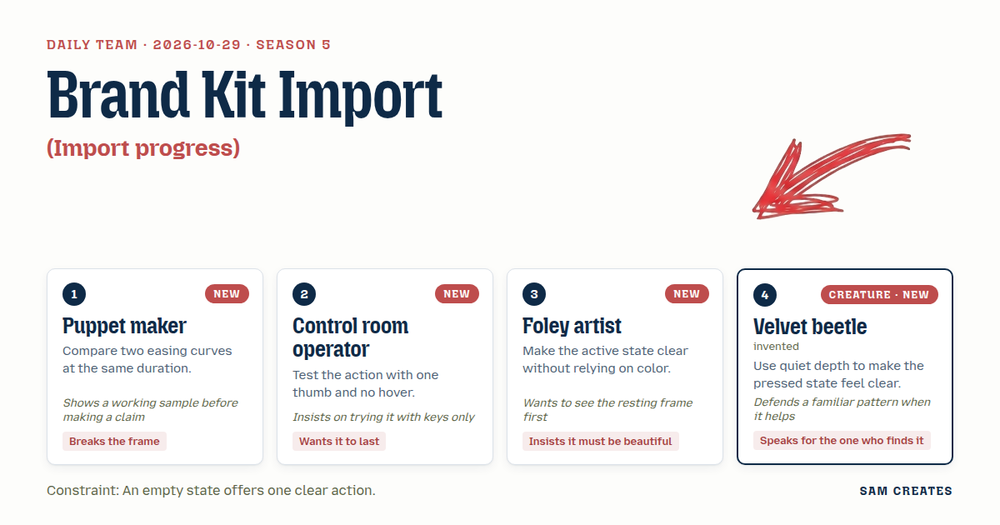
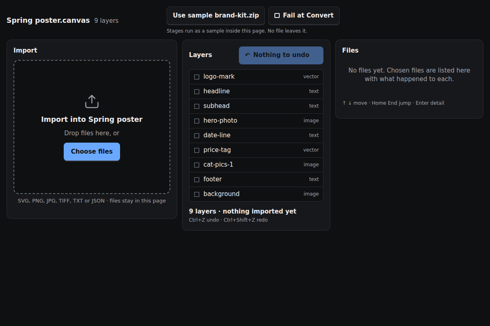
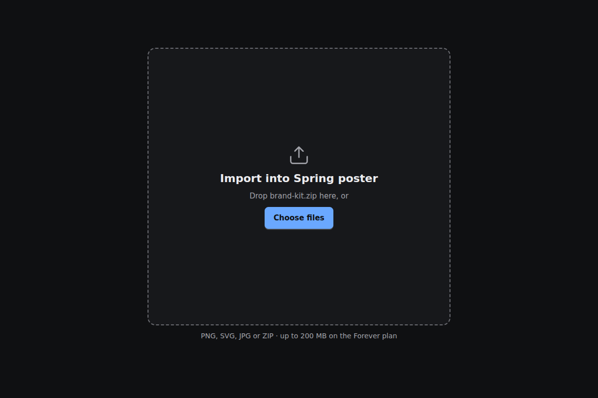
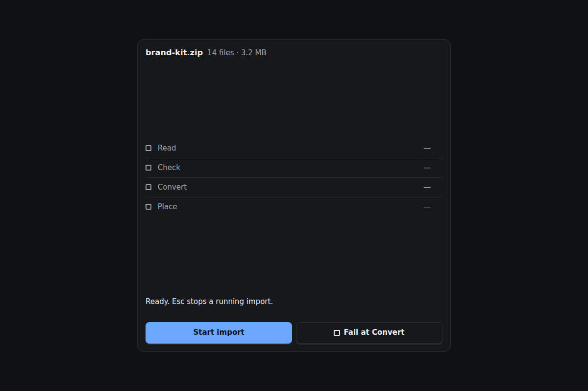
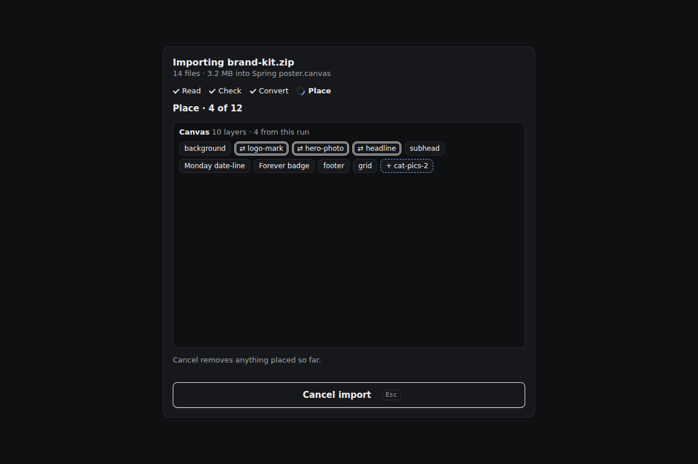
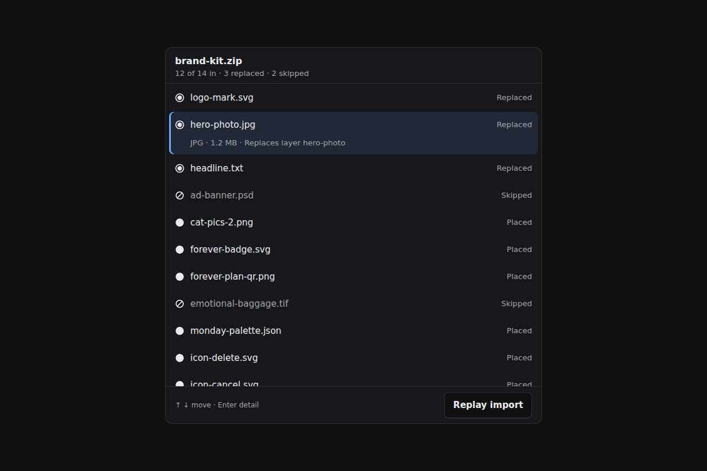
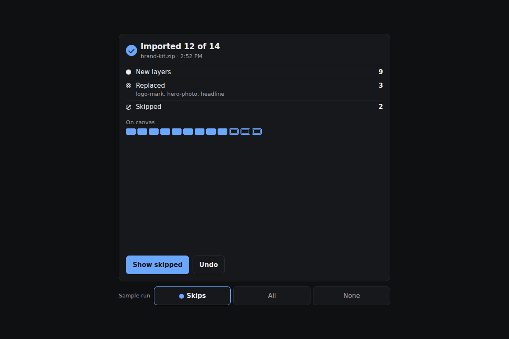
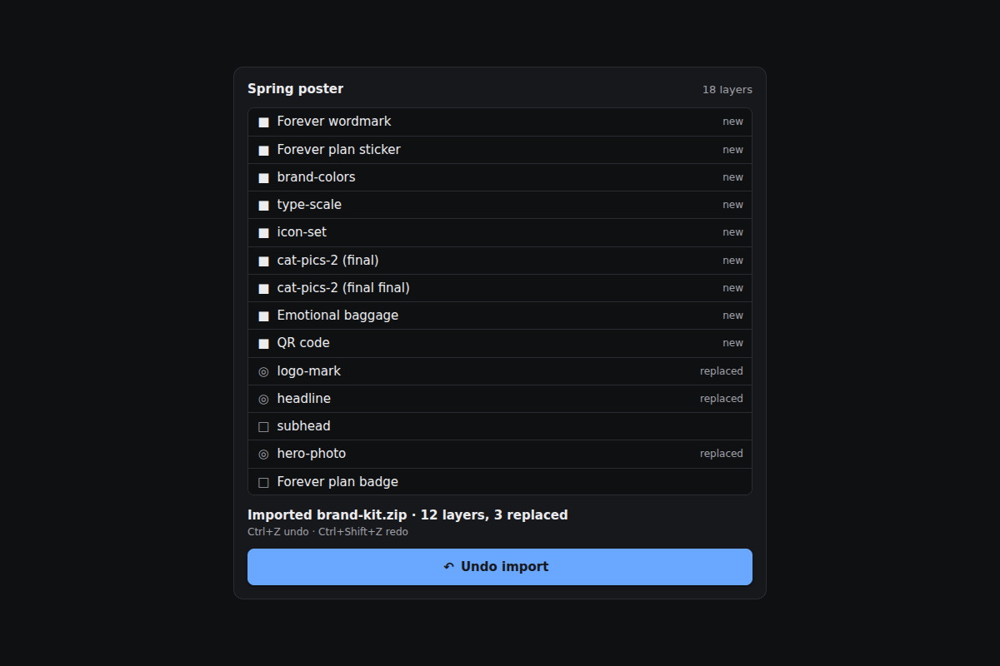

# 2026-10-29: Brand kit import

[Today](../../README.md) · [Archive](../../ARCHIVE.md)



**Task:** Import progress: a loader for a file tool that shows named stages, lets someone cancel and ends with a clear completion state.

**Request source:** [isas1/web-components #45](https://github.com/isas1/web-components/issues/45). Local prototype; source issue stays open.

**Constraint:** An empty state offers one clear action.

**Season:** 2026-10-26

**Decision:** The team builds an import panel for a canvas editor, and a visitor can bring 14 files into a poster, see each named stage with real counts, cancel at any point, read a clear completion summary, and undo the import with the replaced layer...


[Cover art direction](cover.json) · [Cover source](cover.html)

## Feed evidence

- smashing: fetched (9 items)
- hacker-news: fetched (20 items)
- codrops: disabled — 2026-10-27: endpoint returns HTTP 410; awaiting verified replacement
- No feed article recorded as used; fetched items may have been considered without selection.
- Chosen opportunity: request-isas1/web-components-45. It states the practical need directly and matches the brief. The team task's undo need fits inside it as the reversal row, so both needs are served without a second project.

[Saved planning input](planning-input.json)

## Asset

[Pack manifest](pack.json) · [Shared tokens](tokens.json) · [Planning input](planning-input.json)

Generated candidates require human review. Library acceptance: unreviewed.

[Compare Opus, Sonnet, and Haiku](comparison.html)

<a href="piece.html"></a>

[Use it](https://isas1.github.io/daily-team/2026-10-29/) · [piece.html](piece.html), led by Puppet maker. Model: claude-opus-5-5.

<a href="artifact-1.html"></a>

[Use it](https://isas1.github.io/daily-team/2026-10-29/) · [artifact-1.html](artifact-1.html), led by Puppet maker. Model: claude-opus-5-5.

<a href="artifact-2.html"></a>

[Use it](https://isas1.github.io/daily-team/2026-10-29/) · [artifact-2.html](artifact-2.html), led by Control room operator. Model: claude-opus-5-5.

<a href="artifact-3.html"></a>

[Use it](https://isas1.github.io/daily-team/2026-10-29/) · [artifact-3.html](artifact-3.html), led by Foley artist. Model: claude-opus-5-5.

<a href="artifact-4.html"></a>

[Use it](https://isas1.github.io/daily-team/2026-10-29/) · [artifact-4.html](artifact-4.html), led by Velvet beetle. Model: claude-opus-5-5.

<a href="artifact-5.html"></a>

[Use it](https://isas1.github.io/daily-team/2026-10-29/) · [artifact-5.html](artifact-5.html), led by Puppet maker. Model: claude-opus-5-5.

<a href="artifact-6.html"></a>

[Use it](https://isas1.github.io/daily-team/2026-10-29/) · [artifact-6.html](artifact-6.html), led by Control room operator. Model: claude-opus-5-5.

## The session

### Pitch

### Clash

**1 · Puppet maker:** Sample's running. Same 180 ms, linear against ease-out on the stage tick. Linear reads as a counter. Ease-out lands. I still want placed files to drop out of the panel onto the canvas.

**2 · Control room operator:** The drop I can live with. Cancel can't be a corner icon that shows on hover. 44 px, bottom of the panel, Escape does the same. Tab order goes stages, Cancel, list.

**3 · Foley artist:** Resting frame before motion. Take the colour away: which stage is active? Filled glyph, hollow glyph, tick, and the stage word in bold. After that it can be beautiful.

**4 · Velvet beetle:** I'm the one who finds this later. Undo should say the names: logo-mark, hero-photo, headline. And Ctrl+Z, same as always. Nobody needs a new gesture.

**2 · Control room operator:** Then Cancel and Undo overlap. Two reverse buttons in one panel.

**4 · Velvet beetle:** No. Cancel stops work in flight. Undo reverses a finished change. Different moment, different word. On press it sinks 1 px and the shadow shrinks.

**1 · Puppet maker:** Then the strings go. My break-out moves to the landing: placed files settle into the canvas tray once, then stop. The ease-out curve stays.

**3 · Foley artist:** And the empty state gets one action. "Choose files." No docs link beside it.

### Decision

The team builds an import panel for a canvas editor, and a visitor can bring 14 files into a poster, see each named stage with real counts, cancel at any point, read a clear completion summary, and undo the import with the replaced layers named.

Concept: Brand kit import

**Contributions.** Puppet maker set the motion. The stage tick and the tray settle use a 180 ms ease-out, chosen over linear in a side-by-side sample, and play once. Control room operator set the input rules: no hover dependence, 44 px targets, Escape for Cancel, Ctrl+Z for Undo, and a fixed tab order. Foley artist set the state language: filled, hollow and ticked glyphs plus bold text, so no state relies on colour, and the empty drop zone has a single action. Velvet beetle made the case for undo naming what came back and for a quiet 1 px pressed depth. The beetle also defended Ctrl+Z.

**Rejected direction.** Strings was rejected. The marionette drop was mostly art and gave the visitor no new information. It also repeated the 2026-10-23 file-drop-in-a-well falling motion. Its easing study survived.

**Source.** https://github.com/isas1/creative-sites-vault/blob/1595af38a69fbb67c674ef4b90b776a2245c270b/00-components/loaders/05-dash-orbital-ring/var-1-arc-spinner.html. One mechanism is kept: a bordered ring with one coloured top edge, rotated by a CSS keyframe at 0.8 s linear. It is used only in row 2, at 14 px, on the active stage. Improvements:

1. The spinner's generic "Loading" label is replaced with stage text and real file counts in a polite live region.
2. Under reduced motion the ring is a static arc with the word "running". The source only removed the animation.
3. The arc is removed on complete, cancelled and failed, and an explicit glyph and summary take its place.

The shadow DOM, the badge and the housing card are dropped, and the shared tokens apply.

**Why 6.** Each row answers a different visitor moment:

- Nothing chosen yet (empty drop zone).
- What is happening now (stage track).
- How to stop it (Cancel import).
- Which files did what (manifest).
- How it ended (completion summary).
- How to take it back (Undo import).

A retry-one-file row and a shortcut sheet were cut. Retry overlaps the 2026-10-27 pipeline retry. The shortcuts fit in each row's input text.

```json
{
  "schemaVersion": 1,
  "categoryVersion": 1,
  "id": "brand-kit-import",
  "name": "Brand kit import",
  "description": "An import panel for a canvas editor that names its stages with real file counts, cancels with rollback, summarises the result and undoes the import while naming what came back.",
  "project": "A canvas editor imports brand-kit.zip (14 files, 3.2 MB) into Spring poster.canvas (9 layers). 3 incoming files share names with existing layers and replace them.",
  "sizeRationale": "Six rows cover six separate moments: empty, in progress, stopping, per-file detail, ending and reversal. A seventh row for single-file retry was cut because it repeats the 2026-10-27 pipeline retry. A shortcut sheet was cut because each row documents its own keys.",
  "opportunities": [
    {
      "id": "request-isas1/web-components-45",
      "need": "An import loader for a file tool with named stages, cancel and a clear completion state.",
      "use": "A designer imports a brand kit into a poster and needs to know whether to wait, stop or reverse.",
      "interaction": "Stage track with per-file counts, Cancel with rollback, completion summary and undo that names restored layers.",
      "similarity": "Close to the 2026-10-28 load stages row. The difference is that files are countable, so each stage reports 'n of m' honestly, and the import changes the canvas, so it needs undo."
    },
    {
      "id": "daily-task",
      "need": "The same import need, without the issue context.",
      "use": "Same visitor and file tool.",
      "interaction": "Same as the request.",
      "similarity": "Duplicates the request. The request is preferred because it carries the scoped loader need."
    },
    {
      "id": "906c26c75ab309095d956d6f",
      "need": "Clear names for stages and states.",
      "use": "Informs the verbs Read, Check, Convert and Place, and the split between Cancel and Undo.",
      "interaction": "No interaction. It is a naming influence only.",
      "similarity": "An article, with nothing to build from it directly. Too weak to select."
    }
  ],
  "selection": {
    "id": "request-isas1/web-components-45",
    "rationale": "It states the practical need directly and matches the brief. The team task's undo need fits inside it as the reversal row, so both needs are served without a second project."
  },
  "tokens": {
    "colors": {
      "dark": { "bg": "#0f1012", "surface": "#17181b", "text": "#ececef", "muted": "#a0a1a8", "accent": "#6aa8ff", "border": "#2a2c31" },
      "light": { "bg": "#f7f7f8", "surface": "#ffffff", "text": "#16171a", "muted": "#5b5d66", "accent": "#2563c9", "border": "#dcdde2" }
    },
    "typography": { "family": "system-ui, -apple-system, 'Segoe UI', Roboto, sans-serif", "size": "15px" },
    "spacing": { "gap": "12px", "padding": "16px" },
    "radii": { "control": "8px" },
    "motion": { "duration": "180ms", "easing": "ease-out" }
  },
  "components": [
    {
      "row": 1,
      "id": "choose-files-empty",
      "file": "artifact-1.html",
      "name": "Choose files empty state",
      "description": "Empty import zone with one action and a drop target.",
      "category": "Inputs",
      "tags": ["empty-state", "file-input", "drop-zone", "single-action"],
      "purpose": "Start an import when nothing is chosen.",
      "use": "A designer opens Import and picks brand-kit.zip.",
      "input": "Click or tap Choose files, or drop files onto the zone. Keyboard: Tab to the button, then Enter or Space opens the native file picker.",
      "outcome": "The chosen files are counted ('14 files · 3.2 MB') and the import starts.",
      "recovery": "Closing the picker without a choice leaves the empty state unchanged. A drop with zero files reads 'Nothing dropped' and keeps the button focused.",
      "mechanism": "A native input type=file sits behind a visible button. Drop is handled by dragover and drop listeners on the zone. Pointer is not required, because the button covers every path.",
      "nearestAnalogue": "2026-10-24 empty state in tide pool and 2026-10-23 file drop in a well. Both are animated scenes. This is a static zone with one labelled action.",
      "usefulness": "It gives one obvious way in and meets the one-action constraint.",
      "creativeDifference": "The drop target and the button are the same element, so touch users without drag lose nothing.",
      "states": [
        "empty: button 'Choose files', reached on load and after a cancel with nothing placed",
        "drag-over: dashed border turns solid with text 'Drop to import', reached by dragging files over the zone",
        "focus: 2px ring on the button, reached by Tab",
        "nothing-dropped: note under the button, reached by an empty drop"
      ],
      "sources": [{ "title": "ARIA Authoring Practices: Button", "url": "https://www.w3.org/WAI/ARIA/apg/patterns/" }]
    },
    {
      "row": 2,
      "id": "import-stage-track",
      "file": "artifact-2.html",
      "name": "Import stage track",
      "description": "Four named stages with real file counts and a small arc on the active stage only.",
      "category": "Feedback",
      "tags": ["loader", "stages", "live-region", "spinner", "reduced-motion"],
      "purpose": "Show which stage is running and how many files it has handled.",
      "use": "A designer reads 'Convert · 7 of 13' and decides to wait.",
      "input": "Display only. Keyboard: the track is skipped in tab order, and its live region is announced by screen readers.",
      "outcome": "Read, Check, Convert and Place advance in order. Each completed stage shows a tick glyph and its final count.",
      "recovery": "On cancel or failure, the track freezes at the stage reached and names it ('Stopped at Convert').",
      "mechanism": "A job object holds the stage index and per-stage counters. The source's rotating top-border arc is drawn at 14px on the active stage. Glyphs and text change on each tick, and the live region throttles announcements to stage changes plus every fifth file. No percentage is shown.",
      "nearestAnalogue": "2026-10-28 load stages. That row has three fixed stages with sample counts. This row counts discrete files per stage and records where a cancel happened.",
      "usefulness": "File counts are the honest measure of an import, so the wait carries information.",
      "creativeDifference": "State is shown by glyph shape and bold text, so it survives greyscale. The arc is the only motion.",
      "states": [
        "idle: hidden, reached before any files are chosen",
        "reading: 'Read · 14 files', reached when files are chosen",
        "checking: 'Check · 1 unsupported', reached after read",
        "converting: 'Convert · n of 13', reached after check",
        "placing: 'Place · n of 12', reached after convert",
        "complete: all ticks, reached after place",
        "stopped: hollow glyph and 'Stopped at <stage>', reached by Cancel or demo failure",
        "reduced-motion: static arc and the word 'running'"
      ],
      "sources": [
        { "title": "Minimalist arc spinner (creative-sites-vault)", "url": "https://github.com/isas1/creative-sites-vault/blob/1595af38a69fbb67c674ef4b90b776a2245c270b/00-components/loaders/05-dash-orbital-ring/var-1-arc-spinner.html" },
        { "title": "Loader tile variety pack (library content)", "url": "https://github.com/isas1/web-components/issues/45" }
      ]
    },
    {
      "row": 3,
      "id": "cancel-import",
      "file": "artifact-3.html",
      "name": "Cancel import",
      "description": "A thumb-height cancel button that stops the job and rolls back any placed files.",
      "category": "Actions",
      "tags": ["cancel", "abort", "rollback", "button", "escape-key"],
      "purpose": "Stop an import in flight and leave the canvas as it was.",
      "use": "A designer sees the wrong zip in the read count and cancels.",
      "input": "Click or tap Cancel import (44px tall, full width at the panel's foot). Keyboard: Tab to it and press Enter or Space, or press Escape anywhere in the panel.",
      "outcome": "The job aborts. Any layers placed in this run are removed, and replaced layers return.",
      "recovery": "After cancelling, the panel returns to the row 1 empty state. A repeated press while cancelling is ignored.",
      "mechanism": "An AbortController is passed to every stage. A placed-layer list is kept for the run and reversed on abort. The label swaps within a reserved width: Cancel import, Cancelling, Cancelled.",
      "nearestAnalogue": "2026-10-28 load stages cancel, which kept the previous chart. This cancel also rolls back partial canvas changes.",
      "usefulness": "Imports change user work, so stopping halfway must not leave half a kit on the canvas.",
      "creativeDifference": "Escape and a bottom-edge target give the same reach to keyboard and thumb.",
      "states": [
        "ready: enabled during any running stage",
        "pressed: sinks 1px with a reduced shadow, reached on pointer down or key down",
        "cancelling: disabled with label 'Cancelling', reached on press",
        "cancelled: 'Cancelled at Convert · canvas unchanged', reached after rollback",
        "hidden: not rendered when idle or complete",
        "focus: 2px ring"
      ],
      "sources": [{ "title": "ARIA Authoring Practices: Button", "url": "https://www.w3.org/WAI/ARIA/apg/patterns/" }]
    },
    {
      "row": 4,
      "id": "file-manifest",
      "file": "artifact-4.html",
      "name": "File manifest",
      "description": "Per-file list showing each file's state with shape glyphs and a short reason.",
      "category": "Data",
      "tags": ["file-list", "manifest", "listbox", "non-color-state", "skip-reason"],
      "purpose": "Show what happened to each file.",
      "use": "A designer finds that ad-banner.psd was skipped as an unsupported type.",
      "input": "Click or tap a row to expand its reason. Keyboard: Tab into the list, Up and Down move between rows, Home and End jump, Enter expands.",
      "outcome": "The expanded row shows type, size and reason ('Unsupported type .psd', 'Replaces layer hero-photo').",
      "recovery": "Collapsing a row with Enter or a second tap returns it to one line. Selection persists across stage updates.",
      "mechanism": "A listbox with roving tabindex. Rows update in place by file id, so the order never jumps. Glyphs are a hollow circle (queued), a filled circle (placed), a slashed circle (skipped) and a double ring (replaced), each paired with a word.",
      "nearestAnalogue": "2026-10-26 log viewer event list. That list filters past events. This one updates live per file and carries outcome reasons.",
      "usefulness": "A summary count alone hides which file failed and why.",
      "creativeDifference": "Each state has its own shape and word, so the list reads in greyscale.",
      "states": [
        "queued: hollow glyph, reached on read",
        "working: bold row text, reached when the file's stage runs",
        "placed: filled glyph",
        "replaced: double ring with the layer name",
        "skipped: slashed glyph with reason",
        "expanded: detail line, reached by Enter or tap",
        "focus: row ring, reached by arrows"
      ],
      "sources": [{ "title": "ARIA Authoring Practices: Listbox", "url": "https://www.w3.org/WAI/ARIA/apg/patterns/" }]
    },
    {
      "row": 5,
      "id": "import-summary",
      "file": "artifact-5.html",
      "name": "Import summary",
      "description": "Completion card with grouped counts, skip reasons and one next action.",
      "category": "Content",
      "tags": ["completion", "summary", "result", "status"],
      "purpose": "End the import with a clear statement of what landed.",
      "use": "A designer reads 'Imported 12 of 14 · 3 replaced · 2 skipped · 14:52'.",
      "input": "Click or tap Show skipped to jump to the manifest rows. Keyboard: Tab to the link and press Enter. Focus moves to the summary heading on completion.",
      "outcome": "The counts are grouped by placed, replaced and skipped. The placed files settle into the canvas tray once at 180ms ease-out.",
      "recovery": "If nothing was placed, the card reads 'Nothing imported' and offers a single 'Choose other files' action.",
      "mechanism": "The summary is rendered once from the final job record. Focus moves to an h2 with tabindex=-1. The tray settle is one transform transition and is skipped under reduced motion.",
      "nearestAnalogue": "2026-10-28 load stages completion line. That was one line. This row groups outcomes and links to the skipped files.",
      "usefulness": "It gives the visitor a definite end, with no ambiguity between done and stuck.",
      "creativeDifference": "The landing motion carries the Puppet maker's frame break into the editor once, then stops.",
      "states": [
        "complete: all files placed",
        "complete-with-skips: counts plus a Show skipped link",
        "nothing-imported: one action 'Choose other files'",
        "undone: struck summary with 'Undone at 14:53', reached by row 6",
        "reduced-motion: no tray settle"
      ],
      "sources": [{ "title": "Loader tile variety pack (library content)", "url": "https://github.com/isas1/web-components/issues/45" }]
    },
    {
      "row": 6,
      "id": "undo-import",
      "file": "artifact-6.html",
      "name": "Undo import",
      "description": "Undo button that reverses a finished import and names the layers that came back.",
      "category": "Actions",
      "tags": ["undo", "restore", "history", "ctrl-z", "button"],
      "purpose": "Reverse a completed import and show what was restored.",
      "use": "A designer undoes the import and reads 'Restored logo-mark, hero-photo, headline · removed 12'.",
      "input": "Click or tap Undo import. Keyboard: Tab to it and press Enter or Space, or press Ctrl+Z (Cmd+Z on macOS) while the editor has focus.",
      "outcome": "Imported layers are removed and the 3 replaced layers return in their original order. The restored names are listed and briefly outlined on the canvas.",
      "recovery": "Redo import (Ctrl+Shift+Z) reapplies the same import. A second undo with an empty history does nothing and reads 'Nothing to undo'.",
      "mechanism": "One history entry per import stores the removed layer snapshots and the added layer ids. Undo swaps them as one operation. The label swaps within a reserved width: Undo import, Undone, Redo import.",
      "nearestAnalogue": "2026-10-20 undo in rewind, which animated a mistake playing backward. This undo is instant and names what returned.",
      "usefulness": "An import that silently replaces layers needs a way back that says what it restored.",
      "creativeDifference": "The result is a named list of what came back. Restoration is reported, not implied.",
      "states": [
        "available: enabled after complete",
        "pressed: 1px sink with a reduced shadow",
        "undone: restored names listed and the label set to 'Redo import'",
        "redone: summary returns to complete",
        "empty-history: disabled with 'Nothing to undo'",
        "focus: 2px ring"
      ],
      "sources": [{ "title": "ARIA Authoring Practices: Button", "url": "https://www.w3.org/WAI/ARIA/apg/patterns/" }]
    }
  ],
  "demo": {
    "file": "piece.html",
    "rows": [1, 2, 3, 4, 5, 6],
    "sharedState": "One job record and one canvas model for Spring poster.canvas (9 layers). Row 1 starts the job with sample brand-kit.zip (14 files). Row 2 and row 4 read the job's stage index and per-file states. Row 3 aborts the job and rolls back the placed list. On completion, row 5 renders the final record and row 6 receives one history entry: 12 added ids and 3 replaced snapshots. Undo updates the canvas, the row 5 summary and the row 4 glyphs together. A demo toggle forces a failure at Convert."
  }
}
```

### Build notes

1. Reserve label widths with `min-width` in `ch` for the longest label. That is "Cancel import" in row 3 and "Redo import" in row 6. Label swaps then cause no layout shift at 320 px.
2. Throttle the row 2 live region to stage changes and every fifth file. Thirteen convert ticks would otherwise flood a screen reader.
3. The row 6 history entry must hold layer snapshots, not references. If the visitor edits a replacing layer and then undoes, the original hero-photo must come back. Test this by editing a replacing layer, undoing, and checking the restored layer.

**Guest:** Velvet beetle (creature; invented). The method is drawn from public-domain history, myth, or literature, or invented. The guest speaks in character in original words, never quoting the source, and nothing here is endorsed by anyone.

## Team

```text
Team for 2026-10-29
Season: 2026-10-26

1. Puppet maker [new]
   Method: Compare two easing curves at the same duration. [new]
   Stance: Breaks the frame.
   Temperament: Shows a working sample before making a claim.
2. Control room operator [new]
   Method: Test the action with one thumb and no hover. [new]
   Stance: Wants it to last.
   Temperament: Insists on trying it with keys only.
3. Foley artist [new]
   Method: Make the active state clear without relying on color. [new]
   Stance: Insists it must be beautiful.
   Temperament: Wants to see the resting frame first.
4. Velvet beetle (creature; invented) [guest] [new]
   Method: Use quiet depth to make the pressed state feel clear.
   Stance: Speaks for the one who finds it.
   Temperament: Defends a familiar pattern when it helps.

Constraint: An empty state offers one clear action.
Task: Undo edit: an undo control for a canvas editor that restores the previous change and shows what came back.
```

Provider: claude. Model: claude-opus-5-5.
