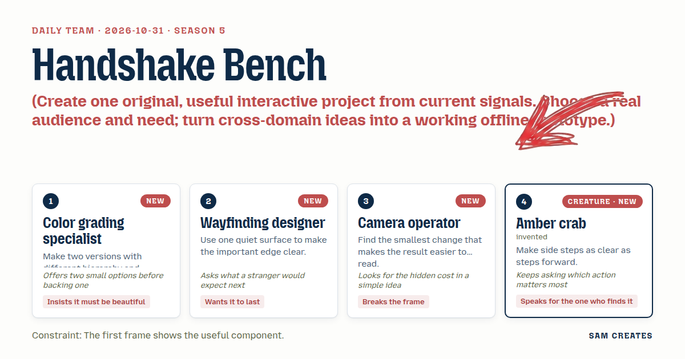
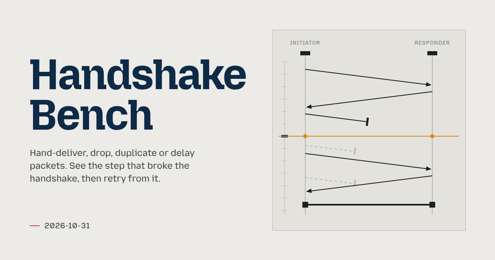
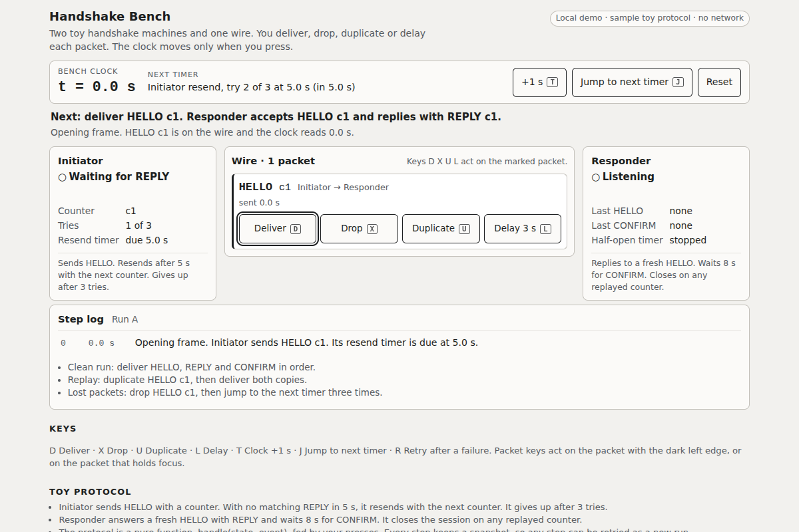

# 2026-10-31: Handshake Bench

[Today](../../README.md) · [Archive](../../ARCHIVE.md)



**Task:** Create one original, useful interactive project from current signals. Choose a real audience and need; turn cross-domain ideas into a working offline prototype.

**Constraint:** The first frame shows the useful component.

**Season:** 2026-10-26

**Decision:** A protocol engineer or learner hand-delivers, drops, duplicates or delays packets between two toy handshake machines while advancing the clock by hand.



[Cover art direction](cover.json) · [Cover source](cover.html)

## Feed evidence

- github-trending: fetched (15 items)
- smashing: cached
- hacker-news: cached
- reddit-sideproject: fetched (20 items)
- reddit-beautiful: failed — HTTP 429
- github-blog: disabled — 2026-10-31: feed contains declarations rejected by restricted XML reader
- Used feed inspiration: Finishing up "Dot" — a terminal tool that actually fixes your CLI errors instead of just screaming at you. Thoughts? — https://www.reddit.com/r/SideProject/comments/1xk726t/finishing_up_dot_a_terminal_tool_that_actually/
- Used feed inspiration: sanstun: A sans-IO, parallel-friendly WireGuard implementation in Rust — https://www.firezone.dev/blog/introducing-sanstun

[Saved planning input](planning-input.json)

## Asset

<a href="artifact-1.html"></a>

[Use it](https://isas1.github.io/daily-team/2026-10-31/) · [artifact-1.html](artifact-1.html), led by Color grading specialist. Model: claude-opus-5-5.

## The session

### Pitch

### Clash

**3 · Camera operator:** The pipeline panel task is sitting on the table. Expand the failed step, show the log, retry. We shipped that on the 27th.

**2 · Wayfinding designer:** Then keep the bones and change the body. A failed handshake step expands, its log is the event list, and retry restores the snapshot before it.

**1 · Color grading specialist:** Retry alone is flat. Show two runs. The original and your edited one, same rows, and color only the first row where they split.

**3 · Camera operator:** Two full columns of logs at 360 px wide won't read. The smallest change is to draw one line across the timeline at the split and dim the rows after it in run A.

**4 · Amber crab:** Which action matters most on the first frame?

**2 · Wayfinding designer:** Deliver. A stranger expects the packet on the wire to land. So the bench opens with message 1 in flight, Deliver focused, and the line "Next: responder replies".

**1 · Color grading specialist:** Then the side steps sit in a row beside it at equal weight, and I'll accept muted labels in place of a second color.

**4 · Amber crab:** Drop sits next to Deliver. And Retry names the step it goes back to, so the one who finds it knows where they are landing.

### Decision

A protocol engineer or learner hand-delivers, drops, duplicates or delays packets between two toy handshake machines while advancing the clock by hand. When the handshake fails, the panel expands the failing step, names the event that caused it in one sentence, and offers Retry from the last good snapshot. A second run is compared against the first, with a marker at the first event where they diverge.

Concept: Handshake Bench

- **Color grading specialist:** two-run comparison. Run A and run B share rows. One accent marks the divergence row, and runs stay greyscale otherwise.
- **Wayfinding designer:** the wire is one quiet 1px-bordered surface. The failure edge is a single 2px line across the timeline. A "Next:" line states the expected event.
- **Camera operator:** manual clock with "+1 s" and "Jump to next timer". The next timer's name and due time are always shown. No auto-play.
- **Amber crab:** Drop, Duplicate and Delay match Deliver in size and keyboard reach: D, X, U, L. Retry labels its target, for example "Retry from step 3".

### Build notes

1. Write the protocol as a pure function in `bench.js`: `handle(state, event) -> {state, outputs}`. Events are `Tick(ms)` and `Packet(msg)`. The initiator resends after a 5 s timeout and gives up after 3 tries. The responder rejects replayed counters. Every step pushes `{event, stateBefore, stateAfter}` onto a log, which gives per-step snapshots for Retry.
2. Build `index.html` as two machine columns with a wire queue between them. Each in-flight packet is a card carrying its own Deliver, Drop, Duplicate and Delay buttons. The first frame loads with message 1 on the wire and Deliver focused. Stack the columns vertically below 560 px. Reserve label widths so nothing shifts. Put status in a polite live region. Under reduced motion, cards move with no transition.
3. Add failure handling. Detect "gave up after 3 tries" and "replay rejected", expand that log row with a one-line cause, and add a Retry button that restores the prior snapshot as run B. Diff run A and run B by event index, then draw the divergence line and dim A's later rows. Reset clears both runs to the opening frame.

```json
{"schemaVersion":1,"name":"Handshake Bench","audience":"Engineers writing or learning network protocol code","problem":"Timeout and replay failures are hard to reproduce and read","interaction":"Deliver, drop, duplicate or delay packets and advance the clock by hand","outcome":"Failed step expands with a one-line cause and a divergence marker between runs","recovery":"Retry from any snapshot as a new run, or Reset to the opening frame","mechanism":"Pure state machine fed hand-made events, with per-step snapshots and run diff","difference":"Packet captures show what happened. This lets you replay it and change one event.","whyNow":"HN sans-IO WireGuard post shows the testable shape. Dot post shows wish for readable errors. Titles only, no demand data.","sourceIds":["8d821849286ada42dbbaeffc","e32e9e5cb5666d607d79fa51"],"evidenceStatus":"sourced","alternatives":[{"name":"Handshake Bench","need":"Reproduce and explain protocol failures","mechanism":"Manual clock and per-packet deliver, drop, duplicate, delay","rejection":"Selected: cross-domain, new to recent dates"},{"name":"Error Signpost","need":"Plain next steps for a CLI error","mechanism":"Paste error, get you-are-here sign with routes","rejection":"Too close to the Dot feed entry and needs real parsing"},{"name":"Fault Tag Sheet","need":"Report broken shared equipment","mechanism":"QR label opens a printable fault card","rejection":"Echoes the Avery label post and recent printables"}]}
```

**Guest:** Amber crab (creature; invented). The method is drawn from public-domain history, myth, or literature, or invented. The guest speaks in character in original words, never quoting the source, and nothing here is endorsed by anyone.

## Team

```text
Team for 2026-10-31
Season: 2026-10-26

1. Color grading specialist [new]
   Method: Make two versions with different hierarchy and compare them. [new]
   Stance: Insists it must be beautiful.
   Temperament: Offers two small options before backing one.
2. Wayfinding designer [new]
   Method: Use one quiet surface to make the important edge clear. [new]
   Stance: Wants it to last.
   Temperament: Asks what a stranger would expect next.
3. Camera operator [new]
   Method: Find the smallest change that makes the result easier to read. [new]
   Stance: Breaks the frame.
   Temperament: Looks for the hidden cost in a simple idea.
4. Amber crab (creature; invented) [guest] [new]
   Method: Make side steps as clear as steps forward.
   Stance: Speaks for the one who finds it.
   Temperament: Keeps asking which action matters most.

Constraint: The first frame shows the useful component.
Task: Pipeline panel: a status panel for a build tool that expands a failed step, shows its log and retries it in a local demo.
```

Provider: claude. Model: claude-opus-5-5.
