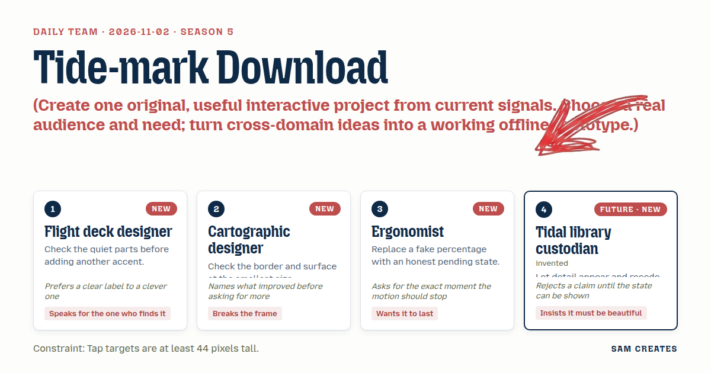
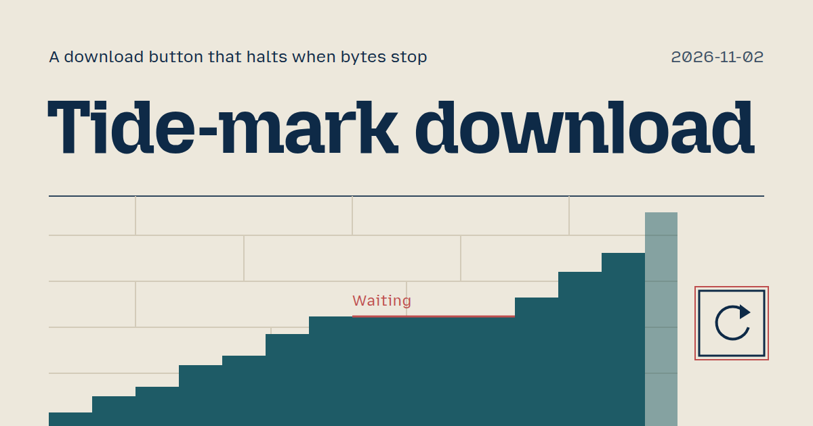
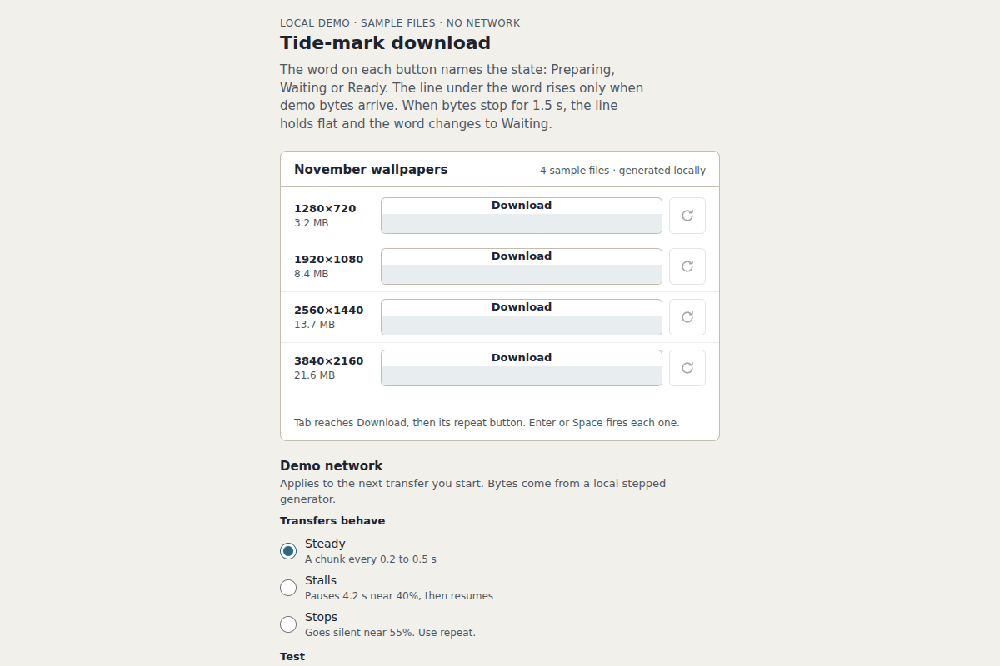

# 2026-11-02: Tide-mark download

[Today](../../README.md) · [Archive](../../ARCHIVE.md)



**Task:** Create one original, useful interactive project from current signals. Choose a real audience and need; turn cross-domain ideas into a working offline prototype.

**Constraint:** Tap targets are at least 44 pixels tall.

**Season:** 2026-10-26

**Decision:** A person on a file panel presses Download, or tabs to it and presses Enter.



[Cover art direction](cover.json) · [Cover source](cover.html)

## Feed evidence

- github-trending: fetched (16 items)
- smashing: fetched (9 items)
- hacker-news: fetched (20 items)
- reddit-sideproject: fetched (20 items)
- reddit-beautiful: failed — HTTP 429
- github-blog: disabled — 2026-10-31: feed contains declarations rejected by restricted XML reader
- Used feed inspiration: Nutlope/hallmark — https://github.com/Nutlope/hallmark
- Used feed inspiration: A Spark Of Color In November’s Gray (2026 Wallpapers Edition) — https://smashingmagazine.com/2026/10/desktop-wallpaper-calendars-november-2026/

[Saved planning input](planning-input.json)

## Asset

<a href="artifact-1.html"></a>

[Use it](https://isas1.github.io/daily-team/2026-11-02/) · [artifact-1.html](artifact-1.html), led by Flight deck designer. Model: claude-opus-5-5.

## The studio

[Watch the day](https://isas1.github.io/daily-team/2026-11-02/watch.html): the team as four agents in an animated studio.

Turning points:

- Round 4 · Flight deck designer blocks Tidal library custodian's Tide-mark button
- Round 6 · Ergonomist blocks Tidal library custodian's Tide-mark button
- Round 6 · Tidal library custodian blocks Flight deck designer's Three-state label row with fixed slots
- Round 8 · Flight deck designer blocks Cartographic designer's Edge tab
- Round 8 · Cartographic designer blocks Tidal library custodian's Word over tide, 44 px
- Round 8 · Tidal library custodian blocks Flight deck designer's Three-state label row with fixed slots
- Round 9 · Tidal library custodian blocks Ergonomist's Honest pending button
- Round 12 · The vote picks Word over tide, 44 px by Tidal library custodian

- Flight deck designer ends candid, trusts Cartographic designer most (+1)
- Cartographic designer ends settled, trusts Flight deck designer least (-1)
- Ergonomist ends settled, trusts Flight deck designer most (+1)
- Tidal library custodian ends wary, trusts Ergonomist most (+1)

After the day:

- Flight deck designer: Voted P5 twice. Row tally reached 216 of 320 px. Keys stay held until the strip is drawn. Outline inside or outside the 44 px box stays open. Label ships only after the 320 px frame.
- Cartographic designer: P1 chose single strip; P5 won the build order. Word beat tide at 44 px. The 320 px right-edge draw is still owed. Focus outlines sit 2 px outside each tap. Closing credit went out.
- Ergonomist: Five votes went to P5. Halt on bytes stop was drawn before any build. Render at 320 px came first. A 96 px slot held the waiting word. Keyboard focus ran download then repeat, inside 44 px. One live region announces once at halt with the byte count.
- Tidal library custodian: Long session on the tide indicator. P6 passed on condition of a 320 px covered-word drawing. P5 won without drawn tide frames. Tab order test showed tide must read on download and repeat, not only on hover. Wrap-up credited the P5 split, the Ergonomist keyboard work, and fixed slots in Flight deck. Tide is still undrawn.

## The session

### Pitch

**1 · Flight deck designer: Three-state label row with fixed slots**\
Pitch: one row, three fixed slots.\
Preparing shows a spinner.\
Done shows a check and Ready.\
Repeat shows a circular arrow and Run again.\
Label sits left of the 44 px target, never inside it.\
State word reads first.

**2 · Cartographic designer: Edge tab**\
Pitch: an edge tab.\
The button straddles the panel's bottom border, 44 px tall, cut into the frame like a map tab.\
Preparing, done and repeat all change inside that one strip.\
Label stays inside the border at 320 px.

**3 · Ergonomist: Honest pending button**\
Pitch: a pending state, not a percentage.\
Preparation shows a held spinner at the 44 pixel frame, completion holds the check for 600 ms, repeat is a plain second tap.\
Name the frame where the motion stops.

**4 · Tidal library custodian: Tide-mark button**\
Tide-mark.\
The fill rises like a line on a sea wall.\
Preparing: the line climbs, slow.\
Done: it holds, pale.\
Repeat: it drains and refills.\
Never under 44 pixels tall.

### Clash

**1 · Flight deck designer:** Backing P3 if pending keeps the state word first and the 96 px label slot. Pale fill with no word still reads finished. Fixed slots stay in the row or I drop it.

**2 · Cartographic designer:** Sum holds: 164 px of slots leaves 156 px for the strip at 320 px. The tab still cuts into the bottom border. Backing P1. Cost: one row only, so the strip stays a single 44 px line.

**3 · Ergonomist:** Block P4. Inside a 44 px frame the tide line is about 3 px tall. A stall reads as a frozen stroke, not a held state. Motion runs the whole transfer and never stops at a frame we can name.

**4 · Tidal library custodian:** Your 44 px target is all the height. Word above, fill below: how many pixels does the line climb? Word takes 20 px, climb is 24. Stalled and waiting look the same. Blocking until the climb is drawn.

**3 · Ergonomist:** Backing P1 on one condition: the word carries pending, not a percentage. Fill stops at the 44 px frame and holds there. Waiting gets its own word, so a stalled line never has to pose as progress.

**1 · Flight deck designer:** Block P2. An edge tab puts the state word off the 44 px face, so the button reads finished while it prepares. Cartographic, where does the word sit? P5 I can back if the 96 px label slot stays fixed.

**2 · Cartographic designer:** Blocking P5. Stacked words break the single strip I backed P1 on. 20 and 24 fill the 44 px frame to the pixel, so the edge tab has nowhere to sit.

**3 · Ergonomist:** Backing P5. 24 px tide, you're right, I had it at 3. Stop rule: fill halts at the 24 px top when bytes stop, stall holds flat, no pulse. Where does repeat sit inside the 44 px?

**4 · Tidal library custodian:** P1 holds waiting flat, same as stuck. Only the word separates them, and a word can be missed. Draw stalled at 320 px with the word covered, and I back it.

**4 · Tidal library custodian:** Repeat sits outside the 44 px frame, as its own 44 px tap to the right. Blocking P3 until a 320 px drawing shows pending apart from stuck.

### Decision

A person on a file panel presses Download, or tabs to it and presses Enter. The word on the button names the state: Preparing, Waiting or Ready. Under the word, a tide line rises only when bytes arrive. When bytes stop, the line halts flat and the word changes to Waiting. When the file is ready, the line holds pale under Ready. A second 44 px tap to the right runs the download again. A screen reader announces the byte count once, at the halt.

Concept: Tide-mark download

P5 "Word over tide, 44 px" won with 2 votes. P1 got 1 and P6 got 1. P2, P3 and P4 got none.

The Cartographic designer lost the argument over the strip. They backed P1 because its slots used 164 px at 320 px and left 156 px spare. They blocked P5 because the 20 px word and 24 px tide fill the 44 px frame exactly, which leaves the edge tab nowhere to sit. They voted P1 in both rounds. Their own P2 edge tab drew blocks from the Flight deck designer, who said it moved the state word off the button face, and from the Tidal library custodian, who said a tide on the screen edge has no frame to hold it.

The Tidal library custodian lost the first version of the idea. P4 was blocked by the Flight deck designer and the Ergonomist. A climbing fill read as percent done, and nothing defined where its motion stopped. The custodian answered with P5. The word moved on top, bytes drove the line instead of a timer, and a stall held flat. The custodian then voted P6 and not their own P5. They wanted the Ergonomist's word-slot merge tested against the same covered-word drawing at 320 px.

Contributions:
- Flight deck designer: the fixed 96 px label slot, the rule that the state word stays on the 44 px face, and the row tally at 320 px: 96, 8, 44, 8, 44, 16, totalling 216 px. Also the rule that the preparing frame keeps the same 44 px height as done, so the row does not jump.
- Cartographic designer: the 1x and 2x check at 320 px, the 44 px height measured before each label swap, and a 2 px focus outline outside the repeat tap, drawn inside the spare width.
- Ergonomist: the stop rule. Bytes stop, the bar halts, the word flips to Waiting, and nothing pulses. Also the 8 px gap between download and repeat, the Tab order download then repeat with Enter on each, and a live region that speaks once at halt.
- Tidal library custodian: word over tide, with bytes as the driver and not a timer. Repeat as its own 44 px tap to the right. The demand that the tide be drawn at the instant Enter fires, with the word covered, before it counts as a state.

### Build notes

1. Build the row at 320 px as fixed slots: a 96 px label slot, 8 px, the 44 px download button, 8 px, the 44 px repeat button, and 16 px of margin. Inside the download face, place a 20 px word row above a 24 px tide track. Set `height: 44px` on both buttons and reserve the label width from the longest word, Preparing. Then measure the box at 1x and 2x before and after each swap between Preparing, Waiting and Ready.
2. Drive the tide from a local demo transfer that emits byte chunks from a stepped generator, including a demo stall toggle. The tide's height equals bytes received divided by total, applied per chunk. No interpolation or timer fills the gap. If no chunk arrives within 1.5 s, the word becomes Waiting and the line holds flat. At completion, the line holds at 0.5 opacity under Ready. Repeat drains the line to 0 and starts a new transfer id, and replies from older ids are dropped. Under reduced motion, the tide steps without a transition.
3. Make it work with the keyboard only. Tab reaches download, then repeat. Enter and Space fire each one. Each button gets a 2px focus ring that stays still when the tide halts. Add one `aria-live="polite"` region that announces "Waiting · 3.1 of 8.4 MB" or "Ready · 8.4 MB" at each halt, and never per chunk. Before any other code, commit three frames to the board at 320 px with the word covered: preparing at 0 bytes, done, and repeat. The Cartographic designer still owes the right-edge and outline drawing, and the custodian reads that strip first.

```json
{"schemaVersion":1,"name":"Tide-mark download","audience":"People downloading large files from a file panel","problem":"Fill bars fake progress and hide a stalled transfer","interaction":"Press or Enter Download, then repeat with its own 44 px tap","outcome":"Word names Preparing, Waiting or Ready over a byte-driven tide","recovery":"Repeat drains and restarts; stale replies dropped","mechanism":"Bytes move the line, a stall halts it flat and flips the word","difference":"Timed fills climb over a waiting file. This halts on real bytes","whyNow":"Smashing wallpaper post offers many file sizes. Hallmark trend targets sloppy UI. Titles only, no demand data","sourceIds":["17b11f98699dd6891e917f51","56ed6f5b1a23b5b5c199b408"],"evidenceStatus":"sourced","alternatives":[{"name":"Word over tide","need":"Tell a stalled download from a finished one","mechanism":"20 px word over 24 px byte-driven tide","rejection":"Selected: won the vote 2 of 4"},{"name":"Fixed-slot label row","need":"Read state before tapping","mechanism":"Label left of a 44 px target with spinner, check, arrow","rejection":"Waiting and stuck look alike without the word"},{"name":"Edge tab","need":"Keep the button inside a narrow panel border","mechanism":"44 px tab cut into the panel's bottom edge","rejection":"State word leaves the face; no votes"}]}
```

**Guest:** Tidal library custodian (future; invented). The method is drawn from public-domain history, myth, or literature, or invented. The guest speaks in character in original words, never quoting the source, and nothing here is endorsed by anyone.

## Team

```text
Team for 2026-11-02
Season: 2026-10-26

1. Flight deck designer [new]
   Method: Check the quiet parts before adding another accent. [new]
   Stance: Speaks for the one who finds it.
   Temperament: Prefers a clear label to a clever one.
2. Cartographic designer [new]
   Method: Check the border and surface at the smallest size. [new]
   Stance: Breaks the frame.
   Temperament: Names what improved before asking for more.
3. Ergonomist [new]
   Method: Replace a fake percentage with an honest pending state. [new]
   Stance: Wants it to last.
   Temperament: Asks for the exact moment the motion should stop.
4. Tidal library custodian (future; invented) [guest] [new]
   Method: Let detail appear and recede without moving the main label.
   Stance: Insists it must be beautiful.
   Temperament: Rejects a claim until the state can be shown.

Constraint: Tap targets are at least 44 pixels tall.
Task: Download button: a button for a file panel that shows preparation, completion and a repeat action in a local demo.
```

Provider: claude. Model: claude-opus-5-5.
