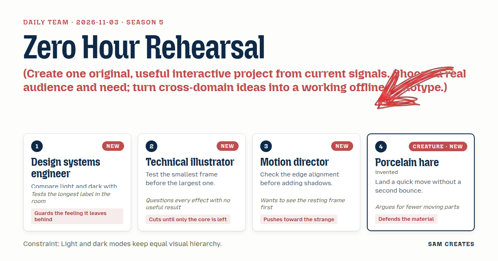
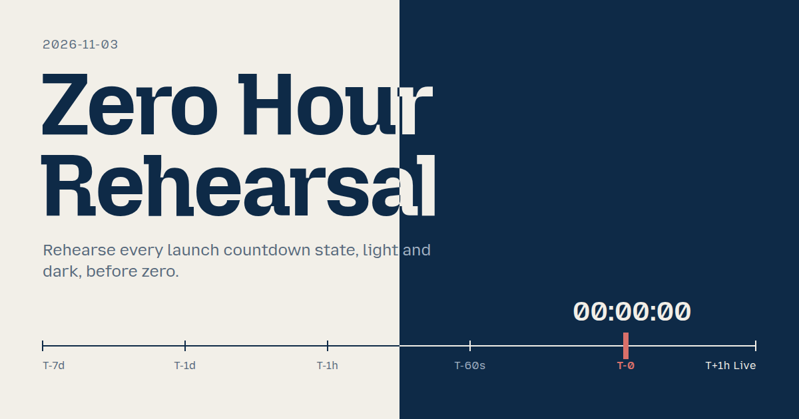
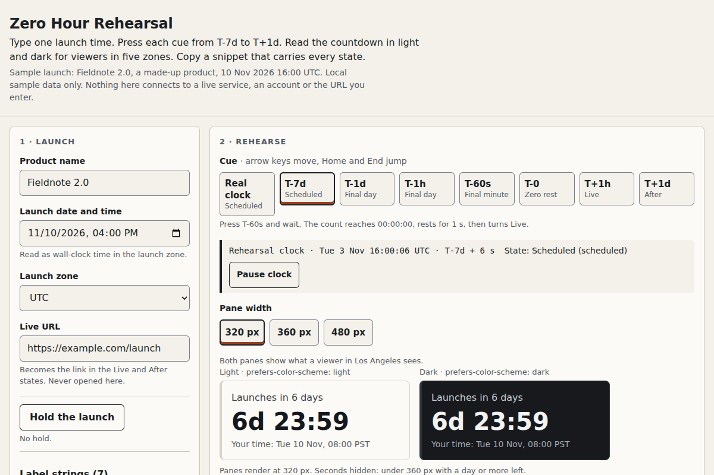

# 2026-11-03: Zero Hour Rehearsal

[Today](../../README.md) · [Archive](../../ARCHIVE.md)



**Task:** Create one original, useful interactive project from current signals. Choose a real audience and need; turn cross-domain ideas into a working offline prototype.

**Constraint:** Light and dark modes keep equal visual hierarchy.

**Season:** 2026-10-26

**Decision:** An indie maker types a launch time and zone, presses cues from T-7d to T+1h, and sees the countdown render in light and dark for any viewer zone.



[Cover art direction](cover.json) · [Cover source](cover.html)

## Feed evidence

- github-trending: fetched (16 items)
- smashing: fetched (9 items)
- hacker-news: fetched (20 items)
- reddit-sideproject: fetched (20 items)
- reddit-beautiful: failed — HTTP 429
- github-blog: disabled — 2026-10-31: feed contains declarations rejected by restricted XML reader
- Used feed inspiration: lots of praise, almost nobody pastes in their own data. How do you read that? — https://www.reddit.com/r/SideProject/comments/1xms205/lots_of_praise_almost_nobody_pastes_in_their_own/
- Used feed inspiration: pbakaus/impeccable — https://github.com/pbakaus/impeccable

[Saved planning input](planning-input.json)

## Asset

<a href="artifact-1.html"></a>

[Use it](https://isas1.github.io/daily-team/2026-11-03/) · [artifact-1.html](artifact-1.html), led by Design systems engineer. Model: claude-opus-5-5.

## The session

### Pitch

### Clash

**3 · Motion director:** The board is the memorable part. Take it away and you have a number on a page.

**4 · Porcelain hare:** A number on a page is what the visitor came for. The flaps are six moving parts that tell you one thing.

**2 · Technical illustrator:** At 320 px a flap board fits four digits and then the label wraps. I tried it in my head and it breaks.

**1 · Design systems engineer:** The board is a skin. The real failure is the counter reading "-00:00:03" at launch, or showing 9 a.m. to someone in Tokyo. Nobody sees that until launch day.

**2 · Technical illustrator:** The sunset clock has the same zero-hour problem, with more at stake.

**1 · Design systems engineer:** It does, but it needs a real export behind it to be useful. A launch rehearsal works offline with one typed time.

**3 · Motion director:** Then take one thing from my side. Broadcast control rooms hold a countdown when a segment slips. Give the maker a Hold that moves the launch, and let the page say so in words.

**4 · Porcelain hare:** Hold is a good part. It changes the state of the clock, not how the clock looks. Keep it.

**3 · Motion director:** And the zero frame rests for one second at "00:00:00" before it switches to Live. No bounce. I'll accept that.

### Decision

An indie maker types a launch time and zone, presses cues from T-7d to T+1h, and sees the countdown render in light and dark for any viewer zone. The maker catches wrong-zone times, negative counters and missing post-launch states before the launch, then copies a 2 KB snippet that contains every state.

Concept: Zero Hour Rehearsal

- Design systems engineer: two panes, light and dark, fed by one state object. Hierarchy tokens are shared: the count is 40 px at weight 600, the label is 16 px, and the local time is 14 px, in both modes. A longest-label check pins the pane width to "Launches in 365 days".
- Technical illustrator: the layout is designed at 320 px first. Seconds drop below 360 px when more than one day remains. No flip, glow or confetti.
- Motion director: the cue rail uses broadcast vocabulary (T-7d, T-1d, T-1h, T-60s, T-0, T+1h) and adds Hold. At zero the frame rests at 00:00:00 for 1 s, then swaps to Live. Edges align on a 4 px grid before any shadow is added.
- Porcelain hare: only the seconds digits tick. The state swap is one 160 ms opacity change with no overshoot. Digits use tabular-nums in the page's own font. Under reduced motion the swap is instant.

The nearest usual approach is a hosted countdown widget that shows the live clock only. This tool rehearses every state on demand and across zones. Handshake Bench (2026-10-31) also advanced a clock by hand, but there the clock drove a protocol simulator. Here the cue rail jumps to named public states for viewers in five zones and outputs a working snippet.

### Build notes

1. Store the launch as one UTC instant in a single state object. Rehearsal time equals launch plus the cue offset, or the real clock in Live mode. A pure `stateAt(now, launch, hold)` returns one of `scheduled`, `final-day`, `final-minute`, `zero-rest`, `live`, `held` and `after`. Format the local launch line with `Intl.DateTimeFormat` for Los Angeles, New York, London, Berlin and Tokyo. An invalid date shows an inline error and keeps the last valid launch.
2. Render both panes from the same `stateAt` result with shared size tokens. Make the cue rail a radio group with arrow keys plus Home and End. Hold opens a time field. The held state reads "Moved to 18:00 · was 16:00" and recomputes the count. Reset restores the sample launch, 2026-11-10 16:00 UTC. A polite live region announces state changes only, not ticks.
3. The Copy snippet button serializes the launch, any hold, the live URL and the label strings into one inline `<div>` and a `<script>` under 2 KB. The script switches modes with `prefers-color-scheme` and never prints a negative count. Run an automated check across all 7 states in both modes for 320 px overflow and equal font-size order before the button enables.

```json
{"schemaVersion":1,"name":"Zero Hour Rehearsal","audience":"Indie makers shipping a launch page","problem":"Countdown states at zero and after go unseen","interaction":"Type launch time, press cues, switch viewer zone","outcome":"Light and dark panes show each state, then copy snippet","recovery":"Invalid date keeps last valid; Reset restores sample","mechanism":"Cue rail jumps clock; Hold moves launch and says so","difference":"Widgets show only live time; this rehearses all states","whyNow":"SideProject post: visitors skip own data. impeccable trend: catch sloppy UI. Titles only","sourceIds":["9e9ee0e5d4c6312bd2fdf39f","ec673bd7694d3a658bba5faa"],"evidenceStatus":"sourced","alternatives":[{"name":"Zero Hour Rehearsal","need":"See every countdown state before launch","mechanism":"Broadcast cue rail with Hold, dual-mode panes","rejection":"Selected: works offline, covers zero and after"},{"name":"Sunset Export Clock","need":"Users see a shutdown export deadline","mechanism":"Countdown flips app to read-only at zero","rejection":"Needs a real export behind it to help"},{"name":"Split-flap Launch Board","need":"Countdown readable across a room","mechanism":"Flap rows flip as each cue arrives","rejection":"A skin of a counter; breaks at 320 px"}]}
```

**Guest:** Porcelain hare (creature; invented). The method is drawn from public-domain history, myth, or literature, or invented. The guest speaks in character in original words, never quoting the source, and nothing here is endorsed by anyone.

## Team

```text
Team for 2026-11-03
Season: 2026-10-26

1. Design systems engineer [new]
   Method: Compare light and dark with the same content. [new]
   Stance: Guards the feeling it leaves behind.
   Temperament: Tests the longest label in the room.
2. Technical illustrator [new]
   Method: Test the smallest frame before the largest one. [new]
   Stance: Cuts until only the core is left.
   Temperament: Questions every effect with no useful result.
3. Motion director [new]
   Method: Check the edge alignment before adding shadows. [new]
   Stance: Pushes toward the strange.
   Temperament: Wants to see the resting frame first.
4. Porcelain hare (creature; invented) [guest] [new]
   Method: Land a quick move without a second bounce.
   Stance: Defends the material.
   Temperament: Argues for fewer moving parts.

Constraint: Light and dark modes keep equal visual hierarchy.
Task: Launch countdown: a countdown for a product launch page that shows time remaining and changes state when the launch arrives.
```

Provider: claude. Model: claude-opus-5-5.
