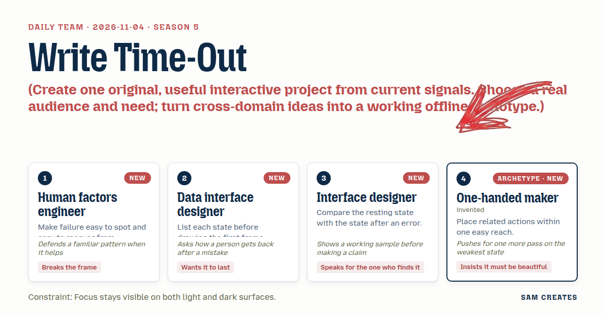
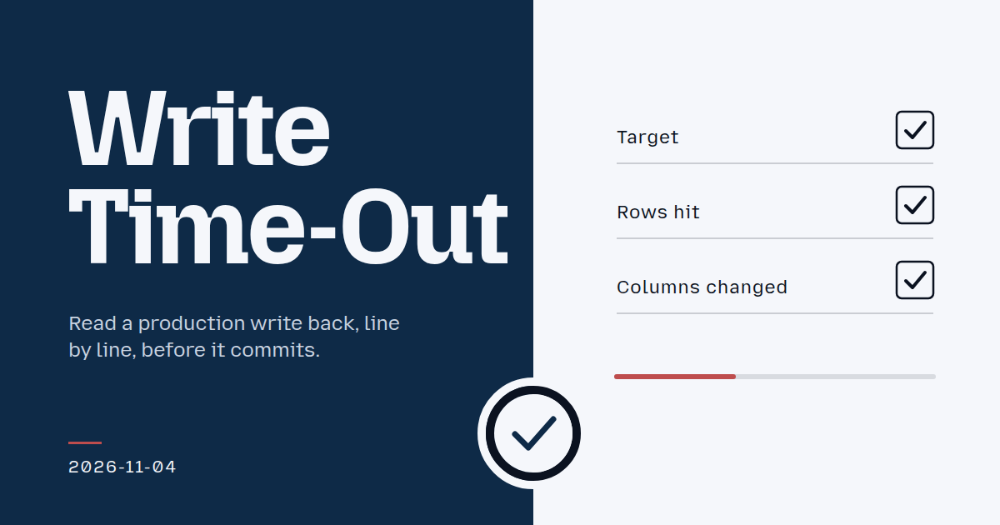
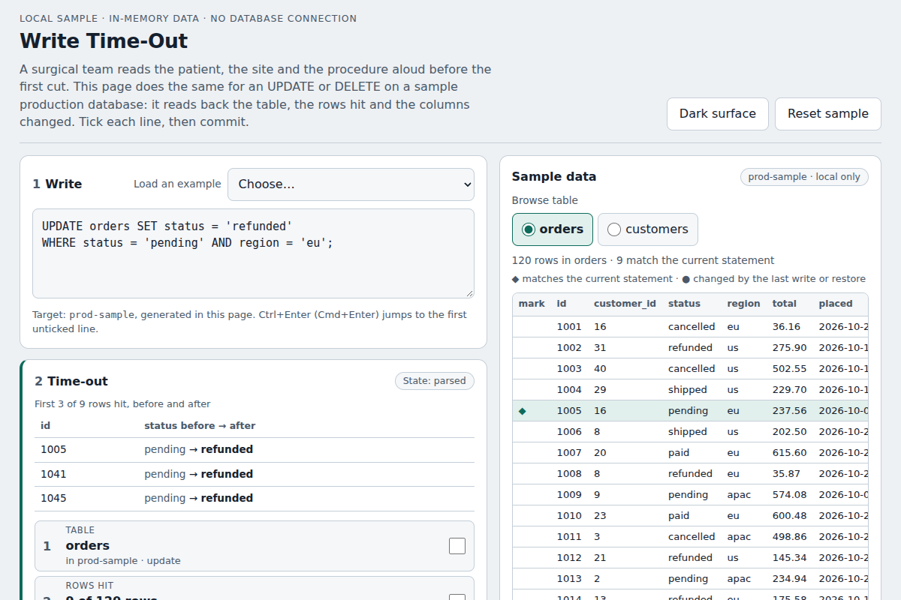

# 2026-11-04: Write Time-Out

[Today](../../README.md) · [Archive](../../ARCHIVE.md)



**Task:** Create one original, useful interactive project from current signals. Choose a real audience and need; turn cross-domain ideas into a working offline prototype.

**Constraint:** Focus stays visible on both light and dark surfaces.

**Season:** 2026-10-26

**Decision:** An engineer types an UPDATE or DELETE against a sample production database.



[Cover art direction](cover.json) · [Cover source](cover.html)

## Feed evidence

- github-trending: fetched (15 items)
- smashing: fetched (10 items)
- hacker-news: fetched (20 items)
- reddit-sideproject: fetched (20 items)
- reddit-beautiful: failed — HTTP 429
- github-blog: disabled — 2026-10-31: feed contains declarations rejected by restricted XML reader
- Used feed inspiration: NiceDB - a free desktop database client where production stays read-only until you unlock it — https://www.reddit.com/r/SideProject/comments/1xno804/nicedb_a_free_desktop_database_client_where/
- Used feed inspiration: max-sixty/worktrunk — https://github.com/max-sixty/worktrunk

[Saved planning input](planning-input.json)

## Asset

<a href="artifact-1.html"></a>

[Use it](https://isas1.github.io/daily-team/2026-11-04/) · [artifact-1.html](artifact-1.html), led by Human factors engineer. Model: claude-opus-5-5.

## The session

### Pitch

### Clash

**2 · Data interface designer:** Ten seconds of toast. Then what. The person notices the wrong count at second eleven.

**1 · Human factors engineer:** Then the write goes into a history list, and Restore lives there. The toast stays the fast path. I won't swap it for a modal.

**4 · One-handed maker:** The history row is the weakest state. Give it one more pass. Same wording as the toast, same button place, so nobody has to hunt for it.

**3 · Interface designer:** And if someone edits the query after ticking? The ticks are now lying.

**1 · Human factors engineer:** Clear them. Say "Query changed · re-check 3 lines." The card never vouches for text it hasn't read.

**2 · Data interface designer:** No WHERE clause. That's the case that wipes a table.

**3 · Interface designer:** Show it. "120 of 120 rows · no WHERE." Then the Commit field asks for the table name typed out. Here, the sample does that already.

**4 · One-handed maker:** Typing a name with one hand is slow. Fine. That case should be slow.

**3 · Interface designer:** Focus ring has to survive the dark theme. A single blue ring vanishes on navy.

**1 · Human factors engineer:** Two rings. Dark inner, light outer. Readable on either surface.

### Decision

An engineer types an UPDATE or DELETE against a sample production database. A time-out card reads the statement back as target, rows hit out of total, columns changed and three before-and-after rows. The engineer ticks each line and commits. A toast confirms "Updated 14 rows in orders · 14:52" with Undo and clears after 10 s without moving focus. The write stays restorable from a history list.

Concept: Write Time-Out

The surgical time-out replaces the generic confirm dialog. The card makes the reader name what they are about to change. It does not ask whether they are sure.

- **Human factors engineer:** the time-out card with three readback lines and per-line ticks, plus the toast. The toast keeps focus in the editor, pauses on hover or focus, and is announced in a polite live region.
- **Data interface designer:** the state list that drives the build. It covers drafting, parsed, unparsed, checked, changed-after-check, no-WHERE, committed, toast-visible, toast-cleared, undone and restored. It also adds the history list, so recovery outlasts the toast.
- **Interface designer:** the no-WHERE path that requires the table name typed exactly. It also covers the comparison between the resting card and the card after a parse error, which keeps the same height and names the token it stopped at.
- **One-handed maker:** a single right-aligned column holding ticks, Commit, toast Undo and history Restore within a 280 px vertical span, each at least 44 px tall. It also covers the second pass on the history row, which uses the toast's wording and button position.

The double focus ring is a 2px #0b1220 inner ring and a 2px #f5f7fb outer ring. It applies to every control in the light and dark themes.

### Build notes

1. Build an in-memory sample database in one `index.html`, with `customers` at 40 rows and `orders` at 120 rows. Add a small parser for `UPDATE t SET c = v[, ...] WHERE ...` and `DELETE FROM t WHERE ...` that supports `=`, `<>`, `<`, `>` and `AND`. On unsupported input, show "Stopped at `<token>`" at the card's fixed height. Before each commit, snapshot the affected rows by id.
2. Render the time-out card from the parse result: target, rows hit "14 of 120", columns changed, and a 3-row before-and-after table. Add three tick checkboxes. Clear all ticks on any edit after a tick, with "Query changed · re-check 3 lines". Enable Commit only when all ticks are set. With no WHERE, also require the table name typed exactly. Add a light/dark toggle, and apply the double focus ring through `:focus-visible` in both themes.
3. Add the toast: `role="status"`, a 10 s timer that pauses on hover and focus-within, and Undo that restores the snapshot and reads "Restored 14 rows in orders". Focus never moves to the toast. On clear, append the entry to the history list, which keeps the same wording and a Restore button in the same column position. Restore on an entry whose rows have changed since then reads "Rows changed since 14:52 · restore skipped 2". Reset sample restores both tables and empties history.

```json
{"schemaVersion":1,"name":"Write Time-Out","audience":"Engineers running ad hoc SQL writes on production","problem":"Confirm dialogs get clicked through and name no rows","interaction":"Type a write, tick three readback lines, commit","outcome":"Row count, before/after rows, then toast with Undo","recovery":"Toast Undo, history Restore, Reset sample","mechanism":"Surgical time-out readback; edits clear ticks; no WHERE needs typed name","difference":"Are-you-sure modals and read-only modes; this shows rows hit and undoes","whyNow":"NiceDB post: prod read-only by default. Worktrunk: parallel agent edits. Titles only, no demand data","sourceIds":["65db66769efd1b895ea5c3f0","d2a13eb5e04b724bc066229f"],"evidenceStatus":"sourced","alternatives":[{"name":"Write Time-Out","need":"Know what a prod write will change","mechanism":"Readback card with per-line ticks and undo toast","rejection":"Selected: works offline, cross-domain, new to recent dates"},{"name":"Worktree Ledger","need":"See which agent worktree saved which file","mechanism":"Per-worktree save marks and conflict preview","rejection":"Needs a live repo to be useful"},{"name":"Apt Source Check","need":"Spot weak entries in sources.list","mechanism":"Paste file, mark each line by transport and key","rejection":"Advisory details unknown; flags would be guesses"}]}
```

**Guest:** One-handed maker (archetype; invented). The method is drawn from public-domain history, myth, or literature, or invented. The guest speaks in character in original words, never quoting the source, and nothing here is endorsed by anyone.

## Team

```text
Team for 2026-11-04
Season: 2026-10-26

1. Human factors engineer [new]
   Method: Make failure easy to spot and easy to recover from. [new]
   Stance: Breaks the frame.
   Temperament: Defends a familiar pattern when it helps.
2. Data interface designer [new]
   Method: List each state before drawing the first frame. [new]
   Stance: Wants it to last.
   Temperament: Asks how a person gets back after a mistake.
3. Interface designer [new]
   Method: Compare the resting state with the state after an error. [new]
   Stance: Speaks for the one who finds it.
   Temperament: Shows a working sample before making a claim.
4. One-handed maker (archetype; invented) [guest] [new]
   Method: Place related actions within one easy reach.
   Stance: Insists it must be beautiful.
   Temperament: Pushes for one more pass on the weakest state.

Constraint: Focus stays visible on both light and dark surfaces.
Task: Save notice: a toast for a project editor that confirms a save and then clears without blocking the work.
```

Provider: claude. Model: claude-opus-5-5.
