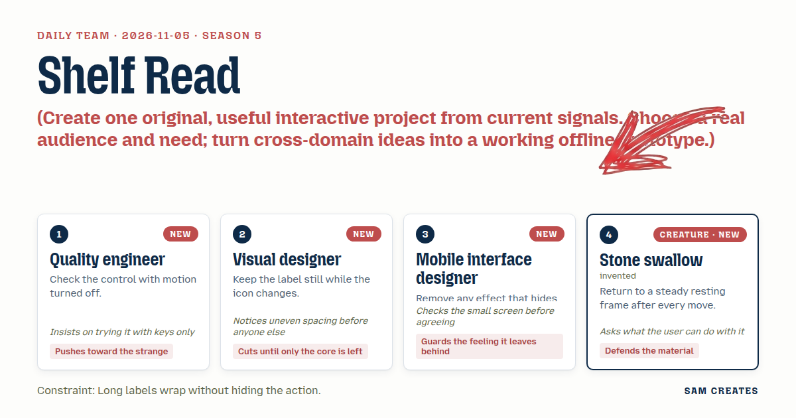
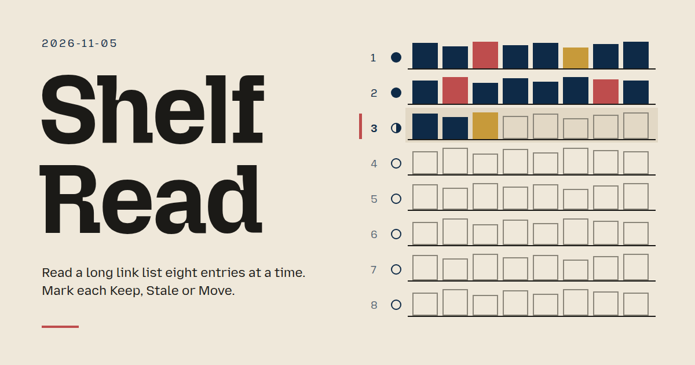
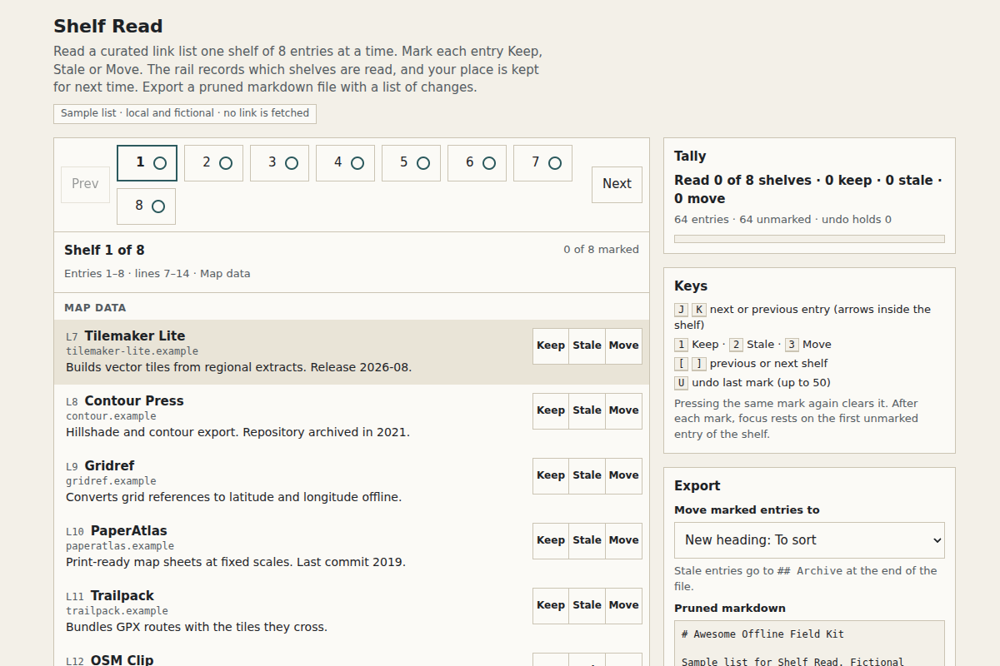

# 2026-11-05: Shelf Read

[Today](../../README.md) · [Archive](../../ARCHIVE.md)



**Task:** Create one original, useful interactive project from current signals. Choose a real audience and need; turn cross-domain ideas into a working offline prototype.

**Constraint:** Long labels wrap without hiding the action.

**Season:** 2026-10-26

**Decision:** A maintainer of a curated link list pastes the markdown, reads it one eight-entry shelf at a time, and marks each entry Keep, Stale or Move.



[Cover art direction](cover.json) · [Cover source](cover.html)

## Feed evidence

- github-trending: fetched (16 items)
- smashing: fetched (11 items)
- hacker-news: fetched (20 items)
- reddit-sideproject: fetched (20 items)
- reddit-beautiful: failed — HTTP 429
- github-blog: disabled — 2026-10-31: feed contains declarations rejected by restricted XML reader
- Used feed inspiration: anthropics/skills — https://github.com/anthropics/skills
- Used feed inspiration: Awesome repositories are no longer awesome — https://erikgahner.github.io/posts/2026/awesome-repositories-are-no-longer-awesome/

[Saved planning input](planning-input.json)

## Asset

<a href="artifact-1.html"></a>

[Use it](https://isas1.github.io/daily-team/2026-11-05/) · [artifact-1.html](artifact-1.html), led by Quality engineer. Model: claude-opus-5-5.

## The session

### Pitch

### Clash

**1 · Quality engineer:** Shelf Read with motion off. What moves? If the page change slides, I turn it off and check the focus still lands somewhere sane.

**4 · Stone swallow:** Nothing slides. After every move it returns to a resting frame. Focus goes to the first unmarked entry on the new shelf. The rail stops.

**3 · Mobile interface designer:** Eight page numbers in a row at 320 px won't fit. And a section label like "Command-line tools for container orchestration" will push the Next button off the edge.

**2 · Visual designer:** Then the label wraps and the buttons keep their own column. Fixed 44 px column on the right. The section text gets the rest. I already see the gap between rail items drifting from 8 to 6 px in your sketch.

**1 · Quality engineer:** My Turn Pager is closer to the task. It's literally pagination through results.

**4 · Stone swallow:** It reads a transcript. It changes nothing. The shelf changes the list, and the user leaves with a file.

**3 · Mobile interface designer:** Discount Ledger needs price history nobody has offline. I drop it. But on the shelf rail, the read mark has to change without the number moving.

**2 · Visual designer:** Number stays still. Icon beside it changes: empty ring, half ring, filled ring. Width reserved for the widest state.

**1 · Quality engineer:** Fine. One condition. Every action has a key, and I test it without a mouse before anyone says done.

### Decision

A maintainer of a curated link list pastes the markdown, reads it one eight-entry shelf at a time, and marks each entry Keep, Stale or Move. The rail shows which shelves are read. The result is a tally ("Read 5 of 8 shelves · 41 keep · 9 stale · 3 move") and an exported markdown file with stale entries moved to an Archive section, plus a list of what changed.

Concept: Shelf Read

The nearest usual approach is a CI link checker. It flags dead URLs, but live links to abandoned projects pass. Editing a 600-line file by hand loses the reader's place. Shelf Read adds a human judgment pass with a place that survives between sessions. The cross-domain mechanism is library shelf-reading: staff check one range of a stack at a time and log which ranges are done.

Signals: the HN title "Awesome repositories are no longer awesome" suggests curated lists decay. GitHub Trending observed anthropics/skills, a public collection repository. Both are titles only. That is an observation, not a publication date, and it is not demand data.

Contributions:
- Stone swallow: the shelf model and the resting frame. After each mark or page change, focus returns to the first unmarked entry and nothing animates.
- Quality engineer: full keyboard map. J and K move between entries. 1, 2 and 3 mark Keep, Stale and Move. [ and ] change shelf. U undoes. Every path is tested with motion off and without a pointer.
- Visual designer: a still number with a changing read icon in a reserved 20 px slot. Three marks only. One 8 px gap token across the rail.
- Mobile interface designer: below 480 px the rail collapses to "Shelf 3 of 8" with 44 px Prev and Next buttons and a jump select. Long section labels wrap in a flexible column, and the action column stays fixed at the right.

### Build notes

1. Parse pasted markdown into entries keyed by line number. Each entry records its section heading, link text, URL host and description. Split the entries into shelves of 8. Include a 64-entry sample list. Store the marks and the current shelf in localStorage. An invalid paste reads "No links found" and keeps the previous list.
2. Build the rail as a `nav` with buttons. The current shelf gets `aria-current="page"`. Each number sits beside a 20 px icon slot: empty ring for unread, half ring for partly marked, filled ring for all marked. The visually hidden words are "unread", "partly read" and "read". Prev and Next disable at the ends. Entry rows use a two-column grid, `1fr 132px`. The label column wraps and the mark buttons never shrink.
3. Write the export. Keep and Move entries stay in their sections. Moved entries go under a chosen heading. Stale entries go to `## Archive`. Show a change list with the line numbers. Provide a Copy button and a .md download. Undo reverses the last mark, with a stack of 50. Reset restores the sample after a confirm line that names the mark count lost.

```json
{"schemaVersion":1,"name":"Shelf Read","audience":"Maintainers of curated link lists","problem":"Stale but live links pile up; place is lost","interaction":"Page 8-entry shelves, mark Keep, Stale or Move","outcome":"Read-shelf rail, tally, pruned markdown and change list","recovery":"Undo last mark, bad paste keeps list, Reset sample","mechanism":"Library shelf-reading: per-shelf read marks persist","difference":"Link checkers miss live abandoned links; this adds judged pass","whyNow":"HN title on awesome lists decaying; skills repo observed trending. Titles only","sourceIds":["aeba5bf756bb149e5d922f04","82a901da1b9bedec6f38670b"],"evidenceStatus":"sourced","alternatives":[{"name":"Shelf Read","need":"Prune a long curated list over sessions","mechanism":"Shelf pages with read marks and keyed triage","rejection":"Selected: offline, cross-domain, leaves a file"},{"name":"Turn Pager","need":"Move through long chat transcripts by keys","mechanism":"Turn rail with J/K jumps and turn count","rejection":"Reads only, drifts toward a chat wrapper"},{"name":"Discount Ledger","need":"Check if a was price existed","mechanism":"Paste seen prices, page dates against claim","rejection":"Echoes feed entry, needs real price data"}]}
```

**Guest:** Stone swallow (creature; invented). The method is drawn from public-domain history, myth, or literature, or invented. The guest speaks in character in original words, never quoting the source, and nothing here is endorsed by anyone.

## Team

```text
Team for 2026-11-05
Season: 2026-10-26

1. Quality engineer [new]
   Method: Check the control with motion turned off. [new]
   Stance: Pushes toward the strange.
   Temperament: Insists on trying it with keys only.
2. Visual designer [new]
   Method: Keep the label still while the icon changes. [new]
   Stance: Cuts until only the core is left.
   Temperament: Notices uneven spacing before anyone else.
3. Mobile interface designer [new]
   Method: Remove any effect that hides the result. [new]
   Stance: Guards the feeling it leaves behind.
   Temperament: Checks the small screen before agreeing.
4. Stone swallow (creature; invented) [guest] [new]
   Method: Return to a steady resting frame after every move.
   Stance: Defends the material.
   Temperament: Asks what the user can do with it.

Constraint: Long labels wrap without hiding the action.
Task: Result pages: pagination for a content library that moves through results and marks the current page.
```

Provider: claude. Model: claude-opus-5-5.
