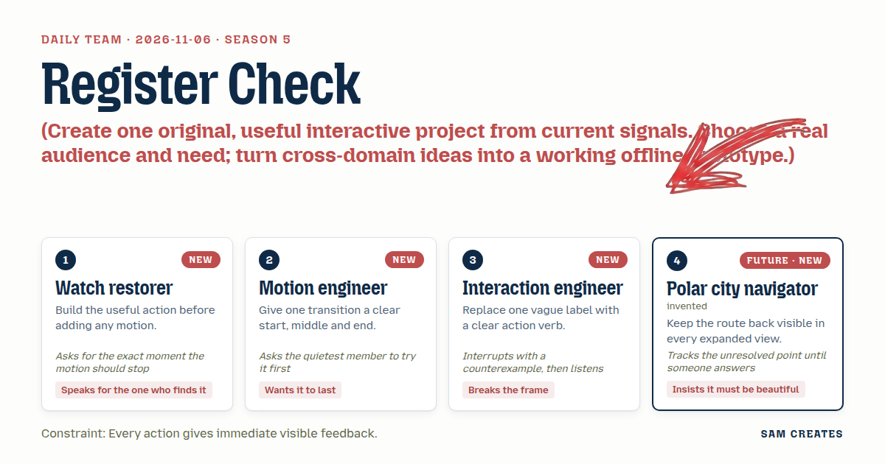
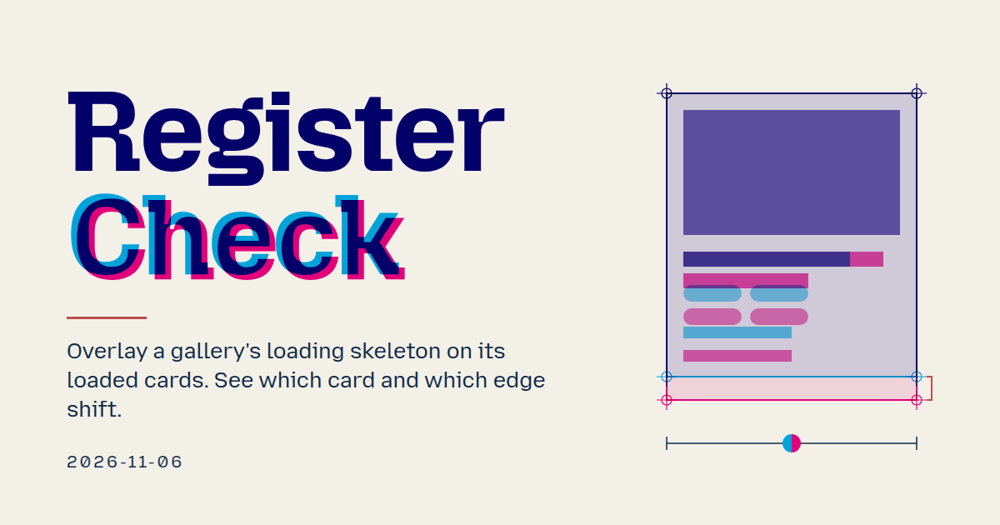
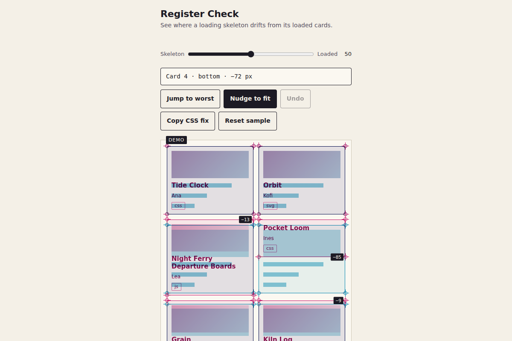

# 2026-11-06: Register Check

[Today](../../README.md) · [Archive](../../ARCHIVE.md)



**Task:** Create one original, useful interactive project from current signals. Choose a real audience and need; turn cross-domain ideas into a working offline prototype.

**Constraint:** Every action gives immediate visible feedback.

**Season:** 2026-10-26

**Decision:** You slide between a gallery's loading skeleton and its real cards and see exactly where they don't line up.



[Cover art direction](cover.json) · [Cover source](cover.html)

## Feed evidence

- github-trending: fetched (18 items)
- smashing: fetched (12 items)
- hacker-news: fetched (20 items)
- reddit-sideproject: fetched (20 items)
- reddit-beautiful: failed — HTTP 429
- github-blog: disabled — 2026-10-31: feed contains declarations rejected by restricted XML reader
- Used feed inspiration: Making Immersive LLM Chat Experiences More Accessible — https://smashingmagazine.com/2026/11/making-immersive-llm-chat-experiences-more-accessible/
- Used feed inspiration: I shipped a Steam strategy game with AI-generated code and visuals. Here is what I had to keep checking. — https://www.reddit.com/r/SideProject/comments/1xpb785/i_shipped_a_steam_strategy_game_with_aigenerated/

[Saved planning input](planning-input.json)

## Asset

<a href="artifact-1.html"></a>

[Use it](https://isas1.github.io/daily-team/2026-11-06/) · [artifact-1.html](artifact-1.html), led by Watch restorer. Model: claude-opus-5-5.

## The session

### Pitch

### Clash

**3 · Interaction engineer:** Counterexample. Lighthouse already gives you CLS. One number, done. Why build a sheet?

**1 · Watch restorer:** One number after load. It doesn't say which card or which edge. "0.12" doesn't tell you the title wrapped to two lines on card four.

**3 · Interaction engineer:** Fine. Then the pacer is a different job, and it needs claims about how screen readers behave that we can't test offline. I'll drop it. But don't ship a button called "Analyze".

**2 · Motion engineer:** Quietest first. Navigator, you've barely spoken. Scrub the slider. Where should it stop?

**4 · Polar city navigator:** At the frame where the fringe is widest. It should stop there and say "card 4 · bottom edge · +14 px". And when I open that card, "Back to sheet" stays pinned and the sheet keeps my scroll. Has anyone answered that yet?

**1 · Watch restorer:** Yes. The exact stop is the worst offset. Arrow keys step the slider in 5s, and End jumps to the worst frame. Nothing animates until the numbers exist.

**4 · Polar city navigator:** Then the marks get to be beautiful. Hairline crosshairs at every card corner, cyan and magenta multiplied, dark where they agree. The ants can wait for data.

**2 · Motion engineer:** And "Nudge to fit" moves the skeleton 1 px per press while the fringe narrows live. That gives immediate feedback on every action, which the constraint asks for.

### Decision

You slide between a gallery's loading skeleton and its real cards and see exactly where they don't line up.

Concept: Register Check

The sheet shows a sample gallery of six project cards. The skeleton is printed in cyan and the loaded cards in magenta, with multiply blend. Aligned edges read dark. Misaligned edges show a coloured fringe labelled with a pixel offset. A scrub slider runs from 0 (skeleton) to 100 (loaded). The sample cards include one that fails each common way: a two-line title, a missing thumbnail, a wrapping tag row and a long author name.

- **Watch restorer:** the measurement comes first. Per-card, per-edge offsets are computed from `getBoundingClientRect` before any blend or motion exists. The slider's End key stops on the worst offset frame.
- **Motion engineer:** one scrubbable transition with a defined start (0), middle (50, both plates) and end (100). Under reduced motion the slider swaps plates without a crossfade.
- **Interaction engineer:** verb labels throughout: "Overlay skeleton", "Jump to worst edge", "Nudge to fit", "Copy CSS fix", "Reset sample". There is no Analyze or Settings.
- **Polar city navigator:** registration crosshairs at every card corner. Opening a card keeps "Back to sheet" pinned and the scroll position kept. The worst-offset readout stays visible until someone fixes it.

The approach it improves is the CLS score in Lighthouse and the brief flash of DevTools layout-shift regions. Both report a shift after it has already happened. Register Check names the card and the edge, then lets the developer fix the size before shipping.

### Build notes

1. Render the gallery twice in one CSS grid using shared track definitions. `.plate-skel` is a cyan layer and `.plate-live` is a magenta layer, both with `mix-blend-mode: multiply`. On load, and after every nudge, measure all four edges of each card pair. Store the offsets in a `register` array and print the worst one in a fixed-width readout ("card 4 · bottom · +14 px").
2. Bind the slider (`input type=range`, 0–100, step 5) to `--mix`, which drives plate opacity. Home, End and the arrow keys are native. "Jump to worst edge" sets the value to 50 and focuses the offending card's fringe label. Each press of "Nudge to fit" changes that skeleton's `min-height` or line count by 1 px, re-measures in the same frame and updates the fringe. Every action pushes onto an undo stack of 20 entries.
3. "Copy CSS fix" writes the adjusted skeleton sizes as a CSS block and shows "Copied 3 rules". "Reset sample" restores the six original cards and clears the undo stack. When a card is open, "Back to sheet" is shown in a sticky header and returns to the stored `scrollY`. Everything is a single offline HTML file with no network calls.

```json
{"schemaVersion":1,"name":"Register Check","audience":"Front-end developers building project galleries","problem":"Skeletons drift from loaded cards; CLS names no card or edge","interaction":"Scrub skeleton-to-loaded slider, jump to worst edge, nudge to fit","outcome":"Per-card edge offsets in px, live fringe, copyable CSS fix","recovery":"Undo nudge, Reset sample, Back to sheet keeps scroll","mechanism":"Print registration: cyan and magenta plates multiply; fringe marks offset","difference":"Lighthouse CLS is one post-load number; this names card, edge and fix","whyNow":"Steam post on what AI output needed checking; Smashing on accessible chat. Titles only, no demand data","sourceIds":["253db4766250cc7717ffc2b3","d2e1dde966c93221d87261d6"],"evidenceStatus":"sourced","alternatives":[{"name":"Register Check","need":"See where a skeleton mismatches loaded cards","mechanism":"Two-plate overlay with scrub slider and 1 px nudge","rejection":"Selected: offline, cross-domain, measurable result"},{"name":"Announce Pacer","need":"Pace screen-reader output in streaming chat","mechanism":"Rehearse live-region rules against a token stream","rejection":"Needs untested AT claims; nears chat wrapper"},{"name":"Pitfall Colony","need":"Explain ant survival in a closed bunker","mechanism":"Explorable inflow sliders with route back up","rejection":"Title only; no data to model honestly"}]}
```

**Guest:** Polar city navigator (future; invented). The method is drawn from public-domain history, myth, or literature, or invented. The guest speaks in character in original words, never quoting the source, and nothing here is endorsed by anyone.

## Team

```text
Team for 2026-11-06
Season: 2026-10-26

1. Watch restorer [new]
   Method: Build the useful action before adding any motion. [new]
   Stance: Speaks for the one who finds it.
   Temperament: Asks for the exact moment the motion should stop.
2. Motion engineer [new]
   Method: Give one transition a clear start, middle and end. [new]
   Stance: Wants it to last.
   Temperament: Asks the quietest member to try it first.
3. Interaction engineer [new]
   Method: Replace one vague label with a clear action verb. [new]
   Stance: Breaks the frame.
   Temperament: Interrupts with a counterexample, then listens.
4. Polar city navigator (future; invented) [guest] [new]
   Method: Keep the route back visible in every expanded view.
   Stance: Insists it must be beautiful.
   Temperament: Tracks the unresolved point until someone answers.

Constraint: Every action gives immediate visible feedback.
Task: Loading preview: a skeleton for a project gallery that holds the card layout while sample content loads.
```

Provider: claude. Model: claude-opus-5-5.
