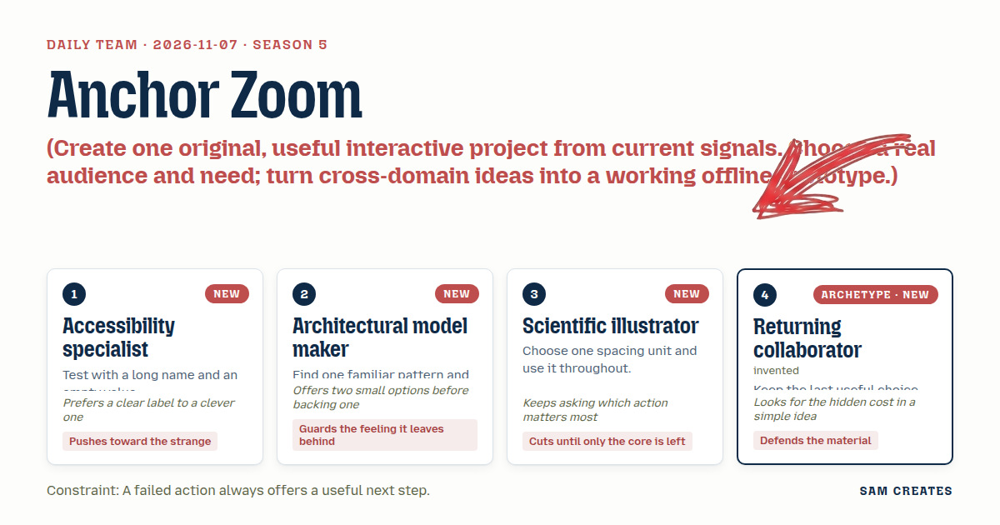
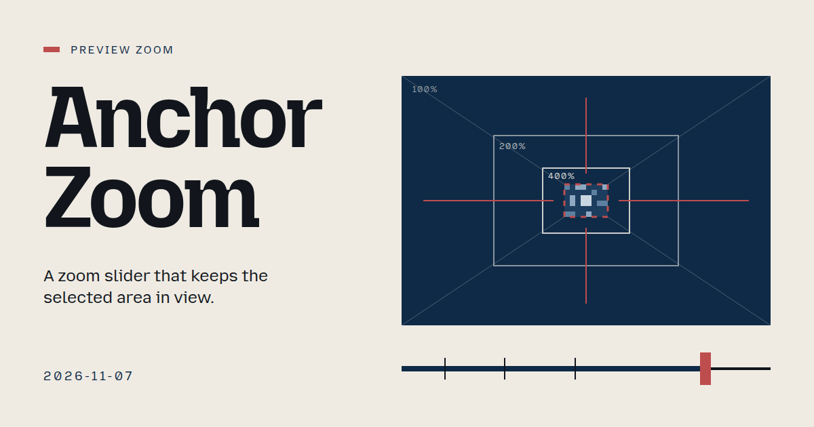
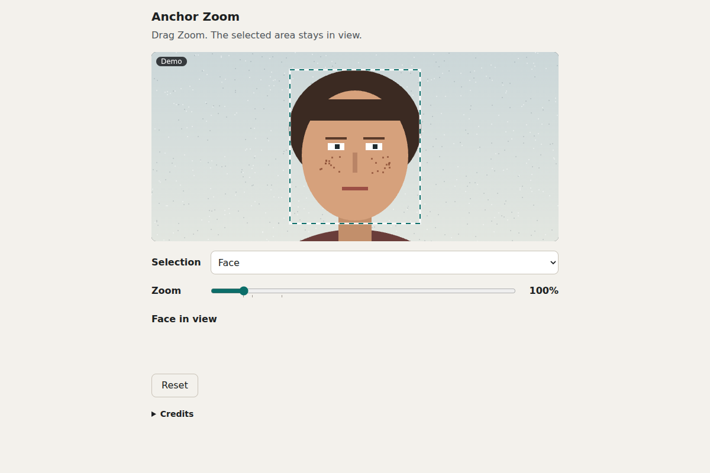

# 2026-11-07: Anchor Zoom

[Today](../../README.md) · [Archive](../../ARCHIVE.md)



**Task:** Create one original, useful interactive project from current signals. Choose a real audience and need; turn cross-domain ideas into a working offline prototype.

**Constraint:** A failed action always offers a useful next step.

**Season:** 2026-10-26

**Decision:** Drag the zoom slider, and the image grows around your selection, keeping it on screen.



[Cover art direction](cover.json) · [Cover source](cover.html)

## Feed evidence

- github-trending: fetched (19 items)
- smashing: fetched (12 items)
- hacker-news: fetched (20 items)
- reddit-sideproject: fetched (20 items)
- reddit-beautiful: failed — HTTP 429
- github-blog: disabled — 2026-10-31: feed contains declarations rejected by restricted XML reader
- Used feed inspiration: I maintain OpenScreen, a free open-source screen recorder. 2.2 adds a Layouts track to switch camera/screen layouts mid-video — https://www.reddit.com/r/SideProject/comments/1xq3mj6/i_maintain_openscreen_a_free_opensource_screen/
- Used feed inspiration: The Components of Agent Memory — https://www.anthropic.com/research/components-of-agent-memory

[Saved planning input](planning-input.json)

## Asset

<a href="artifact-1.html"></a>

[Use it](https://isas1.github.io/daily-team/2026-11-07/) · [artifact-1.html](artifact-1.html), led by Accessibility specialist. Model: claude-opus-5-5.

## The session

### Pitch

### Clash

1. **Scientific illustrator:** An inset keeps context. Your pinned zoom throws the whole image away at 400%.

2. **Accessibility specialist:** An inset doubles the canvas. At 320 px wide you get two postage stamps.

3. **Architectural model maker:** And we ran a loupe on 1 November. Filing Loupe stepped a lens through findings. Another lens repeats it.

4. **Returning collaborator:** Fine. Then what happens when the selection is wider than the view at 400%? Pinning the centre crops both edges, and nobody can see they were cropped.

5. **Accessibility specialist:** That's the failed action. It can't just stop. Say "Selection is 1840 px wide, so its edges are cut off at 400%." Then offer "Fit at 260%" and "Step along the edges".

6. **Scientific illustrator:** Two buttons, then. And with no selection, the slider still has to do something.

7. **Accessibility specialist:** It zooms around the centre and says so: "No selection · zooming around centre". Next step: "Select the subject", which selects the sample face.

8. **Architectural model maker:** Keep the stops as tick marks on the free slider. Fit, 100% and 200%, with no snapping. The familiar control stays familiar.

9. **Returning collaborator:** Restored zoom needs a label, or it feels like a bug: "Restored 400% from last time · Reset".

10. **Scientific illustrator:** Agreed. One status line carries the failure, the restore and the next step.

### Decision

Drag the zoom slider, and the image grows around your selection, keeping it on screen.

Concept: Anchor Zoom

- **Accessibility specialist:** Adds the screen-magnifier focus-follow model. Writes the no-selection and long-name tests. Every failure line ends in a labelled next-step button: "Fit at 260%", "Step along the edges", "Select the subject", "Recenter".
- **Architectural model maker:** Keeps the familiar slider and fixes its weakest state, the drifting selection. Adds three unsnapped ticks at Fit, 100% and 200%.
- **Scientific illustrator:** Sets an 8 px spacing unit across the whole layout. Limits the panel to a slider, a 64 px fixed-width readout and one status line. Rejects the inset.
- **Returning collaborator:** Stores the last zoom for each selection and restores it with a visible label and a Reset button. Uses nearest-neighbour rendering above 200%, so pixel edges stay true.

### Build notes

1. Build one `index.html` with a 1600×1067 sample image drawn on a `<canvas>`, made of three named regions: face, sign and horizon. Use a native `input type=range` for 25–800% with a `datalist` holding three ticks. Keys: arrows step 10%, Page Up and Page Down step 100%, Home goes to Fit, End goes to 800%. Compute the offset as `sel.cx*z - view.w/2` and the same for y, then clamp it to the image bounds. When the clamp moves the selection centre off the view centre, show "Pinned to image edge".
2. Detect failure per frame. If the selection is wider or taller than the view at z, crop the edges and show "Edges cut off at 400%" with two buttons. "Fit at N%" sets z to `min(view.w/sel.w, view.h/sel.h)`. "Step along the edges" moves through the four selection edges using Left and Right. With no selection, zoom around the centre and offer "Select the subject". After a manual drag pan leaves the selection out of view, offer "Recenter". Put the status in an `aria-live=polite` line and announce only state changes.
3. Keep a `Map` from selection id to zoom, mirrored to `sessionStorage`. On reselect, restore the saved zoom and show "Restored 400% from last time · Reset". Set `imageSmoothingEnabled=false` above 200%. Space every element in multiples of 8 px. Test at 320 px width with the long layer name, and confirm that under reduced motion zoom changes apply without easing.

```json
{"schemaVersion":1,"name":"Anchor Zoom","audience":"People retouching regions in image editors","problem":"Zooming in pushes the selected area off screen","interaction":"Drag or key the zoom slider with a region selected","outcome":"Image scales around the selection, which stays in view","recovery":"Failures offer Fit at N%, Step edges, Select subject, Recenter, Reset","mechanism":"Magnifier focus-follow: offset tracks selection, zoom saved per selection","difference":"Editors zoom on centre or cursor; this holds the work region in view","whyNow":"OpenScreen layouts post and HN agent memory title hint at view and recall needs. Titles only, no demand data","sourceIds":["7504546fbd94a83a321f8354","f0247d2be6d23fda27989bba"],"evidenceStatus":"sourced","alternatives":[{"name":"Anchor Zoom","need":"Keep the selection visible while zooming","mechanism":"Selection-anchored slider with per-selection recall","rejection":"Selected: cross-domain, fits 320 px, new to recent dates"},{"name":"Figure Inset","need":"See detail and full context together","mechanism":"Boxed inset with leader line and scale bar","rejection":"Halves canvas on phones; echoes Filing Loupe"},{"name":"Scale Rule Stops","need":"Preview at fixed output scales","mechanism":"Detented 1:1, 1:2, 1:4 strip like a scale rule","rejection":"Solves a different need and needs DPI data"}]}
```

**Guest:** Returning collaborator (archetype; invented). The method is drawn from public-domain history, myth, or literature, or invented. The guest speaks in character in original words, never quoting the source, and nothing here is endorsed by anyone.

## Team

```text
Team for 2026-11-07
Season: 2026-10-26

1. Accessibility specialist [new]
   Method: Test with a long name and an empty value. [new]
   Stance: Pushes toward the strange.
   Temperament: Prefers a clear label to a clever one.
2. Architectural model maker [new]
   Method: Find one familiar pattern and improve its weakest state. [new]
   Stance: Guards the feeling it leaves behind.
   Temperament: Offers two small options before backing one.
3. Scientific illustrator [new]
   Method: Choose one spacing unit and use it throughout. [new]
   Stance: Cuts until only the core is left.
   Temperament: Keeps asking which action matters most.
4. Returning collaborator (archetype; invented) [guest] [new]
   Method: Keep the last useful choice when the view opens again.
   Stance: Defends the material.
   Temperament: Looks for the hidden cost in a simple idea.

Constraint: A failed action always offers a useful next step.
Task: Preview zoom: a slider for an image editor that changes magnification while keeping the selected area in view.
```

Provider: claude. Model: claude-opus-5-5.
