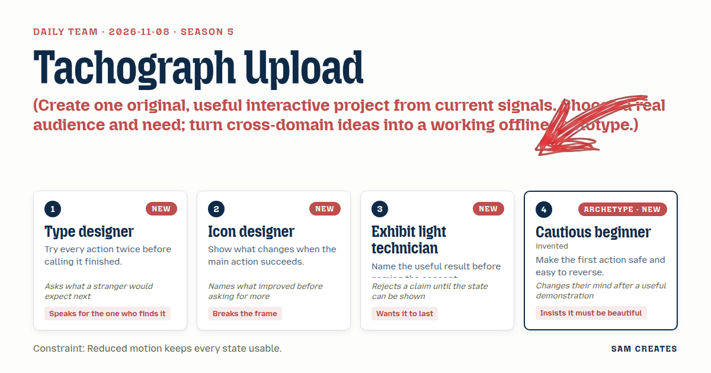
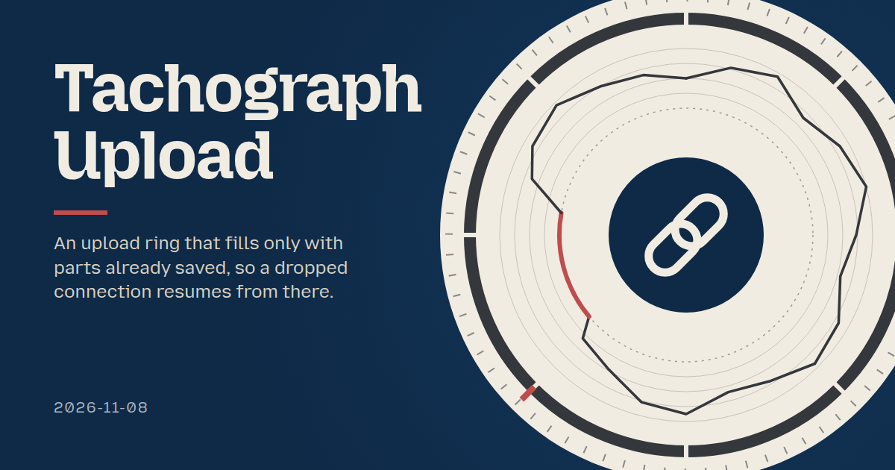
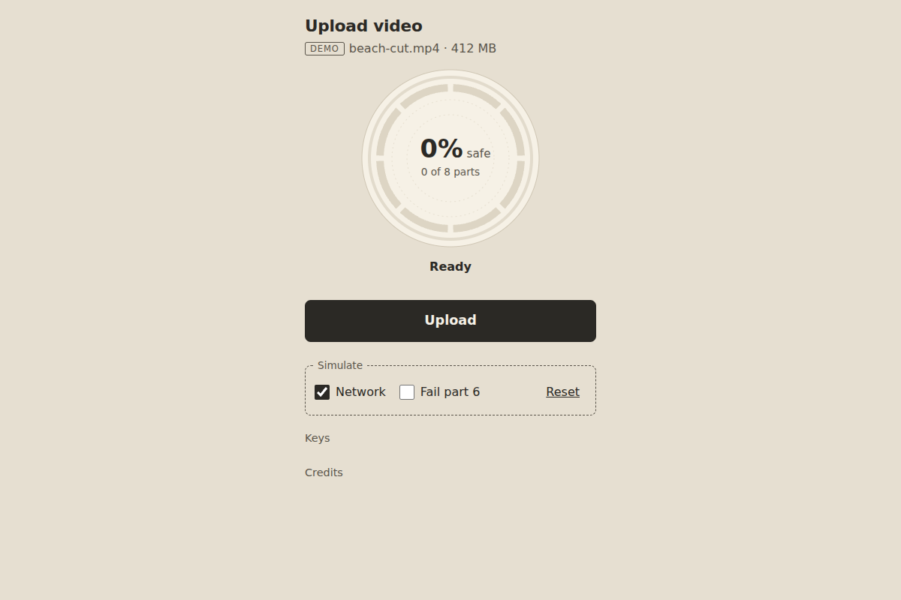

# 2026-11-08: Tachograph Upload

[Today](../../README.md) · [Archive](../../ARCHIVE.md)



**Task:** Create one original, useful interactive project from current signals. Choose a real audience and need; turn cross-domain ideas into a working offline prototype.

**Constraint:** Reduced motion keeps every state usable.

**Season:** 2026-10-26

**Decision:** You upload a video, and the ring fills only with parts already saved, so a dropped connection resumes from there.



[Cover art direction](cover.json) · [Cover source](cover.html)

## Feed evidence

- github-trending: fetched (17 items)
- smashing: fetched (12 items)
- hacker-news: fetched (20 items)
- reddit-sideproject: fetched (20 items)
- reddit-beautiful: failed — HTTP 429
- github-blog: disabled — 2026-10-31: feed contains declarations rejected by restricted XML reader
- Used feed inspiration: JIT bitmap text rendering for microcontrollers — https://linebender.org/blog/jit-bitmap-text/
- Used feed inspiration: I got tired of scanner apps putting basic features behind paywalls, so I made my own — https://www.reddit.com/r/SideProject/comments/1xqwn2e/i_got_tired_of_scanner_apps_putting_basic/

[Saved planning input](planning-input.json)

## Asset

<a href="artifact-1.html"></a>

[Use it](https://isas1.github.io/daily-team/2026-11-08/) · [artifact-1.html](artifact-1.html), led by Type designer. Model: claude-opus-5-5.

## The session

### Pitch

### Clash

**3 · Exhibit light technician:** Two numbers in the centre is one too many. "Sent" is a claim. Show me the chunk ticks and I'll believe "safe."

**1 · Type designer:** Then the ticks carry it. Eight chunks, eight notches. Filled means stored. A stranger reads notches faster than a percent.

**4 · Cautious beginner:** The contact sheet is prettier than a ring with notches.

**2 · Icon designer:** It's also the import manifest from 29 October with thumbnails. The tachograph trace is new. Drop the wifi and watch the line go flat at 64%.

**4 · Cautious beginner:** Show me.

**2 · Icon designer:** Demo: chunk 6 is mid-flight, network off. The trace goes flat at 64%. The outer sent arc falls back to the last notch. Resume starts from notch 5.

**4 · Cautious beginner:** Fine. The flat arc reads like a pencil line on paper, and that's the part I liked. I'll drop the contact sheet if Pause comes before Cancel.

**3 · Exhibit light technician:** Then my budget stays out of the ring. One footnote line: "Retries used 18 MB." It holds without carrier data.

**1 · Type designer:** I tried Resume twice during a drop. The second press has to do nothing and say "Already resuming". Otherwise the ring double-counts.

### Decision

You upload a video, and the ring fills only with parts already saved, so a dropped connection resumes from there.

Concept: Tachograph Upload

- **Type designer:** Sets the centre readout in fixed-width tabular figures: "64% safe · 5 of 8 parts". Runs every control twice and sets the second-press results: "Already resuming", "Already paused", and Retry disabled while pending.
- **Icon designer:** Draws the tachograph trace, with angle for confirmed bytes and radius for rate in 4 bands. On success the trace closes, the centre glyph swaps to a link mark and the action becomes "Copy link".
- **Exhibit light technician:** Puts the result first: "Safe to close: 264 MB stored". Adds the footnote "Retries used 18 MB". Only acknowledged chunks advance the confirmed arc.
- **Cautious beginner:** Places Pause as the first and largest action, with Cancel second behind a confirm that lists what is kept. Defines the paper-and-pencil finish: a warm off-white disc and a graphite trace.

The ring improves on the usual percent ring, which merges sent bytes with stored bytes and hides stalls. Here a drop shows where it happened and how much survived. That matters for large clips on unstable networks, where a reset to 0% costs minutes and mobile data.

Under reduced motion, the arcs jump per chunk, the trace draws without a sweep, and every state stays named in text.

### Build notes

1. Build a local upload simulator in `index.html`. It sends 8 chunks of a 412 MB sample with a seeded rate curve, a Network toggle, a Fail chunk 6 toggle and acknowledgement delays. State holds `sent`, `confirmed[]`, `rateLog[]` and a request id, and stale acks are dropped.
2. Render one 240 px SVG. It has an outer sent arc, an inner confirmed arc with 8 notches, a radial rate trace from `rateLog`, and a centre readout in a live region announced per chunk and per state change. Add a `prefers-reduced-motion` path that sets arcs directly.
3. Wire the controls Pause, Resume, Cancel, Retry and Copy link, plus the Space and Escape keys. Add second-press guards and a Reset sample. Resume restarts from the last confirmed notch. Test each control twice at 320 px width.

```json
{"schemaVersion":1,"name":"Tachograph Upload","audience":"Video creators uploading large clips on unstable networks","problem":"Rings merge sent and stored bytes and hide where a stall began","interaction":"Upload, Pause, drop network, Resume or Retry","outcome":"Ring shows safe parts, flat stall arc, then Copy link","recovery":"Resume from last stored part, Retry guarded, Reset sample","mechanism":"Tachograph disc: angle is acked bytes, radius is rate; 8 part notches","difference":"Percent rings reset or freeze; this shows what survived and where","whyNow":"SideProject scanner post: people build own media tools. HN microcontroller text: small readouts. Titles only, no demand data","sourceIds":["79f83838997b3539b5680f2d","fbb4c6ab199fa8c66f539df1"],"evidenceStatus":"sourced","alternatives":[{"name":"Tachograph Upload","need":"Know what a dropped upload kept","mechanism":"Acked-part notches with radial rate trace","rejection":"Selected: cross-domain, differs from 11-02 tide download"},{"name":"Light Budget Ring","need":"See mobile data spent on retries","mechanism":"Lux-hour style budget arc per retry","rejection":"Needs carrier plan data; kept as one footnote"},{"name":"Contact Sheet","need":"Track several files at once","mechanism":"Frames darken as each file lands","rejection":"Echoes 10-29 import manifest"}]}
```

**Guest:** Cautious beginner (archetype; invented). The method is drawn from public-domain history, myth, or literature, or invented. The guest speaks in character in original words, never quoting the source, and nothing here is endorsed by anyone.

## Team

```text
Team for 2026-11-08
Season: 2026-10-26

1. Type designer [new]
   Method: Try every action twice before calling it finished. [new]
   Stance: Speaks for the one who finds it.
   Temperament: Asks what a stranger would expect next.
2. Icon designer [new]
   Method: Show what changes when the main action succeeds. [new]
   Stance: Breaks the frame.
   Temperament: Names what improved before asking for more.
3. Exhibit light technician [new]
   Method: Name the useful result before naming the concept. [new]
   Stance: Wants it to last.
   Temperament: Rejects a claim until the state can be shown.
4. Cautious beginner (archetype; invented) [guest] [new]
   Method: Make the first action safe and easy to reverse.
   Stance: Insists it must be beautiful.
   Temperament: Changes their mind after a useful demonstration.

Constraint: Reduced motion keeps every state usable.
Task: Upload progress: a progress ring for a media tool that shows how much of a file has uploaded and when it finishes.
```

Provider: claude. Model: claude-opus-5-5.
