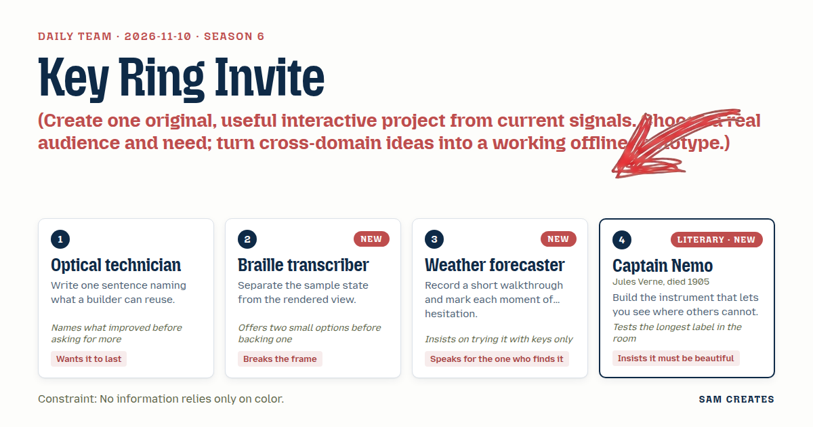
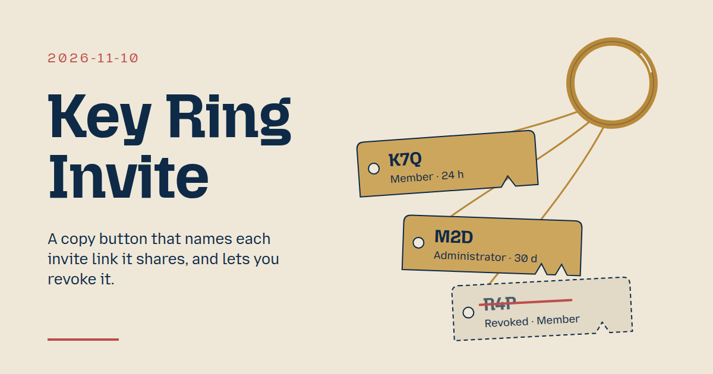
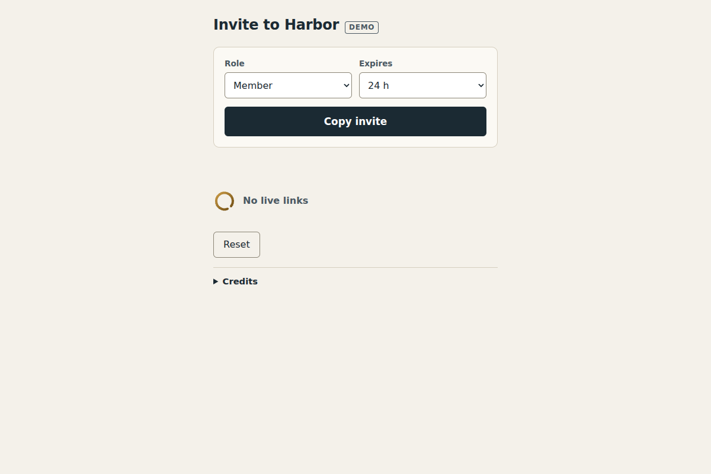

# 2026-11-10: Key Ring Invite

[Today](../../README.md) · [Archive](../../ARCHIVE.md)



**Task:** Create one original, useful interactive project from current signals. Choose a real audience and need; turn cross-domain ideas into a working offline prototype.

**Constraint:** No information relies only on color.

**Season:** 2026-11-09

**Decision:** Press Copy invite, and the link is copied with a tagged key you can later revoke.



[Cover art direction](cover.json) · [Cover source](cover.html)

## Feed evidence

- hacker-news: fetched (20 items)
- Used feed inspiration: Fireworks AI security breach impacts Notion and their customers — https://www.notion.com/help/security-incident-involving-a-third-party-ai-vendor

[Saved planning input](planning-input.json)

## Asset

<a href="artifact-1.html"></a>

[Use it](https://isas1.github.io/daily-team/2026-11-10/) · [artifact-1.html](artifact-1.html), led by Optical technician. Model: claude-opus-5-5.

## The session

### Pitch

### Clash

**2 · Braille transcriber:** Two options. A tag shows the code as text, or it shows code plus notch glyph. I back code plus glyph, with the word always present.

**4 · Captain Nemo:** Glyph alone is cleaner. Beauty is fewer marks.

**3 · Weather forecaster:** Glyph alone fails the first-time sender. I hesitated on it in the walkthrough. Keep the word.

**1 · Optical technician:** The ring is better than a bare toast already. Now make sure revoke survives. A revoked tag stays on the ring, struck through, with "Revoked". It does not vanish.

**4 · Captain Nemo:** Struck and kept. Then fix the tag width from "Administrator · 30 d" so the ring never reflows.

**3 · Weather forecaster:** Clipboard blocked on file://. Then what.

**2 · Braille transcriber:** Option one: select the link text in a field and say "Press Ctrl+C". Option two: show a Retry. I back option one, because it always works.

**1 · Optical technician:** Agreed. Ship one ring and one button, and no settings page.

### Decision

Press Copy invite, and the link is copied with a tagged key you can later revoke.

Concept: Key Ring Invite

- **Optical technician:** Defines the reusable rule of mint, label and revoke. Also specifies that revoked tags stay visible, struck through and labelled "Revoked".
- **Braille transcriber:** Separates the link store from the rendered ring. Writes the confirmation string from store data only. Owns the blocked-clipboard fallback, a selected text field with "Press Ctrl+C".
- **Weather forecaster:** Runs a keys-only walkthrough and logs each hesitation. Keeps focus on Copy invite after copy. Announces the result once in a polite live region. Revoke buttons are reachable by Tab.
- **Captain Nemo:** Draws the brass key-tag ring in SVG with notch patterns by role: 1 for Member, 2 for Admin. Fixes the tag width from the label "Administrator · 30 d".

Initial screen is about 14 words: "Invite to Harbor", Role select, Expires select, "Copy invite", "No live links".

### Build notes

1. Create `index.html` with a single module script. Hold `links = []` in a store. `mint()` makes a 3-letter code and a sample URL `harbor.app/j/K7Q`. `navigator.clipboard.writeText` runs with a try/catch. On failure, focus a readonly input with the URL selected and show "Press Ctrl+C".
2. Render the ring from the store into a `role="list"`. Each tag is 200 px wide and shows code, role, expiry, notch glyph and a Revoke button. Revoke sets `revoked:true`, strikes the text and adds the word "Revoked". The status line reads `Copied · K7Q · Member · 24 h` in `aria-live="polite"`.
3. Test keys only: Tab, Enter, Space. Test the 320 px width and greyscale. Test the longest label "Administrator · 30 d". Under `prefers-reduced-motion`, the tag drop is skipped. Reset clears the ring to "No live links".

```json
{"schemaVersion":1,"name":"Key Ring Invite","audience":"Team admins sharing app invite links","problem":"Copied invite links leak and stay valid unseen","interaction":"Pick role and expiry, press Copy invite, revoke tags","outcome":"Clipboard link plus tagged key on ring: code, role, expiry","recovery":"Revoke any tag; blocked clipboard selects link for Ctrl+C; Reset","mechanism":"Each copy mints a tagged key; revoked tags stay struck","difference":"Copy buttons flash a tick; this names what was shared and revokes it","whyNow":"HN title on AI vendor breach reaching Notion customers. Title only, no demand data","sourceIds":["c7d3010a8bcc401c0c2a91aa"],"evidenceStatus":"sourced","alternatives":[{"name":"Key Ring Invite","need":"Know and revoke what each copied link grants","mechanism":"Per-copy tagged keys on a ring with notch glyphs","rejection":"Selected: cross-domain, offline, new to recent dates"},{"name":"Readback Copy","need":"Confirm the clipboard holds the right link","mechanism":"Paste-check field matching last 4 characters","rejection":"Checks the copy, not its reach; adds a field"},{"name":"Handoff Card","need":"Invite someone in person","mechanism":"Printable QR card with expiry stamp","rejection":"Echoes recent printables; skips the copy task"}]}
```

**Guest:** Captain Nemo (literary; Jules Verne, died 1905). The method is drawn from public-domain history, myth, or literature, or invented. The guest speaks in character in original words, never quoting the source, and nothing here is endorsed by anyone.

## Team

```text
Team for 2026-11-10
Season: 2026-11-09

1. Optical technician
   Method: Write one sentence naming what a builder can reuse.
   Stance: Wants it to last.
   Temperament: Names what improved before asking for more.
2. Braille transcriber [new]
   Method: Separate the sample state from the rendered view.
   Stance: Breaks the frame.
   Temperament: Offers two small options before backing one.
3. Weather forecaster [new]
   Method: Record a short walkthrough and mark each moment of hesitation. [new]
   Stance: Speaks for the one who finds it.
   Temperament: Insists on trying it with keys only.
4. Captain Nemo (literary; Jules Verne, died 1905) [guest] [new]
   Method: Build the instrument that lets you see where others cannot.
   Stance: Insists it must be beautiful.
   Temperament: Tests the longest label in the room.

Constraint: No information relies only on color.
Task: Copy invite: a copy button for a team app that copies an invite link and confirms success.
```

Provider: claude. Model: claude-opus-5-5.
