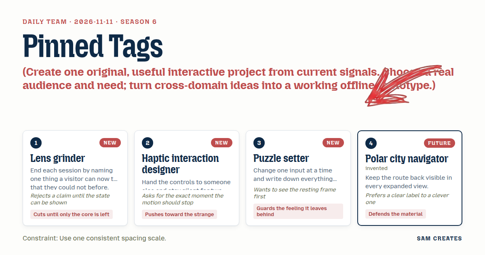
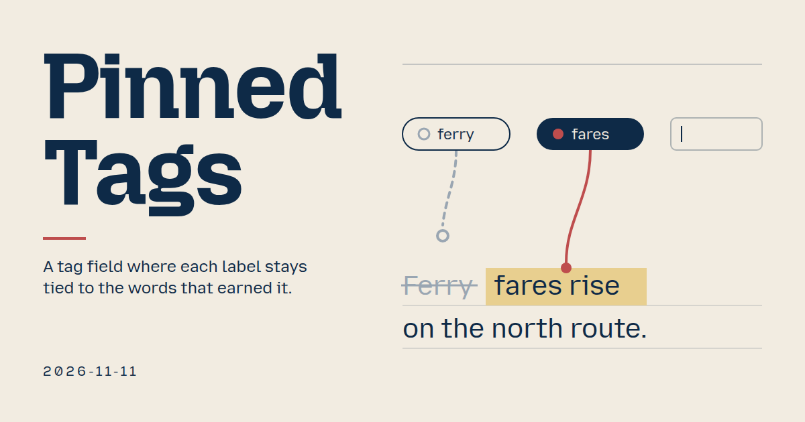
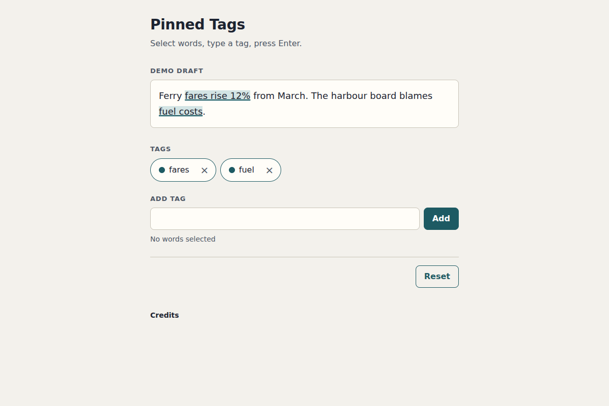

# 2026-11-11: Pinned Tags

[Today](../../README.md) · [Archive](../../ARCHIVE.md)



**Task:** Create one original, useful interactive project from current signals. Choose a real audience and need; turn cross-domain ideas into a working offline prototype.

**Constraint:** Use one consistent spacing scale.

**Season:** 2026-11-09

**Decision:** Select words in a draft, type a tag, and the tag stays tied to those words.



[Cover art direction](cover.json) · [Cover source](cover.html)

## Feed evidence

- reddit-sideproject: fetched (20 items)
- Used feed inspiration: mostra - talk while you click around a live site, and each point becomes a comment where you pointed — https://www.reddit.com/r/SideProject/comments/1xtffxl/mostra_talk_while_you_click_around_a_live_site/

[Saved planning input](planning-input.json)

## Asset

<a href="artifact-1.html"></a>

[Use it](https://isas1.github.io/daily-team/2026-11-11/) · [artifact-1.html](artifact-1.html), led by Lens grinder. Model: claude-opus-5-5.

## The session

### Pitch

### Clash

**2 · Haptic interaction designer:** Make an unpinned tag float loose, drifting at the edge of the field. Strange is good here.

**4 · Polar city navigator:** A drifting chip is a moving target. Put it in the row and give it no pin glyph. That's clear enough.

**1 · Lens grinder:** Agreed. Show me drift as a state. I won't accept it as a mood.

**3 · Puzzle setter:** What happens to the feeling if *pin lost* turns red and shakes? It reads as an error the user made.

**2 · Haptic interaction designer:** Then the glyph swaps from a filled pin to a hollow ring. No shake. The change stops when the glyph changes.

**1 · Lens grinder:** Editing a label inline. Does that earn its place?

**3 · Puzzle setter:** Yes. Rename *ferry* to *ferries* and the pin should survive. One input changes and one thing moves.

**4 · Polar city navigator:** And removal says "Removed fares · Undo" in the status line. That's the route back, visible.

**1 · Lens grinder:** Cut everything else. Ship it.

### Decision

Select words in a draft, type a tag, and the tag stays tied to those words.

Concept: Pinned Tags

- **Lens grinder:** Scope is held to add, edit, remove and pin. The closing line for the visitor: you can now select a phrase and pin a tag to it.
- **Haptic interaction designer:** Owns the pin mechanism from the mostra signal. Pressing a chip pulses its phrase once for 240 ms. Reduced motion uses a static outline instead.
- **Puzzle setter:** Owns the resting frame, which has 2 chips, 2 sentences and an empty field. Each action writes one status line naming what changed, including *pin lost* when an edit removes the anchored words.
- **Polar city navigator:** Owns labels and the way back. Escape returns from the draft to the chip that sent you there. Removal always offers Undo in the status line.

Initial visible text is 26 words: a headline, 2 sentences, "Tags", 2 chips, the "Add tag" field and one hint. That is under the 40-word target. Spacing uses one scale: 4, 8, 12, 16, 24 and 32 px.

### Build notes

1. **Tag store.** Each tag is stored as `{id, label, anchor}`, where `anchor` holds start, end and the quoted text. The draft is a `contenteditable` region. On every input event, each anchor is re-found by searching for its quoted text. A tag whose quote is missing becomes `orphan` and gets a hollow-ring glyph plus a visually hidden "pin lost". Duplicate labels are matched case-insensitively. A duplicate add focuses the existing chip and writes "Already tagged fares".
2. **Field and chips.** Enter in the field adds a tag. If text is selected in the draft, the tag pins to that selection. Otherwise it is added unpinned. Backspace in an empty field moves focus to the last chip. On a focused chip, Left and Right move between chips, Enter or F2 edits the label inline, and Delete removes the chip. In inline edit, Escape reverts and an empty commit removes the tag. Every removal writes "Removed fares · Undo" to a polite live region, and Undo restores the tag with its anchor. Each × button has the accessible name "Remove fares". All chips have 44 px targets.
3. **Pin jump and spacing.** Pressing a pinned chip scrolls to its span and adds one 240 ms highlight, then clears it. Escape in the draft returns focus to that chip. All gaps, padding and chip sizes come from `--s1` to `--s6` (4, 8, 12, 16, 24, 32 px), with no other values. Reset restores the sample draft and its 2 chips.

```json
{"schemaVersion":1,"name":"Pinned Tags","audience":"Editors tagging drafts in a publishing tool","problem":"Tags detach from the text that justified them","interaction":"Select words, type a tag, Enter; edit or remove chips","outcome":"Chip pinned to a phrase; press it to light the phrase","recovery":"Undo removal, Escape reverts edit, Reset sample","mechanism":"Each tag stores its quote; edits that delete it mark pin lost","difference":"Tag fields keep a flat list; this shows why and when a tag breaks","whyNow":"mostra post title: comments placed where you point. Title only, no demand data","sourceIds":["c695e2885bf59220365ca2ec"],"evidenceStatus":"sourced","alternatives":[{"name":"Pinned Tags","need":"Keep tags tied to the text they describe","mechanism":"Selection-anchored chips with pin lost state","rejection":"Selected: cross-domain, offline, new to recent dates"},{"name":"Keyboard Tag Rail","need":"Tag a draft with no mouse","mechanism":"Key-only chip rail from hotel no-mouse post","rejection":"A shortcut layer on a plain tag field"},{"name":"Bidi Tag Field","need":"Mix Hebrew, Arabic and Latin tags","mechanism":"Per-chip direction with caret order hints","rejection":"Needs RTL user testing the sources lack"}]}
```

**Guest:** Polar city navigator (future; invented). The method is drawn from public-domain history, myth, or literature, or invented. The guest speaks in character in original words, never quoting the source, and nothing here is endorsed by anyone.

## Team

```text
Team for 2026-11-11
Season: 2026-11-09

1. Lens grinder
   Method: End each session by naming one thing a visitor can now try that they could not before. [new]
   Stance: Cuts until only the core is left.
   Temperament: Rejects a claim until the state can be shown.
2. Haptic interaction designer [new]
   Method: Hand the controls to someone else and stay silent for two minutes. [new]
   Stance: Pushes toward the strange.
   Temperament: Asks for the exact moment the motion should stop.
3. Puzzle setter [new]
   Method: Change one input at a time and write down everything that moved. [new]
   Stance: Guards the feeling it leaves behind.
   Temperament: Wants to see the resting frame first.
4. Polar city navigator (future; invented) [guest]
   Method: Keep the route back visible in every expanded view.
   Stance: Defends the material.
   Temperament: Prefers a clear label to a clever one.

Constraint: Use one consistent spacing scale.
Task: Content tags: a tag input for a publishing tool that adds, edits, and removes labels from a draft.
```

Provider: claude. Model: claude-opus-5-5.
