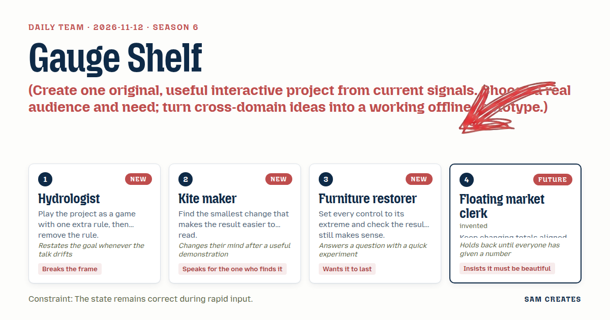
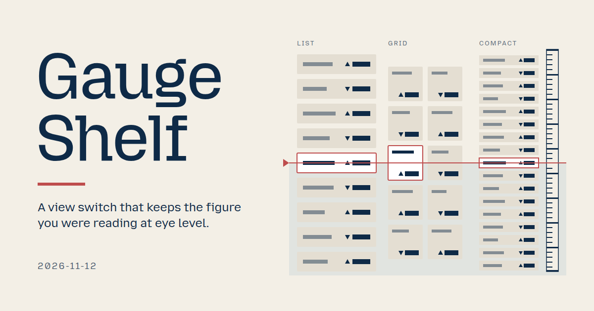
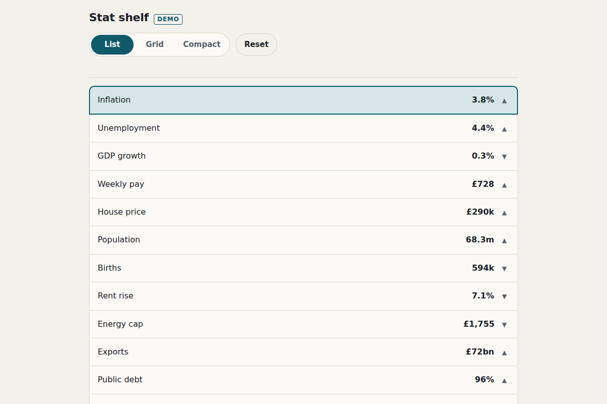

# 2026-11-12: Gauge Shelf

[Today](../../README.md) · [Archive](../../ARCHIVE.md)



**Task:** Create one original, useful interactive project from current signals. Choose a real audience and need; turn cross-domain ideas into a working offline prototype.

**Constraint:** The state remains correct during rapid input.

**Season:** 2026-11-09

**Decision:** Press List, Grid or Compact, and the stat you were reading stays where your eyes are.



[Cover art direction](cover.json) · [Cover source](cover.html)

## Feed evidence

- reddit-beautiful: fetched (20 items)
- Used feed inspiration: UK by Numbers: the UK’s official social and economic statistics visualised — https://www.reddit.com/r/InternetIsBeautiful/comments/1xu9gxj/uk_by_numbers_the_uks_official_social_and/

[Saved planning input](planning-input.json)

## Asset

<a href="artifact-1.html"></a>

[Use it](https://isas1.github.io/daily-team/2026-11-12/) · [artifact-1.html](artifact-1.html), led by Hydrologist. Model: claude-opus-5-5.

## The session

### Pitch

### Clash

**1 · Hydrologist:** Without the rule, Grid to Compact jumps the reader 900px down. With it, the outlined stat moves less than 8px. The rule stays.

**2 · Kite maker:** Then the outline is redundant. Drop it.

**3 · Furniture restorer:** Quick test. Switch with keyboard focus on the sixth stat, at 320px, with 48 stats. The anchor holds, but the eye still needs the outline to find it after a reflow. Keep both.

**2 · Kite maker:** That demo convinced me. Outline stays. I'll hold the status line to four words: "Kept Inflation · Grid".

**1 · Hydrologist:** Back to the goal. Anchor capture happens on the first press of a burst. Otherwise each mid-burst view becomes the new anchor and the place drifts.

**3 · Furniture restorer:** Extremes. One stat, zero stats, a 40-character name, 200% text. The empty state reads "No stats", in all three views.

**4 · Floating market clerk:** Numbers in: 8px drift, 300 ms burst, 4 words, 320px. Now mine. The figure sits in one right-aligned tabular column in List and Compact, at the same card corner in Grid, with a trend glyph next to it. If it moves, it is wrong. If it is not aligned, it is not beautiful.

**1 · Hydrologist:** Agreed. That is the build.

### Decision

Press List, Grid or Compact, and the stat you were reading stays where your eyes are.

Concept: Gauge Shelf

- **Hydrologist:** The gauge rule. The anchor stat's screen offset is measured before a switch and restored after it, within 8px.
- **Kite maker:** A 2px outline that stays on the anchor stat across views, plus a four-word status line.
- **Furniture restorer:** Burst handling with last press winning and the anchor taken from before the burst. Extreme cases tested at 0, 1 and 48 stats, at 320px and 200% text.
- **Floating market clerk:** A tabular right-aligned figure column with ▲▼ trend glyphs, kept in the same position in every view.

### Build notes

1. Keep one `view` state and one `anchorId`. On the first press of a burst, record the `anchorId` and its `getBoundingClientRect().top`. Debounce the render to one rAF, apply the final `view`, then set `scrollTop` so the anchor returns to its recorded top. Cancel in-flight transitions on each new press.
2. Use native radio inputs styled as three segments (List, Grid, Compact) with arrow, Home and End keys. Show 12 sample stats from one data array, labelled "Sample figures". Use `font-variant-numeric: tabular-nums` and a fixed 6ch figure column. The trend is shown by glyph shape and word, without relying on color.
3. Add a test strip behind `?test`. It fires a 10-press burst, runs the 0, 1 and 48 stat sets, and asserts that the anchor drift is 8px or less. Under reduced motion, layout is set directly. Keep visible copy at 40 words or fewer.

```json
{"schemaVersion":1,"name":"Gauge Shelf","audience":"Reporters browsing a statistics chart library","problem":"Switching list, grid, compact loses the stat being read","interaction":"Press List, Grid or Compact, even rapidly","outcome":"Read stat stays at same screen height, outlined, figure aligned","recovery":"Last press wins; anchor from before burst; empty shows No stats","mechanism":"Gauge rule: anchor offset saved before switch, restored after, under 8px","difference":"View toggles reflow from top; this holds place and figure column","whyNow":"UK by Numbers post shows public stats libraries. Title only, no demand data","sourceIds":["f2a3efafda89d422e16693fa"],"evidenceStatus":"sourced","alternatives":[{"name":"Gauge Shelf","need":"Keep place and figures while changing view density","mechanism":"Anchored three-view switch with fixed figure column","rejection":"Selected: cross-domain, offline; differs from 11-07 zoom anchor"},{"name":"Doodle Relay Shelf","need":"Browse doodles left by past visitors","mechanism":"Grid, list, compact of visitor doodles by time","rejection":"Echoes the doodle feed entry; weak need"},{"name":"Pass Contact Sheet","need":"See which satellites imaged a place","mechanism":"Three views of passes with image thumbs","rejection":"Needs real imagery; echoes 11-08 contact sheet"}]}
```

**Guest:** Floating market clerk (future; invented). The method is drawn from public-domain history, myth, or literature, or invented. The guest speaks in character in original words, never quoting the source, and nothing here is endorsed by anyone.

## Team

```text
Team for 2026-11-12
Season: 2026-11-09

1. Hydrologist [new]
   Method: Play the project as a game with one extra rule, then remove the rule. [new]
   Stance: Breaks the frame.
   Temperament: Restates the goal whenever the talk drifts.
2. Kite maker [new]
   Method: Find the smallest change that makes the result easier to read.
   Stance: Speaks for the one who finds it.
   Temperament: Changes their mind after a useful demonstration.
3. Furniture restorer
   Method: Set every control to its extreme and check the result still makes sense. [new]
   Stance: Wants it to last.
   Temperament: Answers a question with a quick experiment.
4. Floating market clerk (future; invented) [guest]
   Method: Keep changing totals aligned and easy to compare.
   Stance: Insists it must be beautiful.
   Temperament: Holds back until everyone has given a number.

Constraint: The state remains correct during rapid input.
Task: View switch: a segmented control for a project library that switches between list, grid, and compact views.
```

Provider: claude. Model: claude-opus-5-5.
