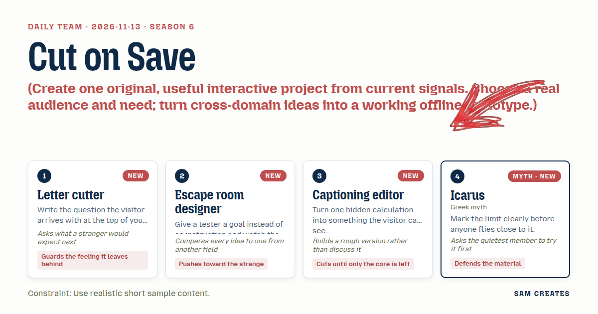
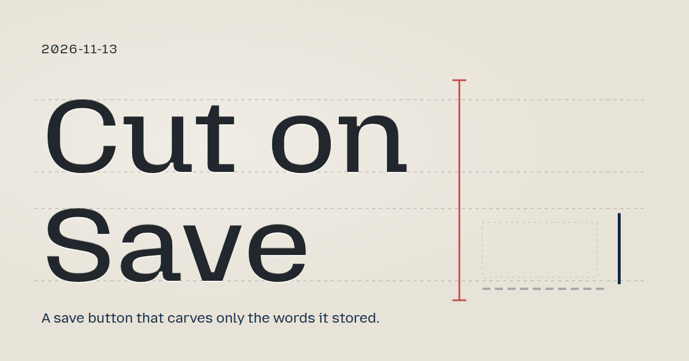
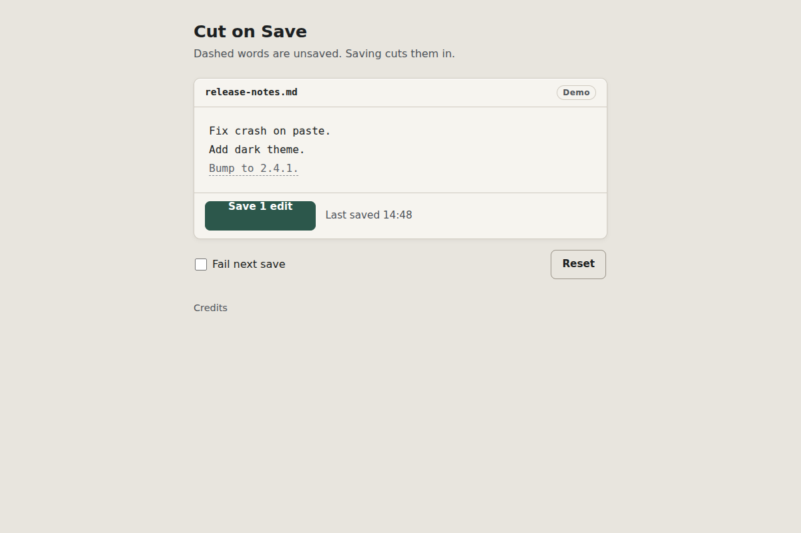

# 2026-11-13: Cut on Save

[Today](../../README.md) · [Archive](../../ARCHIVE.md)



**Task:** Create one original, useful interactive project from current signals. Choose a real audience and need; turn cross-domain ideas into a working offline prototype.

**Constraint:** Use realistic short sample content.

**Season:** 2026-11-09

**Decision:** Type in a short note and press Save.



[Cover art direction](cover.json) · [Cover source](cover.html)

## Feed evidence

- github-trending: fetched (14 items)
- Used feed inspiration: zed-industries/zed — https://github.com/zed-industries/zed

[Saved planning input](planning-input.json)

## Asset

<a href="artifact-1.html"></a>

[Use it](https://isas1.github.io/daily-team/2026-11-13/) · [artifact-1.html](artifact-1.html), led by Letter cutter. Model: claude-opus-5-5.

## The session

### Pitch

### Clash

**2 · Escape room designer:** Pencil and chisel is still a metaphor. What if the button were a lock with tumblers, one for each edit?

**3 · Captioning editor:** Tumblers move the answer off the text. The underline sits on the words themselves. Keep it there.

**1 · Letter cutter:** A stranger expects the button to change. They don't expect the words to change. That surprise is the whole point, so the button has to stay plain.

**4 · Icarus:** I typed during Saving. My new word stayed pencil and the older words were cut. That's correct, and the status line has to say so.

**2 · Escape room designer:** Then the button reads "Save 1 edit" again straight after success. The tester follows that route without being told.

**3 · Captioning editor:** Agreed. Status gets four words at most. "Not saved · edit kept." Then Retry.

**1 · Letter cutter:** Failure has to feel calm. The pencil stays exactly as it was, and nothing gets struck through.

**4 · Icarus:** The toggle reads "Fail next save" and resets itself after one failure. The limit stays in plain view.

### Decision

Type in a short note and press Save. Unsaved words change from pencil to carved once they are stored.

Concept: Cut on Save

- Letter cutter: the pencil-to-carved visual rule, and calm failure copy that keeps the pencil intact.
- Escape room designer: snapshot-scoped saves. Edits typed during Saving stay pencil, and the count updates afterward.
- Captioning editor: the visible pending-range calculation, the edit count on the button, and a 40-word ceiling.
- Icarus: a single labelled "Fail next save" toggle that resets after use, and a guarded Retry.

### Build notes

1. Use one `contenteditable` file pane for `release-notes.md` with three sample lines: "Fix crash on paste.", "Add dark theme." and "Bump to 2.4.1.". The last line starts as a pending range.
   - Track pending ranges as `{id, start, end, version}`.
   - Draw pencil as a 1px dashed grey underline at 0.7 opacity.
   - Draw carved as solid ink with a 1px inset shadow.
   - Use a 0.25 s ink transition, skipped under `prefers-reduced-motion`.
2. Save is a native button, also triggered by Ctrl+S or Cmd+S. Reserve its width from the longest label, "Saving 2 edits".
   - On press, record a snapshot version and start a 900 ms fake write with a request id.
   - On acknowledgement, carve only the ranges at or below the snapshot version.
   - Drop replies with a stale request id.
   - Ignore presses while a save is pending.
3. Use a polite live region for the status line, at most 4 words: "Saved 14:52" or "Not saved · edit kept". Retry appears in a reserved slot, takes focus on failure, and disables while pending.
   - The "Fail next save" checkbox fails one attempt, then unchecks itself.
   - Reset restores the sample.
   - Visible word count is 17 at load and stays under 40 including dynamic text.
   - Layout fits a 320 px width.

```json
{"schemaVersion":1,"name":"Cut on Save","audience":"Writers and developers saving files in an editor","problem":"A Saved tick never shows which edits are still at risk","interaction":"Type, press Save or Ctrl+S, toggle a failure, Retry","outcome":"Stored words turn from pencil to carved; newer edits stay pencil","recovery":"Failure keeps edits in pencil with guarded Retry; Reset sample","mechanism":"Snapshot-scoped save carves only ranges sent; later typing stays pending","difference":"Editors show a file-level dot; this marks unsaved words in place","whyNow":"Zed trending observed, summary names a multiplayer editor. Title and summary only, no demand data","sourceIds":["b6bd2783a916c52eefcb6ee6"],"evidenceStatus":"sourced","alternatives":[{"name":"Cut on Save","need":"See which words a save stored","mechanism":"Pencil-to-carved ranges scoped to save snapshot","rejection":"Selected: cross-domain, offline, new to recent dates"},{"name":"Tumbler Lock Save","need":"Count edits a save covers","mechanism":"Button lock with one tumbler per edit","rejection":"Moves the answer off the text"},{"name":"Save Limit Gauge","need":"Know time since last stored version","mechanism":"Arc fills toward an autosave limit","rejection":"Timer nags and hides which edits are at risk"}]}
```

**Guest:** Icarus (myth; Greek myth). The method is drawn from public-domain history, myth, or literature, or invented. The guest speaks in character in original words, never quoting the source, and nothing here is endorsed by anyone.

## Team

```text
Team for 2026-11-13
Season: 2026-11-09

1. Letter cutter
   Method: Write the question the visitor arrives with at the top of your notes. [new]
   Stance: Guards the feeling it leaves behind.
   Temperament: Asks what a stranger would expect next.
2. Escape room designer [new]
   Method: Give a tester a goal instead of an instruction and watch the route they take. [new]
   Stance: Pushes toward the strange.
   Temperament: Compares every idea to one from another field.
3. Captioning editor [new]
   Method: Turn one hidden calculation into something the visitor can see. [new]
   Stance: Cuts until only the core is left.
   Temperament: Builds a rough version rather than discuss it.
4. Icarus (myth; Greek myth) [guest] [new]
   Method: Mark the limit clearly before anyone flies close to it.
   Stance: Defends the material.
   Temperament: Asks the quietest member to try it first.

Constraint: Use realistic short sample content.
Task: Save button: an action button for an editor that shows pending work, confirms success and offers retry after a sample failure.
```

Provider: claude. Model: claude-opus-5-5.
