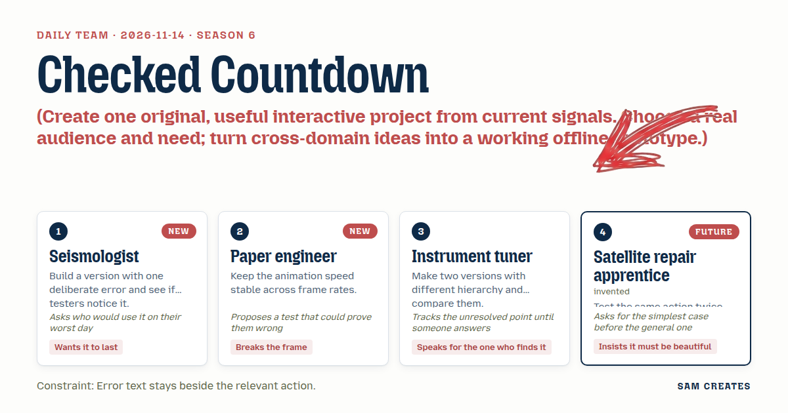
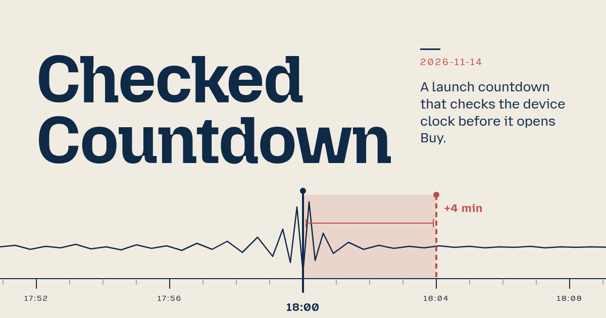
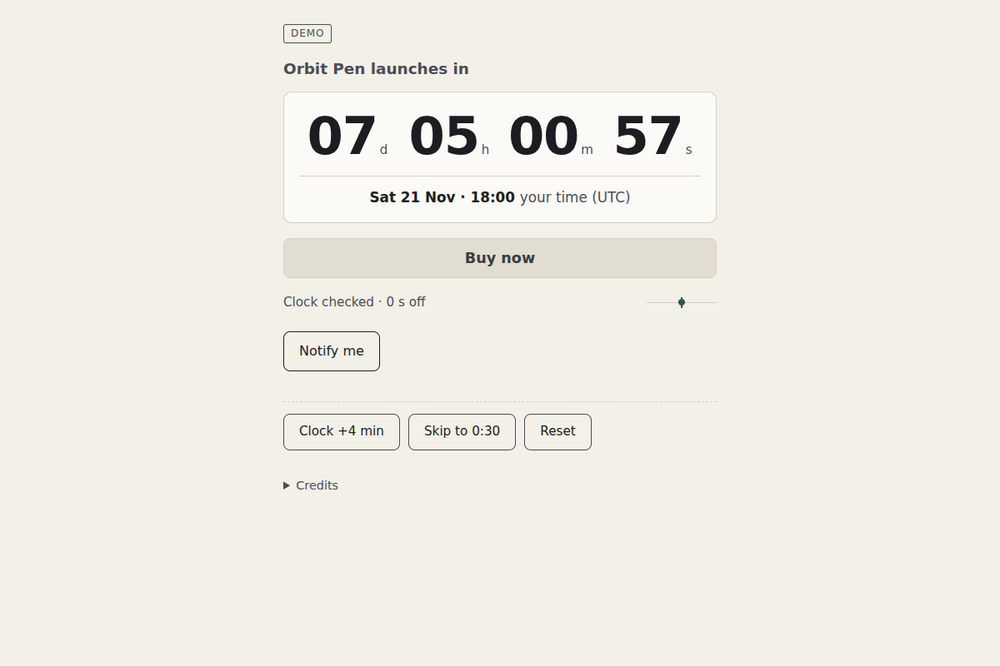

# 2026-11-14: Checked Countdown

[Today](../../README.md) · [Archive](../../ARCHIVE.md)



**Task:** Create one original, useful interactive project from current signals. Choose a real audience and need; turn cross-domain ideas into a working offline prototype.

**Constraint:** Error text stays beside the relevant action.

**Season:** 2026-11-09

**Decision:** A visitor watches the countdown and sees the exact local launch time it counts toward.



[Cover art direction](cover.json) · [Cover source](cover.html)

## Feed evidence

- smashing: fetched (11 items)
- Used feed inspiration: Should You Actually Add AI To That? A Four-Question Audit For Product Teams — https://smashingmagazine.com/2026/11/should-you-add-ai-audit-product-teams/

[Saved planning input](planning-input.json)

## Asset

<a href="artifact-1.html"></a>

[Use it](https://isas1.github.io/daily-team/2026-11-14/) · [artifact-1.html](artifact-1.html), led by Seismologist. Model: claude-opus-5-5.

## The session

### Pitch

### Clash

**2 · Paper engineer:** Rings are the frame break. A plain number is just one more widget.

**3 · Instrument tuner:** The ring map takes the visitor's worst day and hides their own zone in a crowd of other zones.

**2 · Paper engineer:** Then run the test I offered. Ask someone their local launch time using the map, and time how long it takes.

**1 · Seismologist:** I'll take the result in advance. On a phone they squint. The clock check answers it in one line, and it also catches the early-open failure.

**4 · Satellite repair apprentice:** That leaves the case nobody answered. Device clock 4 minutes fast, visitor presses Buy at what they think is 18:00. What do they see?

**1 · Seismologist:** The button stays shut. The note beside it reads "Your clock is 4 min fast. Opens 18:00 your time."

**3 · Instrument tuner:** The note goes next to the button, never in a banner up top. That matches the constraint, and I'll hold us to it.

**4 · Satellite repair apprentice:** Then I test it twice. Skew on, press. Skew off, press. Both results must match the corrected clock.

**2 · Paper engineer:** Fine. The frame break moves into the zero moment. The digits fold away and the button takes their place, all timed from the clock rather than frame count.

### Decision

A visitor watches the countdown and sees the exact local launch time it counts toward.

Concept: Checked Countdown

The countdown runs on a checked clock. The page compares the device clock with a reference timestamp, stores the offset, and counts from the corrected time. It names the launch moment in the visitor's zone. If the device clock is wrong, the Buy button stays closed and the note beside it gives the offset and the true opening time. At zero, the digits fold into an open Buy button.

This improves on standard launch timers. Those count down from the device clock and give no zone. A skewed clock opens the button early, and an ambiguous "18:00" sends visitors to look up the time elsewhere. The Smashing audit asks what users need to verify output. Here the output is the number, and the page shows the clock offset and the zone it is based on.

- **Seismologist:** the clock offset model, plus a test build with a deliberate +4 min skew to see whether testers notice the note.
- **Paper engineer:** the zero transition, driven by `performance.now()` deltas against the launch instant. It looks the same at 30, 60 and 144 fps.
- **Instrument tuner:** the A/B hierarchy. Version A leads with the digits. Version B leads with "18:00 your time". The one testers read faster ships. The tuner also enforces the rule that error text stays beside the button.
- **Satellite repair apprentice:** the double-press checks for Notify and Buy, the same-zone sample as the default case, and the final visual pass at 320 px.

Initial copy, about 30 words: "Orbit Pen launches in", "02 d 04 h 11 m 09 s", "Sat 21 Nov · 18:00 your time (Europe/London)", "Clock checked · 0 s off", "Notify me", "Shift clock +4 min".

### Build notes

1. Compute `offset = referenceNow - Date.now()` once on load. Derive the remaining time on every frame as `launch - (Date.now() + offset)`. Never decrement a counter. Format the launch instant with `Intl.DateTimeFormat` in the resolved zone.
2. Put the Buy/Notify button and its note in one fixed-height block, with the note in a polite live region directly under the button. The button enables only when the corrected time reaches the launch instant. A second press while it is pending is ignored. "Shift clock +4 min" and Reset buttons sit below as demo controls.
3. At zero, collapse the digit cells over 320 ms using elapsed-time easing, reveal "Buy now" and "Live since 18:00", then move focus to the button. Under reduced motion, swap the elements directly.

```json
{"schemaVersion":1,"name":"Checked Countdown","audience":"Visitors to a product launch page","problem":"Device clock skew and unnamed zones make countdowns wrong","interaction":"Watch countdown, press Notify or Buy, shift demo clock","outcome":"Local launch time, clock offset, Buy opens at true zero","recovery":"Skewed press stays shut with offset note beside it; Reset","mechanism":"Station clock check: offset stored, count runs on corrected time","difference":"Timers trust device clock and omit zone; this shows both","whyNow":"Smashing audit asks what users need to verify output. Title and summary only, no demand data","sourceIds":["9f663437118e879c3e8168d2"],"evidenceStatus":"sourced","alternatives":[{"name":"Checked Countdown","need":"Trust when a launch opens locally","mechanism":"Clock offset check with note beside the button","rejection":"Selected: cross-domain, offline; differs from 11-03 rehearsal"},{"name":"Arrival Rings","need":"See launch reach each time zone","mechanism":"Wavefront rings light zones on a world map","rejection":"Hides the visitor's own zone; slow on phones"},{"name":"Launch Queue Slip","need":"Know your place once sales open","mechanism":"Numbered slip issued at zero","rejection":"Needs a real server to be honest"}]}
```

**Guest:** Satellite repair apprentice (future; invented). The method is drawn from public-domain history, myth, or literature, or invented. The guest speaks in character in original words, never quoting the source, and nothing here is endorsed by anyone.

## Team

```text
Team for 2026-11-14
Season: 2026-11-09

1. Seismologist [new]
   Method: Build a version with one deliberate error and see if testers notice it. [new]
   Stance: Wants it to last.
   Temperament: Asks who would use it on their worst day.
2. Paper engineer [new]
   Method: Keep the animation speed stable across frame rates.
   Stance: Breaks the frame.
   Temperament: Proposes a test that could prove them wrong.
3. Instrument tuner
   Method: Make two versions with different hierarchy and compare them.
   Stance: Speaks for the one who finds it.
   Temperament: Tracks the unresolved point until someone answers.
4. Satellite repair apprentice (future; invented) [guest]
   Method: Test the same action twice before trusting it.
   Stance: Insists it must be beautiful.
   Temperament: Asks for the simplest case before the general one.

Constraint: Error text stays beside the relevant action.
Task: Launch countdown: a countdown for a product launch page that shows time remaining and changes state when the launch arrives.
```

Provider: claude. Model: claude-opus-5-5.
