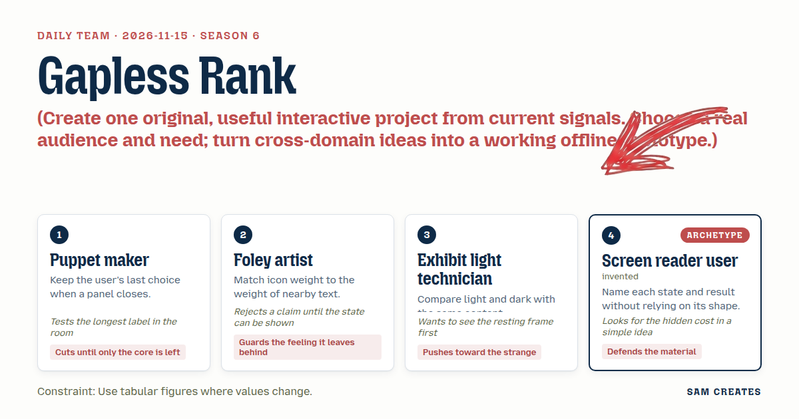
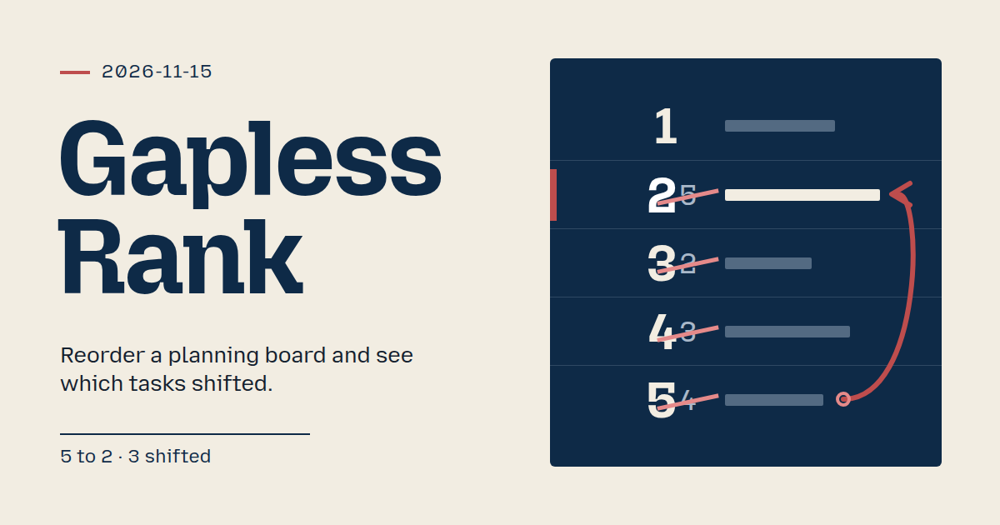
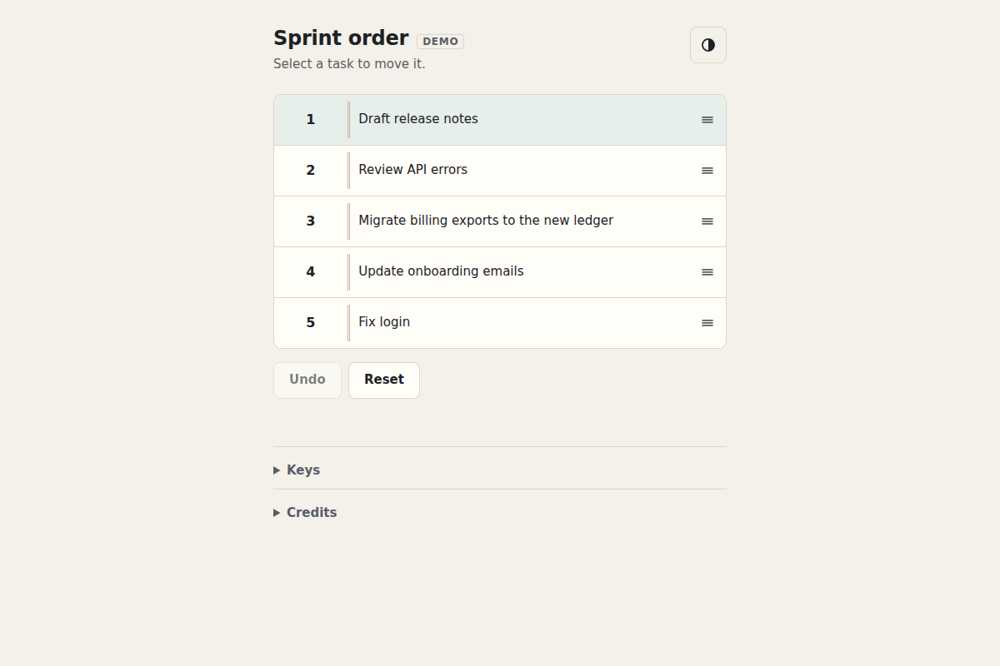

# 2026-11-15: Gapless Rank

[Today](../../README.md) · [Archive](../../ARCHIVE.md)



**Task:** Create one original, useful interactive project from current signals. Choose a real audience and need; turn cross-domain ideas into a working offline prototype.

**Constraint:** Use tabular figures where values change.

**Season:** 2026-11-09

**Decision:** Pick a task, choose its new number, and every task that shifted shows its old number struck.



[Cover art direction](cover.json) · [Cover source](cover.html)

## Feed evidence

- hacker-news: fetched (20 items)
- Used feed inspiration: Strictly monotonic timestamps and gapless sequences in Rust — https://tsoracle.rs/

[Saved planning input](planning-input.json)

## Asset

<a href="artifact-1.html"></a>

[Use it](https://isas1.github.io/daily-team/2026-11-15/) · [artifact-1.html](artifact-1.html), led by Puppet maker. Model: claude-opus-5-5.

## The session

### Pitch

### Clash

**3 · Exhibit light technician:** Struck numbers on every shifted row. That's the whole idea.

**4 · Screen reader user:** On screen, yes. Read aloud, that's noise. Announce the moved task and a count of shifted tasks. Nothing else.

**1 · Puppet maker:** Agreed. And the struck marks clear on the next move. Keep only one correction visible.

**2 · Foley artist:** Then the last move has to stay legible until the next one. No fade timer. A timer is a claim that I'm done reading.

**3 · Exhibit light technician:** Fine, no timer. The struck figure in dark mode has to hold contrast, though. Strike at 1.5 px, not a hairline.

**1 · Puppet maker:** Drag?

**4 · Screen reader user:** Drag can stay as a shortcut. The real path is: select a row, press a number, or press Alt+Up or Alt+Down. Same result, same announcement.

**2 · Foley artist:** Undo restores the old order and the old strikes in one step. If it can't show that, it doesn't count.

### Decision

Pick a task, choose its new number, and every task that shifted shows its old number struck.

Concept: Gapless Rank

The list is a gapless sequence from 1 to n, like an invoice ledger. A move renumbers every row without holes. Each row that changed shows its old position struck beside the new one. The nearest usual approach is a drag list that reorders with no trace, so a reviewer cannot tell what shifted. Here the last move stays readable until the next one, and Undo reverses it. The source is the HN post on strictly monotonic timestamps and gapless sequences in Rust. Only its title was used. It supplied the gapless renumbering rule, and the struck old numbers make that rule visible.

- **Puppet maker:** The "Move to" field remembers its last value when it closes. The sample list includes a 40-character label to test wrapping at 320 px.
- **Foley artist:** Arrow glyphs use a 1.75 px stroke to match 15 px text weight. The moved row settles once in 160 ms, which is skipped under reduced motion. Status text is written only after the DOM order commits.
- **Exhibit light technician:** Ledger strike on old numbers at 1.5 px. The first frame shown is the resting list. Light and dark were checked with the same 5 tasks, and the struck figure meets 4.5:1 contrast in both.
- **Screen reader user:** Each row is named "Task, n of 5, was m." One polite live line reads "Fix login moved 5 to 2. 3 shifted." Per-row announcements are suppressed.

Initial visible copy: "Sprint order", five task labels, numbers 1 to 5, "Undo" and "Reset". The total is under 40 words. The status line is empty until the first move.

### Build notes

1. Store the list as an ordered array of ids with a `prev` index map from the last move only. Render positions and struck old numbers in `font-variant-numeric: tabular-nums` inside a fixed 3ch column.
2. Use a listbox with roving tabindex. Up and Down move focus. Alt+Up and Alt+Down move the task one step. Digits 1–5 move it to that position. Drag uses pointer events and calls the same `move(id, to)`. A move to the current position is a no-op.
3. Keep a one-step history of `{order, prev}`. Undo swaps it back and rewrites the live line ("Undone · Fix login back to 5"). Reset restores the sample and clears the strikes. Set the status text after layout commits, using `requestAnimationFrame`.

```json
{"schemaVersion":1,"name":"Gapless Rank","audience":"Team leads reprioritizing a planning board","problem":"After a reorder, nobody can tell which tasks shifted","interaction":"Select a task, press a number or Alt+arrow, or drag","outcome":"Gapless 1..n renumber; shifted rows show old number struck","recovery":"Undo restores order and marks; Reset restores sample","mechanism":"Ledger correction: last move's old positions kept struck","difference":"Drag lists reorder with no trace; this shows what shifted","whyNow":"HN Rust post on gapless sequences. Title only, no demand data","sourceIds":["ddd34cc7886c3c3654c885f3"],"evidenceStatus":"sourced","alternatives":[{"name":"Gapless Rank","need":"See what a reorder shifted","mechanism":"Gapless renumber with struck old positions","rejection":"Selected: cross-domain, offline, new to recent dates"},{"name":"Swap Ledger","need":"Reorder by trading two tasks","mechanism":"Pair-swap only, each swap logged","rejection":"Long moves take many swaps"},{"name":"Earcon Order","need":"Hear position while reordering","mechanism":"Pitch rises with rank on each step","rejection":"Needs audio; hidden cost for shared rooms"}]}
```

**Guest:** Screen reader user (archetype; invented). The method is drawn from public-domain history, myth, or literature, or invented. The guest speaks in character in original words, never quoting the source, and nothing here is endorsed by anyone.

## Team

```text
Team for 2026-11-15
Season: 2026-11-09

1. Puppet maker
   Method: Keep the user's last choice when a panel closes.
   Stance: Cuts until only the core is left.
   Temperament: Tests the longest label in the room.
2. Foley artist
   Method: Match icon weight to the weight of nearby text.
   Stance: Guards the feeling it leaves behind.
   Temperament: Rejects a claim until the state can be shown.
3. Exhibit light technician
   Method: Compare light and dark with the same content.
   Stance: Pushes toward the strange.
   Temperament: Wants to see the resting frame first.
4. Screen reader user (archetype; invented) [guest]
   Method: Name each state and result without relying on its shape.
   Stance: Defends the material.
   Temperament: Looks for the hidden cost in a simple idea.

Constraint: Use tabular figures where values change.
Task: Board order: a reorder list for a planning board that moves tasks and makes their new order clear.
```

Provider: claude. Model: claude-opus-5-5.
