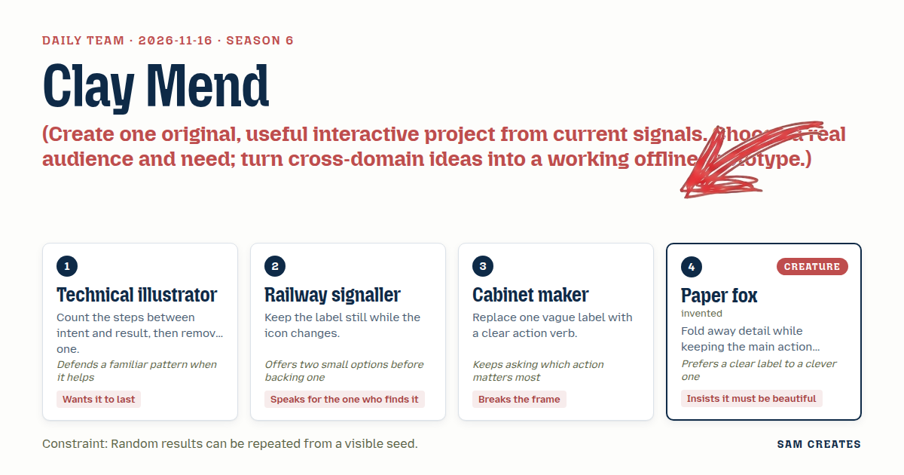
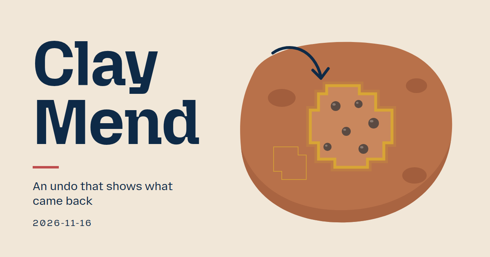
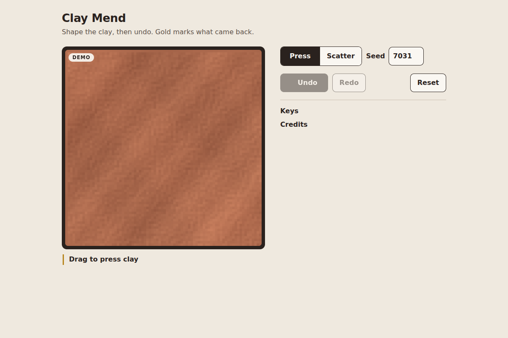

# 2026-11-16: Clay Mend

[Today](../../README.md) · [Archive](../../ARCHIVE.md)



**Task:** Create one original, useful interactive project from current signals. Choose a real audience and need; turn cross-domain ideas into a working offline prototype.

**Constraint:** Random results can be repeated from a visible seed.

**Season:** 2026-11-09

**Decision:** Press or scatter clay, press Undo, and a gold seam outlines exactly what came back.



[Cover art direction](cover.json) · [Cover source](cover.html)

## Feed evidence

- reddit-sideproject: fetched (20 items)
- Used feed inspiration: I've spent my evenings and weekends creating a game where the whole world is clay — https://www.reddit.com/r/SideProject/comments/1xxprui/ive_spent_my_evenings_and_weekends_creating_a/

[Saved planning input](planning-input.json)

## Asset

<a href="artifact-1.html"></a>

[Use it](https://isas1.github.io/daily-team/2026-11-16/) · [artifact-1.html](artifact-1.html), led by Technical illustrator. Model: claude-opus-5-5.

## The session

### Pitch

### Clash

**3 · Cabinet maker:** A history list shows every step. Why throw that away?

**1 · Technical illustrator:** Because it is one more place to look. The answer belongs on the clay.

**2 · Railway signaller:** Then keep one thing still. Undo stays at the same spot, with the same word.

**4 · Paper fox:** A gold seam for 2 seconds, then a crease. The crease stays until the next edit.

**3 · Cabinet maker:** And if someone scatters, undoes and redoes? A different spray would be a lie.

**2 · Railway signaller:** So show the seed beside Scatter. Same seed, same pebbles.

**1 · Technical illustrator:** That is checkable. Redo draws the same 6 pebbles at the same points.

**4 · Paper fox:** A clever label like "Mend" would charm people and confuse them. Keep "Undo."

### Decision

Press or scatter clay, press Undo, and a gold seam outlines exactly what came back.

Concept: Clay Mend

**Source.** The selected feed item is 5c9f3a4ba90c3c4b005240dc, a Reddit r/SideProject post titled "I've spent my evenings and weekends creating a game where the whole world is clay." The title supplies the material. The canvas is clay that can be pressed and scattered, and undo is shown as a repair to it.

**Audience and need.** The audience is indie game developers blocking out clay-style terrain. Undo in paint tools restores pixels silently. With random brushes there is a second problem: redo can produce a different spray from the first one.

**Mechanism.** Each change stores two things: the tool, and a mask of the pixels it touched. Scatter also stores its seed.

- **Undo** restores the masked pixels. It traces the edge of the mask in gold for 2 s. After that the trace fades to a 1 px crease, which stays until the next edit.
- **Redo** reruns the tool from its stored seed and inputs. Because of that, the result is identical to the first run.

**Difference.** Photoshop-style history panels name a step but do not show where it was on the canvas. The 2026-10-29 "Undo import" listed restored layer names. Clay Mend instead marks the restored region on the canvas itself. It also makes random edits repeatable from a seed the user can see.

**Contributions.**

- **Technical illustrator:** removes the history panel and puts the restored outline directly on the canvas.
- **Railway signaller:** fixes the Undo label in place and adds a 16 px icon slot that shows the next tool to be reversed.
- **Cabinet maker:** writes the status line as "Back: <tool>, <count>, seed <n>." Also sets Redo to replay from the seed.
- **Paper fox:** designs the gold seam and the fold-down to a crease, and holds the line on keeping the label "Undo."

**Visible copy.** The initial screen carries about 19 words:

- Title: "Clay Mend"
- Buttons: Press, Scatter, Undo, Redo, Reset
- Seed field: "Seed 7031"
- Status: "Drag to press clay"

After an undo, the status reads, for example, "Back: Scatter, 6 pebbles, seed 7031."

### Build notes

1. **Canvas and seeded scatter.** Use a 320×320 canvas with a clay height grid at 4 px cells. Press lowers the cells under a 24 px brush. Scatter uses mulberry32(seed) to place 6 pebbles. After each scatter, the seed advances, and the new value is shown in an editable field. Reset restores the sample grid and seed 7031.

2. **History entries.** Each entry stores {tool, inputs, seed, mask, before}.
   - Undo writes `before` back into the masked cells. It then draws the mask outline as a gold stroke, which a requestAnimationFrame (rAF) loop fades to a 1 px crease over 2 s. Under reduced motion, the crease is drawn directly.
   - Redo reruns the tool from `inputs` and `seed`. In debug mode, it also checks that the resulting cells match the stored mask.

3. **Controls and announcements.** The Undo label has a fixed width, with a 16 px icon slot that swaps between a thumbprint and a pebble.
   - Ctrl+Z or Cmd+Z undoes. Ctrl+Shift+Z redoes.
   - When there is no history, Undo is disabled and the status reads "Nothing to undo."
   - Status text sits in a polite live region.

```json
{"schemaVersion":1,"name":"Clay Mend","audience":"Indie game devs blocking out clay terrain","problem":"Undo restores silently; random brushes redo differently","interaction":"Press or Scatter clay, then Undo or Redo","outcome":"Gold seam outlines restored clay; status names tool, count, seed","recovery":"Redo replays from seed; Reset restores sample and seed 7031","mechanism":"Masked history; undo traces mask edge in gold, folds to crease","difference":"History panels name steps off-canvas; this marks the region and repeats random edits","whyNow":"SideProject post on a game world made of clay. Title only, no demand data","sourceIds":["5c9f3a4ba90c3c4b005240dc"],"evidenceStatus":"sourced","alternatives":[{"name":"Clay Mend","need":"See what an undo brought back","mechanism":"Gold seam on restored mask with visible seed","rejection":"Selected: cross-domain, offline; differs from 10-29 layer list"},{"name":"Before/After Swipe","need":"Compare canvas states","mechanism":"Drag a divider between pre and post undo","rejection":"Extra step; eye leaves the work"},{"name":"Step Film Strip","need":"Jump many steps back","mechanism":"Thumbnail strip of every history entry","rejection":"A history panel; echoes 10-20 rewind"}]}
```

**Guest:** Paper fox (creature; invented). The method is drawn from public-domain history, myth, or literature, or invented. The guest speaks in character in original words, never quoting the source, and nothing here is endorsed by anyone.

## Team

```text
Team for 2026-11-16
Season: 2026-11-09

1. Technical illustrator
   Method: Count the steps between intent and result, then remove one.
   Stance: Wants it to last.
   Temperament: Defends a familiar pattern when it helps.
2. Railway signaller
   Method: Keep the label still while the icon changes.
   Stance: Speaks for the one who finds it.
   Temperament: Offers two small options before backing one.
3. Cabinet maker
   Method: Replace one vague label with a clear action verb.
   Stance: Breaks the frame.
   Temperament: Keeps asking which action matters most.
4. Paper fox (creature; invented) [guest]
   Method: Fold away detail while keeping the main action visible.
   Stance: Insists it must be beautiful.
   Temperament: Prefers a clear label to a clever one.

Constraint: Random results can be repeated from a visible seed.
Task: Undo edit: an undo control for a canvas editor that restores the previous change and shows what came back.
```

Provider: claude. Model: claude-opus-5-5.
