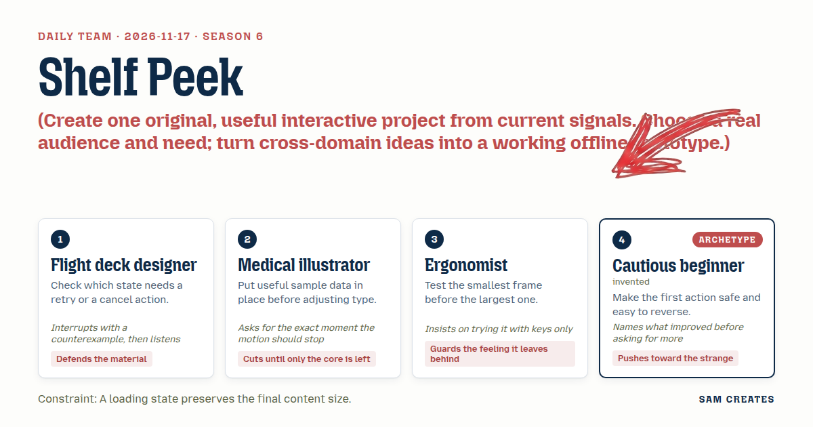
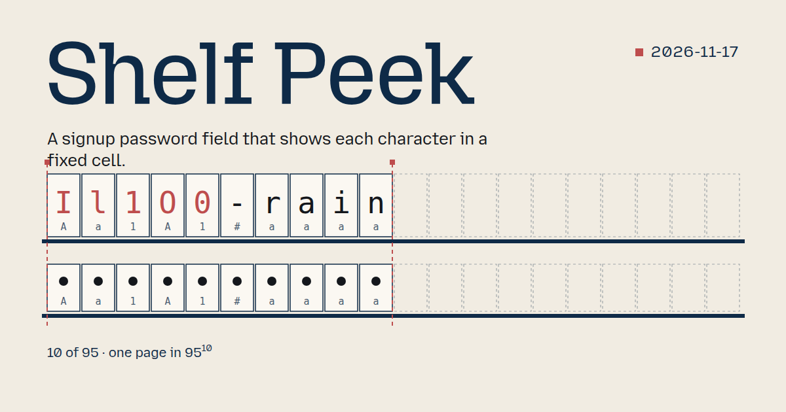
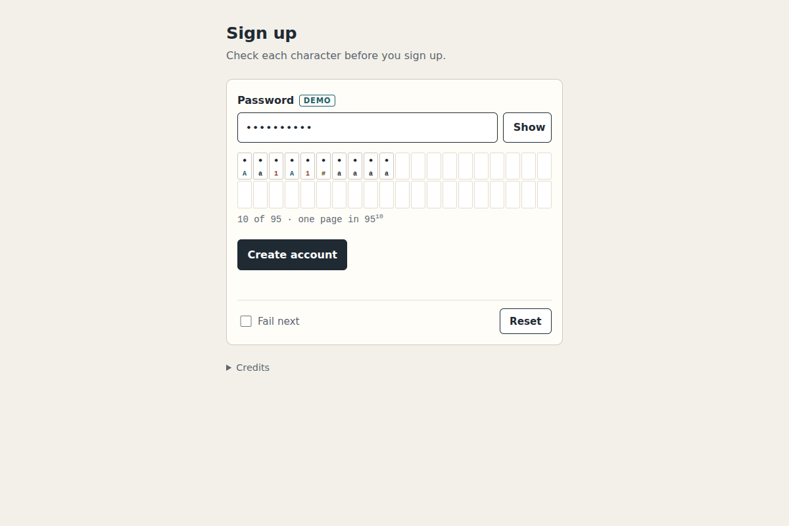

# 2026-11-17: Shelf Peek

[Today](../../README.md) · [Archive](../../ARCHIVE.md)



**Task:** Create one original, useful interactive project from current signals. Choose a real audience and need; turn cross-domain ideas into a working offline prototype.

**Constraint:** A loading state preserves the final content size.

**Season:** 2026-11-09

**Decision:** Type a password, press Show, and check each character in fixed cells before signing up.



[Cover art direction](cover.json) · [Cover source](cover.html)

## Feed evidence

- reddit-beautiful: fetched (20 items)
- Used feed inspiration: Borges' Library of Babel: walk to the book where any sentence is already written — https://www.reddit.com/r/InternetIsBeautiful/comments/1xyki7k/borges_library_of_babel_walk_to_the_book_where/

[Saved planning input](planning-input.json)

## Asset

<a href="artifact-1.html"></a>

[Use it](https://isas1.github.io/daily-team/2026-11-17/) · [artifact-1.html](artifact-1.html), led by Flight deck designer. Model: claude-opus-5-5.

## The session

### Pitch

### Clash

**3 · Ergonomist:** Cells at 320 px. Twenty characters, 14 px each, that's 280. It fits. Thirty-two doesn't.

**1 · Flight deck designer:** Counterexample. A password manager pastes 40 characters. Then what?

**3 · Ergonomist:** Wrap to a second row of cells. Reserve both rows from the start so nothing moves.

**2 · Medical illustrator:** Where does the class mark stop? Exact moment.

**3 · Ergonomist:** On the frame the character lands. No easing. Under reduced motion it's the same.

**4 · Cautious beginner:** The fixed cells already help. I can see the 1 is a 1. Can the shelf count go further, like a walk between shelves?

**2 · Medical illustrator:** Cut it. One line. Length and alphabet size. Nothing about strength, we can't prove strength.

**1 · Flight deck designer:** Agreed. And Checking keeps the button at the width of Create account. Same box for Retry.

**4 · Cautious beginner:** Fine. One line, and Escape always hides. That's the safe first step.

### Decision

Type a password, press Show, and check each character in fixed cells before signing up.

Concept: Shelf Peek

- **Flight deck designer:** submit states. Create account → Checking → Created or Failed with Retry. Cancel during Checking. Input and caret survive every state. Button width reserved from the longest label.
- **Medical illustrator:** sample `Il1O0-rain` loaded on Reset. One monospace face. Per-cell class mark (A, a, 1, #) that appears on the frame the character lands and never animates. The shelf line is cut to length and alphabet size only.
- **Ergonomist:** 320 px first. Two cell rows reserved for up to 40 characters. Keys: Tab, Space on Show, Alt+F8 in the field. Focus and selection restored after toggle.
- **Cautious beginner:** Escape and blur both hide. The Library of Babel page framing: a password shown as a page of cells with one line, `10 of 95 · one page in 95^10`.

Visible copy at load: Password, Show, the cell page, the shelf line, Create account, Reset. About 22 words with status text.

### Build notes

1. Use one `input` that switches `type` between password and text. Before the switch, store `selectionStart`, `selectionEnd` and `selectionDirection`, then restore them after it. The font is monospace at a fixed `ch` width, so dots and characters share one width. Wire Escape and blur to hide, and Alt+F8 to toggle.
2. Under the input, render a 2×20 grid of 14 px cells. The grid is reserved at full height whether hidden or shown. In hidden state the cells show only class marks. In shown state each cell shows its character above its mark. The shelf line computes alphabet size from the classes present (26, 26, 10, 33) and prints `n of k · one page in k^n`.
3. Submit is a demo job with an AbortController, a 1.2 s delay and a failure toggle. The button `min-width` is measured from "Create account". States are Checking with Cancel, Created, and Failed with Retry. Retry ignores presses while a job runs. Reset restores the sample, hides the text and clears status.

```json
{"schemaVersion":1,"name":"Shelf Peek","audience":"People creating accounts on signup forms","problem":"Reveal toggles shift layout, lose caret, hide lookalike chars","interaction":"Type, press Show or Alt+F8, Escape hides, Create account","outcome":"Fixed cells show each char with class mark; caret kept","recovery":"Escape or blur hides; failed submit keeps input, Retry; Reset","mechanism":"Babel page: one char per reserved cell, shelf line of length and alphabet","difference":"Eye toggles swap type and jump width; this keeps size and marks lookalikes","whyNow":"Library of Babel post: any string sits on a page. Title only, no demand data","sourceIds":["5145194c97dcbf48afca4167"],"evidenceStatus":"sourced","alternatives":[{"name":"Shelf Peek","need":"Check a password for typos before signup","mechanism":"Reserved cell page with class marks, caret kept","rejection":"Selected: cross-domain, offline, new to recent dates"},{"name":"Space Walk","need":"See why length beats symbols","mechanism":"Walk rooms of search space as you type","rejection":"Strength meter in disguise; ignores breach lists"},{"name":"Hold Peek","need":"Reveal briefly on a crowded train","mechanism":"Press and hold to show, release hides","rejection":"Fails keys-only use and needs steady hold"}]}
```

**Guest:** Cautious beginner (archetype; invented). The method is drawn from public-domain history, myth, or literature, or invented. The guest speaks in character in original words, never quoting the source, and nothing here is endorsed by anyone.

## Team

```text
Team for 2026-11-17
Season: 2026-11-09

1. Flight deck designer
   Method: Check which state needs a retry or a cancel action.
   Stance: Defends the material.
   Temperament: Interrupts with a counterexample, then listens.
2. Medical illustrator
   Method: Put useful sample data in place before adjusting type.
   Stance: Cuts until only the core is left.
   Temperament: Asks for the exact moment the motion should stop.
3. Ergonomist
   Method: Test the smallest frame before the largest one.
   Stance: Guards the feeling it leaves behind.
   Temperament: Insists on trying it with keys only.
4. Cautious beginner (archetype; invented) [guest]
   Method: Make the first action safe and easy to reverse.
   Stance: Pushes toward the strange.
   Temperament: Names what improved before asking for more.

Constraint: A loading state preserves the final content size.
Task: Password reveal: a password field for a signup prototype that switches between hidden and visible text without losing input.
```

Provider: claude. Model: claude-opus-5-5.
