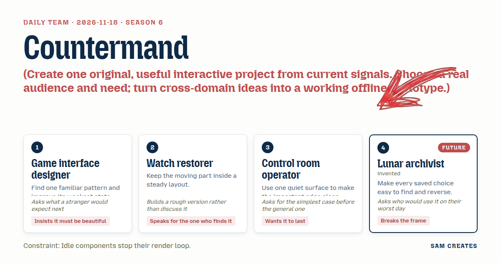
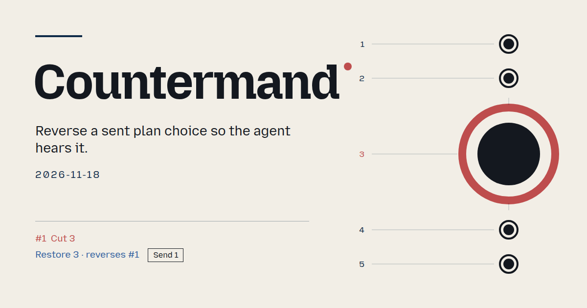
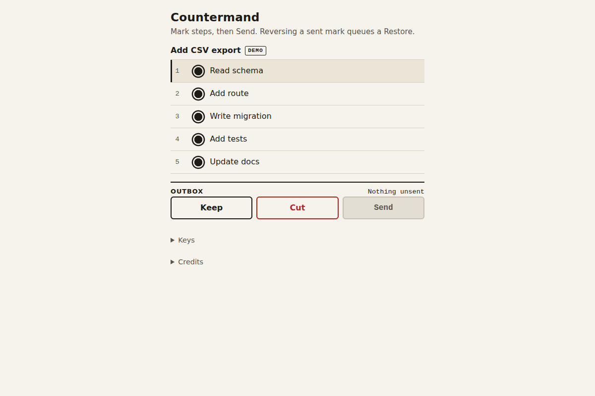

# 2026-11-18: Countermand

[Today](../../README.md) · [Archive](../../ARCHIVE.md)



**Task:** Create one original, useful interactive project from current signals. Choose a real audience and need; turn cross-domain ideas into a working offline prototype.

**Constraint:** Idle components stop their render loop.

**Season:** 2026-11-09

**Decision:** Mark plan steps Keep or Cut and press Send; reversing a sent mark writes a numbered Restore line.



[Cover art direction](cover.json) · [Cover source](cover.html)

## Feed evidence

- github-trending: fetched (16 items)
- Used feed inspiration: backnotprop/plannotator — https://github.com/backnotprop/plannotator

[Saved planning input](planning-input.json)

## Asset

<a href="artifact-1.html"></a>

[Use it](https://isas1.github.io/daily-team/2026-11-18/) · [artifact-1.html](artifact-1.html), led by Game interface designer. Model: claude-opus-5-5.

## The session

### Pitch

### Clash

1. **Watch restorer:** Ran the sample. "Add CSV export," five steps. Cut step 3, Write migration. Send. Outbox shows "#1 Cut 3." Then I pressed Keep on 3. Outbox shows "Restore 3 · reverses #1."

2. **Game interface designer:** And the ring on row 3 is still red while the fill is ink. A stranger would expect that mismatch to mean "not done yet." Good.

3. **Lunar archivist:** Here's the mistake. Someone presses Keep, sees the fill go back to normal and walks away. They think the reversal happened. The agent still has #1.

4. **Control room operator:** So the mismatch can't sit on a quiet row alone. Send needs the count: "Send 1." When ring and fill agree everywhere, Send greys and says nothing.

5. **Game interface designer:** And the page title gains a small dot while anything is unsent. You can see it from another tab.

6. **Lunar archivist:** Second case. Cut 3 before sending, then Keep 3. That's no counter at all. The pending line just disappears. Only sent marks earn a reversal.

7. **Watch restorer:** Then the rule is about the ring, not the history. A difference between ring and fill makes a line. No difference, no line.

8. **Control room operator:** And the slide animation stops when the fill settles. No loop runs while the page is idle. That's the team constraint, and it keeps an open review tab cheap for hours.

### Decision

Mark plan steps Keep or Cut and press Send; reversing a sent mark writes a numbered Restore line.

Concept: Countermand

- **Game interface designer:** the two-layer mark. The ring shows the sent state and the fill shows the wanted state, so a mismatch reads as unsent.
- **Watch restorer:** the steady layout. Five fixed rows with a 28 px mark slot. Only the fill moves, and the outbox grows below.
- **Control room operator:** the Send count and the grey idle state. Send reads "Send N" only while rings and fills differ.
- **Lunar archivist:** the countermand rule. Each send gets a number. Reversing a sent choice emits "Restore N · reverses #k" instead of deleting text.

### Build notes

1. Model each step as `{sent, wanted}`. The outbox is a pure function: for every step where `sent ≠ wanted`, emit Cut or Restore. Restore cites the send number that last set `sent`. On Send, copy `wanted` into `sent`, push a numbered ledger entry, and set the title dot from the outbox length.
2. Render 5 rows with a fixed 28 px mark slot: an SVG ring for `sent` and a fill for `wanted`. Keep and Cut act on the selected row. Arrow keys move the selection, K and X apply marks, and Ctrl+Enter sends. Send stays disabled with no label count while the outbox is empty.
3. Run the fill slide (120 ms) with a requestAnimationFrame loop that calls `cancelAnimationFrame` when the fill settles. Expose a `frames` counter in a debug hook and assert it does not increase during 2 s of idle after any action.

**Visible words on the first screen (about 24):** Countermand · Add CSV export · Read schema · Add route · Write migration · Add tests · Update docs · Keep · Cut · Send · Nothing unsent.

```json
{"schemaVersion":1,"name":"Countermand","audience":"Developers reviewing a coding agent's plan before and during its run","problem":"After feedback is sent, reversing one choice deletes the note locally, and the agent never learns the step is back","interaction":"Select a plan step, press Keep or Cut, press Send; later reverse a sent mark and Send again","outcome":"Outbox lists numbered lines; reversing a sent Cut produces 'Restore 3 · reverses #1', and Send shows the unsent count","recovery":"Reversing an unsent mark removes its pending line; a wrong sent cut is fixed by Keep plus Cut on the right step, then Send","mechanism":"Each step holds sent and wanted states; any mismatch emits a line, and Restore cites the send number that set the old state","difference":"Usual review tools edit or delete notes in place, so a reversal sends nothing; here a reversal after send becomes an explicit numbered countermand","whyNow":"Saved trending item plannotator describes sending all plan feedback to agents in one click; that suggests the after-send case matters, with no demand data","sourceIds":["e6357f1e7e944cc84f059f59"],"evidenceStatus":"sourced","craft":{"rule":"Lunar archivist: every saved choice easy to find and reverse. A sent mark can't be erased; a mismatch between sent and wanted emits a Restore line citing the send number, so undo after send creates output","design":"Surface: five fixed plan rows, 28px ring+fill mark slot. Phone: rows, Keep/Cut bar, sticky Send+outbox. Mono for numbers, sans for steps. Ink on paper, red Cut, blue Restore. Sparse. 120ms fill slide; loop stops at rest","trial":{"start":"Plan 'Add CSV export': 1 Read schema, 2 Add route, 3 Write migration, 4 Add tests, 5 Update docs. All Keep, ledger empty","action":"Select 3, press Cut, press Send (#1 Cut 3). Then select 3, press Keep","result":"Row 3 ring red, fill ink; outbox 'Restore 3 · reverses #1'; button 'Send 1'; title dot on. No loop frames after 120ms","mistake":"User meant to cut step 4, pressed Keep on 3, and walked away without pressing Send, so the agent still holds #1","recovery":"Send 1 and title dot stay visible; Cut 4 adds a line, Send makes #2 with Restore 3 and Cut 4; rings match fills, Send greys"}},"alternatives":[{"name":"Countermand","need":"Reverse a sent plan choice so the agent hears it","mechanism":"Sent vs wanted states per step; mismatch emits numbered Cut or Restore lines","action":"Cut a step, Send, then press Keep on it","result":"Outbox shows 'Restore 3 · reverses #1' and Send 1","rejection":"Selected: clear gain over in-place note deletion, and the rule changes output state"},{"name":"Hold Points","need":"Decide where an unattended agent must stop and wait","mechanism":"Steps marked Go or Hold; dependents of a Hold inherit it; a reach line marks the last unattended step","action":"Toggle Hold on a plan step","result":"Reach line moves up; dependent steps grey as blocked","rejection":"Rejected: Hold-moves-the-line repeats Zero Hour Rehearsal, and dependency entry is too heavy for one screen"},{"name":"Note Weigher","need":"Catch contradictory review notes before one-click send","mechanism":"Groups notes by step and flags pairs that both cut and edit the same step","action":"Type two notes on the same step","result":"Conflict pair shown with Keep one prompt","rejection":"Rejected: needs text heuristics that misfire offline; conflicts are rarer than reversals"}]}
```

**Guest:** Lunar archivist (future; invented). The method is drawn from public-domain history, myth, or literature, or invented. The guest speaks in character in original words, never quoting the source, and nothing here is endorsed by anyone.

## Team

```text
Team for 2026-11-18
Season: 2026-11-09

1. Game interface designer
   Method: Find one familiar pattern and improve its weakest state.
   Stance: Insists it must be beautiful.
   Temperament: Asks what a stranger would expect next.
2. Watch restorer
   Method: Keep the moving part inside a steady layout.
   Stance: Speaks for the one who finds it.
   Temperament: Builds a rough version rather than discuss it.
3. Control room operator
   Method: Use one quiet surface to make the important edge clear.
   Stance: Wants it to last.
   Temperament: Asks for the simplest case before the general one.
4. Lunar archivist (future; invented) [guest]
   Method: Make every saved choice easy to find and reverse.
   Stance: Breaks the frame.
   Temperament: Asks who would use it on their worst day.

Constraint: Idle components stop their render loop.
Task: Booking date: a date picker for an appointment prototype that selects an available day and shows the choice.
```

Provider: claude. Model: claude-opus-5-5.
