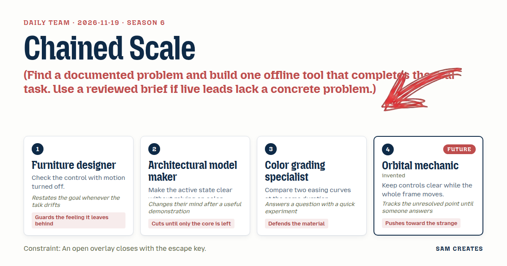
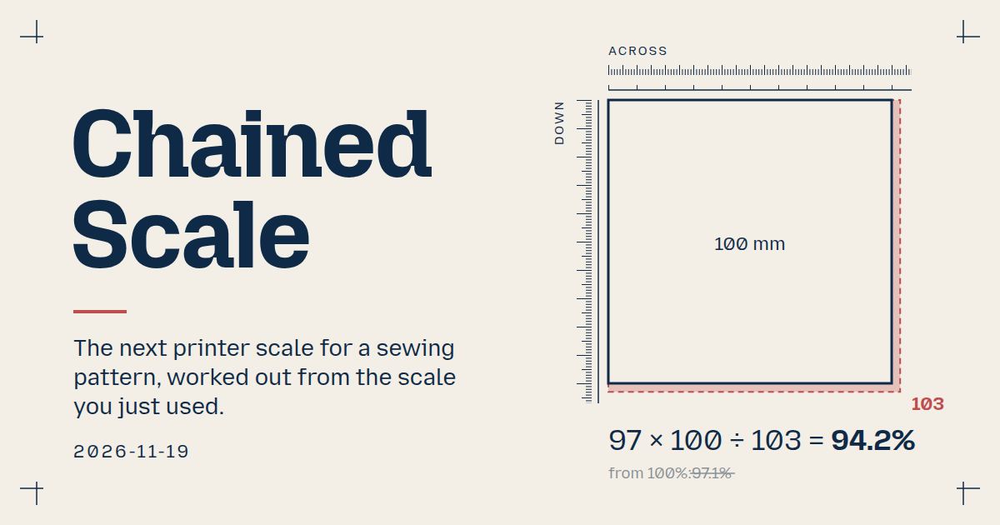
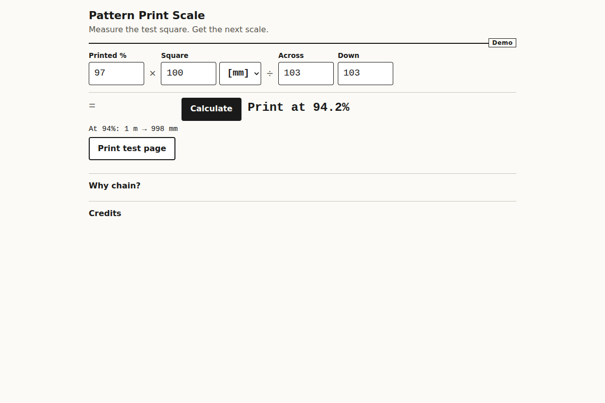

# 2026-11-19: Chained Scale

[Today](../../README.md) · [Archive](../../ARCHIVE.md)



**Task:** Find a documented problem and build one offline tool that completes the real task. Use a reviewed brief if live leads lack a concrete problem.

**Problem:** A test square printed at an adjusted scale still measures wrong, and the next scale must be calculated from the current one, not from 100%

**Improvement:** Calculating from 97% gives 94.2% where calculating from 100% gives 97.1%; the tool removes that wrong-base error and replaces guessed reprints with one calculated setting plus one test-page print

**Check:** Browser passed both inputs, error feedback and recovery.

**Constraint:** An open overlay closes with the escape key.

**Season:** 2026-11-09

**Decision:** Type how you printed and what your ruler measured.



[Cover art direction](cover.json) · [Cover source](cover.html)

## Feed evidence

- github-trending: fetched (15 items)
- smashing: fetched (12 items)
- hacker-news: fetched (20 items)
- Problem source: Calibrate printed sewing patterns — https://www.reddit.com/r/SewingForBeginners/comments/1wn8svu/

[Saved planning input](planning-input.json)

## Asset

<a href="artifact-1.html"></a>

[Use it](https://isas1.github.io/daily-team/2026-11-19/) · [artifact-1.html](artifact-1.html), led by Furniture designer. Model: claude-opus-5-5.

## The session

### Pitch

### Clash

**3 · Color grading specialist:** Quick test. Printed at 97, square should be 100 mm, measures 103 both ways. Computing from 100% gives 97.1. Computing from 97% gives 94.2. Same ruler reading, same duration of effort, two answers. Only one of them lands on 100 mm.

**4 · Orbital mechanic:** So most people will type 100 into "printed at" even after they changed it. What stops them?

**2 · Architectural model maker:** The field starts empty and the label says "Printed at." The result line stays blank until it is filled. Leaving it empty is not an option, so no one gets 100% by default.

**1 · Furniture designer:** Back to the goal. One page printed, one square checked, then the pattern. Card Window still leaves the printer scale unknown. Seam Count wastes the paper we are trying to save.

**4 · Orbital mechanic:** Card Window drops, then. But I'm holding the axis question. Paper feed stretches one direction. Across and down can differ.

**2 · Architectural model maker:** Then you get two numbers, and you are told plainly that one box cannot fix both axes. If the two axes are within half a point of each other, you get their average.

**3 · Color grading specialist:** Here is a mistake. Someone measures in centimetres and types the reading into a millimetre box. You get a scale near 900%, the printer accepts it, and the result is garbage.

**2 · Architectural model maker:** I'd planned to just compute. That demonstration changes my mind. If a measurement is under 80% or over 125% of the intended size, the result line stays empty and an error names the field, the value and the unit. Fix the field, press Calculate again, and the error clears.

### Decision

Type how you printed and what your ruler measured. You get the exact printer scale to use next.

Concept: Chained Scale

- **Architectural model maker:** the chained-scale rule and the out-of-range units check. The selected unit is marked with brackets and bold weight, so the active state does not depend on color.
- **Color grading specialist:** the 97% sample that shows the result from 100% and from 97% side by side. This sample becomes the primary case.
- **Orbital mechanic:** per-axis results and the mismatch message. In the print preview overlay, the controls stay pinned while the page preview scrolls.
- **Furniture designer:** no motion at all. The result appears in place on Calculate and the overlay appears without transition. The preview check gets the same treatment, so it leaves the user calm and sure of the next step.

### Build notes

1. Build one form on one offline HTML page with these controls:
   - `solution-printed` (number, empty at start)
   - `solution-intended` (number)
   - `solution-unit` (select, values `mm` and `in`)
   - `solution-width` (number, across)
   - `solution-height` (number, down)
   - `solution-calc` (button)
   - `solution-result` (output line)
   - `solution-detail` (output line)
   - `solution-error` (error line)

   Calculate each axis as printed × intended ÷ measured. If the two axes are within 0.5 points, average them and show the result in `solution-result` as `Print at {n}%`, with one decimal place. In `solution-detail`, show the whole-number scale and how far a 1 m piece would be off at that scale.

   Primary case: fill `solution-printed` 97, `solution-intended` 100, `solution-width` 103 and `solution-height` 103, then click `solution-calc`. `solution-result` must read `Print at 94.2%`.

2. Validate before calculating. Check across first, then down. If a measurement is under 0.8× or over 1.25× the intended size, clear `solution-result` and set `solution-error` from the template `Across {value} {unit} is far from {intended} {unit}. Check units.` Use `Down` for the height field and print numbers as parsed. A valid calculation clears `solution-error`.

3. Add `solution-print` (button). It opens `solution-preview`, a modal overlay showing a calibration page with a true 100 mm square, a 1 in square and the scale to print at. The overlay contains `solution-preview-print`, which calls `window.print()`, and `solution-preview-close`. Escape closes the overlay and returns focus to `solution-print`. Print CSS hides everything except the page. There is no animation.

```json
{"schemaVersion":1,"name":"Chained Scale","audience":"Home sewers printing PDF patterns on a home printer","problem":"A test square printed at an adjusted scale still measures wrong, and the next scale must be calculated from the current one, not from 100%","interaction":"Type printed scale, intended square size and unit, measured width and height, press Calculate, then open and print the calibration page","outcome":"Exact next scale to one decimal place, per-axis warning, whole-number box error over 1 m, and a printable calibration page","recovery":"A measurement outside 0.8 to 1.25 of the intended size blocks the result and names the field, value and unit; correcting it and pressing Calculate clears the error","mechanism":"Each axis scale is printed times intended divided by measured; axes within 0.5 points are averaged, otherwise both are shown; the result stays empty until every field is valid","difference":"Baseline is adjust, reprint and remeasure by guess. Here one calculation from the current scale gives the next setting, and the calibration page is printed in place of the pattern","whyNow":"The reviewed brief dated 2026-11-19 states the workaround and the gap; live feeds held no concrete problem; no demand figures are claimed","sourceIds":["reddit-1wn8svu"],"evidenceStatus":"sourced","proof":{"workaround":"Print at actual size, check the test square with a ruler, then adjust printer scale and print again if needed.","gap":"When the measured square is still off, calculate the exact scale from the measured and intended lengths, and give a single calibration page to print before risking the whole pattern.","improvement":"Calculating from 97% gives 94.2% where calculating from 100% gives 97.1%; the tool removes that wrong-base error and replaces guessed reprints with one calculated setting plus one test-page print"},"craft":{"rule":"Architectural model maker: chained scale ratios. The new scale multiplies the scale already used, per axis, instead of restarting at 100%. A 97% print measuring 103 of 100 mm yields 94.2%, not 97.1%","design":"Work surface is one equation line: printed % times intended over measured equals next %. Phone: inputs stacked, result and Print pinned below. Mono tabular figures, sans labels, ink on paper, one blue focus ring, red error text. Sparse, about 30 words. No motion","trial":{"start":"Fresh page, unit mm, all fields empty, result blank","action":"Printed 97, intended 100, across 103, down 103, press Calculate","result":"Result reads Print at 94.2%; detail shows whole-number 94% and the 1 m error","mistake":"User types a centimetre reading, 10.3, into across and down while the unit is mm","recovery":"Error names Across 10.3 mm; user types 103 in both, presses Calculate; error clears and Print at 94.2% returns"}},"alternatives":[{"name":"Chained Scale","need":"Next printer scale after a test print measured wrong","mechanism":"Per-axis ratio chained from the current scale, with a units check","action":"Type printed scale, intended size and measured across and down, press Calculate","result":"Exact next scale, whole-number error over 1 m, printable calibration page","rejection":"Selected: it produces the printer setting the brief asks for and stops the wrong-base and wrong-unit errors"},{"name":"Card Window","need":"Check paper size without a ruler","mechanism":"User matches a box to a bank card to set screen pixels per mm, then shows a true-size square","action":"Drag box edges to match a card held against the screen","result":"True-size square on screen to lay paper against","rejection":"Rejected: screen calibration drifts between devices and still yields no printer scale"},{"name":"Seam Count","need":"Find which tile slipped in a taped pattern","mechanism":"Cumulative drift computed from the gap typed at each seam","action":"Type measured gap at each seam of assembled tiles","result":"Tile that is off and its offset in mm","rejection":"Rejected: it needs the whole pattern printed first, which wastes the paper the brief aims to save"}],"cases":[{"phase":"primary","steps":[{"action":"fill","target":"solution-printed","value":"97"},{"action":"fill","target":"solution-intended","value":"100"},{"action":"fill","target":"solution-width","value":"103"},{"action":"fill","target":"solution-height","value":"103"},{"action":"click","target":"solution-calc"}],"expect":{"target":"solution-result","text":"Print at 94.2%"}},{"phase":"alternate","steps":[{"action":"select","target":"solution-unit","value":"in"},{"action":"fill","target":"solution-printed","value":"100"},{"action":"fill","target":"solution-intended","value":"4"},{"action":"fill","target":"solution-width","value":"4.125"},{"action":"fill","target":"solution-height","value":"4.125"},{"action":"click","target":"solution-calc"}],"expect":{"target":"solution-result","text":"Print at 97.0%"}},{"phase":"mistake","steps":[{"action":"fill","target":"solution-printed","value":"97"},{"action":"fill","target":"solution-intended","value":"100"},{"action":"fill","target":"solution-width","value":"10.3"},{"action":"fill","target":"solution-height","value":"10.3"},{"action":"click","target":"solution-calc"}],"expect":{"target":"solution-error","text":"Across 10.3 mm is far from 100 mm. Check units."}},{"phase":"recovery","steps":[{"action":"fill","target":"solution-width","value":"103"},{"action":"fill","target":"solution-height","value":"103"},{"action":"click","target":"solution-calc"}],"expect":{"target":"solution-result","text":"Print at 94.2%"}}]}
```

**Guest:** Orbital mechanic (future; invented). The method is drawn from public-domain history, myth, or literature, or invented. The guest speaks in character in original words, never quoting the source, and nothing here is endorsed by anyone.

## Team

```text
Team for 2026-11-19
Season: 2026-11-09

1. Furniture designer
   Method: Check the control with motion turned off.
   Stance: Guards the feeling it leaves behind.
   Temperament: Restates the goal whenever the talk drifts.
2. Architectural model maker
   Method: Make the active state clear without relying on color.
   Stance: Cuts until only the core is left.
   Temperament: Changes their mind after a useful demonstration.
3. Color grading specialist
   Method: Compare two easing curves at the same duration.
   Stance: Defends the material.
   Temperament: Answers a question with a quick experiment.
4. Orbital mechanic (future; invented) [guest]
   Method: Keep controls clear while the whole frame moves.
   Stance: Pushes toward the strange.
   Temperament: Tracks the unresolved point until someone answers.

Constraint: An open overlay closes with the escape key.
Task: Folder trail: breadcrumbs for a file browser that show the current folder and let someone return to a parent.
```

Provider: claude. Model: claude-opus-5-5.
