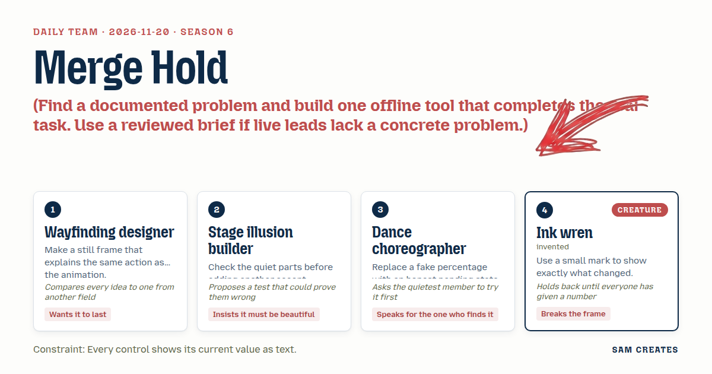

# 2026-11-20: Merge Hold

[Today](../../README.md) · [Archive](../../ARCHIVE.md)



**Task:** Find a documented problem and build one offline tool that completes the real task. Use a reviewed brief if live leads lack a concrete problem.

**Run result:** browser alternate failed: solution-result did not show the expected visible result after the saved steps

**Constraint:** Every control shows its current value as text.

**Season:** 2026-11-09

**Decision:** Paste two lists, press Compare, settle each doubtful pair, then download one clean list.

## Feed evidence

- github-trending: fetched (13 items)
- smashing: fetched (12 items)
- hacker-news: fetched (20 items)
- Problem source: Review possible duplicates before merging two lists — https://www.reddit.com/r/excel/comments/1xxlhji/

[Saved planning input](planning-input.json)

## Asset

artifact-1.html: no asset. browser alternate failed: solution-result did not show the expected visible result after the saved steps

## The session

### Pitch

### Clash

**3 · Dance choreographer:** Wren, you've said nothing. Try it first. Here's the sample: master has 101 Ana Ruiz and 102 Jon Park.

**4 · Ink wren:** Numbers first. How many pending rows before you'd give up?

**2 · Stage illusion builder:** Thirty. And here's a test that could sink me: paste the master into the import. If one row lands in Review, the quiet part is broken.

**1 · Wayfinding designer:** Five per screen, like gate numbers. More than that and nobody reads the board.

**4 · Ink wren:** Then I'll try it. Import 103 Ana Ruiz: the same name, a different ID. It goes to Review and isn't merged. Import 102 John Park: the same ID, and the mark sits under the "h", only there. Now I know what changed.

**1 · Wayfinding designer:** I see a mistake. Someone copies rows from Excel without the header line. The first data row becomes the header, there's no id column, and every row reads as junk.

**3 · Dance choreographer:** Then the error should say what it read. "First row read as header: 103,Ana Ruiz." Then they see it straight away.

**2 · Stage illusion builder:** And the fix is to paste again with the header row and press Compare. The page shouldn't need a reload, and the earlier error should clear.

### Decision

Paste two lists, press Compare, settle each doubtful pair, then download one clean list.

Concept: Merge Hold

- **Ink wren:** per-character marks. Inserted characters are underlined and removed characters are struck, so "Jon" → "John" marks only the `h`. This replaces any similarity score.
- **Dance choreographer:** the rule. Review pairs start at Pending. The merged row count and Download stay withheld until Pending is 0.
- **Wayfinding designer:** the pair frame. Master row over import row, IDs aligned in a fixed left column, and `=` or `≠` between the two IDs.
- **Stage illusion builder:** quiet Same rows, which appear only as a count. The self-paste test also becomes a check: pasting the master into the import must produce 0 Review.
- **Mistake fix from the Clash:** the error message quotes the first row it treated as the header.

Matching:

| Import row compared to master | Lane |
|---|---|
| Same ID, same name after normalizing | Same |
| Same ID, different name | Review |
| Different ID, name within edit distance 2 after normalizing | Review |
| Anything else | New |

Names are normalized by setting lowercase, trimming, collapsing spaces and stripping punctuation.

Pair options:

- Pending
- Keep master
- Use import
- Keep both (disabled when the two IDs are equal)

### Build notes

1. **Parser and matcher.** Write a CSV/TSV parser that handles quoted fields. Header names are matched case-insensitively. The key select `solution-key` lists the master headers and defaults to `id`. If the import has no key column, show this in `solution-error`: "Import has no id column. First row read as header: …". Each new Compare clears the error. Classify rows using the matching table above.
2. **Review lane and summary.**
   - Render pairs in import order as `solution-pair1`, `solution-pair2` and so on.
   - Each pair is a native select with the four options. The select shows its option text.
   - Use mono for row text, with the wren marks on changed characters.
   - Write the summary to `solution-result` as "New n, Same n, Review n, Pending n." When Pending is 0, add " Merged n rows."
3. **Gated export.**
   - `solution-download` shows "Download waits: n pending" while it is disabled and "Download merged.csv (n rows)" once enabled. It writes the master rows, then the New rows, then the decided import rows.
   - `solution-copy` copies the same CSV.
   - Save both textareas to localStorage.

Control IDs:

- `solution-master`
- `solution-import`
- `solution-key`
- `solution-compare`
- `solution-pairN`
- `solution-result`
- `solution-error`
- `solution-download`
- `solution-copy`

First case, from a fresh page:

1. Fill `solution-master` with `id,name\n101,Ana Ruiz\n102,Jon Park`.
2. Fill `solution-import` with `id,name\n103,Ana Ruiz\n102,John Park\n104,Mei Lin`.
3. Select `id` in `solution-key`.
4. Click `solution-compare`.
5. Select "Keep both" in `solution-pair1`.
6. Select "Use import" in `solution-pair2`.

Expected `solution-result`: "New 1, Same 0, Review 2, Pending 0. Merged 4 rows."

```json
{"schemaVersion":1,"name":"Merge Hold","audience":"Spreadsheet beginners who merge a recurring import of hundreds of rows into a master list","problem":"Near-duplicate rows reach the master list because fuzzy matching auto-joins or misses them, and records with the same name but different IDs get merged by mistake","interaction":"Paste master and import lists, press Compare, set each Review pair from Pending to Keep master, Use import or Keep both, then download or copy the merged CSV","outcome":"A merged.csv in which every ambiguous row was decided by the person, with counts of New, Same and Review rows","recovery":"A missing key column shows an error quoting the first row read as the header; pasting again with the header and pressing Compare clears it without a reload","mechanism":"Rows split into Same (same ID and normalized name), Review (same ID with a different name, or a different ID with a name within edit distance 2) and New. Review pairs start Pending, and the merged count and Download stay withheld until Pending is 0","difference":"Power Query fuzzy merge joins rows above a similarity threshold and leaves review to a separate manual pass. Here there is no threshold or score: each doubtful pair is shown with character marks and needs one select change, and the file cannot be exported while a pair is undecided","whyNow":"Reviewed brief from 2026-11-19 describes recurring imports and a macro or Power Query workaround. Live feeds held no concrete list-merge problem. No demand or market data is claimed","sourceIds":["reddit-1xxlhji"],"evidenceStatus":"sourced","proof":{"workaround":"Maintain a workbook macro or set up Power Query, then review potential matches before writing them to the master list","gap":"No reusable offline review step that takes pasted rows, queues near matches and keeps IDs and same-name records distinct until the user decides, then downloads the merged result","improvement":"Four actions (paste, Compare, set each pair, Download) with no macro or query setup, and Download is disabled while any pair is Pending, so an undecided near match cannot be written silently"},"craft":{"rule":"Dance choreographer: an honest pending state replaces a fake percentage. No similarity score is shown. Every Review pair starts Pending, and the merged count and Download stay withheld until Pending is 0. Surprise: 103 Ana Ruiz stays Pending beside 101 Ana Ruiz because the IDs differ.","design":"Work surface is the review lane: master row over import row, IDs in a fixed left column with = or ≠. Phone: summary line, pairs, then a pinned Download; inputs collapse after Compare. Mono rows, sans labels, ink on paper, amber Pending, blue decided, red error. Sparse, about 38 words. No motion.","trial":{"start":"Master: 101 Ana Ruiz, 102 Jon Park. Import: 103 Ana Ruiz, 102 John Park, 104 Mei Lin. Key: id","action":"Press Compare, set pair 1 to Keep both and pair 2 to Use import","result":"Summary reads New 1, Same 0, Review 2, Pending 0. Merged 4 rows. The h in John is underlined. Download shows merged.csv (4 rows)","mistake":"Import pasted without its header row: 103,Ana Ruiz then 104,Mei Lin","recovery":"The error quotes 103,Ana Ruiz as the header read. Paste again with the id,name header and press Compare: the error clears, 1 New and 1 Review appear, and Keep master gives Merged 3 rows"}},"alternatives":[{"name":"Merge Hold","need":"Decide ambiguous matches before they reach the master list","mechanism":"Rows split into three lanes, and Pending pairs gate the export","action":"Paste both lists and press Compare","result":"Review pairs with character marks, a lane-count summary, and a merged.csv once Pending reaches 0","rejection":"Selected: it addresses the brief's stated gap (review queue, IDs kept distinct, downloadable merge) in four actions"},{"name":"Field Picker","need":"Combine differing field values across rows already matched by ID","mechanism":"Rows are matched on ID only, and each cell is chosen per field","action":"Click the winning cell in each column of a matched pair","result":"One composite row per match, ready to replace the master row","rejection":"It skips the near-match question the brief names as the hard part, and different-ID duplicates pass through unseen"},{"name":"Decision Memory","need":"Avoid deciding the same near pair every month","mechanism":"Past decisions are stored in localStorage and auto-applied to the next import","action":"Load a new import against saved decisions","result":"A queue that shrinks each month, with auto-decided rows listed","rejection":"No gain on first use, and an auto-applied decision could hide a new ID conflict that the brief wants kept distinct"}],"cases":[{"phase":"primary","steps":[{"action":"fill","target":"solution-master","value":"id,name\n101,Ana Ruiz\n102,Jon Park"},{"action":"fill","target":"solution-import","value":"id,name\n103,Ana Ruiz\n102,John Park\n104,Mei Lin"},{"action":"select","target":"solution-key","value":"id"},{"action":"click","target":"solution-compare"},{"action":"select","target":"solution-pair1","value":"Keep both"},{"action":"select","target":"solution-pair2","value":"Use import"}],"expect":{"target":"solution-result","text":"New 1, Same 0, Review 2, Pending 0. Merged 4 rows."}},{"phase":"alternate","steps":[{"action":"fill","target":"solution-master","value":"id,name\n101,Ana Ruiz\n102,Jon Park"},{"action":"fill","target":"solution-import","value":"id,name\n101,ana ruiz\n102,Jon  Park."},{"action":"click","target":"solution-compare"}],"expect":{"target":"solution-result","text":"New 0, Same 2, Review 0, Pending 0. Merged 2 rows."}},{"phase":"mistake","steps":[{"action":"fill","target":"solution-master","value":"id,name\n101,Ana Ruiz\n102,Jon Park"},{"action":"fill","target":"solution-import","value":"103,Ana Ruiz\n104,Mei Lin"},{"action":"click","target":"solution-compare"}],"expect":{"target":"solution-error","text":"Import has no id column. First row read as header: 103,Ana Ruiz."}},{"phase":"recovery","steps":[{"action":"fill","target":"solution-import","value":"id,name\n103,Ana Ruiz\n104,Mei Lin"},{"action":"click","target":"solution-compare"},{"action":"select","target":"solution-pair1","value":"Keep master"}],"expect":{"target":"solution-result","text":"New 1, Same 0, Review 1, Pending 0. Merged 3 rows."}}]}
```

**Guest:** Ink wren (creature; invented). The method is drawn from public-domain history, myth, or literature, or invented. The guest speaks in character in original words, never quoting the source, and nothing here is endorsed by anyone.

## Team

```text
Team for 2026-11-20
Season: 2026-11-09

1. Wayfinding designer
   Method: Make a still frame that explains the same action as the animation.
   Stance: Wants it to last.
   Temperament: Compares every idea to one from another field.
2. Stage illusion builder
   Method: Check the quiet parts before adding another accent.
   Stance: Insists it must be beautiful.
   Temperament: Proposes a test that could prove them wrong.
3. Dance choreographer
   Method: Replace a fake percentage with an honest pending state.
   Stance: Speaks for the one who finds it.
   Temperament: Asks the quietest member to try it first.
4. Ink wren (creature; invented) [guest]
   Method: Use a small mark to show exactly what changed.
   Stance: Breaks the frame.
   Temperament: Holds back until everyone has given a number.

Constraint: Every control shows its current value as text.
Task: Download button: a button for a file panel that shows preparation, completion and a repeat action in a local demo.
```

Provider: claude. Model: claude-opus-5-5.
