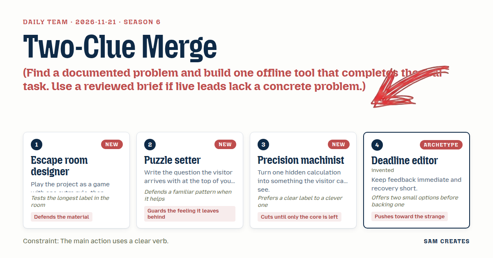

# 2026-11-21: Two-Clue Merge

[Today](../../README.md) · [Archive](../../ARCHIVE.md)



**Task:** Find a documented problem and build one offline tool that completes the real task. Use a reviewed brief if live leads lack a concrete problem.

**Run result:** browser mistake failed: solution-error did not show the expected visible result after the saved steps

**Constraint:** The main action uses a clear verb.

**Season:** 2026-11-09

**Decision:** Paste your master list and a new import, press Check import, and each row is sorted for you.

## Feed evidence

- github-trending: fetched (13 items)
- smashing: fetched (12 items)
- hacker-news: fetched (20 items)
- Problem source: Review possible duplicates before merging two lists — https://www.reddit.com/r/excel/comments/1xxlhji/

[Saved planning input](planning-input.json)

## Asset

artifact-1.html: no asset. browser mistake failed: solution-error did not show the expected visible result after the saved steps

## The session

### Pitch

### Clash

**3 · Precision machinist:** Trying it. Master has `88,Liu Wen`. Import has `91,Liu Wen` and `88,Liu Wen`. Check import. Row 88 is a duplicate, both clues lit. Row 91 goes to review: the name cell agrees, the ID cell differs. Correct.

**1 · Escape room designer:** And with the rule removed, row 91 would vanish into the duplicate pile. That's the surprise a person can explain: the same name, still kept apart.

**2 · Puzzle setter:** Here's the mistake. Someone in a hurry sets row 91 to Same record. If Liu Wen 91 is a different person, they're gone from the merge.

**4 · Deadline editor:** Two fixes. One: block Same record when the IDs differ. Two: allow it, but record the import ID in a `merged_ids` column so the merge can be traced and reversed. I back two. Blocking forces a workaround.

**2 · Puzzle setter:** Then the select must flip back to Keep both and the counts must change at once. No confirm dialog. The familiar pattern helps here.

**3 · Precision machinist:** Keep one line for the outcome: counts of new, duplicate and to review. Nothing else above the queue.

**1 · Escape room designer:** The longest label is "Download merged CSV". It stays. It says exactly what leaves the page.

**4 · Deadline editor:** Agreed. Review rows start Undecided, and Download stays disabled while any row is Undecided.

### Decision

Paste your master list and a new import, press Check import, and each row is sorted for you.

**Concept: Two-Clue Merge**

**Contributions:**

- **Escape room designer:** the two-clue rule. ID and name must both agree before a row counts as a duplicate.
- **Puzzle setter:** the heading question. It also caught the hurried-merge mistake that led to `merged_ids`.
- **Precision machinist:** the per-row clue cells, which show ID agreement and the name edit distance.
- **Deadline editor:** the Same record and Keep both select, instant recount, and Download disabled until the queue is resolved.

### Build notes

**1. Parse and validate.**

- Parse `solution-master` and `solution-import` as comma or tab separated text with a header row.
- Find the ID and Name columns case-insensitively.
- On failure, write the error to `solution-error` and leave `solution-summary` unchanged.
- Normalize names by trimming, lowercasing, collapsing spaces and stripping punctuation.

**2. Classify on `solution-check` click.**

- **Duplicate:** the ID and the normalized name both match a master row.
- **Review:** the ID matches but the name differs, or the ID is new but the name is within edit distance 2 of a master name.
- **New:** everything else.
- Render review rows in `solution-queue`. Each row shows clue cells and has a select `solution-pick-N`, numbered from 1, with three options: Undecided, Same record, Keep both.
- Write "{n} new, {d} duplicate, {r} to review" to `solution-summary`. Keep both counts as new. Same record counts as duplicate.

**3. Build the download.**

- `solution-download` builds the merged CSV from three parts: master rows, new rows, and Keep both rows.
- For each Same record pick, append the import ID to that master row's `merged_ids` column.
- Disable the button while any pick is Undecided.

**First case:**

- **Master:** `ID,Name / 104,Ana Ruiz / 205,Ben Okafor`.
- **Import:** `ID,Name / 104,Ana Ruiz / 233,Ana Ruiz / 310,Cara Lind`.
- **Action:** click `solution-check`.
- **Expected `solution-summary`:** "1 new, 1 duplicate, 1 to review".

```json
{"schemaVersion":1,"name":"Two-Clue Merge","audience":"Spreadsheet beginners who screen recurring imports of hundreds of rows against a master list","problem":"Merging an import into a master list either drops same-name people with different IDs or needs a macro or Power Query setup before any review can happen","interaction":"Paste master list and import, press Check import, set Same record or Keep both on each review row, press Download merged CSV","outcome":"Every import row is counted as new, duplicate or to review, and a merged CSV downloads with merged_ids recording each confirmed merge","recovery":"A wrong pick is changed back in its select and the counts update at once; a missing ID column shows an error and a corrected paste re-checks","mechanism":"Two-clue classification: ID and normalized name must both match for a duplicate; one matching clue or a name within edit distance 2 sends the row to review; review rows block download until decided","difference":"Remove Duplicates on Name drops a same-name person with a new ID, and Power Query needs a built query; here two pastes and one click queue that row for review instead","whyNow":"Reviewed brief from 2026-11-19 describes the recurring import task and its macro or Power Query workaround; live feeds that day held no concrete list-merge problem; no demand data is claimed","sourceIds":["reddit-1xxlhji"],"evidenceStatus":"sourced","proof":{"workaround":"Maintain a workbook macro or set up Power Query, then review potential matches before writing them to the master list","gap":"No reusable offline review step with pasted rows, a near-match queue and a merged download that keeps IDs and same-name records distinct until the user decides","improvement":"A same-name row with a different ID goes to the review queue instead of being deleted by Remove Duplicates on Name, and no query or macro setup step is needed before review"},"craft":{"rule":"Escape room designer: one extra rule, two clues must agree. A row becomes a duplicate only when ID and normalized name both match; one clue alone moves it to review. Removing the rule lets same-name rows with new IDs fall into duplicates and vanish from the merge","design":"Work surface: review queue rows with ID and name clue cells side by side. Phone: question, Import, Check import, summary, queue, Download; master list collapses above. Mono for IDs and rows, sans labels. Ink on paper, amber review rows, gray duplicates. Sparse, under 40 words. No motion","trial":{"start":"Fresh page. Master: ID,Name then 88,Liu Wen. Import: ID,Name then 91,Liu Wen and 88,Liu Wen","action":"Press Check import, then set the select on row 91 to Same record","result":"Summary reads 0 new, 1 duplicate, 1 to review, then 0 new, 2 duplicate, 0 to review; row 88 in the CSV gets merged_ids 91","mistake":"Liu Wen 91 is a different person, and the hurried Same record pick folds them into master row 88","recovery":"Change the row 91 select to Keep both; the summary returns to 1 new, 1 duplicate, 0 to review and the CSV lists 91,Liu Wen as its own row with merged_ids empty"}},"cases":[{"phase":"primary","steps":[{"action":"fill","target":"solution-master","value":"ID,Name\n104,Ana Ruiz\n205,Ben Okafor"},{"action":"fill","target":"solution-import","value":"ID,Name\n104,Ana Ruiz\n233,Ana Ruiz\n310,Cara Lind"},{"action":"click","target":"solution-check"}],"expect":{"target":"solution-summary","text":"1 new, 1 duplicate, 1 to review"}},{"phase":"alternate","steps":[{"action":"fill","target":"solution-master","value":"ID,Name\n104,Ana Ruiz\n205,Ben Okafor"},{"action":"fill","target":"solution-import","value":"ID,Name\n205,Ben Okafor\n411,Dev Patel\n412,Eli Moss"},{"action":"click","target":"solution-check"}],"expect":{"target":"solution-summary","text":"2 new, 1 duplicate, 0 to review"}},{"phase":"mistake","steps":[{"action":"fill","target":"solution-master","value":"ID,Name\n104,Ana Ruiz\n205,Ben Okafor"},{"action":"fill","target":"solution-import","value":"Name\nAna Ruiz"},{"action":"click","target":"solution-check"}],"expect":{"target":"solution-error","text":"Import needs an ID column."}},{"phase":"recovery","steps":[{"action":"fill","target":"solution-import","value":"ID,Name\n233,Ana Ruiz"},{"action":"click","target":"solution-check"},{"action":"select","target":"solution-pick-1","value":"Keep both"}],"expect":{"target":"solution-summary","text":"1 new, 0 duplicate, 0 to review"}}],"alternatives":[{"name":"Two-Clue Merge","need":"Screen an import against a master list without losing same-name people","mechanism":"ID and name must both agree for a duplicate; single-clue or near-name rows queue for a Same record or Keep both pick","action":"Paste master list and import, press Check import","result":"Counts of new, duplicate and to review, a queue showing which clues agree, and a merged CSV with merged_ids","rejection":"Selected: two pastes and one click, and no same-name row with a new ID is dropped without a decision"},{"name":"Match Ladder","need":"Tune how loose fuzzy name matching should be","mechanism":"Similarity score per pair against a draggable threshold line","action":"Paste both lists and drag the similarity threshold slider","result":"Ranked pair list with a line marking which pairs count as matches","rejection":"Rejected: the beginner must pick a number, IDs are ignored, and no merged list is produced"},{"name":"Merge Diff Sheet","need":"Sign off an import on paper before merging","mechanism":"Side-by-side diff with matched and added rows shaded, print stylesheet","action":"Paste both lists and press Diff, then print","result":"Printable sheet marking matched and added rows","rejection":"Rejected: no decisions are stored and no merged result can be downloaded"}]}
```

**Guest:** Deadline editor (archetype; invented). The method is drawn from public-domain history, myth, or literature, or invented. The guest speaks in character in original words, never quoting the source, and nothing here is endorsed by anyone.

## Team

```text
Team for 2026-11-21
Season: 2026-11-09

1. Escape room designer [new]
   Method: Play the project as a game with one extra rule, then remove the rule. [new]
   Stance: Defends the material.
   Temperament: Tests the longest label in the room.
2. Puzzle setter [new]
   Method: Write the question the visitor arrives with at the top of your notes. [new]
   Stance: Guards the feeling it leaves behind.
   Temperament: Defends a familiar pattern when it helps.
3. Precision machinist
   Method: Turn one hidden calculation into something the visitor can see. [new]
   Stance: Cuts until only the core is left.
   Temperament: Prefers a clear label to a clever one.
4. Deadline editor (archetype; invented) [guest]
   Method: Keep feedback immediate and recovery short.
   Stance: Pushes toward the strange.
   Temperament: Offers two small options before backing one.

Constraint: The main action uses a clear verb.
Task: Task selection: a checkbox for a task list that selects one task or shows a partly selected group.
```

Provider: claude. Model: claude-opus-5-5.
