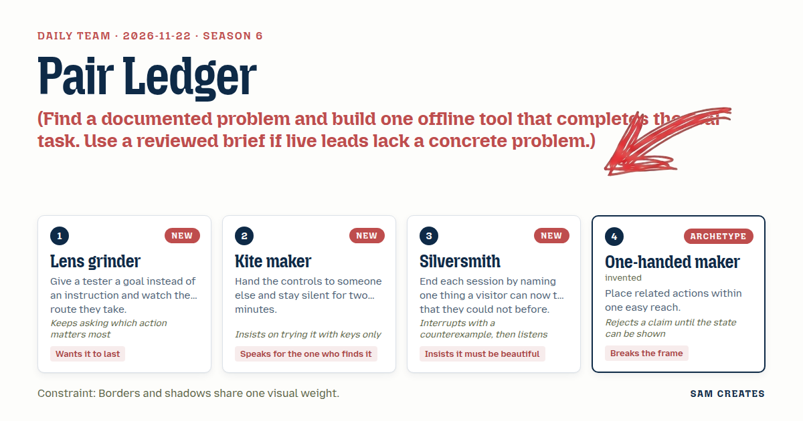

# 2026-11-22: Pair Ledger

[Today](../../README.md) · [Archive](../../ARCHIVE.md)



**Task:** Find a documented problem and build one offline tool that completes the real task. Use a reviewed brief if live leads lack a concrete problem.

**Run result:** browser mistake failed: solution-error did not show the expected visible result after the saved steps

**Constraint:** Borders and shadows share one visual weight.

**Season:** 2026-11-09

**Decision:** Paste two lists, press Compare, and decide each near match before downloading one clean list.

## Feed evidence

- github-trending: fetched (13 items)
- smashing: fetched (12 items)
- hacker-news: fetched (20 items)
- Problem source: Review possible duplicates before merging two lists — https://www.reddit.com/r/excel/comments/1xxlhji/

[Saved planning input](planning-input.json)

## Asset

artifact-1.html: no asset. browser mistake failed: solution-error did not show the expected visible result after the saved steps

## The session

### Pitch

### Clash

**1 · Lens grinder:** Goal only, no instructions. I told the tester "make one clean list." Master was Dana Ruiz and Lee Park. The import had Lee Park twice with no ID, plus Lee Park with ID 310. Which action matters most here?

**2 · Kite maker:** I handed over the keyboard and said nothing for two minutes. Tab, Compare, Tab into the queue. She pressed Same record once and both no-ID Lee Parks cleared. She said "oh, they were the same row twice." Then she pressed Same record on the 310 row as well.

**4 · One-handed maker:** That's the mistake. 310 is not 102. You merged a distinct person. Show me the state that tells her so before she clicks, or I don't accept that the queue works.

**3 · Silversmith:** Counterexample. Two different people can share a name in one list. So the pair has to carry its proof: "310 ≠ 102" in mono, on the same line as the buttons. It should read like a hallmark stamped on the piece.

**4 · One-handed maker:** And one reach. Same record, Different and Undo sit on that pair's line. One decision applies to every queued row with the same no-ID name and the same master target. Rows with their own ID never group. Each ID gets its own decision.

**1 · Lens grinder:** It has to last past today. Undo returns the pair to the queue and the count goes back up. Download stays disabled while anything is still in review.

**2 · Kite maker:** Keys only, confirmed. Every pair uses native buttons in reading order. Nothing depends on drag or hover.

**3 · Silversmith:** Last line after download: "Next import: paste this file as Master." Then she knows what she can do tomorrow.

### Decision

Paste two lists, press Compare, and decide each near match before downloading one clean list.

Concept: Pair Ledger

- **Lens grinder:** Goal-only trial. Compare is the single primary action. Download stays disabled until the review count reaches 0.
- **Kite maker:** Silent-handoff trial that found the wrong merge. Keyboard-only order through native buttons.
- **Silversmith:** The "310 ≠ 102" ID stamp on each pair. One hairline weight for borders and shadows. The next-import line shown after download.
- **One-handed maker:** The one-reach rule. Decision, Undo and ID proof sit on one line. One decision clears every no-ID repeat of a pair. Rows with an ID are never grouped.

### Build notes

1. **Parse and sort.** Parse `solution-master` and `solution-import` as comma- or tab-separated text. Require a header row containing ID and Name in any case. Normalize names by trimming, lowercasing, collapsing spaces and stripping punctuation. Sort each import row into one of three outcomes:
   - ID match: drop.
   - New ID with no name match: append.
   - Name match with an empty or different ID: queue.

   Group queued no-ID rows by normalized name plus master ID. Never group rows that have an ID. If the header is missing, write an error naming the missing header to `solution-error` and keep the pasted text.
2. **Queue and result.** Render the queue in `solution-queue` as one line per group, numbered N from 1. Each line shows:
   - the import cells and the master cells,
   - an ID stamp in mono,
   - native buttons `solution-same-N`, `solution-different-N` and `solution-undo-N`.

   Same record fills blank master fields and drops the import rows. Different appends them. Undo restores the group. After `solution-compare` and after every decision, write `Rows: {N}. To review: {K}.` to `solution-result`. Enable `solution-download` only when K is 0. Download writes a CSV with the union of all columns and shows the next-import line.
3. **Style and first case.** Use 1px borders and `0 1px 0` shadows in the same ink at 18% opacity. Use mono for cells and IDs and sans for labels. Amber marks the to-review count, red marks errors and blue is the focus ring. Decided lines fold in 120ms, and nothing else moves. First case: fill `solution-master` with `ID,Name\n101,Dana Ruiz\n102,Lee Park` and `solution-import` with `ID,Name\n102,Lee Park\n103,Ana Gil`. Click `solution-compare`. Expect `solution-result` to read `Rows: 3. To review: 0.`

```json
{"schemaVersion":1,"name":"Pair Ledger","audience":"Spreadsheet beginners who merge recurring imports of hundreds of rows into one master list","problem":"Near-duplicate rows (same name, missing or different ID) must be reviewed before merging, and today that needs a macro or Power Query setup first","interaction":"Paste master and import rows, press Compare, press Same record or Different on each queued pair, then Download CSV","outcome":"A rows and review count that updates per decision, and a downloadable merged CSV with every column once nothing is left to review","recovery":"Undo on any decided pair returns it to the queue and raises the review count; a missing header shows an error and keeps the pasted text","mechanism":"ID matches drop, new IDs append, name-only matches queue as pairs; no-ID repeats of one name and master target share a single decision; rows with their own ID always get their own pair","difference":"Baseline is a workbook macro or Power Query merge followed by manual review. Here there is no query or macro setup, and identical no-ID repeats clear with one decision instead of one per row","whyNow":"Reviewed brief reddit-1xxlhji (2026-11-19) states the problem and workaround. Live feed items on 2026-11-22 are releases and news with no stated user problem. No demand data beyond the brief","sourceIds":["reddit-1xxlhji"],"evidenceStatus":"sourced","proof":{"workaround":"Maintain a workbook macro or set up Power Query, then review potential matches before writing them to the master list.","gap":"No reusable offline review step that takes pasted rows, queues near matches, keeps IDs and same-name records distinct until decided, and downloads the merged result.","improvement":"Pasting both lists and pressing Compare replaces building a query or macro; repeated no-ID rows for one name and master target clear with one click instead of one click per row; download is blocked until review count is 0."},"craft":{"rule":"One-handed maker, related actions within one reach: decision, Undo and ID stamp share one pair line, and one decision applies to every queued no-ID row with the same name and master target. Rows with an ID never group, so one click can clear two rows yet never merge two IDs","design":"Surface: pair ledger, import row left, master right, ID stamp and buttons between. Phone: inputs stacked, Compare, count, queue, Download pinned. Mono cells and IDs, sans labels. Ink on paper, amber count, red error, blue focus. Border and shadow 1px, 18% ink. Motion: 120ms fold","trial":{"start":"Master: ID,Name / 101,Dana Ruiz / 102,Lee Park. Import: ID,Name / ,Lee Park / ,lee park / 310,Lee Park","action":"Press Compare, then Same record on the no-ID Lee Park pair","result":"Both no-ID rows clear with one click; count reads Rows: 2. To review: 1. The 310 pair remains with stamp 310 ≠ 102","mistake":"Pressing Same record on the 310 pair, merging a distinct person into 102","recovery":"Press Undo on that pair; it returns to the queue, count reads Rows: 2. To review: 1., then press Different to reach Rows: 3. To review: 0."}},"cases":[{"phase":"primary","steps":[{"action":"fill","target":"solution-master","value":"ID,Name\n101,Dana Ruiz\n102,Lee Park"},{"action":"fill","target":"solution-import","value":"ID,Name\n102,Lee Park\n103,Ana Gil"},{"action":"click","target":"solution-compare"}],"expect":{"target":"solution-result","text":"Rows: 3. To review: 0."}},{"phase":"alternate","steps":[{"action":"fill","target":"solution-master","value":"ID,Name\n101,Dana Ruiz"},{"action":"fill","target":"solution-import","value":"ID,Name\n,dana ruiz\n,Dana  Ruiz.\n205,Dana Ruiz"},{"action":"click","target":"solution-compare"},{"action":"click","target":"solution-same-1"}],"expect":{"target":"solution-result","text":"Rows: 1. To review: 1."}},{"phase":"mistake","steps":[{"action":"fill","target":"solution-master","value":"ID,Name\n101,Dana Ruiz"},{"action":"fill","target":"solution-import","value":"103,Ana Gil"},{"action":"click","target":"solution-compare"}],"expect":{"target":"solution-error","text":"Import needs a header row with ID and Name."}},{"phase":"recovery","steps":[{"action":"fill","target":"solution-import","value":"ID,Name\n103,Ana Gil"},{"action":"click","target":"solution-compare"}],"expect":{"target":"solution-result","text":"Rows: 2. To review: 0."}}],"alternatives":[{"name":"Pair Ledger","need":"Review name-only matches before they reach the master list, keeping distinct IDs apart","mechanism":"ID match drops, new ID appends, name-only match queues as a pair; no-ID repeats share one decision","action":"Paste master and import, press Compare, decide each pair","result":"Live Rows and To review count, ID stamp per pair, merged CSV download once review is 0","rejection":"Selected: it is the only direction that both queues near matches and keeps same-name, different-ID records apart until the user decides"},{"name":"Key Diff","need":"See what an import adds or changes by one key column","mechanism":"Exact key comparison into Added, Changed and Missing bands","action":"Pick the key column and paste both lists","result":"Three bands of rows with changed cells marked","rejection":"Rejected: exact keys never surface a row with a missing ID and a matching name, which is the case the brief describes"},{"name":"Score Slider","need":"Merge fuzzy duplicates without row-by-row review","mechanism":"Name similarity score with a draggable auto-merge threshold","action":"Drag the threshold slider","result":"Merged list redraws with pairs above the threshold combined","rejection":"Rejected: it removes the review the brief asks for and would merge two people who share a name"}]}
```

**Guest:** One-handed maker (archetype; invented). The method is drawn from public-domain history, myth, or literature, or invented. The guest speaks in character in original words, never quoting the source, and nothing here is endorsed by anyone.

## Team

```text
Team for 2026-11-22
Season: 2026-11-09

1. Lens grinder
   Method: Give a tester a goal instead of an instruction and watch the route they take. [new]
   Stance: Wants it to last.
   Temperament: Keeps asking which action matters most.
2. Kite maker [new]
   Method: Hand the controls to someone else and stay silent for two minutes. [new]
   Stance: Speaks for the one who finds it.
   Temperament: Insists on trying it with keys only.
3. Silversmith
   Method: End each session by naming one thing a visitor can now try that they could not before. [new]
   Stance: Insists it must be beautiful.
   Temperament: Interrupts with a counterexample, then listens.
4. One-handed maker (archetype; invented) [guest]
   Method: Place related actions within one easy reach.
   Stance: Breaks the frame.
   Temperament: Rejects a claim until the state can be shown.

Constraint: Borders and shadows share one visual weight.
Task: Unread count: a badge for an inbox that updates when messages arrive or someone marks them read.
```

Provider: claude. Model: claude-opus-5-5.
