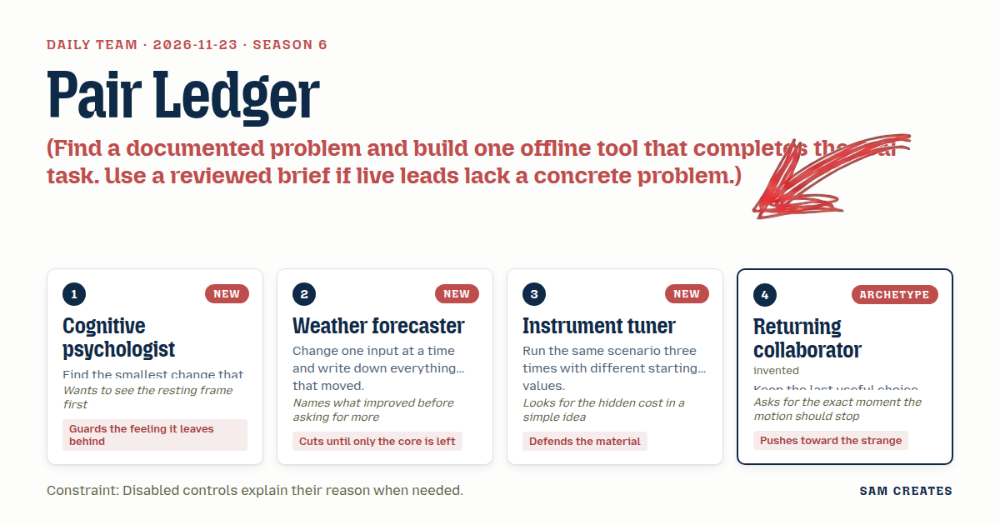

# 2026-11-23: Pair Ledger

[Today](../../README.md) · [Archive](../../ARCHIVE.md)



**Task:** Find a documented problem and build one offline tool that completes the real task. Use a reviewed brief if live leads lack a concrete problem.

**Run result:** browser mistake failed: solution-error did not show the expected visible result after the saved steps

**Constraint:** Disabled controls explain their reason when needed.

**Season:** 2026-11-09

**Decision:** Paste two lists, decide each near match, and download one clean merged list.

## Feed evidence

- github-trending: fetched (13 items)
- smashing: fetched (12 items)
- hacker-news: fetched (20 items)
- Problem source: Review possible duplicates before merging two lists — https://www.reddit.com/r/excel/comments/1xxlhji/

[Saved planning input](planning-input.json)

## Asset

artifact-1.html: no asset. browser mistake failed: solution-error did not show the expected visible result after the saved steps

## The session

### Pitch

### Clash

**3 · Instrument tuner:** Sample. Master: 101 Ana Ruiz, 102 Ben Ode. Import: 102 Ben Ode exact, 219 "ana ruiz", 305 Cy Lam. I get one exact, one new, one to review.

**3 · Instrument tuner:** Again with the import's 101 carrying a new email. Same ID, different data. Separate has to be greyed, with "ID 101 is taken" beside it.

**2 · Weather forecaster:** Good. The exact row never reaches the queue. Here's the mistake, though. She sees two Ana Ruiz rows and presses Same out of habit. They're two people. Master 101's email becomes ana.r@y.org, silently.

**1 · Cognitive psychologist:** Then the decided pair can't just vanish. It folds to one line that says what moved. "Email ana@x.org → ana.r@y.org." Undo beside it.

**2 · Weather forecaster:** And Undo puts the old email back and returns the pair to the queue. Count goes back up by one.

**4 · Returning collaborator:** And memory has to be correctable too. If she saved the wrong choice, "1 remembered" must be pressable. It sends those pairs back to the queue.

**1 · Cognitive psychologist:** Download stays disabled while anything is undecided. The reason text says how many are left. That's the feeling I want: nothing leaves the page half-decided.

**3 · Instrument tuner:** Header check first. If the new rows have no ID column, say so before comparing anything.

### Decision

Paste two lists, decide each near match, and download one clean merged list.

Concept: Pair Ledger

Contributions:
- **Cognitive psychologist:** aligned two-row pairs with only the differing cells underlined, plus the folded moved-field line.
- **Weather forecaster:** exact rows and new rows counted, not queued. The per-decision moved-field record is the trial's warning signal.
- **Instrument tuner:** merge semantics. The master ID is kept and non-blank new fields fill it. Separate is disabled on a shared ID, with its reason shown.
- **Returning collaborator:** `craft.rule`. Pair decisions persist in localStorage keyed by master ID and new ID. The next Compare applies them before queueing. "N remembered" re-queues them on press.

### Build notes

1. **Parsing and classification.**
   - Parse each textarea as CSV or TSV. The header must include ID and Name, matched case-insensitively. Otherwise show the error in `solution-error`.
   - Classify each new row in this order:
     1. Identical to a master row across all columns after trimming: count it as exact.
     2. Same ID as a master row: queue it.
     3. Same normalized name (lowercase, trimmed, collapsed spaces, no punctuation): queue it.
     4. Anything else: count it as new.
   - Remembered pair keys resolve before queueing.

2. **Controls.**
   - Inputs: `solution-master` and `solution-incoming` (labeled textareas), and `solution-compare`.
   - Status line: `solution-result` reads `{n} new, {e} exact, {r} to review`. Append `. {m} rows ready` when r is 0, and `, {k} remembered` when k is above 0.
   - Each queued pair has buttons `solution-same-N` and `solution-separate-N`.
   - Each decided pair has `solution-undo-N`.
   - `solution-remembered` re-queues stored pairs.
   - `solution-download` is a native disabled button. `solution-download-reason` holds its reason text.
   - First case:
     1. Fill `solution-master` with `ID,Name,Email\n101,Ana Ruiz,ana@x.org\n102,Ben Ode,ben@x.org`.
     2. Fill `solution-incoming` with `ID,Name,Email\n102,Ben Ode,ben@x.org\n219,ana ruiz,ana.r@y.org\n305,Cy Lam,cy@x.org`.
     3. Click `solution-compare`.
     4. `solution-result` shows `1 new, 1 exact, 1 to review`.

3. **Decisions, undo and export.**
   - Same: overwrite master fields with the non-blank new values and keep the master ID.
   - Separate: add the new row. Disable it with "ID {id} is taken" when the IDs match.
   - Each decision folds to a moved-fields line with Undo, which restores the prior values and re-queues the pair.
   - Download writes the merged CSV through a Blob.
   - Layout and motion:
     - Collapse with a 120 ms height transition and no loop. Use no motion under prefers-reduced-motion.
     - On phones, show the queue first, with the result line and Download pinned at the bottom.

```json
{"schemaVersion":1,"name":"Pair Ledger","audience":"Spreadsheet beginner screening recurring imports of hundreds of rows against a master list","problem":"Near matches (same ID with new data, same name with a different ID) need a person's decision before they reach the master list, and the usual answer is a macro or a Power Query setup","interaction":"Paste master and new rows, press Compare, press Same or Separate on each queued pair, then Download","outcome":"Counts of new, exact and to-review rows; a pair queue; a merged CSV download once every pair is decided","recovery":"Missing ID or Name header shows an error before comparing; Undo on a decided pair restores the master values and re-queues it; the remembered button re-queues stored decisions","mechanism":"Exact rows and new rows are counted, not queued. Same-ID or same-name pairs queue with differing cells marked. Same fills the master row and keeps its ID; Separate adds the row and is disabled on a shared ID. Decisions persist per ID pair for the next paste","difference":"Baseline is a workbook macro or Power Query plus manual review. Pair Ledger needs no setup, queues both ID and name ambiguity in one list, shows the fields each merge changed, and does not re-ask decided pairs on the next paste","whyNow":"Reviewed brief reddit-1xxlhji (2026-11-19) describes the need. Live feeds in this snapshot state no concrete problem. No demand or popularity claim is made","sourceIds":["reddit-1xxlhji"],"evidenceStatus":"sourced","proof":{"workaround":"Maintain a workbook macro or set up Power Query, then review potential matches before writing them to the master list","gap":"No reusable offline review step that takes pasted rows, queues near matches, keeps IDs and same-name records distinct until decided, and downloads the merged result","improvement":"No macro or query setup step; same-ID and same-name pairs appear in one queue; each Same decision lists the fields it changed with Undo; a pair decided once is applied on the next Compare instead of being queued again"},"craft":{"rule":"Returning collaborator: keep the last useful choice when the view opens again. Each pair decision is stored by master ID plus new ID; the next Compare resolves stored pairs before queueing, so the to-review count drops and a remembered count appears, which re-queues them on press","design":"Work surface is the pair queue: master row over new row, shared mono columns, differing cells underlined amber. Phone: queue first, result line and Download pinned below. Sans labels, ink on paper, blue focus, red errors. About 35 words. 120ms collapse, then rest","trial":{"start":"Master: 101 Ana Ruiz ana@x.org, 102 Ben Ode ben@x.org. New: 102 Ben Ode ben@x.org, 219 ana ruiz ana.r@y.org, 305 Cy Lam cy@x.org","action":"Press Compare, then Separate on the 101/219 pair","result":"Line reads 1 new, 1 exact, 0 to review. 4 rows ready; Download enables; the merged CSV holds 101, 102, 219, 305","mistake":"User presses Same on 101/219 by habit, though they are two people; master 101 email becomes ana.r@y.org and 219 is dropped","recovery":"Folded line shows Email ana@x.org to ana.r@y.org; Undo restores ana@x.org, re-queues the pair, to-review returns to 1 and Download disables with its reason"}},"alternatives":[{"name":"Pair Ledger","need":"Decide ambiguous duplicates and produce a clean master list","mechanism":"Count exact and new rows, queue same-ID and same-name pairs, remember decisions per ID pair","action":"Paste both lists and press Compare","result":"Pair queue with Same or Separate, then a merged CSV download","rejection":"Selected: completes the real task offline with a file result and fewer repeated decisions"},{"name":"Key Probe","need":"Know which columns define a duplicate","mechanism":"Toggle key columns and log collision counts after each single change","action":"Toggle ID, Name or Email as the key","result":"Collision count per key choice and a flagged-row list","rejection":"Rejected: produces a key definition, not a merged master list"},{"name":"Formula Kit","need":"Flag duplicates inside the existing workbook","mechanism":"Generate XLOOKUP and COUNTIFS formulas from chosen column letters","action":"Pick master and import column letters","result":"Copyable formulas that mark likely duplicates in Excel","rejection":"Rejected: review and merging stay manual and decisions do not persist"}],"cases":[{"phase":"primary","steps":[{"action":"fill","target":"solution-master","value":"ID,Name,Email\n101,Ana Ruiz,ana@x.org\n102,Ben Ode,ben@x.org"},{"action":"fill","target":"solution-incoming","value":"ID,Name,Email\n102,Ben Ode,ben@x.org\n219,ana ruiz,ana.r@y.org\n305,Cy Lam,cy@x.org"},{"action":"click","target":"solution-compare"}],"expect":{"target":"solution-result","text":"1 new, 1 exact, 1 to review"}},{"phase":"alternate","steps":[{"action":"fill","target":"solution-master","value":"ID,Name,Email\n101,Ana Ruiz,ana@x.org\n102,Ben Ode,ben@x.org"},{"action":"fill","target":"solution-incoming","value":"ID,Name,Email\n101,Ana Ruiz,ana@new.org\n306,Dee Fox,dee@x.org\n307,Eli Moss,eli@x.org"},{"action":"click","target":"solution-compare"},{"action":"click","target":"solution-same-1"}],"expect":{"target":"solution-result","text":"2 new, 0 exact, 0 to review. 4 rows ready"}},{"phase":"mistake","steps":[{"action":"fill","target":"solution-master","value":"ID,Name,Email\n101,Ana Ruiz,ana@x.org\n102,Ben Ode,ben@x.org"},{"action":"fill","target":"solution-incoming","value":"Name,Email\nCy Lam,cy@x.org"},{"action":"click","target":"solution-compare"}],"expect":{"target":"solution-error","text":"New rows need ID and Name columns."}},{"phase":"recovery","steps":[{"action":"fill","target":"solution-incoming","value":"ID,Name,Email\n305,Cy Lam,cy@x.org"},{"action":"click","target":"solution-compare"}],"expect":{"target":"solution-result","text":"1 new, 0 exact, 0 to review. 3 rows ready"}}]}
```

**Guest:** Returning collaborator (archetype; invented). The method is drawn from public-domain history, myth, or literature, or invented. The guest speaks in character in original words, never quoting the source, and nothing here is endorsed by anyone.

## Team

```text
Team for 2026-11-23
Season: 2026-11-09

1. Cognitive psychologist [new]
   Method: Find the smallest change that makes the result easier to read.
   Stance: Guards the feeling it leaves behind.
   Temperament: Wants to see the resting frame first.
2. Weather forecaster [new]
   Method: Change one input at a time and write down everything that moved. [new]
   Stance: Cuts until only the core is left.
   Temperament: Names what improved before asking for more.
3. Instrument tuner
   Method: Run the same scenario three times with different starting values. [new]
   Stance: Defends the material.
   Temperament: Looks for the hidden cost in a simple idea.
4. Returning collaborator (archetype; invented) [guest]
   Method: Keep the last useful choice when the view opens again.
   Stance: Pushes toward the strange.
   Temperament: Asks for the exact moment the motion should stop.

Constraint: Disabled controls explain their reason when needed.
Task: Project card: a card for a workspace that opens useful details and lets someone pin or archive the sample project.
```

Provider: claude. Model: claude-opus-5-5.
