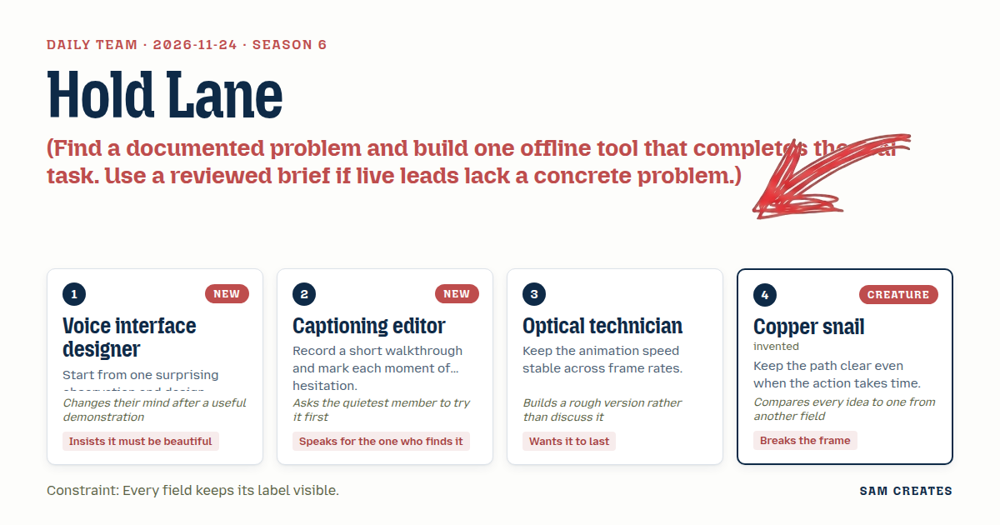

# 2026-11-24: Hold Lane

[Today](../../README.md) · [Archive](../../ARCHIVE.md)



**Task:** Find a documented problem and build one offline tool that completes the real task. Use a reviewed brief if live leads lack a concrete problem.

**Run result:** browser mistake failed: solution-error did not show the expected visible result after the saved steps

**Constraint:** Every field keeps its label visible.

**Season:** 2026-11-09

**Decision:** Paste your master list and a new import, press Compare, decide each held pair, then download the merged list.

## Feed evidence

- github-trending: fetched (13 items)
- smashing: fetched (12 items)
- hacker-news: fetched (20 items)
- Problem source: Review possible duplicates before merging two lists — https://www.reddit.com/r/excel/comments/1xxlhji/

[Saved planning input](planning-input.json)

## Asset

artifact-1.html: no asset. browser mistake failed: solution-error did not show the expected visible result after the saved steps

## The session

### Pitch

### Clash

**3 · Optical technician:** I built it rough. Master has A101 Maria Lopez and A102 Tom Reed. Import has A103 Maria Lopez and A104 Ana Silva. Compare reports one added and one held.

**1 · Voice interface designer:** Then Ana is in and Maria waits. I wanted the card to offer "Merge" for the Marias. It shouldn't. The choices are Keep both or Skip import, because the IDs differ. I've changed my mind.

**2 · Captioning editor:** Snail, you haven't spoken about the input yet. Try it the way a beginner does, straight from Excel.

**4 · Copper snail:** Copied cells. Like a ship's ledger copied by a clerk who uses tabs and no commas. I paste, press Compare, and get "needs an id column". But my sheet has an id column.

**2 · Captioning editor:** That's the hesitation I mark. Excel copies tab-separated rows. The parser saw one giant column. Detect the tab or the comma from the header line. When an id column really is missing, the error names the columns it found, so the person can see what went wrong.

**3 · Optical technician:** Done. Tab or comma, picked per box. Headers are case-insensitive. The error lists the found headers in order.

**4 · Copper snail:** And held rows stay out of the download, but the button counts them. "Download 3 rows, 1 held." Nobody thinks the file is finished when it isn't.

**1 · Voice interface designer:** Then it's beautiful because it's honest. Two numbers on one button.

### Decision

Paste your master list and a new import, press Compare, decide each held pair, then download the merged list.

Concept: Hold Lane

- **Voice interface designer:** the ID-over-name rule and the pair card. Same ID with changed fields offers Keep master or Use import. Same name with a different ID offers Keep both or Skip import. A name match never merges automatically.
- **Captioning editor:** tab-or-comma detection per box, and an error that names the columns it found.
- **Optical technician:** the rough build, localStorage for the master and remembered pair decisions, and a 150 ms time-based card slide that is skipped under reduced motion.
- **Copper snail:** the hold lane rule. Undecided rows never block export and never overwrite master data. The Download button carries both counts.

Source: reviewed brief `reddit-1xxlhji`. The live feed items show releases and news with no stated merge or duplicate problem. The brief names a recurring import of hundreds of rows, a macro or Power Query workaround, and an unmet need for an offline review queue that keeps IDs and same-name records distinct.

**Comparison with past projects.** Gapless Rank, Countermand and Write Time-Out used struck history or readback on a single list. Hold Lane compares two lists row by row. It uses a holding queue that runs in parallel with the merged output. No recent project merged two data sets or produced a downloadable CSV. Shelf Read shares the idea of persistent marks, but its unit was links, not paired records.

### Build notes

1. **Parse and classify.** Build `solution-master` and `solution-import` textareas, labelled "Master" and "Import". Add a `solution-compare` button. Parse each box with a tab or comma delimiter, detected from its header line, and match headers case-insensitively. Each box needs an `id` column; otherwise write the found headers into `solution-error`. Classify each import row in this order:
   - Same ID and all fields equal: unchanged.
   - Same ID with any field different: held, type "Same ID, changed".
   - No ID match but the normalized `name` matches (trimmed, lowercased, spaces collapsed): held, type "Same name, different ID".
   - Otherwise: added.

   Write `Added N, unchanged N, held N` to `solution-summary`.
2. **Hold lane and output.** Show one held pair at a time in a card with labelled field rows and differing fields marked. Add a `solution-decision` select and a `solution-apply` button. Add a `solution-undo` button that returns the last decided pair to held. Add a `solution-download` button that exports master rows plus settled rows as CSV, using the union of headers. Its label reads `Download N rows` and appends `, N held` when the queue is not empty. Held rows are never written to the output. Save the master and decisions keyed by `importId~masterId` in localStorage, and auto-apply a saved decision when the same pair reappears.
3. **First case to pass.** From a fresh page, fill `solution-master` with `id,name,email` / `A101,Maria Lopez,maria@x.org` / `A102,Tom Reed,tom@x.org`. Fill `solution-import` with `id,name,email` / `A103,Maria Lopez,mlopez@y.org` / `A104,Ana Silva,ana@x.org`. Click `solution-compare`. `solution-summary` must read `Added 1, unchanged 0, held 1`.

```json
{"schemaVersion":1,"name":"Hold Lane","audience":"A spreadsheet beginner who merges a recurring import of hundreds of rows into a master list","problem":"Near-duplicate rows must be reviewed before they reach the master list, and same-name records with different IDs must stay distinct until the person decides","interaction":"Paste master and import rows, press Compare, choose a decision for each held pair, press Download","outcome":"A merged CSV of master plus settled rows, with a named count of held rows that stay out of the file until decided","recovery":"Undo returns the last decided pair to the hold lane; a missing id column shows an error naming the columns found, and Compare reruns after the fix","mechanism":"Rows are classified by ID first and normalized name second; name-only matches and changed same-ID rows go to a hold lane that never blocks export; decisions persist per ID pair in localStorage","difference":"Baseline is a workbook macro or a Power Query merge plus manual review. Hold Lane needs one paste per list and one Compare click, never merges on name alone, and names held rows on the Download button instead of writing them","whyNow":"One reviewed brief dated 2026-11-19 describes this recurring task and workaround. It is a single written report, not a measure of demand","sourceIds":["reddit-1xxlhji"],"evidenceStatus":"sourced","proof":{"workaround":"Maintain a workbook macro or set up Power Query, then review potential matches before writing them to the master list","gap":"No reusable offline review step that takes pasted rows, queues near matches, keeps IDs and same-name records distinct until decided, and gives a downloadable merged result","improvement":"Setup drops from building a macro or merge query to two pastes and one Compare click. Same-name rows with different IDs are never auto-merged, and the Download label shows how many rows are still held"},"craft":{"rule":"Copper snail: keep the path clear. Undecided rows move to a held state and are excluded from output instead of blocking export. Download is always available, its count drops by held rows, and the label names them, so 3 rows plus 1 held is visible","design":"Work surface is a pair card: master row left, import row right, labelled field lines, differing cells marked. Phone order is card, then summary and Download, then paste boxes. Mono for IDs and values, sans labels. Ink on paper, amber held, red error, blue focus. About 30 words. 150ms timed slide","trial":{"start":"Fresh page. Master holds A101 Maria Lopez maria@x.org and A102 Tom Reed tom@x.org. Import holds A103 Maria Lopez mlopez@y.org and A104 Ana Silva ana@x.org","action":"Press Compare, then on the card choose Keep both and press Apply","result":"After Compare the summary shows Added 1, unchanged 0, held 1 and the card reads Same name, different ID. After Apply the button reads Download 4 rows","mistake":"The person pastes an import whose header is name,email with no id column, or picks Skip import because the names match","recovery":"The error names the found columns; adding the id column and pressing Compare restores the summary. Undo returns the skipped pair to held, and the button again reads 1 held"}},"alternatives":[{"name":"Hold Lane","need":"Merge a recurring import without merging same-name records or blocking on unclear rows","mechanism":"ID-first classification with a non-blocking hold lane and per-pair remembered decisions","action":"Paste both lists and press Compare","result":"Summary counts, one labelled pair card, and a Download button showing rows ready and rows held","rejection":"Selected: it does the brief's whole job on one page and makes held rows visible in the output count"},{"name":"Pair Ledger","need":"Avoid re-deciding the same pairs every week","mechanism":"Imports a saved decisions file and auto-resolves known pairs before showing anything else","action":"Load last week's decisions file, then paste the new import","result":"A list of auto-resolved pairs and the few new pairs left to decide","rejection":"Rejected: adds file handling for a beginner and does nothing on the first run; localStorage gives the same memory"},{"name":"Similarity Sieve","need":"Catch typos such as Mariа Lopes against Maria Lopez","mechanism":"Fuzzy name score with a threshold slider that regroups candidate matches","action":"Drag the threshold slider","result":"The count of candidate pairs rises or falls as the threshold moves","rejection":"Rejected: a score like 0.82 is hard for a beginner to explain, and it invites merges that ignore distinct IDs"}],"cases":[{"phase":"primary","steps":[{"action":"fill","target":"solution-master","value":"id,name,email\nA101,Maria Lopez,maria@x.org\nA102,Tom Reed,tom@x.org"},{"action":"fill","target":"solution-import","value":"id,name,email\nA103,Maria Lopez,mlopez@y.org\nA104,Ana Silva,ana@x.org"},{"action":"click","target":"solution-compare"}],"expect":{"target":"solution-summary","text":"Added 1, unchanged 0, held 1"}},{"phase":"alternate","steps":[{"action":"fill","target":"solution-master","value":"id,name,email\nA101,Maria Lopez,maria@x.org\nA102,Tom Reed,tom@x.org"},{"action":"fill","target":"solution-import","value":"id\tname\temail\nA101\tMaria Lopez\tmaria@x.org\nA102\tTom Reed\ttom@z.org"},{"action":"click","target":"solution-compare"}],"expect":{"target":"solution-summary","text":"Added 0, unchanged 1, held 1"}},{"phase":"mistake","steps":[{"action":"fill","target":"solution-master","value":"id,name,email\nA101,Maria Lopez,maria@x.org\nA102,Tom Reed,tom@x.org"},{"action":"fill","target":"solution-import","value":"name,email\nAna Silva,ana@x.org"},{"action":"click","target":"solution-compare"}],"expect":{"target":"solution-error","text":"Import needs an id column. Found: name, email."}},{"phase":"recovery","steps":[{"action":"fill","target":"solution-import","value":"id,name,email\nA104,Ana Silva,ana@x.org"},{"action":"click","target":"solution-compare"}],"expect":{"target":"solution-download","text":"Download 3 rows"}}]}
```

**Guest:** Copper snail (creature; invented). The method is drawn from public-domain history, myth, or literature, or invented. The guest speaks in character in original words, never quoting the source, and nothing here is endorsed by anyone.

## Team

```text
Team for 2026-11-24
Season: 2026-11-09

1. Voice interface designer [new]
   Method: Start from one surprising observation and design toward it. [new]
   Stance: Insists it must be beautiful.
   Temperament: Changes their mind after a useful demonstration.
2. Captioning editor [new]
   Method: Record a short walkthrough and mark each moment of hesitation. [new]
   Stance: Speaks for the one who finds it.
   Temperament: Asks the quietest member to try it first.
3. Optical technician
   Method: Keep the animation speed stable across frame rates.
   Stance: Wants it to last.
   Temperament: Builds a rough version rather than discuss it.
4. Copper snail (creature; invented) [guest]
   Method: Keep the path clear even when the action takes time.
   Stance: Breaks the frame.
   Temperament: Compares every idea to one from another field.

Constraint: Every field keeps its label visible.
Task: Filter panel: a panel for a library that applies and clears filters while showing the resulting item count.
```

Provider: claude. Model: claude-opus-5-5.
