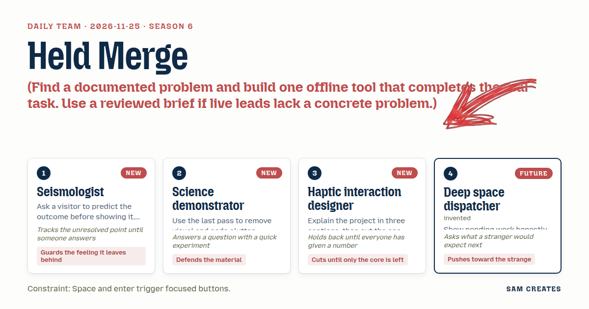
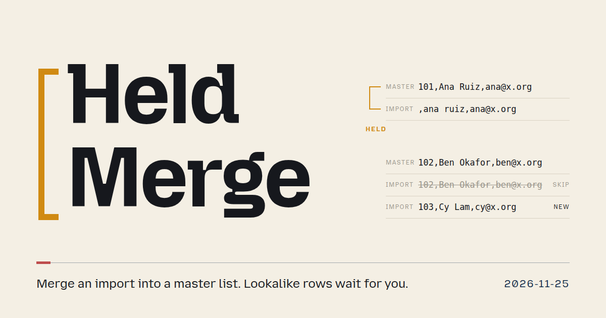
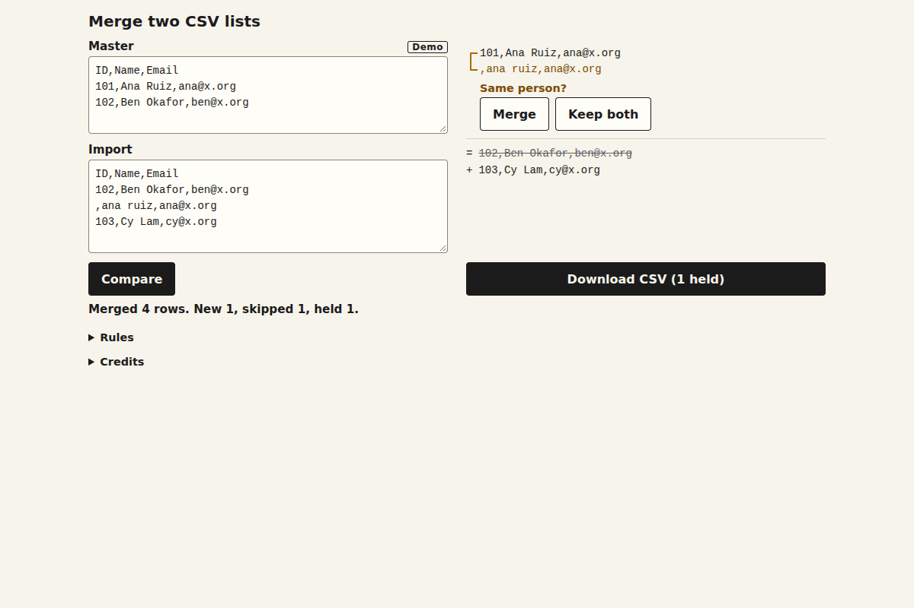

# 2026-11-25: Held Merge

[Today](../../README.md) · [Archive](../../ARCHIVE.md)



**Task:** Find a documented problem and build one offline tool that completes the real task. Use a reviewed brief if live leads lack a concrete problem.

**Problem:** Near-duplicate rows must be reviewed before they reach the master list, and same-name records with different IDs must not be fused without a decision

**Improvement:** Paste, Compare, decide, Download: no macro or query to build, and a same-name row with a different ID always waits for a Merge or Keep both click instead of matching automatically

**Check:** Browser passed both inputs, error feedback and recovery. Phone fit and keyboard replay passed.

**Constraint:** Space and enter trigger focused buttons.

**Season:** 2026-11-09

**Decision:** Paste your master list and a new import, press Compare, then settle each held lookalike before downloading.



[Cover art direction](cover.json) · [Cover source](cover.html)

## Feed evidence

- github-trending: cached
- smashing: cached
- hacker-news: cached
- Problem source: Review possible duplicates before merging two lists — https://www.reddit.com/r/excel/comments/1xxlhji/

[Saved planning input](planning-input.json)

## Asset

<a href="artifact-1.html"></a>

[Use it](https://isas1.github.io/daily-team/2026-11-25/) · [artifact-1.html](artifact-1.html), led by Seismologist. Model: claude-opus-5-5.

## The session

### Pitch

### Clash

**2 · Science demonstrator:** Quick try. Master has 101 Ana Ruiz and 102 Ben Okafor. Import has 102 Ben again, a lowercase ana ruiz with no ID, and 103 Cy Lam. Compare. Four rows: one new, one skipped, one held.

**1 · Seismologist:** And the held one. Who closes it? It sits there until someone presses something. The count stays in the result line until it reads zero.

**3 · Haptic interaction designer:** My number first. The formula route is one paste, and Held Merge is four steps. But my formula would mark ana ruiz as a match and 211 Ana Ruiz as a match too. Same name, different person, maybe. That's the mistake.

**4 · Deep space dispatcher:** Which is why a different ID never auto-merges. 211 Ana Ruiz goes to held, beside 101. Strange result, and the right one.

**2 · Science demonstrator:** Another mistake. People copy the rows and miss the header line. Then "103,Cy Lam" becomes the header, there is no ID column, and every row looks wrong.

**3 · Haptic interaction designer:** So the error names the missing columns. The pasted text stays in the box. Add one line, press Compare again. No reset.

**1 · Seismologist:** The prediction box goes, then. But the held count is my prediction kept honest. It must never go below the real open pairs.

**4 · Deep space dispatcher:** Agreed. Download works at any time, and its label carries the held count.

### Decision

Paste your master list and a new import, press Compare, then settle each held lookalike before downloading.

Concept: Held Merge

- **Deep space dispatcher:** The rule. Lookalikes enter a held state that is counted, written to the CSV with Review=held, and shown on the Download label.
- **Seismologist:** The held count stays in the result line until every pair has a decision.
- **Science demonstrator:** The sample trial, the missing-header catch, and raw row text shown unchanged in mono.
- **Haptic interaction designer:** The cut copy, about 30 visible words. The formula route serves as the rejected baseline that exposed the same-name risk.

**Design.** The work surface reads left to right in sequence: Master and Import textareas feed one result ledger. Each held pair is drawn as two mono rows joined by a 2px amber bracket, which makes the "maybe one record" relationship visible. On a phone, the order is Master, Import, Compare, result line, held queue, with Download pinned to the bottom. Mono tabular type is used for rows and sans for labels. Colors are ink on paper, amber for held, gray strike for skipped duplicates, and one blue focus ring. Density is sparse. A resolved pair collapses in 120ms. There is no other motion.

### Build notes

1. Build a single HTML file with native controls: textareas `solution-master` and `solution-import`, buttons `solution-compare` and `solution-download`, a live status `solution-result` and a list `solution-queue`. Held pairs get buttons `solution-merge-N` and `solution-keep-N`. Parse CSV with quoted fields. Both lists need a header containing ID and Name, matched case-insensitively. If either header is missing, write an error naming the list and the missing columns to `solution-result` and keep the textarea text.
2. Classify each import row:
   - Same nonempty ID as a master row: skipped.
   - Name equal to a master name after lowercasing, trimming, collapsing spaces and stripping punctuation, with an empty or different ID: held.
   - Anything else: new.
   
   Write "Merged N rows. New X, skipped Y, held Z." where N is master + new + held. First case: master `ID,Name,Email` / `101,Ana Ruiz,ana@x.org` / `102,Ben Okafor,ben@x.org`. Import `ID,Name,Email` / `102,Ben Okafor,ben@x.org` / `,ana ruiz,ana@x.org` / `103,Cy Lam,cy@x.org`. Press Compare. Expected result: "Merged 4 rows. New 1, skipped 1, held 1."
3. Handle decisions and download:
   - Merge drops the import row, fills only empty master fields, and moves the pair from held to skipped.
   - Keep both moves the pair from held to new.
   - Recompute the status line after every decision.
   - Download builds a CSV Blob with a Review column (blank or "held"). The button label is "Download CSV" plus "(Z held)" when Z > 0.

```json
{"schemaVersion":1,"name":"Held Merge","audience":"A spreadsheet beginner who merges recurring imports of hundreds of rows into one master list","problem":"Near-duplicate rows must be reviewed before they reach the master list, and same-name records with different IDs must not be fused without a decision","interaction":"Paste master and import CSV text, press Compare, press Merge or Keep both on each held pair, press Download CSV","outcome":"A status line with row, new, skipped and held counts, a queue of held pairs, and a downloadable merged CSV with a Review column","recovery":"A missing ID or Name header shows an error naming the list and columns; the pasted text stays, the user adds the header and presses Compare again","mechanism":"Same ID is skipped, same normalized name with empty or different ID is held, the rest is new; held rows are counted, shown on Download and written with Review=held until decided","difference":"Baseline is a workbook macro or Power Query plus manual review. Here the user pastes two lists and presses Compare with no query to build, and a different-ID same-name row is never merged without a click","whyNow":"The reviewed brief dated 2026-11-19 describes the task, workaround and gap. Today's cached live leads hold no concrete user problem. No demand size is claimed","sourceIds":["reddit-1xxlhji"],"evidenceStatus":"sourced","proof":{"workaround":"Maintain a workbook macro or set up Power Query, then review potential matches before writing them to the master list","gap":"No reusable offline review step that takes pasted rows, queues near matches, keeps IDs and same-name records distinct until the user decides, and downloads the merged result","improvement":"Paste, Compare, decide, Download: no macro or query to build, and a same-name row with a different ID always waits for a Merge or Keep both click instead of matching automatically"},"craft":{"rule":"Deep space dispatcher: show pending work honestly. Lookalike rows enter a held state that counts toward N, shows on the Download label and is written with Review=held. Only Merge (held to skipped) or Keep both (held to new) changes that state","design":"Left-to-right sequence: Master and Import feed one result ledger; held pairs are two mono rows joined by a 2px amber bracket. Phone: inputs, Compare, result, queue, pinned Download. Mono rows, sans labels, ink on paper, amber held, gray strike skipped, blue focus. Sparse. 120ms collapse only","trial":{"start":"Fresh page. Master: 101 Ana Ruiz, 102 Ben Okafor, with ID,Name,Email header","action":"Paste an import with header and rows 102 Ben Okafor, blank-ID ana ruiz, 103 Cy Lam, then press Compare","result":"Status reads Merged 4 rows. New 1, skipped 1, held 1. The queue shows ana ruiz bracketed to 101 Ana Ruiz, and Download reads Download CSV (1 held)","mistake":"The user pastes import rows without the ID,Name,Email header line and presses Compare","recovery":"The error names Import and the missing ID and Name columns while the pasted rows stay. The user adds the header, presses Compare, and the counts and queue return"}},"alternatives":[{"name":"Held Merge","need":"Merge an import into a master list without fusing lookalike records unseen","mechanism":"ID and normalized-name classification with a held state that stays counted and is exported until decided","action":"Paste master and import CSV text, press Compare","result":"Counts of new, skipped and held, a bracketed held-pair queue, and a CSV download with a Review column","rejection":"Selected: it completes the merge offline, and held pairs keep same-name different-ID records apart until a click"},{"name":"Predict Count","need":"Catch an unexpected number of new rows before it reaches the master list","mechanism":"The user enters an expected new-row count before the reveal; a mismatch highlights the surplus rows","action":"Type the expected number of new rows, then paste the import and press Reveal","result":"Predicted versus actual count, with surplus rows marked","rejection":"Rejected: the guess adds a step and still produces no merged list or review decisions"},{"name":"Formula Card","need":"Flag duplicates inside the user's own Excel workbook","mechanism":"Generates an XLOOKUP and COUNTIF formula from the pasted header names","action":"Paste both header rows and press Make formula","result":"A copyable formula that marks matching rows in Excel","rejection":"Rejected: it matches on name alone, so 211 Ana Ruiz would be flagged as 101, and the review still happens by hand"}],"cases":[{"phase":"primary","steps":[{"action":"fill","target":"solution-master","value":"ID,Name,Email\n101,Ana Ruiz,ana@x.org\n102,Ben Okafor,ben@x.org"},{"action":"fill","target":"solution-import","value":"ID,Name,Email\n102,Ben Okafor,ben@x.org\n,ana ruiz,ana@x.org\n103,Cy Lam,cy@x.org"},{"action":"click","target":"solution-compare"}],"expect":{"target":"solution-result","text":"Merged 4 rows. New 1, skipped 1, held 1."}},{"phase":"alternate","steps":[{"action":"fill","target":"solution-master","value":"ID,Name,Email\n101,Ana Ruiz,ana@x.org\n102,Ben Okafor,ben@x.org"},{"action":"fill","target":"solution-import","value":"ID,Name,Email\n104,Dee Park,dee@x.org\n105,Eli Moss,eli@x.org"},{"action":"click","target":"solution-compare"}],"expect":{"target":"solution-result","text":"Merged 4 rows. New 2, skipped 0, held 0."}},{"phase":"mistake","steps":[{"action":"fill","target":"solution-master","value":"ID,Name,Email\n101,Ana Ruiz,ana@x.org\n102,Ben Okafor,ben@x.org"},{"action":"fill","target":"solution-import","value":"103,Cy Lam,cy@x.org\n211,Ana Ruiz,ana.r@x.org"},{"action":"click","target":"solution-compare"}],"expect":{"target":"solution-result","text":"Import needs a header row with ID and Name."}},{"phase":"recovery","steps":[{"action":"fill","target":"solution-import","value":"ID,Name,Email\n103,Cy Lam,cy@x.org\n211,Ana Ruiz,ana.r@x.org"},{"action":"click","target":"solution-compare"}],"expect":{"target":"solution-result","text":"Merged 4 rows. New 1, skipped 0, held 1."}}]}
```

**Guest:** Deep space dispatcher (future; invented). The method is drawn from public-domain history, myth, or literature, or invented. The guest speaks in character in original words, never quoting the source, and nothing here is endorsed by anyone.

## Team

```text
Team for 2026-11-25
Season: 2026-11-09

1. Seismologist [new]
   Method: Ask a visitor to predict the outcome before showing it, then compare the two. [new]
   Stance: Guards the feeling it leaves behind.
   Temperament: Tracks the unresolved point until someone answers.
2. Science demonstrator [new]
   Method: Use the last pass to remove visual and code clutter.
   Stance: Defends the material.
   Temperament: Answers a question with a quick experiment.
3. Haptic interaction designer [new]
   Method: Explain the project in three captions, then cut the one nobody needs. [new]
   Stance: Cuts until only the core is left.
   Temperament: Holds back until everyone has given a number.
4. Deep space dispatcher (future; invented) [guest]
   Method: Show pending work honestly when replies take a long time.
   Stance: Pushes toward the strange.
   Temperament: Asks what a stranger would expect next.

Constraint: Space and enter trigger focused buttons.
Task: Fieldnote sorter: a local tool for birdwatching clubs that tags sightings by time and place and shows which hours of the day bring the most variety.
```

Provider: claude. Model: claude-opus-5-5.
