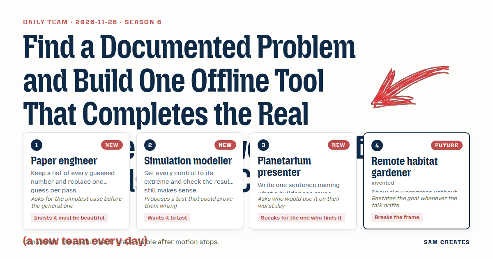

# 2026-11-26: Find a documented problem and build one offline tool that completes the real task. Use a reviewed brief if live leads lack a concrete problem.

[Today](../../README.md) · [Archive](../../ARCHIVE.md)



**Task:** Find a documented problem and build one offline tool that completes the real task. Use a reviewed brief if live leads lack a concrete problem.

**Run result:** No saved lead shows a concrete problem the team can solve.

**Constraint:** The useful result stays visible after motion stops.

**Season:** 2026-11-09

## Feed evidence

- github-trending: fetched (15 items)
- smashing: fetched (12 items)
- hacker-news: fetched (20 items)

[Saved planning input](planning-input.json)

## Asset

No asset. The team could not run: No saved lead shows a concrete problem the team can solve.
**Guest:** Remote habitat gardener (future; invented). The method is drawn from public-domain history, myth, or literature, or invented. The guest never speaks as the figure, and nothing here is endorsed by anyone.

## Team

```text
Team for 2026-11-26
Season: 2026-11-09

1. Paper engineer [new]
   Method: Keep a list of every guessed number and replace one guess per pass. [new]
   Stance: Insists it must be beautiful.
   Temperament: Asks for the simplest case before the general one.
2. Simulation modeller [new]
   Method: Set every control to its extreme and check the result still makes sense. [new]
   Stance: Wants it to last.
   Temperament: Proposes a test that could prove them wrong.
3. Planetarium presenter [new]
   Method: Write one sentence naming what a builder can reuse.
   Stance: Speaks for the one who finds it.
   Temperament: Asks who would use it on their worst day.
4. Remote habitat gardener (future; invented) [guest]
   Method: Show slow progress without pretending it is complete.
   Stance: Breaks the frame.
   Temperament: Restates the goal whenever the talk drifts.

Constraint: The useful result stays visible after motion stops.
Task: Erosion sandbox: an explorable model for school geography classes that sets rainfall and slope and shows how a riverbank wears away over time.
```

Provider: claude. Model: none.
