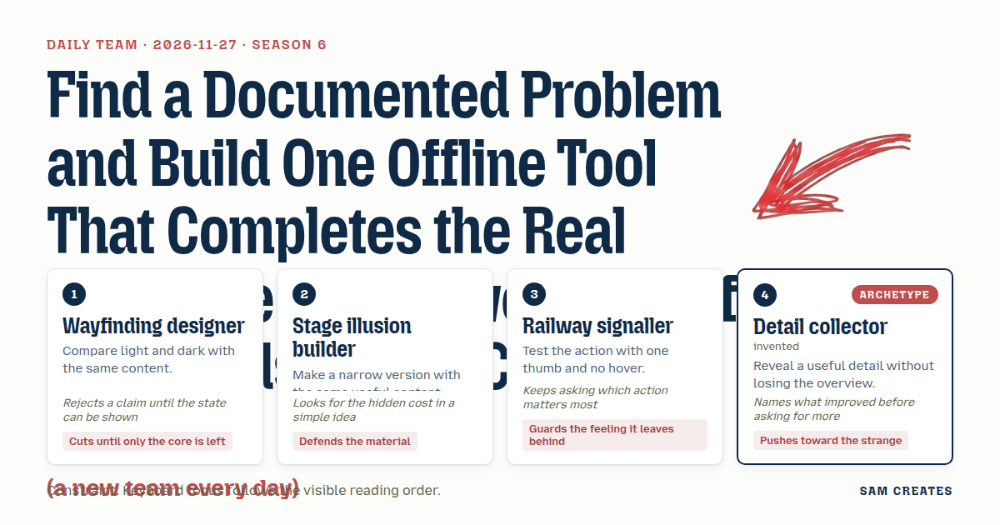

# 2026-11-27: Find a documented problem and build one offline tool that completes the real task. Use a reviewed brief if live leads lack a concrete problem.

[Today](../../README.md) · [Archive](../../ARCHIVE.md)



**Task:** Find a documented problem and build one offline tool that completes the real task. Use a reviewed brief if live leads lack a concrete problem.

**Run result:** No saved lead shows a concrete problem the team can solve.

**Constraint:** Keyboard focus follows the visible reading order.

**Season:** 2026-11-09

## Feed evidence

- github-trending: fetched (15 items)
- smashing: fetched (12 items)
- hacker-news: fetched (20 items)

[Saved planning input](planning-input.json)

## Asset

No asset. The team could not run: No saved lead shows a concrete problem the team can solve.
**Guest:** Detail collector (archetype; invented). The method is drawn from public-domain history, myth, or literature, or invented. The guest never speaks as the figure, and nothing here is endorsed by anyone.

## Team

```text
Team for 2026-11-27
Season: 2026-11-09

1. Wayfinding designer
   Method: Compare light and dark with the same content.
   Stance: Cuts until only the core is left.
   Temperament: Rejects a claim until the state can be shown.
2. Stage illusion builder
   Method: Make a narrow version with the same useful content.
   Stance: Defends the material.
   Temperament: Looks for the hidden cost in a simple idea.
3. Railway signaller
   Method: Test the action with one thumb and no hover.
   Stance: Guards the feeling it leaves behind.
   Temperament: Keeps asking which action matters most.
4. Detail collector (archetype; invented) [guest]
   Method: Reveal a useful detail without losing the overview.
   Stance: Pushes toward the strange.
   Temperament: Names what improved before asking for more.

Constraint: Keyboard focus follows the visible reading order.
Task: Signal relay game: a logic puzzle for players who like routing problems that sends messages between stations with delays and shows which ones arrive late.
```

Provider: claude. Model: none.
